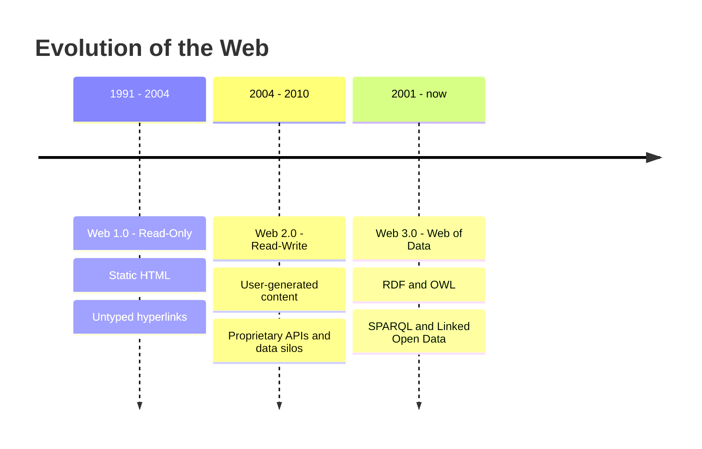
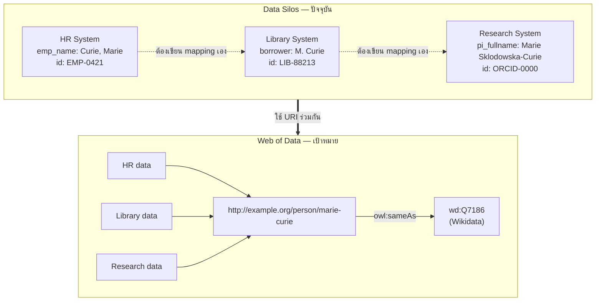

# 01.01 วิวัฒนาการของ Web: 1.0 → 2.0 → 3.0

Web เปลี่ยนไปมากตั้งแต่ปี 1991 แต่สิ่งหนึ่งที่แทบไม่เปลี่ยนคือ **ข้อมูลบน Web ถูกออกแบบมาให้ "มนุษย์อ่าน" ไม่ใช่ "machine เข้าใจ"**
บทนี้ไล่ดูว่าแต่ละยุคของ Web แก้ปัญหาอะไร และทิ้งปัญหาอะไรไว้ให้ Semantic Web ต้องแก้
เราจะเห็นว่า **unstructured data** และ **data silo** คือรากของปัญหาที่ทั้งคอร์สนี้พยายามจัดการ

---

## Web 1.0 — The Read-Only Web (ราว 1991–2004)

Web ยุคแรกคือชุดของ **static HTML document** ที่เชื่อมกันด้วย hyperlink ผู้ใช้ทำได้อย่างเดียวคือ "อ่าน"
เนื้อหาถูกเขียนโดยเจ้าของเว็บ และ update ด้วยการแก้ไฟล์ `.html` แล้ว upload ขึ้น server ใหม่

- **Unit of information**: document (หน้าเว็บ)
- **Link**: ชี้จาก document ไป document — link ไม่มีความหมาย บอกแค่ "ไปต่อที่นี่"
- **ปัญหา**: machine เห็น `<h1>Marie Curie</h1>` เป็นแค่ "ข้อความตัวใหญ่" ไม่รู้ว่านี่คือ **ชื่อคน**

## Web 2.0 — The Read-Write Web (ราว 2004–ปัจจุบัน)

Web 2.0 เปลี่ยนผู้ใช้จาก consumer เป็น **producer** เกิด blog, wiki, social network, user-generated content
ฝั่งเทคนิคมี AJAX, RESTful API และ platform ขนาดใหญ่

- **Unit of information**: post, profile, comment — ยังเป็น document อยู่ดี แต่ dynamic
- **Link**: เพิ่ม social link (follow, friend) แต่ยังไม่มี machine-readable semantics
- **ปัญหาใหม่**: ข้อมูลถูกขังใน platform → เกิด **data silo** ขนาดมหึมา

## Web 3.0 — The Web of Data / Semantic Web

Web 3.0 ในความหมายที่ W3C ใช้ คือ **Web of Data**: เปลี่ยนหน่วยข้อมูลจาก "document" เป็น "**thing**"
และเปลี่ยน link จาก "ไปหน้าถัดไป" เป็น "**typed relationship**" ที่ machine ตีความได้

- **Unit of information**: resource (คน, สถานที่, ยา, งานวิจัย) ระบุด้วย URI
- **Link**: `<Marie_Curie> <wonPrize> <Nobel_Prize_in_Physics>` — link มี **ชนิด** และมี **ความหมาย**
- **ผลลัพธ์**: machine merge, query และ reason ข้ามแหล่งข้อมูลได้

> ⚠️ ระวังคำว่า "Web3" (ไม่มีจุด) ที่มักหมายถึง blockchain/decentralized ownership — เป็นคนละเรื่องกับ **Web 3.0 = Semantic Web**
> คอร์สนี้พูดถึงอย่างหลังเท่านั้น

---

## เปรียบเทียบสามยุค

| มิติ | Web 1.0 | Web 2.0 | Web 3.0 (Semantic Web) |
| --- | --- | --- | --- |
| บทบาทผู้ใช้ | Read | Read + Write | Read + Write + **Machine reasoning** |
| หน่วยข้อมูล | Document | Post / Profile | **Resource (thing)** |
| ความหมายของ link | Untyped hyperlink | Social link | **Typed, semantic link** |
| รูปแบบข้อมูล | HTML | HTML + JSON API | **RDF, OWL** |
| ภาษา query | (ไม่มี) full-text search | REST API เฉพาะเจ้า | **SPARQL** (มาตรฐานกลาง) |
| การรวมข้อมูล | Copy & paste | ETL รายเจ้า | **Merge by URI** อัตโนมัติ |
| ตัวอย่าง | Static homepage | Facebook, Wikipedia | Wikidata, Google Knowledge Graph |



---

## ปัญหาที่ 1: Unstructured Data

สมมติเว็บของมหาวิทยาลัยแสดงหน้าอาจารย์แบบนี้:

```html
<div class="profile">
  <h2>Marie Curie</h2>
  <p>Professor of Physics, born 7 November 1867 in Warsaw.</p>
  <p>Email: marie.curie@example.org</p>
</div>
```

มนุษย์อ่านเข้าใจทันที แต่ machine เห็นเพียง **string** กับ **tag ที่บอกแค่การจัดหน้า**:

- `Professor of Physics` — คือตำแหน่งงาน หรือชื่อหนังสือ?
- `7 November 1867` — คือวันเกิด วันรับตำแหน่ง หรือวันตีพิมพ์?
- `Warsaw` — เมืองในโปแลนด์ หรือชื่อถนน?

ถ้าอยากดึงข้อมูลออกมา ต้องเขียน **scraper** ที่ผูกกับ CSS class ของเว็บนั้น ๆ
พอเว็บเปลี่ยน layout scraper ก็พังทันที นี่คือปัญหา **brittleness of screen scraping**

ถ้าเปลี่ยนมาเขียนแบบ RDF (Turtle) ความกำกวมจะหายไป:

```turtle
@prefix ex:     <http://example.org/> .
@prefix schema: <https://schema.org/> .
@prefix xsd:    <http://www.w3.org/2001/XMLSchema#> .

ex:MarieCurie a schema:Person ;
    schema:name      "Marie Curie" ;
    schema:jobTitle  "Professor of Physics" ;
    schema:birthDate "1867-11-07"^^xsd:date ;
    schema:birthPlace ex:Warsaw ;
    schema:email     "marie.curie@example.org" .

ex:Warsaw a schema:City ;
    schema:name "Warsaw" .
```

ตอนนี้ machine รู้แน่ชัดว่า `1867-11-07` เป็น **วันเกิด** ชนิด `xsd:date` และ `ex:Warsaw` เป็น **City** ไม่ใช่ string ลอย ๆ

---

## ปัญหาที่ 2: Data Silo

**Data silo** คือสภาพที่ข้อมูลเรื่องเดียวกันกระจายอยู่คนละระบบ คนละ schema คนละ identifier และเชื่อมกันไม่ได้โดยอัตโนมัติ

ลองนึกถึงมหาวิทยาลัยหนึ่งที่มี 3 ระบบ:

| System | เรียกคนคนนี้ว่า | Field name | ID |
| --- | --- | --- | --- |
| HR system | `Curie, Marie` | `emp_name` | `EMP-0421` |
| Library system | `M. Curie` | `borrower` | `LIB-88213` |
| Research system | `Marie Skłodowska-Curie` | `pi_fullname` | `ORCID-0000-...` |

คำถามง่าย ๆ อย่าง *"อาจารย์ที่ยืมหนังสือเกิน 5 เล่ม มี grant วิจัยกี่คน"* กลายเป็นโครงการ integration หลายเดือน
เพราะต้องทำ **entity resolution** เอง ทั้งที่ทั้งสามระบบพูดถึงคนคนเดียวกัน



หัวใจของทางออกคือ **ใช้ URI เดียวกันแทน entity เดียวกัน** — เมื่อทุกระบบชี้ไปที่ `http://example.org/person/marie-curie`
การ merge ข้อมูลก็เหลือเพียงการ **union ของ triple set** ไม่ต้องเขียน mapping ทีละคู่ระบบ

---

## แล้วทำไม Web 2.0 API ยังไม่พอ?

หลายคนถามว่า "ก็มี REST API ให้ดึง JSON แล้วนี่" — ปัญหาคือ:

1. **Schema เป็นของใครของมัน** — API เจ้าหนึ่งใช้ `"birth_date"` อีกเจ้าใช้ `"dob"` ไม่มีมาตรฐานกลาง
2. **Identifier ไม่ global** — `"id": 42` ของ API หนึ่ง ไม่มีทางรู้ว่าตรงกับ `"id": 991` ของอีก API หรือไม่
3. **ไม่มี link ออกนอกระบบ** — JSON ตอบกลับมาเป็น "เกาะ" ไม่ได้ชี้ต่อไปยัง dataset อื่น
4. **ไม่มี semantics ให้ reason** — machine ไม่รู้ว่า `"role": "professor"` implies `"role": "employee"`

RDF แก้ทั้งสี่ข้อนี้ด้วย: **URI เป็น identifier กลาง**, **vocabulary เผยแพร่สาธารณะ**, **link ข้าม dataset ได้**, และ **มี formal semantics ให้ reasoner ทำงาน**

---

## Key Points

- **Web 1.0** = read-only document, **Web 2.0** = read-write + user-generated content, **Web 3.0** = Web of Data ที่ machine ตีความได้
- Web 3.0 (Semantic Web) ต่างจาก "Web3" (blockchain) คนละเรื่องกันโดยสิ้นเชิง
- **Unstructured data**: HTML บอกแค่ "แสดงผลอย่างไร" ไม่ได้บอก "หมายความว่าอะไร" ทำให้ต้องพึ่ง screen scraping ที่เปราะบาง
- **Data silo**: entity เดียวกันมีหลาย identifier หลาย schema ทำให้การรวมข้อมูลกลายเป็นงาน integration ราคาแพง
- ทางออกหลักคือเปลี่ยนหน่วยข้อมูลจาก **document** เป็น **resource ที่มี URI** และเปลี่ยน hyperlink เป็น **typed link**
- REST API แบบเดิมยังไม่พอ เพราะขาด global identifier, shared vocabulary, cross-dataset link และ formal semantics
- บทถัดไปจะดูว่า Tim Berners-Lee วางวิสัยทัศน์นี้ไว้อย่างไรตั้งแต่ปี 2001
