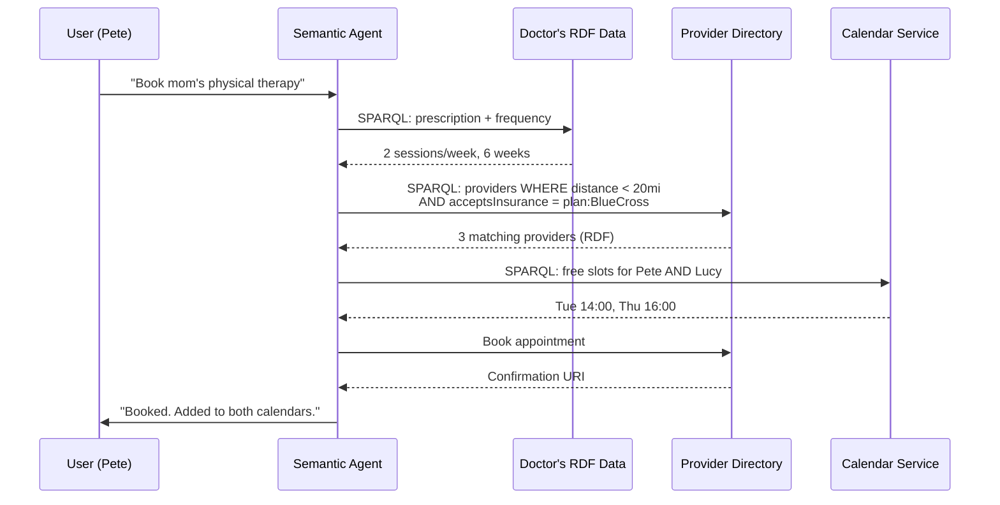
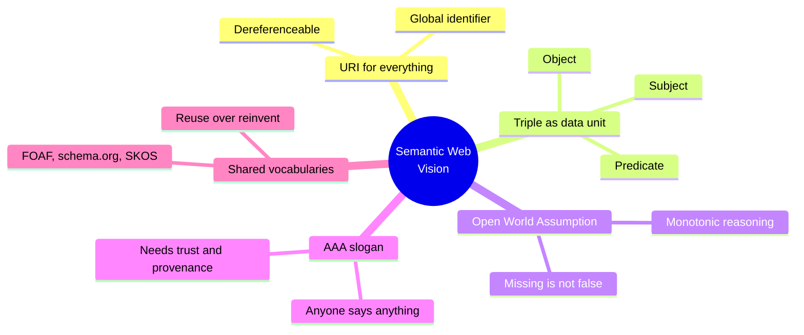

# 01.02 วิสัยทัศน์ Semantic Web

ในปี 2001 **Tim Berners-Lee** ผู้ให้กำเนิด World Wide Web ร่วมกับ **James Hendler** และ **Ora Lassila**
ตีพิมพ์บทความ *"The Semantic Web"* ใน Scientific American วางภาพของ Web ที่ machine ไม่ได้แค่แสดงผลข้อมูล แต่ **เข้าใจความหมาย** ของมันได้
บทนี้อธิบายว่าวิสัยทัศน์นั้นคืออะไร ประกอบด้วยความคิดหลักอะไรบ้าง และวันนี้เดินทางมาถึงไหนแล้ว

---

## นิยามอย่างเป็นทางการ

W3C ให้นิยามไว้ว่า Semantic Web คือ **"a Web of data that can be processed directly and indirectly by machines"**
ขยายความได้ว่า:

> Semantic Web ไม่ใช่ Web ใหม่ที่แยกจากของเดิม แต่เป็น **ส่วนขยาย (extension)** ของ Web ปัจจุบัน
> ที่ข้อมูลถูกให้ความหมายชัดเจน (well-defined meaning) จน machine กับมนุษย์ทำงานร่วมกันได้ดีขึ้น

จุดสำคัญคือคำว่า **extension** — เราไม่ทิ้ง HTML, HTTP, URI แต่เพิ่มชั้นความหมายทับลงไปบนโครงสร้างเดิม

---

## Scenario ต้นฉบับจากบทความปี 2001

บทความเปิดด้วยฉากที่ Pete กับ Lucy ต้องพาแม่ไปพบแพทย์ **agent** ของแต่ละคนทำงานร่วมกันโดยอัตโนมัติ:

1. อ่าน **prescription** จากระบบของแพทย์ → รู้ว่าต้องทำ physical therapy สัปดาห์ละ 2 ครั้ง
2. ค้นหา provider ที่ (ก) อยู่ในรัศมี 20 ไมล์จากบ้าน (ข) รับประกันของแม่ (ค) มี rating ≥ 4
3. เทียบ **calendar** ของทั้งสองคน หา slot ที่ว่างตรงกัน
4. จอง appointment แล้วใส่กลับเข้า calendar

สิ่งที่ทำให้ scenario นี้เป็นไปได้ ไม่ใช่ AI ที่ฉลาดกว่ามนุษย์ แต่คือ **ข้อมูลที่ machine-readable พอ** จนตัวแทนซอฟต์แวร์ทำงานได้:
insurance plan, clinic rating, ระยะทาง และ calendar ต่างถูกอธิบายด้วย vocabulary ที่แชร์กัน



---

## ความคิดหลัก 5 ข้อ

### 1. Anything can be identified by a URI

ทุกสิ่งที่เราอยากพูดถึง — คน, หนังสือ, โรค, แนวคิดนามธรรม, แม้แต่ความสัมพันธ์ — มี **URI** เป็นชื่อสากล
URI ทำหน้าที่เดียวกับ primary key แต่ **unique ทั้ง Web** ไม่ใช่แค่ใน database เดียว

```turtle
@prefix ex: <http://example.org/> .

# ทั้ง resource และ relationship ล้วนมี URI
ex:MarieCurie  ex:wonPrize  ex:NobelPrizeInPhysics .
```

### 2. Data is expressed as triples

ทุกข้อความความรู้ย่อยลงเป็นรูปแบบเดียว: **subject – predicate – object**
โครงสร้างที่เรียบง่ายและสม่ำเสมอนี้เองที่ทำให้การ merge ข้อมูลจากคนละแหล่งเป็นเพียงการ union ของ set

### 3. Partial information is acceptable (Open World)

Web ไม่มีวัน "ครบ" — ข้อมูลที่เราไม่มี ไม่ได้แปลว่าไม่จริง Semantic Web จึงตั้งอยู่บน **Open World Assumption**
เอกสารหนึ่งอธิบาย Marie Curie ไม่ครบ ก็ไม่เป็นไร เอกสารอื่นเติมได้ในภายหลัง (รายละเอียดใน [01.04](01.04-key-concepts.md))

### 4. Anyone can say anything about anything (AAA)

หลัก **AAA slogan** บอกว่าใครก็ตามสามารถ publish ข้อความเกี่ยวกับ resource ใดก็ได้ แม้จะไม่ได้เป็นเจ้าของ resource นั้น
ผลตามมาคือ Semantic Web ต้องอยู่กับ **ความขัดแย้ง** และต้องมี **trust layer** ให้ผู้บริโภคข้อมูลเลือกเชื่อแหล่งที่ตรวจสอบได้

### 5. Shared vocabularies enable interoperability

การจะเข้าใจตรงกัน ต้องอ้าง **vocabulary/ontology ร่วมกัน** เช่น `foaf:name`, `schema:birthDate`, `skos:broader`
การ reuse vocabulary ที่มีอยู่แล้วสำคัญกว่าการประดิษฐ์ของตัวเอง — เป็นหัวใจของ [Chapter 09](../09-well-known-ontologies/09.01-dublin-core.md)



---

## ตัวอย่างเป็นรูปธรรม: จาก HTML สู่ knowledge

หน้าเว็บบรรยายงานประชุมหนึ่ง เขียนแบบเดิมกับแบบ semantic ต่างกันดังนี้

**แบบ Web 2.0 — machine เดาไม่ได้**

```html
<p>ISWC 2024 will be held in Baltimore from 11 to 15 November 2024.</p>
```

**แบบ Semantic Web — machine ตอบคำถามได้**

```turtle
@prefix ex:     <http://example.org/> .
@prefix schema: <https://schema.org/> .
@prefix xsd:    <http://www.w3.org/2001/XMLSchema#> .

ex:ISWC2024 a schema:Event ;
    schema:name      "International Semantic Web Conference 2024" ;
    schema:startDate "2024-11-11"^^xsd:date ;
    schema:endDate   "2024-11-15"^^xsd:date ;
    schema:location  ex:Baltimore .

ex:Baltimore a schema:City ;
    schema:name "Baltimore" ;
    schema:containedInPlace ex:Maryland .
```

เมื่อข้อมูลอยู่ในรูปนี้ agent ตอบคำถามอย่าง *"มีงานประชุมอะไรใน Maryland ช่วงพฤศจิกายน"* ได้ทันทีด้วย SPARQL
โดยไม่ต้องเข้าใจภาษาอังกฤษหรือ parse ประโยค

---

## วันนี้วิสัยทัศน์นี้ไปถึงไหน

| สิ่งที่ **สำเร็จ** แล้ว | สิ่งที่ **ยังไม่สำเร็จ** ตามภาพเดิม |
| --- | --- |
| RDF, SPARQL, OWL เป็น W3C Recommendation | Autonomous agent ที่วิ่งข้ามเว็บอย่างอิสระ |
| schema.org ถูกใช้บนเว็บหลายสิบล้านโดเมน | Trust layer และ proof layer ยังใช้งานจริงน้อยมาก |
| Wikidata มี item หลักร้อยล้าน เปิด SPARQL ฟรี | ข้อมูลองค์กรส่วนใหญ่ยังอยู่ใน silo เหมือนเดิม |
| Knowledge Graph เป็นเทคโนโลยีหลักของ search engine | ผู้พัฒนาเว็บทั่วไปยังไม่เขียน RDF เอง |
| Enterprise Knowledge Graph แพร่หลายในองค์กรใหญ่ | Reasoning ระดับ Web-scale ยังทำไม่ได้จริง |

ข้อสังเกตสำคัญ: **Knowledge Graph** คือรูปแบบที่วิสัยทัศน์นี้ "ลงจอด" ได้จริงในอุตสาหกรรม
และในยุค LLM ปัจจุบัน Knowledge Graph กลับมามีบทบาทอีกครั้งในฐานะแหล่ง **grounding** ที่ตรวจสอบได้ (ดู [12.11](../12-linked-open-data/12.11-summary.md))

---

## Key Points

- Semantic Web ถูกวางวิสัยทัศน์ไว้ในบทความปี 2001 โดย Tim Berners-Lee, James Hendler และ Ora Lassila
- นิยาม W3C: **Web of data ที่ machine ประมวลผลได้** และเป็น **extension** ของ Web เดิม ไม่ใช่ Web ใหม่
- ความคิดหลัก 5 ข้อ: **URI ระบุทุกสิ่ง**, **triple เป็นหน่วยข้อมูล**, **Open World Assumption**, **AAA slogan**, **shared vocabulary**
- **AAA (Anyone can say Anything about Anything)** ทำให้ต้องมี provenance และ trust — ไม่ใช่ทุกข้อความบน Web ที่ควรเชื่อ
- วิสัยทัศน์ส่วน infrastructure (RDF/SPARQL/OWL/Wikidata) สำเร็จแล้ว แต่ส่วน autonomous agent และ trust layer ยังห่างจากภาพเดิม
- **Knowledge Graph** คือรูปธรรมที่แนวคิดนี้ประสบความสำเร็จมากที่สุดในเชิงอุตสาหกรรม
