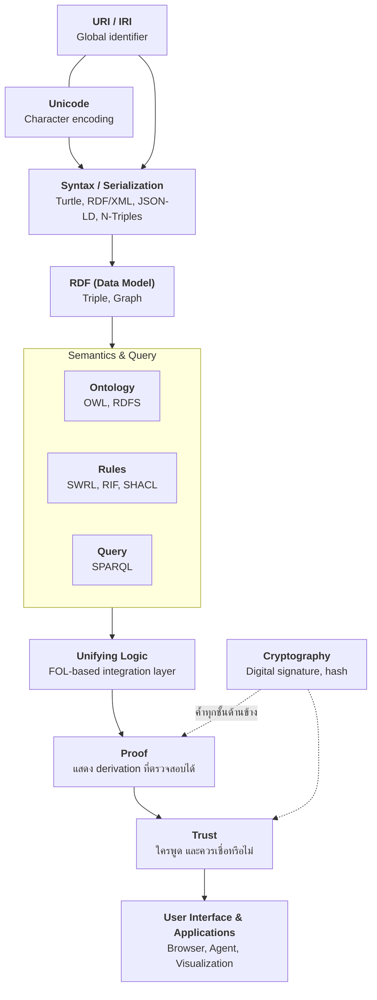

# 01.03 Semantic Web Stack (Layer Cake)

**Semantic Web Stack** หรือที่เรียกกันติดปากว่า **Layer Cake** คือแผนภาพที่ Tim Berners-Lee ใช้สรุปว่าเทคโนโลยีของ Semantic Web
วางซ้อนกันอย่างไร ตั้งแต่ชั้นล่างสุดที่เป็นโครงสร้าง Web เดิม ไปจนถึงชั้นบนสุดที่เป็นเรื่องความน่าเชื่อถือ
บทนี้อธิบายทีละชั้นพร้อมบอกว่าแต่ละชั้นเรียนอยู่ใน chapter ไหนของคอร์ส

---

## ภาพรวม Layer Cake



---

## อธิบายทีละชั้น

### Layer 1 — Unicode & URI/IRI (ฐานราก)

- **Unicode** ทำให้เขียนข้อมูลได้ทุกภาษาในระบบเดียว — `"Marie Curie"`, `"มารี กูว์รี"`, `"居里夫人"` อยู่ในกราฟเดียวกันได้
- **URI (Uniform Resource Identifier)** คือชื่อสากลของ resource ส่วน **IRI** คือ URI ที่รองรับอักขระ Unicode
- ชั้นนี้ให้สิ่งสำคัญที่สุดคือ **global uniqueness** — เมื่อสองระบบใช้ URI เดียวกัน แปลว่าพูดถึงสิ่งเดียวกัน

> 📘 เรียนละเอียดใน [02.02 URI, Literal, Blank Node](../02-rdf/02.02-uri-literal-bnode.md)

### Layer 2 — Syntax / Serialization

ชั้นนี้คือ "รูปแบบไฟล์" ที่ใช้เขียน RDF ลงบน disk หรือส่งผ่านเครือข่าย ในภาพต้นฉบับปี 2001 ระบุเพียง **XML**
แต่ปัจจุบันมีทางเลือกที่ใช้งานจริงมากกว่า:

| Format | จุดเด่น | ใช้เมื่อ |
| --- | --- | --- |
| **Turtle** | อ่านง่ายที่สุดสำหรับมนุษย์ | เขียน ontology ด้วยมือ, สอน (**default ของคอร์สนี้**) |
| **JSON-LD** | เป็น JSON ปกติ | ฝังใน HTML, ส่งผ่าน REST API |
| **N-Triples** | หนึ่งบรรทัดหนึ่ง triple | dump ขนาดใหญ่, streaming, diff |
| **RDF/XML** | มาตรฐานแรกสุด | ระบบเก่า, OWL file บางตัว |

**สำคัญ**: syntax เป็นแค่เปลือก — ข้อมูลชุดเดียวกันเขียนได้หลายรูปแบบโดยความหมายไม่เปลี่ยน

> 📘 เรียนละเอียดใน [02.06 Other Formats](../02-rdf/02.06-other-formats.md)

### Layer 3 — RDF (Data Model)

หัวใจของ stack ทั้งหมด RDF กำหนดว่า **ข้อมูลคือเซตของ triple** และ triple ประกอบกันเป็น **graph**
ชั้นนี้ตอบคำถามว่า "ข้อมูลมีโครงสร้างอย่างไร" โดยไม่สนใจว่าเก็บเป็นไฟล์แบบไหน

```turtle
@prefix ex: <http://example.org/> .

ex:MarieCurie ex:worksAt ex:UniversityOfParis .
```

> 📘 เรียนละเอียดใน [Chapter 02 — RDF](../02-rdf/02.01-triple-model.md)

### Layer 4a — Ontology (RDFS & OWL)

ชั้นนี้ให้ **vocabulary กับ semantics** — บอกว่ามี class อะไร property อะไร และ class เหล่านั้นสัมพันธ์กันอย่างไร
ทำให้ reasoner อนุมานความรู้ที่ไม่ได้เขียนไว้ตรง ๆ ได้

```turtle
@prefix ex:   <http://example.org/> .
@prefix rdfs: <http://www.w3.org/2000/01/rdf-schema#> .
@prefix owl:  <http://www.w3.org/2002/07/owl#> .

ex:Professor rdfs:subClassOf ex:Employee .
ex:Employee  rdfs:subClassOf ex:Person .
ex:worksAt   a owl:ObjectProperty ;
             rdfs:domain ex:Employee ;
             rdfs:range  ex:Organization .
```

จาก TBox ข้างบน + ข้อเท็จจริงว่า `ex:MarieCurie a ex:Professor` reasoner อนุมานได้เองว่า
`ex:MarieCurie a ex:Person`

> 📘 เรียนละเอียดใน [Chapter 03 — RDFS](../03-rdfs/03.01-class-instance.md) และ [Chapter 08 — OWL](../08-owl/08.01-owl-species.md)

### Layer 4b — Rules (SWRL / RIF / SHACL)

บางความรู้แสดงด้วย OWL ไม่ได้ เช่น *"ถ้า X เป็นพี่น้องของพ่อ Y แล้ว X เป็นลุงของ Y"* ต้องใช้ **rule language**

```
hasParent(?y, ?p) ^ hasBrother(?p, ?x) -> hasUncle(?y, ?x)
```

> 📘 เรียนละเอียดใน [Chapter 11 — SWRL](../11-swrl/11.01-swrl-intro.md)

### Layer 4c — Query (SPARQL)

ภาษามาตรฐานสำหรับ query RDF graph เทียบได้กับ SQL ของโลก relational

```sparql
PREFIX ex: <http://example.org/>

SELECT ?person ?org
WHERE {
  ?person ex:worksAt ?org .
}
```

> 📘 เรียนละเอียดใน [Chapter 06 — SPARQL](../06-sparql/06.01-sparql-intro.md)

### Layer 5 — Unifying Logic

ชั้นที่ตั้งใจให้เป็น "กาว" เชื่อม ontology กับ rule เข้าด้วยกันบนฐาน first-order logic เดียว
เป็นที่มาว่าทำไมคอร์สนี้จึงมี [Chapter 04 — Logics](../04-logics/04.01-why-logic.md) แทรกอยู่ก่อนเข้า OWL

### Layer 6 — Proof

ไม่ใช่แค่ตอบว่า "จริง" แต่ต้อง **แสดง derivation** ให้ตรวจสอบได้ว่าอนุมานมาจาก axiom ใดบ้าง
ในทางปฏิบัติ reasoner สมัยใหม่ทำได้ระดับหนึ่งผ่าน **explanation / justification** (เช่นใน Protégé)

### Layer 7 — Trust

ต่อจาก proof: ต่อให้พิสูจน์ได้ว่า derivation ถูกต้อง ก็ยังต้องตัดสินว่า **แหล่งข้อมูลต้นทางเชื่อได้ไหม**
ในทางปฏิบัติวันนี้แก้ด้วย **provenance metadata** (PROV-O) และ named graph มากกว่ากลไก trust แบบอัตโนมัติ

> 📘 ดู [09.05 PROV-O และ DCAT](../09-well-known-ontologies/09.05-provenance-dcat.md)

### แกนข้าง — Cryptography

digital signature และ hash ค้ำชั้น proof/trust เพื่อยืนยันว่า "ข้อมูลนี้มาจากผู้ publish จริงและไม่ถูกแก้"

---

## สรุปเป็นตาราง: ชั้นไหนอยู่ chapter ไหน

| Layer | เทคโนโลยี | สถานะมาตรฐาน | Chapter ในคอร์ส |
| --- | --- | --- | --- |
| Unicode, URI/IRI | URI, IRI | ✅ มั่นคง | 02 |
| Syntax | Turtle, JSON-LD, N-Triples, RDF/XML | ✅ มั่นคง | 02 |
| Data model | RDF 1.1 | ✅ W3C Rec | 02 |
| Ontology | RDFS, OWL 2 | ✅ W3C Rec | 03, 08 |
| Rules | SWRL, RIF, SHACL | ⚠️ SWRL เป็น Member Submission | 11 |
| Query | SPARQL 1.1 | ✅ W3C Rec | 06 |
| Unifying Logic | FOL, Description Logic | 🔬 เชิงทฤษฎี | 04 |
| Proof | Explanation / Justification | 🚧 บางส่วน | 04, 10 |
| Trust | PROV-O, signature | 🚧 ยังไม่ครบ | 09, 12 |

---

## Key Points

- Layer Cake อธิบายว่าเทคโนโลยี Semantic Web **วางซ้อนกัน** โดยชั้นบนพึ่งพาชั้นล่าง
- ฐานรากคือ **Unicode + URI/IRI** ให้ global identifier — เป็นเงื่อนไขที่ทำให้ข้อมูลข้ามระบบ merge กันได้
- **RDF** คือชั้น data model ที่ทั้ง stack วางอยู่บน ส่วน syntax (Turtle/JSON-LD/…) เป็นเพียงเปลือกที่แลกเปลี่ยนกันได้
- ชั้นกลางแยกเป็นสามเสาที่ทำงานคู่กัน: **Ontology** (RDFS/OWL), **Rules** (SWRL/SHACL), **Query** (SPARQL)
- ชั้น **Unifying Logic / Proof / Trust** เป็นส่วนที่ยังไม่สมบูรณ์ในทางปฏิบัติ ปัจจุบันทดแทนด้วย provenance และ named graph
- Cryptography ไม่ใช่ชั้นหนึ่งในกอง แต่เป็น **แกนข้าง** ที่ค้ำ proof และ trust
