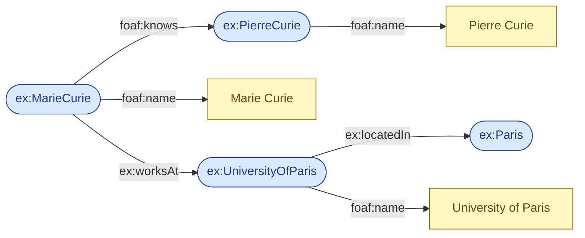
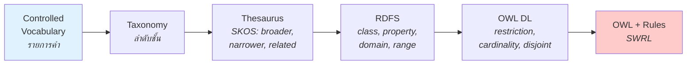
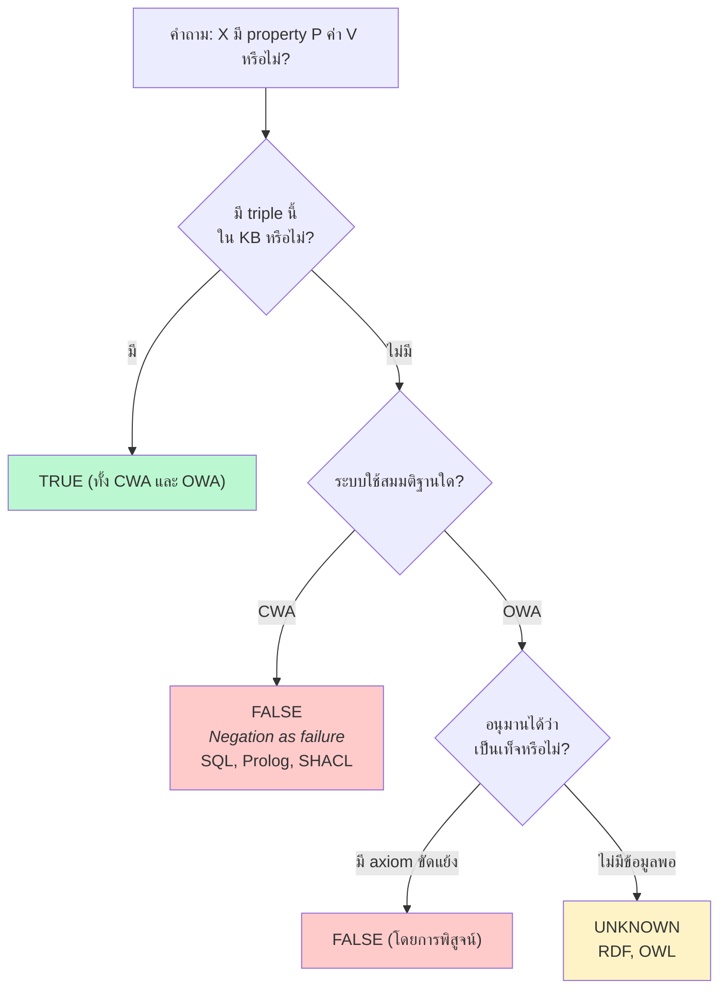

# 01.04 Key Concepts: Resource, Triple, Ontology, OWA vs CWA

บทนี้รวบรวมศัพท์แกนกลางที่จะถูกใช้ซ้ำตลอดทั้งคอร์ส ได้แก่ **Resource**, **Triple**, **Ontology**
และแนวคิดที่มักทำให้คนมาจากสาย database สับสนที่สุดคือ **Open World Assumption (OWA)** เทียบกับ **Closed World Assumption (CWA)**
ปิดท้ายด้วยภาพรวมของ **Knowledge Representation** เพื่อวางบริบทว่า Semantic Web ยืนอยู่ตรงไหนในสาขานี้

---

## Resource

**Resource** คือ "สิ่งใดก็ตามที่เราต้องการพูดถึง" ไม่จำกัดว่าต้องเป็นสิ่งที่อยู่บน Web

| ประเภท | ตัวอย่าง | URI ตัวอย่าง |
| --- | --- | --- |
| Information resource | หน้าเว็บ, ไฟล์ PDF | `http://example.org/paper.pdf` |
| Physical object | คน, อาคาร, เครื่องมือ | `http://example.org/person/marie-curie` |
| Abstract concept | ความยุติธรรม, จำนวนเฉพาะ | `http://example.org/concept/Justice` |
| Relationship | "รู้จัก", "แต่งโดย" | `http://xmlns.com/foaf/0.1/knows` |
| Class | มนุษย์, องค์กร | `https://schema.org/Person` |

หลักสำคัญ: **ทุกอย่างเป็น resource รวมถึงตัว relationship และตัว class เอง** ทำให้ RDF สามารถพูดถึง schema ของตัวเองได้
(คุณสมบัตินี้เรียกว่า **reflexivity** ของ RDF)

สิ่งเดียวที่ไม่ใช่ resource คือ **literal** — ค่าข้อมูลดิบ เช่น `"Marie Curie"`, `42`, `"1867-11-07"^^xsd:date`

---

## Triple

**Triple** คือหน่วยข้อความความรู้ที่เล็กที่สุดของ RDF ประกอบด้วยสามส่วน:

```
<subject>  <predicate>  <object> .
```

| ตำแหน่ง | เป็นอะไรได้บ้าง | เทียบกับภาษาอังกฤษ |
| --- | --- | --- |
| **Subject** | URI หรือ Blank Node | ประธาน |
| **Predicate** | URI เท่านั้น | กริยา/ความสัมพันธ์ |
| **Object** | URI, Blank Node หรือ **Literal** | กรรม/ค่า |

```turtle
@prefix ex:   <http://example.org/> .
@prefix foaf: <http://xmlns.com/foaf/0.1/> .

# object เป็น URI  → เกิด link ระหว่าง resource
ex:MarieCurie foaf:knows ex:PierreCurie .

# object เป็น literal → เก็บค่าข้อมูล
ex:MarieCurie foaf:name "Marie Curie" .
```

เมื่อนำหลาย triple มาต่อกัน จะได้ **graph** โดยอัตโนมัติ เพราะ object ของ triple หนึ่งเป็น subject ของอีก triple ได้



> 🔵 วงรี = resource (URI) 🟡 สี่เหลี่ยม = literal — เป็น convention การวาด RDF graph ที่ใช้ตลอดคอร์สนี้

---

## Ontology

**Ontology** ในบริบท computer science คือ *"a formal, explicit specification of a shared conceptualization"* (Gruber, 1993)
แยกดูทีละคำ:

| คำ | ความหมาย | ทำไมสำคัญ |
| --- | --- | --- |
| **formal** | เขียนด้วยภาษาที่มี semantics ชัดเจน | machine ประมวลผลและ reason ได้ |
| **explicit** | นิยาม concept และข้อจำกัดไว้อย่างเปิดเผย | ไม่ปล่อยให้เป็นความเข้าใจโดยนัย |
| **shared** | เป็นที่ยอมรับร่วมกันในชุมชน | ทำให้เกิด interoperability |
| **conceptualization** | โมเดลนามธรรมของโดเมน | ไม่ผูกกับ implementation |

### ระดับความ "หนัก" ของ ontology (Semantic Spectrum)



ยิ่งไปทางขวา **expressivity สูงขึ้น** แต่ **ต้นทุนการสร้างและ computational complexity ก็สูงขึ้น** ตาม
การเลือกจุดที่เหมาะสมกับงานเป็นทักษะหลักของ [Chapter 10 — Ontology Design](../10-ontology-design/10.01-methodology.md)

---

## Open World Assumption (OWA) vs Closed World Assumption (CWA)

นี่คือจุดที่คนมาจากสาย SQL สะดุดมากที่สุด และเป็นสมมติฐานที่กำหนดพฤติกรรมของ reasoner ทั้งหมด

### นิยาม

- **CWA (Closed World Assumption)** — สิ่งที่ไม่ได้ระบุว่าจริง ถือว่า **เท็จ** ("ไม่มีในฐานข้อมูล = ไม่มีจริง")
- **OWA (Open World Assumption)** — สิ่งที่ไม่ได้ระบุว่าจริง ถือว่า **ไม่ทราบ** ("ไม่มีในฐานข้อมูล = ยังไม่รู้")

### ตัวอย่างเปรียบเทียบ

สมมติมีข้อมูลเพียงเท่านี้:

```turtle
@prefix ex: <http://example.org/> .

ex:MarieCurie ex:wonPrize ex:NobelPrizeInPhysics .
ex:MarieCurie ex:wonPrize ex:NobelPrizeInChemistry .
```

คำถาม: *"Marie Curie ได้รางวัล Fields Medal หรือไม่?"*

| ระบบ | คำตอบ | เหตุผล |
| --- | --- | --- |
| **SQL / Prolog (CWA)** | **No** | ไม่มี row นี้ในตาราง → เท็จ |
| **RDF / OWL (OWA)** | **Unknown** | ไม่มีข้อมูล ไม่ได้แปลว่าไม่จริง อาจมีเอกสารอื่นที่ยังไม่ได้อ่าน |

คำถาม: *"Marie Curie ได้รางวัลทั้งหมดกี่รางวัล?"*

| ระบบ | คำตอบ |
| --- | --- |
| **CWA** | **2** (นับจากที่มี) |
| **OWA** | **อย่างน้อย 1** — เพราะ reasoner ยังไม่รู้ว่า `ex:NobelPrizeInPhysics` กับ `ex:NobelPrizeInChemistry` เป็นคนละสิ่งกัน! |

ข้อสองนี้เชื่อมกับอีกสมมติฐานหนึ่งที่ต้องรู้คู่กันเสมอ

### No Unique Name Assumption (No-UNA)

ใน OWL **URI สอง URI ที่ต่างกัน อาจหมายถึงสิ่งเดียวกันก็ได้** — ต่างจาก database ที่ primary key ต่างกัน = คนละ row เสมอ
ถ้าต้องการบอกว่าเป็นคนละสิ่ง ต้องประกาศชัดเจน:

```turtle
@prefix ex:  <http://example.org/> .
@prefix owl: <http://www.w3.org/2002/07/owl#> .

# บอกว่าเป็นคนละรางวัลจริง ๆ
ex:NobelPrizeInPhysics owl:differentFrom ex:NobelPrizeInChemistry .

# ในทางกลับกัน บอกว่า URI สองตัวนี้คือสิ่งเดียวกัน
ex:MarieCurie owl:sameAs <http://www.wikidata.org/entity/Q7186> .
```

หลังประกาศ `owl:differentFrom` แล้ว reasoner จึงจะสรุปได้ว่า "ได้รางวัลอย่างน้อย **2** รางวัล"



### ทำไม Semantic Web ต้องเลือก OWA

เพราะ **Web ไม่มีขอบเขต** — ไม่มีใครเห็นข้อมูลทั้งหมดของ Web ได้ ถ้าใช้ CWA ระบบจะสรุปผิดทันทีที่ยังไม่ได้ crawl ครบ
ผลพลอยได้คือ OWA ทำให้การอนุมานเป็น **monotonic**: เพิ่มข้อมูลใหม่แล้วข้อสรุปเดิมไม่มีวันถูกยกเลิก มีแต่จะเพิ่มขึ้น

### แล้วเมื่อไหร่จึงควรใช้ CWA

เมื่อต้องการ **validate ข้อมูล** เช่น "ทุก Student ต้องมี email" — งานนี้ OWL ทำไม่ได้ดี (OWL จะเพียงอนุมานว่ามี email อยู่ที่ไหนสักแห่ง)
ให้ใช้ **SHACL** ซึ่งทำงานแบบ closed world แทน (ดู [07.06 pySHACL](../07-python-semantic-web/07.06-pyshacl.md))

| ต้องการ | ใช้ |
| --- | --- |
| อนุมานความรู้ใหม่ (inference) | OWL reasoner — OWA |
| ตรวจความครบถ้วนของข้อมูล (validation) | SHACL — CWA |

---

## Knowledge Representation โดยสังเขป

**Knowledge Representation and Reasoning (KRR)** คือสาขาของ AI ที่ศึกษาว่าจะเข้ารหัสความรู้อย่างไรให้ machine ใช้เหตุผลต่อได้
Semantic Web คือการนำ KRR มาใช้ **ในระดับ Web scale**

| Formalism | ยุค | จุดเด่น | ข้อจำกัด |
| --- | --- | --- | --- |
| **Semantic Network** | 1960s | เห็นภาพเป็น node/edge เข้าใจง่าย | ไม่มี formal semantics |
| **Frame** | 1970s | มี slot/filler ใกล้กับ OOP | reasoning ไม่เป็นมาตรฐาน |
| **First-Order Logic** | ยาวนาน | expressive สูงมาก | **undecidable** |
| **Description Logic** | 1990s | decidable + expressive พอใช้ | ยังเขียน rule ซับซ้อนไม่ได้ |
| **RDF/RDFS** | 2004 | เบา ขยายง่าย เหมาะกับ Web | expressivity ต่ำ |
| **OWL 2** | 2009 | อิงบน DL มี reasoner พร้อมใช้ | learning curve ชัน |

จะเห็นว่า **RDF/RDFS/OWL ไม่ได้เกิดจากสุญญากาศ** แต่เป็นทายาทสายตรงของ Description Logic
ซึ่งเป็นเหตุผลที่คอร์สนี้แทรก [Chapter 04 — Logics](../04-logics/04.01-why-logic.md) ไว้ก่อนสอน OWL

---

## Key Points

- **Resource** = ทุกสิ่งที่พูดถึงได้ ระบุด้วย URI — รวมถึง class และ property เอง สิ่งที่ไม่ใช่ resource มีเพียง **literal**
- **Triple** = subject–predicate–object; predicate ต้องเป็น URI เสมอ, object เท่านั้นที่เป็น literal ได้
- **Ontology** = formal, explicit specification of a shared conceptualization — มีระดับความหนักตั้งแต่ vocabulary จนถึง OWL + rules
- **CWA**: ไม่มีข้อมูล = เท็จ (SQL, SHACL) — **OWA**: ไม่มีข้อมูล = ไม่ทราบ (RDF, OWL)
- **No Unique Name Assumption**: URI ต่างกันอาจเป็นสิ่งเดียวกัน ต้องใช้ `owl:differentFrom` / `owl:sameAs` ระบุให้ชัด
- OWA ทำให้ inference เป็น **monotonic** — ข้อมูลใหม่ไม่ลบล้างข้อสรุปเดิม เหมาะกับธรรมชาติของ Web ที่ไม่มีที่สิ้นสุด
- ใช้ **OWL สำหรับ inference** และใช้ **SHACL สำหรับ validation** — เลือกให้ตรงกับปัญหา
- Semantic Web สืบทอดมาจากสาย **Knowledge Representation** โดยเฉพาะ **Description Logic**
