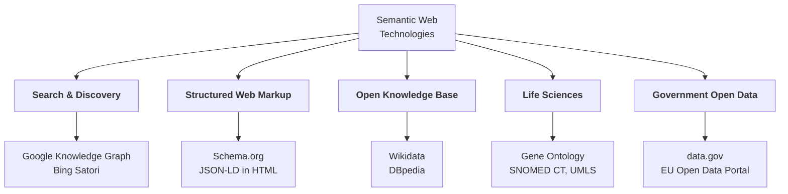

# 01.05 Applications ในโลกจริง

Semantic Web ไม่ได้อยู่แค่ในเอกสาร W3C — เทคโนโลยีนี้ทำงานอยู่เบื้องหลังสิ่งที่เราใช้ทุกวัน ตั้งแต่กล่องข้อมูลข้าง ๆ ผลการค้นหา
ไปจนถึงระบบวินิจฉัยทางการแพทย์และ portal ข้อมูลเปิดภาครัฐ บทนี้ยก use case ที่เป็นรูปธรรมที่สุด 5 กลุ่ม
พร้อมตัวอย่าง data จริงในรูปแบบ Turtle และ JSON-LD

---

## ภาพรวม



---

## 1. Google Knowledge Graph

Google เปิดตัว **Knowledge Graph** ในปี 2012 ด้วยประโยคสรุปที่กลายเป็นคำอธิบาย Semantic Web ที่ดีที่สุดประโยคหนึ่ง:
*"things, not strings"* — ค้นหา `mercury` แล้วระบบต้องแยกให้ออกว่าหมายถึงดาวเคราะห์ ธาตุเคมี หรือเทพเจ้าโรมัน

**สิ่งที่ทำงานอยู่เบื้องหลัง**

| องค์ประกอบ | บทบาท |
| --- | --- |
| Entity + unique ID | แทน `mercury` ด้วย entity คนละตัว (คล้าย URI) |
| Typed relation | `Mercury → orbits → Sun`, `Mercury → symbol → "Hg"` |
| Entity linking | จับคู่ข้อความในหน้าเว็บกลับไปยัง entity |
| Knowledge panel | แสดงผลจาก graph ไม่ใช่จาก snippet |

ข้อมูลเดียวกันถ้าเขียนเป็น RDF จะหน้าตาแบบนี้:

```turtle
@prefix ex:     <http://example.org/> .
@prefix schema: <https://schema.org/> .
@prefix xsd:    <http://www.w3.org/2001/XMLSchema#> .

ex:Mercury_planet a schema:Thing ;
    schema:name        "Mercury" ;
    schema:description "The smallest planet in the Solar System" ;
    ex:orbits          ex:Sun ;
    ex:orbitalPeriod   "87.97"^^xsd:decimal .

ex:Mercury_element a schema:Thing ;
    schema:name        "Mercury" ;
    schema:description "Chemical element with symbol Hg" ;
    ex:atomicNumber    "80"^^xsd:integer .

# ชื่อเหมือนกัน แต่คนละ resource — นี่คือหัวใจของ "things, not strings"
```

**ผลกระทบเชิงธุรกิจ**: Knowledge panel และ rich result ทำให้เว็บที่ใส่ structured markup ได้พื้นที่แสดงผลมากกว่า
เป็นแรงจูงใจทางเศรษฐกิจที่ผลักดันให้ schema.org แพร่หลาย

---

## 2. Schema.org — vocabulary ที่ถูกใช้มากที่สุดบน Web

**Schema.org** ก่อตั้งปี 2011 โดย Google, Microsoft, Yahoo และ Yandex ร่วมกัน เป็น vocabulary กลางสำหรับ markup หน้าเว็บ
มี type มากกว่า 800 ชนิด ครอบคลุม Person, Organization, Product, Event, Recipe, JobPosting, MedicalCondition ฯลฯ

**รูปแบบที่แนะนำในปัจจุบันคือ JSON-LD ฝังในแท็ก `<script>`** เพราะแยกจาก markup การแสดงผล แก้ไขง่าย ไม่รบกวน layout

```html
<script type="application/ld+json">
{
  "@context": "https://schema.org",
  "@type": "Course",
  "name": "Semantic Web & Linked Open Data with Python",
  "description": "An introductory course on RDF, OWL, SPARQL and Linked Open Data.",
  "provider": {
    "@type": "Organization",
    "name": "Example University",
    "sameAs": "https://www.wikidata.org/entity/Q1234567"
  },
  "inLanguage": "th",
  "teaches": ["RDF", "SPARQL", "OWL", "Linked Open Data"],
  "coursePrerequisites": "Basic Python programming"
}
</script>
```

ข้อมูลชุดเดียวกันนี้ เมื่อ parse เป็น RDF จะได้ triple แบบนี้:

```turtle
@prefix schema: <https://schema.org/> .

<> a schema:Course ;
    schema:name        "Semantic Web & Linked Open Data with Python" ;
    schema:inLanguage  "th" ;
    schema:teaches     "RDF", "SPARQL", "OWL", "Linked Open Data" ;
    schema:provider    [ a schema:Organization ;
                         schema:name "Example University" ;
                         schema:sameAs <https://www.wikidata.org/entity/Q1234567> ] .
```

> 💡 **Markup ทางเลือกอื่น**: Microdata และ RDFa ฝังใน attribute ของ HTML โดยตรง ยังใช้ได้แต่ maintain ยากกว่า

---

## 3. Wikidata และ DBpedia — Open Knowledge Base

### Wikidata

Wikidata คือฐานความรู้เปิดที่แก้ไขโดยชุมชน มี **item** มากกว่า 100 ล้านรายการ ทุกรายการมี **Q-number** เป็น identifier
และทุก property มี **P-number**

| Identifier | ความหมาย |
| --- | --- |
| `wd:Q7186` | Marie Curie |
| `wd:Q937` | Albert Einstein |
| `wdt:P31` | instance of |
| `wdt:P279` | subclass of |
| `wdt:P106` | occupation |
| `wdt:P166` | award received |

Wikidata เปิด **SPARQL endpoint** สาธารณะที่ `https://query.wikidata.org/sparql` ให้ query ได้ฟรี

```sparql
# หานักฟิสิกส์ที่ได้รับรางวัลโนเบลสาขาฟิสิกส์ พร้อมปีเกิด
PREFIX wd:  <http://www.wikidata.org/entity/>
PREFIX wdt: <http://www.wikidata.org/prop/direct/>
PREFIX rdfs: <http://www.w3.org/2000/01/rdf-schema#>

SELECT ?person ?personLabel ?birthDate
WHERE {
  ?person wdt:P166 wd:Q38104 .        # award received = Nobel Prize in Physics
  ?person wdt:P569 ?birthDate .       # date of birth
  ?person rdfs:label ?personLabel .
  FILTER(LANG(?personLabel) = "en")
}
ORDER BY ?birthDate
LIMIT 10
```

### DBpedia

DBpedia สกัดข้อมูลจาก **infobox ของ Wikipedia** ออกมาเป็น RDF โดยอัตโนมัติ จุดเด่นคือเป็น **hub ของ LOD Cloud**
มี `owl:sameAs` link ไปยัง dataset อื่นจำนวนมหาศาล

```turtle
@prefix dbr:  <http://dbpedia.org/resource/> .
@prefix dbo:  <http://dbpedia.org/ontology/> .
@prefix owl:  <http://www.w3.org/2002/07/owl#> .

dbr:Marie_Curie a dbo:Scientist ;
    dbo:birthDate  "1867-11-07"^^<http://www.w3.org/2001/XMLSchema#date> ;
    dbo:birthPlace dbr:Warsaw ;
    dbo:field      dbr:Physics, dbr:Chemistry ;
    owl:sameAs     <http://www.wikidata.org/entity/Q7186> ,
                   <http://viaf.org/viaf/61548432> ,
                   <http://id.loc.gov/authorities/names/n79066418> .
```

| | Wikidata | DBpedia |
| --- | --- | --- |
| ที่มาข้อมูล | ชุมชนกรอกโดยตรง | สกัดอัตโนมัติจาก Wikipedia infobox |
| Identifier | Q-number (opaque) | ชื่อบทความ (readable) |
| คุณภาพ | มี reference ต่อ statement | ขึ้นกับคุณภาพ infobox |
| ความสด | ทันที | ตาม release cycle |

> 📘 เปรียบเทียบละเอียดใน [09.08 DBpedia](../09-well-known-ontologies/09.08-dbpedia.md)

---

## 4. Biomedical & Life Sciences

วงการชีวการแพทย์เป็น **early adopter ที่จริงจังที่สุด** ของ ontology เพราะเป็นโดเมนที่คำศัพท์เยอะ กำกวมสูง และผิดพลาดไม่ได้

| Ontology | ขนาดโดยประมาณ | ใช้ทำอะไร |
| --- | --- | --- |
| **Gene Ontology (GO)** | 40,000+ terms | อธิบาย gene function 3 มิติ: biological process, molecular function, cellular component |
| **SNOMED CT** | 350,000+ concepts | รหัสทางคลินิก ใช้ในระบบ EHR ทั่วโลก |
| **ChEBI** | 150,000+ entities | โมเลกุลและสารเคมีที่มีความสำคัญทางชีวภาพ |
| **UMLS** | 4M+ concepts | Metathesaurus ที่ map vocabulary ทางการแพทย์เข้าด้วยกัน |
| **MeSH** | 30,000+ descriptors | ใช้ index บทความใน PubMed |

ตัวอย่างการใช้ Gene Ontology:

```turtle
@prefix obo:  <http://purl.obolibrary.org/obo/> .
@prefix rdfs: <http://www.w3.org/2000/01/rdf-schema#> .
@prefix ex:   <http://example.org/> .

obo:GO_0006915 rdfs:label     "apoptotic process" ;
               rdfs:subClassOf obo:GO_0012501 .   # programmed cell death

ex:TP53 a ex:Gene ;
    rdfs:label            "TP53" ;
    ex:participatesIn     obo:GO_0006915 ;
    ex:associatedWithDisease ex:LiFraumeniSyndrome .
```

**ประโยชน์ที่ได้จริง**: เมื่อ GO บอกว่า `apoptotic process` เป็น subclass ของ `programmed cell death`
การค้นหางานวิจัยเรื่อง programmed cell death จะได้ผลลัพธ์ที่พูดถึง apoptosis มาด้วยโดยอัตโนมัติ — นี่คือ **inference ที่สร้างมูลค่าจริง**

---

## 5. Government Open Data

รัฐบาลหลายประเทศเผยแพร่ข้อมูลเปิดในรูปแบบ Linked Data โดยใช้ **DCAT (Data Catalog Vocabulary)** อธิบาย catalog

| Portal | ประเทศ/ภูมิภาค | จุดเด่น |
| --- | --- | --- |
| `data.gov` | สหรัฐอเมริกา | dataset หลักแสนรายการ |
| `data.europa.eu` | สหภาพยุโรป | ใช้ DCAT-AP เป็นมาตรฐาน |
| `data.gov.uk` | สหราชอาณาจักร | บุกเบิก Linked Data ภาครัฐ |
| `data.go.th` | ประเทศไทย | Open Government Data ของไทย |

ตัวอย่าง dataset description ด้วย DCAT:

```turtle
@prefix dcat:  <http://www.w3.org/ns/dcat#> .
@prefix dcterms: <http://purl.org/dc/terms/> .
@prefix xsd:   <http://www.w3.org/2001/XMLSchema#> .
@prefix ex:    <http://example.org/catalog/> .

ex:AirQuality2024 a dcat:Dataset ;
    dcterms:title       "Air Quality Measurements 2024" ;
    dcterms:description "Hourly PM2.5 and PM10 readings from 120 monitoring stations." ;
    dcterms:publisher   ex:EnvironmentAgency ;
    dcterms:issued      "2025-01-15"^^xsd:date ;
    dcterms:license     <https://creativecommons.org/licenses/by/4.0/> ;
    dcat:keyword        "air quality", "PM2.5", "environment" ;
    dcat:distribution   ex:AirQuality2024CSV .

ex:AirQuality2024CSV a dcat:Distribution ;
    dcat:accessURL  <https://example.org/data/air-quality-2024.csv> ;
    dcat:mediaType  "text/csv" ;
    dcat:byteSize   "48219043"^^xsd:decimal .
```

> 📘 ลงมือทำจริงใน [12.06 Open Government Data](../12-linked-open-data/12.06-open-gov-data.md)

---

## Use case อื่นที่น่าสนใจ

| โดเมน | ตัวอย่าง | สิ่งที่ Semantic Web ช่วย |
| --- | --- | --- |
| **Cultural heritage** | Europeana, Getty AAT | รวม metadata จากพิพิธภัณฑ์หลายพันแห่งด้วย vocabulary กลาง |
| **Publishing** | BBC Sport, New York Times | ใช้ ontology จัดหมวดเนื้อหาและสร้างหน้า topic อัตโนมัติ |
| **E-commerce** | GoodRelations, schema.org Product | ทำให้สินค้าเดียวกันข้ามร้านเทียบกันได้ |
| **Enterprise KG** | Siemens, Airbus, ธนาคาร | รวม master data ข้ามหน่วยธุรกิจ |
| **LLM grounding** | RAG over Knowledge Graph | ลด hallucination ด้วยข้อเท็จจริงที่ตรวจสอบย้อนกลับได้ |

---

## Key Points

- **Google Knowledge Graph** ทำให้แนวคิด *"things, not strings"* เป็นรูปธรรม และผลักดันให้ structured markup แพร่หลาย
- **Schema.org** คือ vocabulary ที่ถูกใช้มากที่สุดบน Web ปัจจุบันนิยมฝังด้วย **JSON-LD** ในแท็ก `<script type="application/ld+json">`
- **Wikidata** (ชุมชนกรอก, Q-number) และ **DBpedia** (สกัดจาก Wikipedia infobox) เป็น open knowledge base หลักสองแหล่งที่ query ฟรีผ่าน SPARQL
- วงการ **biomedical** ใช้ ontology จริงจังที่สุด (GO, SNOMED CT, ChEBI, UMLS) เพราะได้ประโยชน์จาก inference โดยตรง
- ภาครัฐใช้ **DCAT** อธิบาย dataset catalog เป็นมาตรฐานเดียวกันทั่วโลก
- แนวโน้มใหม่คือการใช้ Knowledge Graph เป็นแหล่ง **grounding** ให้ LLM เพื่อให้คำตอบตรวจสอบย้อนกลับได้
