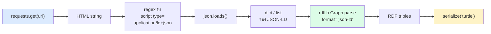

# 01.06 Python: เตรียมเครื่องมือและดึง Schema.org จากเว็บจริง

บทนี้เป็นบทปฏิบัติแรกของคอร์ส เราจะตั้ง virtual environment ติดตั้ง library ที่ใช้ตลอดคอร์ส
แล้วเขียนสคริปต์ Python ดึงหน้าเว็บจริงมาสกัด **Schema.org JSON-LD** ที่ฝังอยู่ พร้อมแปลงเป็น RDF graph ด้วย **rdflib**
เป้าหมายคือให้เห็นด้วยตาตัวเองว่า structured data มีอยู่จริงบนเว็บที่เราใช้ทุกวัน

> 📁 ไฟล์เต็มอยู่ที่ [`code/ch01/fetch_schema_org.py`](../code/ch01/fetch_schema_org.py)

---

## 1. เตรียม environment

```bash
python3 -m venv .venv
source .venv/bin/activate        # Windows: .venv\Scripts\activate
python -m pip install --upgrade pip
```

ติดตั้ง library หลักของคอร์ส (ตอนนี้ใช้แค่สองตัวแรก ที่เหลือเตรียมไว้สำหรับบทถัด ๆ ไป):

```bash
pip install requests rdflib SPARQLWrapper owlready2 pyshacl pandas networkx pyvis
```

ตรวจสอบว่าติดตั้งสำเร็จ:

```python
import rdflib
import requests

print("rdflib  :", rdflib.__version__)
print("requests:", requests.__version__)
```

Expected output (เลข version อาจต่างไป):

```
rdflib  : 7.1.1
requests: 2.32.3
```

---

## 2. โครงสร้างของโปรแกรม



---

## 3. ดึงหน้าเว็บ

```python
import requests

HEADERS = {
    # บางเว็บบล็อก default user-agent ของ requests จึงต้องระบุเอง
    "User-Agent": "Mozilla/5.0 (compatible; SemanticWebCourseBot/1.0)",
    "Accept": "text/html,application/xhtml+xml",
}


def fetch_html(url: str, timeout: int = 15) -> str:
    """ดึง HTML จาก url; raise HTTPError ถ้า status ไม่ใช่ 2xx"""
    response = requests.get(url, headers=HEADERS, timeout=timeout)
    response.raise_for_status()
    response.encoding = response.apparent_encoding or response.encoding
    return response.text


html = fetch_html("https://schema.org/Person")
print(len(html), "characters")
```

---

## 4. สกัด JSON-LD block

Schema.org แบบ JSON-LD จะอยู่ในแท็ก `<script type="application/ld+json">` เสมอ

```python
import json
import re
from typing import Any, Dict, List

JSONLD_PATTERN = re.compile(
    r'<script[^>]+type=["\']application/ld\+json["\'][^>]*>(.*?)</script>',
    re.DOTALL | re.IGNORECASE,
)


def extract_jsonld(html: str) -> List[Dict[str, Any]]:
    """คืน list ของ JSON-LD object ที่พบในหน้า"""
    blocks: List[Dict[str, Any]] = []
    for raw in JSONLD_PATTERN.findall(html):
        try:
            data = json.loads(raw.strip())
        except json.JSONDecodeError as exc:
            print(f"[warn] parse ไม่ผ่าน: {exc}")
            continue
        # หนึ่ง block อาจเป็น object เดียว หรือ array ของ object
        if isinstance(data, list):
            blocks.extend(item for item in data if isinstance(item, dict))
        elif isinstance(data, dict):
            blocks.append(data)
    return blocks


blocks = extract_jsonld(html)
print(f"พบ {len(blocks)} JSON-LD block")
```

> ⚠️ regex ใช้ได้สำหรับการเรียน แต่ใน production ควรใช้ HTML parser จริง
> เช่น library **`extruct`** ซึ่งสกัดได้ทั้ง JSON-LD, Microdata และ RDFa ในคราวเดียว

---

## 5. แปลง JSON-LD เป็น RDF graph

จุดสำคัญ: **JSON-LD คือ RDF** ที่เขียนในรูป JSON ดังนั้น rdflib โหลดตรง ๆ ได้เลย

```python
from rdflib import Graph


def jsonld_to_graph(blocks, base: str) -> Graph:
    """โหลดทุก JSON-LD block เข้า Graph เดียวกัน"""
    graph = Graph()
    for block in blocks:
        graph.parse(data=json.dumps(block), format="json-ld", publicID=base)
    return graph


graph = jsonld_to_graph(blocks, base="https://schema.org/Person")
print(f"ได้ {len(graph)} triples")

graph.bind("schema", "https://schema.org/")
print(graph.serialize(format="turtle"))
```

Expected output (ตัวอย่าง — ข้อมูลจริงขึ้นกับหน้าเว็บ ณ เวลาที่รัน):

```turtle
@prefix schema: <https://schema.org/> .

<https://schema.org/Person> a schema:Class ;
    schema:name "Person" ;
    schema:description "A person (alive, dead, undead, or fictional)." .
```

---

## 6. ทดสอบกับ JSON-LD ที่เราเขียนเอง

ถ้าเว็บที่ลองไม่มี markup ให้ทดสอบด้วยข้อมูลของเราเองก่อน:

```python
from rdflib import Graph

course_jsonld = {
    "@context": "https://schema.org",
    "@type": "Course",
    "@id": "http://example.org/course/semantic-web",
    "name": "Semantic Web & Linked Open Data with Python",
    "inLanguage": "th",
    "teaches": ["RDF", "SPARQL", "OWL", "Linked Open Data"],
    "provider": {
        "@type": "Organization",
        "name": "Example University",
        "sameAs": "https://www.wikidata.org/entity/Q1234567",
    },
}

g = Graph()
g.parse(data=json.dumps(course_jsonld), format="json-ld")
g.bind("schema", "https://schema.org/")
print(g.serialize(format="turtle"))
```

Expected output:

```turtle
@prefix schema: <https://schema.org/> .

<http://example.org/course/semantic-web> a schema:Course ;
    schema:inLanguage "th" ;
    schema:name "Semantic Web & Linked Open Data with Python" ;
    schema:provider [ a schema:Organization ;
            schema:name "Example University" ;
            schema:sameAs <https://www.wikidata.org/entity/Q1234567> ] ;
    schema:teaches "Linked Open Data",
        "OWL",
        "RDF",
        "SPARQL" .
```

สังเกตสองอย่าง:

1. `provider` ที่เป็น nested object กลายเป็น **blank node** (`[ ... ]`) เพราะไม่ได้ประกาศ `@id`
2. `teaches` ที่เป็น array กลายเป็น **หลาย triple ที่มี predicate เดียวกัน** — ใน RDF ไม่มี "field ที่เก็บ list" โดยธรรมชาติ

---

## 7. รันสคริปต์เต็ม

```bash
python code/ch01/fetch_schema_org.py
python code/ch01/fetch_schema_org.py https://www.bbc.com/news
```

Expected output (ย่อ):

```
==============================================================================
URL: https://www.bbc.com/news
==============================================================================
  ขนาด HTML: 412,883 characters
  สัญญาณ markup อื่น ๆ:
    - microdata_itemscope     : 0
    - microdata_itemtype      : 0
    - rdfa_typeof             : 0
    - rdfa_property           : 6
  พบ JSON-LD block: 2 รายการ
    [1] @type=WebPage  name=Home - BBC News
    [2] @type=ItemList  name=(no name)
  จำนวน triple ที่ได้: 47
```

---

## 8. ตรวจ structured data ด้วยเครื่องมือออนไลน์

ก่อนเขียนโค้ด การส่อง markup ด้วยเครื่องมือสำเร็จรูปเร็วกว่ามาก:

| เครื่องมือ | URL | ใช้ทำอะไร |
| --- | --- | --- |
| Schema Markup Validator | `validator.schema.org` | ตรวจ markup ทุกชนิดตาม schema.org |
| Google Rich Results Test | `search.google.com/test/rich-results` | ดูว่า Google เห็น markup แบบไหน |
| Structured Data Linter | `linter.structured-data.org` | แสดง triple ที่สกัดได้ |

---

## Troubleshooting

| อาการ | สาเหตุที่พบบ่อย | วิธีแก้ |
| --- | --- | --- |
| `403 Forbidden` | เว็บบล็อก bot | ตั้ง `User-Agent` ให้เหมือน browser และเคารพ `robots.txt` |
| `พบ JSON-LD block: 0` | หน้านั้น render ด้วย JavaScript | ลองหน้าอื่น หรือใช้ headless browser |
| `JSONDecodeError` | ใน JSON มี comment หรือ trailing comma | ข้าม block นั้น (โค้ดจัดการให้แล้ว) |
| `rdflib parse` ช้ามาก | `@context` ถูก fetch จาก network ทุกครั้ง | cache context ไว้ local |

---

## Key Points

- ติดตั้ง environment ด้วย `venv` แล้ว `pip install requests rdflib` เป็นอย่างน้อยสำหรับบทนี้
- Schema.org บนเว็บสมัยใหม่นิยมฝังด้วย **JSON-LD** ในแท็ก `<script type="application/ld+json">`
- **JSON-LD คือ RDF** — `rdflib.Graph().parse(data=..., format="json-ld")` แปลงได้ตรง ๆ ไม่ต้องเขียน mapping เอง
- nested object ที่ไม่มี `@id` จะกลายเป็น **blank node** ส่วน JSON array จะกลายเป็น **หลาย triple ที่ predicate เดียวกัน**
- regex ใช้เรียนได้ แต่ production ควรใช้ `extruct` หรือ HTML parser จริง เพราะรองรับ Microdata และ RDFa ด้วย
- ตรวจ markup เร็ว ๆ ได้ที่ `validator.schema.org` ก่อนลงมือเขียนโค้ด
- ตั้ง `User-Agent` และเคารพ `robots.txt` เสมอเมื่อดึงข้อมูลจากเว็บจริง
