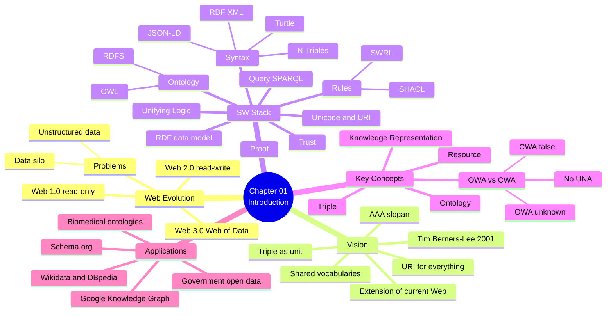
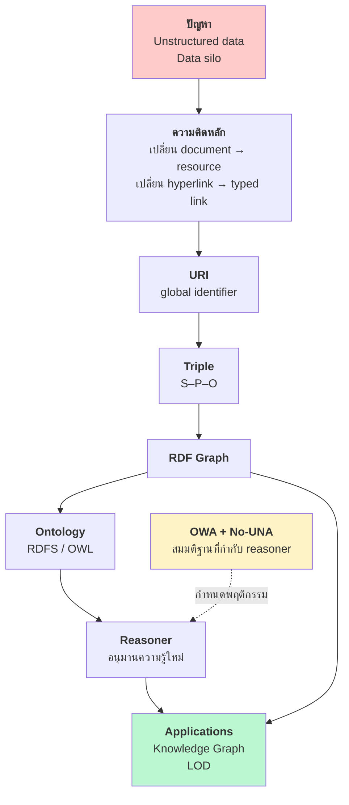

# 01.07 สรุป Chapter 01

Chapter นี้วางรากความคิดทั้งหมดของคอร์ส: Web เดินทางมาถึงจุดที่ข้อมูลมหาศาลแต่ machine ยังตีความไม่ได้
Semantic Web เสนอทางออกด้วยการเปลี่ยนหน่วยข้อมูลจาก document เป็น resource ที่มี URI และเชื่อมกันด้วย typed link
บทสรุปนี้รวบยอดสาระสำคัญ พร้อม concept map และภาพตัวอย่างว่า Chapter 02 จะพาไปไหนต่อ

---

## Key Takeaways

### 1. ปัญหาที่ Semantic Web แก้

| ปัญหา | อาการ | ทางออก |
| --- | --- | --- |
| **Unstructured data** | HTML บอกแค่การแสดงผล machine เดาความหมายไม่ได้ | ใส่ semantics ด้วย RDF + vocabulary |
| **Data silo** | entity เดียวกันมีหลาย ID หลาย schema | ใช้ **URI ร่วมกัน** + `owl:sameAs` |
| **Brittle integration** | scraper และ mapping พังทุกครั้งที่ต้นทางเปลี่ยน | มาตรฐานกลาง: RDF + SPARQL |
| **No shared meaning** | API แต่ละเจ้าตั้งชื่อ field ตามใจ | reuse ontology สาธารณะ |

### 2. แนวคิดหลักที่ต้องจำ

- **Resource** = ทุกสิ่งที่พูดถึงได้ ระบุด้วย **URI**
- **Triple** = `subject – predicate – object` หน่วยความรู้ที่เล็กที่สุด
- **Graph** = เซตของ triple ที่เชื่อมกันโดยอัตโนมัติผ่าน URI ร่วม
- **Ontology** = formal, explicit specification of a shared conceptualization
- **OWA** = ไม่มีข้อมูล ≠ เท็จ (ต่างจาก CWA ของ SQL)
- **No-UNA** = URI ต่างกันอาจเป็นสิ่งเดียวกัน จนกว่าจะประกาศ `owl:differentFrom`

### 3. Semantic Web Stack

จากล่างขึ้นบน: **URI/Unicode → Syntax → RDF → (Ontology | Rules | Query) → Logic → Proof → Trust**
ชั้นล่างมั่นคงและใช้งานจริงแล้ว ชั้นบน (proof, trust) ยังเป็นงานที่ค้างอยู่

### 4. สิ่งที่ใช้งานจริงแล้ววันนี้

Google Knowledge Graph · Schema.org · Wikidata · DBpedia · Gene Ontology · SNOMED CT · DCAT ใน open government data

---

## Concept Map



---

## แผนภาพความเชื่อมโยงของแนวคิด



---

## Self-check: ตอบได้ครบไหม

1. Web 3.0 กับ Web3 ต่างกันอย่างไร
2. ยกตัวอย่าง data silo ในองค์กรที่คุณรู้จัก แล้วบอกว่า URI ช่วยแก้อย่างไร
3. เรียงชั้นของ Semantic Web Stack จากล่างขึ้นบนได้หรือไม่
4. `ex:A ex:knows ex:B` — ตำแหน่งไหนคือ subject/predicate/object และตำแหน่งไหนเป็น literal ไม่ได้
5. ถ้า KB ไม่มี triple `ex:Marie ex:hasEmail ?x` ระบบแบบ OWA และ CWA ตอบต่างกันอย่างไร
6. ทำไม OWL จึงต้องมี `owl:differentFrom` ทั้งที่ URI ต่างกันอยู่แล้ว
7. Schema.org ควรฝังในหน้าเว็บด้วยรูปแบบใด และเพราะอะไร

---

## Preview: Chapter 02 — RDF

Chapter หน้าเราจะลงลึกในชั้นที่เป็นหัวใจของ stack ทั้งหมด นั่นคือ **RDF**

| จะได้เรียน | สาระ |
| --- | --- |
| Triple model | โครงสร้าง S–P–O อย่างละเอียด |
| URI / Literal / Blank Node | ความต่างของ URI–URL–IRI, typed literal, language tag, bnode |
| RDF Graph | graph เป็นเซตของ triple, named graph |
| **Turtle full form** | `@prefix`, `@base`, กฎ syntax ครบถ้วน |
| **Turtle shorthand** | `;` `,` `[]` `()` — แสดงคู่กับ full form ทุกครั้ง |
| Formats อื่น | RDF/XML, N-Triples, JSON-LD และเลือกใช้เมื่อไหร่ |
| Prefix cheat sheet | `rdf:` `rdfs:` `owl:` `xsd:` `dc:` `foaf:` `schema:` |
| rdflib | สร้าง graph, เพิ่ม triple, serialize ทุก format |

ตัวอย่างสิ่งที่จะเขียนเป็นได้ตอนจบ Chapter 02 — ข้อมูลชุดเดียวกัน สองสไตล์:

```turtle
# ---------- Full form ----------
@prefix ex:   <http://example.org/> .
@prefix foaf: <http://xmlns.com/foaf/0.1/> .

ex:MarieCurie foaf:name "Marie Curie" .
ex:MarieCurie foaf:knows ex:PierreCurie .
ex:MarieCurie foaf:knows ex:AlbertEinstein .

# ---------- Shorthand ----------
@prefix ex:   <http://example.org/> .
@prefix foaf: <http://xmlns.com/foaf/0.1/> .

ex:MarieCurie foaf:name  "Marie Curie" ;
              foaf:knows ex:PierreCurie , ex:AlbertEinstein .
```

---

## Key Points

- Semantic Web แก้สองปัญหาใหญ่: **unstructured data** และ **data silo** ด้วยการใช้ URI และ typed link
- แนวคิดแกน 4 ตัวคือ **Resource, Triple, Graph, Ontology** — ทุก chapter ที่เหลือต่อยอดจากสี่ตัวนี้
- **OWA + No-UNA** คือสมมติฐานที่ทำให้ reasoner ของ Semantic Web ทำงานต่างจาก database โดยสิ้นเชิง
- Semantic Web Stack ชั้นล่าง (URI → RDF → SPARQL/OWL) ใช้งานได้จริงแล้ว ชั้นบน (proof, trust) ยังไม่สมบูรณ์
- เทคโนโลยีนี้ไม่ใช่ทฤษฎีล้วน — Google KG, Wikidata, Gene Ontology และ open government data ใช้อยู่ทุกวัน
- Chapter 02 จะลงลึก RDF และ **Turtle ทั้ง full form กับ shorthand** ซึ่งเป็น notation หลักของทั้งคอร์ส
