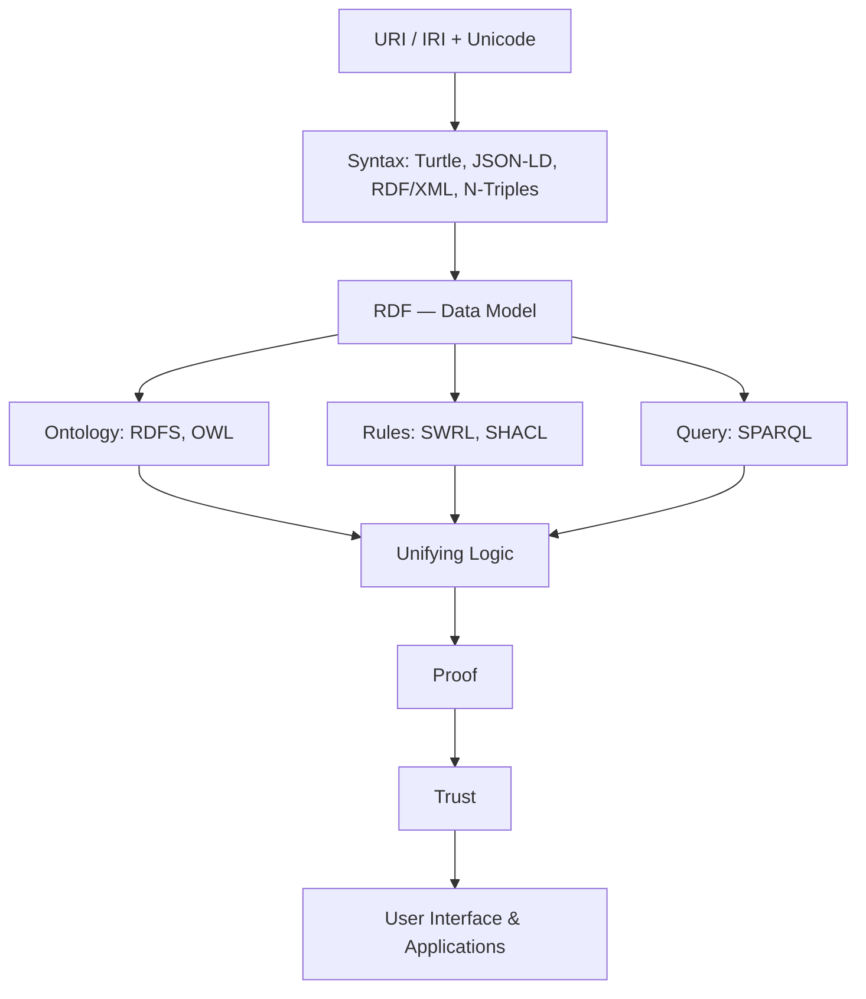

# 01.08 แบบฝึกหัด Chapter 01

แบบฝึกหัดชุดนี้เน้นการ **สังเกตของจริง** และ **อธิบายแนวคิดด้วยคำพูดตัวเอง** มากกว่าการเขียนโค้ด
เพราะทักษะที่ต้องได้จาก Chapter 01 คือ "มองออกว่าโครงสร้างข้อมูลบนเว็บมีหน้าตาอย่างไร" และ "เข้าใจสมมติฐานพื้นฐานที่ต่างจาก database"
ให้ทำครบทุกข้อก่อนขึ้น Chapter 02

---

### Exercise 1: ตามล่า Schema.org บนเว็บจริง 3 เว็บ

**โจทย์**

เลือกเว็บไซต์จริง **3 เว็บจากคนละประเภท** เช่น

- เว็บข่าว (`bbc.com`, `reuters.com`)
- เว็บ e-commerce (`shopee.co.th`, `amazon.com`)
- เว็บสูตรอาหาร / เว็บหางาน / เว็บโรงแรม

สำหรับแต่ละเว็บ:

1. เปิด **View Source** แล้วค้นหาคำว่า `application/ld+json`
2. คัดลอก JSON-LD block ที่พบมาวางในไฟล์คำตอบ
3. ระบุ `@type` ที่ใช้ และ property อย่างน้อย 5 ตัว
4. ตรวจ markup ด้วย `validator.schema.org` แล้วบันทึกว่าพบ warning หรือ error อะไรบ้าง
5. รันสคริปต์เพื่อยืนยันผล:

```bash
python code/ch01/fetch_schema_org.py https://www.bbc.com/news
```

**Expected output**

ตารางสรุปรูปแบบนี้ พร้อม JSON-LD ที่คัดลอกมา:

| Website | ประเภท | `@type` ที่พบ | Property ตัวอย่าง | จำนวน block | Warning จาก validator |
| --- | --- | --- | --- | --- | --- |
| bbc.com/news | ข่าว | `WebPage`, `ItemList` | `name`, `url`, `itemListElement` | 2 | ไม่มี |
| … | | | | | |

พร้อมย่อหน้าสรุป 3–5 บรรทัดว่า **เว็บประเภทไหนใส่ markup ละเอียดที่สุด และคิดว่าเพราะอะไร**

---

### Exercise 2: วาด Semantic Web Stack จากความจำ

**โจทย์**

1. **ปิดเอกสารทั้งหมด** แล้ววาด Layer Cake จากความจำลงกระดาษ ให้ครบทุกชั้นตั้งแต่ Unicode/URI ถึง Trust
2. เขียนกำกับแต่ละชั้นว่า **เทคโนโลยีจริงคืออะไร** (เช่น ชั้น Query = SPARQL)
3. เปิด [01.03](01.03-sw-stack.md) เทียบ แล้ว **ทำเครื่องหมายสิ่งที่ลืมหรือวางผิดตำแหน่ง**
4. แปลงภาพที่ถูกต้องเป็น Mermaid diagram

**Expected output**

ไฟล์ `answer-01.md` ที่มี Mermaid block ทำงานได้ เช่น



พร้อมรายการ "ชั้นที่ลืม" อย่างน้อย 1 บรรทัด (ถ้าจำได้ครบให้เขียนว่าชั้นไหนไม่แน่ใจที่สุด)

---

### Exercise 3: OWA vs CWA — วิเคราะห์กรณีจริง

**โจทย์**

กำหนด Knowledge Base ต่อไปนี้ (มีเพียงเท่านี้ ไม่มีข้อมูลอื่น):

```turtle
@prefix ex: <http://example.org/> .

ex:alice  a            ex:Student ;
          ex:enrolledIn ex:CS101 ;
          ex:enrolledIn ex:CS102 .

ex:bob    a            ex:Student ;
          ex:enrolledIn ex:CS101 .

ex:CS101  a            ex:Course ;
          ex:taughtBy  ex:profSmith .
```

ตอบคำถามต่อไปนี้ **สองคอลัมน์: ภายใต้ CWA และภายใต้ OWA** พร้อมเหตุผล

1. `ex:bob` ลงเรียน `ex:CS102` หรือไม่
2. `ex:alice` ลงเรียนทั้งหมดกี่วิชา
3. `ex:CS102` สอนโดยใคร
4. มี Student ทั้งหมดกี่คนในระบบ
5. `ex:alice` กับ `ex:bob` เป็นคนละคนหรือไม่

จากนั้น:

6. เขียน triple เพิ่มเติมที่จำเป็น เพื่อให้ reasoner แบบ OWA สรุปได้ว่า **alice ลงเรียนอย่างน้อย 2 วิชา** และ **alice ไม่ใช่ bob**

**Expected output**

ตารางคำตอบ:

| # | คำถาม | CWA | OWA | เหตุผล |
| --- | --- | --- | --- | --- |
| 1 | bob ลง CS102? | No | Unknown | OWA: ไม่มีข้อมูล ≠ เท็จ |
| 2 | alice ลงกี่วิชา | 2 | ≥ 1 | ยังไม่รู้ว่า CS101 ≠ CS102 |
| … | | | | |

พร้อม Turtle block สำหรับข้อ 6 ที่มี `owl:differentFrom` และ/หรือ `owl:AllDifferent`

---

### Exercise 4: แปลงข้อมูลไม่มีโครงสร้างให้เป็น triple

**โจทย์**

จากย่อหน้าภาษาอังกฤษต่อไปนี้:

> Alan Turing was a British mathematician born on 23 June 1912 in London.
> He worked at the University of Manchester and is known for the Turing machine.
> He was supervised by Alonzo Church at Princeton University.

1. ระบุ **resource** ทั้งหมดที่พบ (คน สถานที่ องค์กร แนวคิด)
2. กำหนด URI ให้แต่ละ resource ภายใต้ namespace `http://example.org/`
3. เขียน **อย่างน้อย 10 triple** ในรูปแบบ Turtle โดยใช้ `foaf:` และ `schema:` ที่มีอยู่จริง
4. ระบุว่า triple ไหนที่ object เป็น **literal** และ triple ไหนที่ object เป็น **resource**
5. วาด RDF graph ด้วย Mermaid โดยใช้วงรีแทน resource และสี่เหลี่ยมแทน literal

**Expected output**

ไฟล์ Turtle ที่ parse ผ่านโดยไม่มี error:

```bash
python -c "from rdflib import Graph; g=Graph(); g.parse('answer-04.ttl', format='turtle'); print(len(g), 'triples')"
```

```
12 triples
```

พร้อม Mermaid diagram และตารางแยก literal/resource

---

### Exercise 5: เลือกจุดบน Semantic Spectrum

**โจทย์**

เลือกโดเมนที่คุณคุ้นเคย 1 โดเมน (เช่น ระบบห้องสมุด, ร้านกาแฟ, ระบบลงทะเบียนเรียน, คลังเพลง)

1. ระบุ **use case** ที่ต้องการจริง 3 ข้อ เขียนเป็นคำถามที่ระบบต้องตอบได้
2. ตัดสินใจว่าโดเมนนี้ควรอยู่จุดไหนบน semantic spectrum
   (controlled vocabulary → taxonomy → thesaurus → RDFS → OWL DL → OWL + rules)
3. **ให้เหตุผล** โดยอ้าง use case ในข้อ 1 ว่าทำไมจึงไม่ต้องไปไกลกว่านั้น และทำไมจึงไม่พอถ้าน้อยกว่านั้น
4. ระบุ vocabulary สาธารณะที่น่าจะ reuse ได้อย่างน้อย 2 ตัว (ดูตัวอย่างจาก [01.05](01.05-applications.md))

**Expected output**

เอกสารสั้น 1 หน้า โครงสร้างดังนี้:

```
Domain: Library management
Use cases:
  1. "หนังสือเล่มไหนที่ผู้แต่งเป็นชาวฝรั่งเศส และหมวดหมู่อยู่ใต้ Science"
  2. ...
Chosen level: RDFS + OWL (บางส่วน)
Justification: use case 1 ต้องการ transitive subclass ของหมวดหมู่ → RDFS พอ
               แต่ use case 3 ต้องการ "หนังสือที่ยืมไม่ได้" ซึ่งต้องใช้ disjointWith → ต้อง OWL
Vocabularies to reuse: dcterms:, bibo:, schema:Book
```

> 💡 คำตอบข้อนี้จะถูกนำกลับมาใช้อีกครั้งใน [Chapter 10 — Ontology Design](../10-ontology-design/10.01-methodology.md) ให้เก็บไฟล์ไว้

---

## Key Points

- Exercise 1 ฝึก **สังเกต**: structured data มีอยู่จริงบนเว็บที่ใช้ทุกวัน และแต่ละอุตสาหกรรมใส่ไม่เท่ากัน
- Exercise 2 ฝึก **จำโครงสร้าง**: Layer Cake เป็นแผนที่ที่จะอ้างถึงตลอดคอร์ส
- Exercise 3 ฝึก **แยกสมมติฐาน**: OWA vs CWA คือจุดที่คนมาจากสาย SQL พลาดบ่อยที่สุด
- Exercise 4 ฝึก **แปลงข้อความเป็น triple** — ทักษะพื้นฐานที่ใช้ตลอด Chapter 02–03
- Exercise 5 ฝึก **ตัดสินใจระดับ expressivity** ซึ่งเป็นหัวใจของงาน ontology engineering จริง
- เก็บคำตอบ Exercise 4 และ 5 ไว้ เพราะจะถูกนำมาต่อยอดใน chapter หลัง
