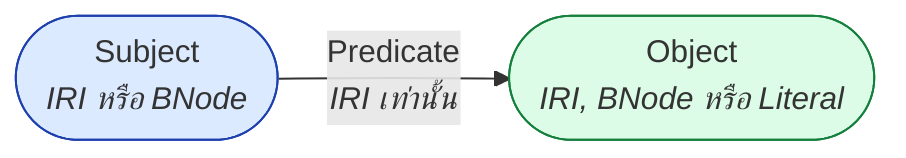
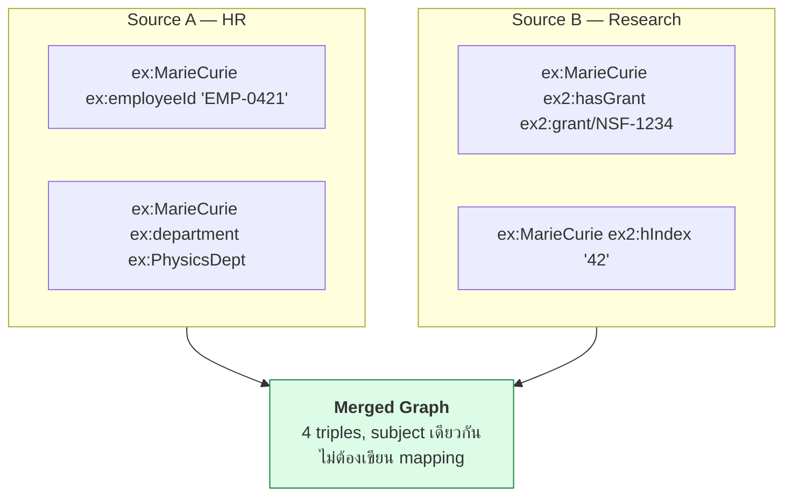
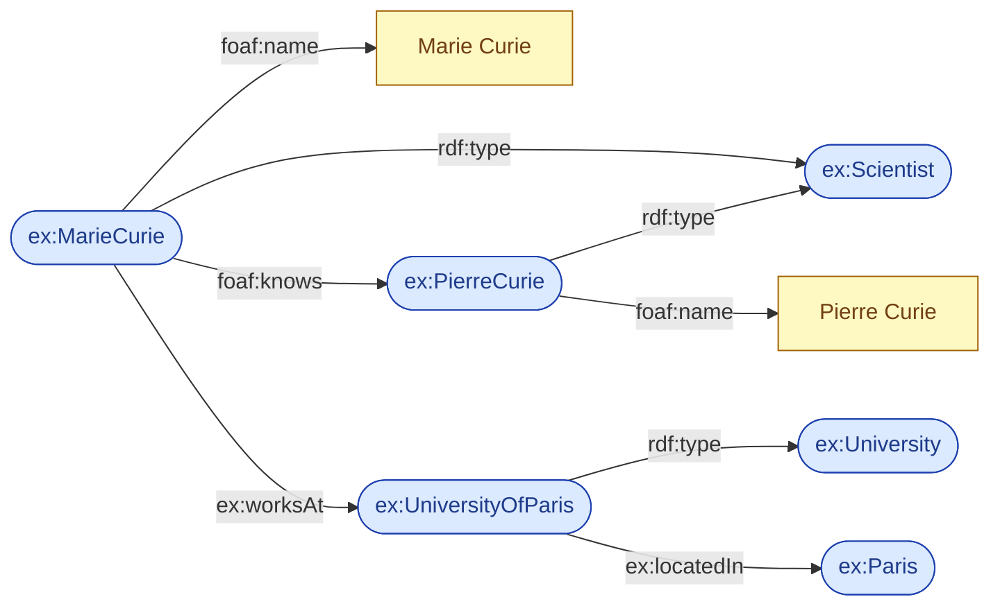

# 02.01 Triple Model: Subject–Predicate–Object

**RDF (Resource Description Framework)** มีโครงสร้างข้อมูลเพียงแบบเดียวคือ **triple** — ข้อความที่ประกอบด้วยสามส่วน
ความเรียบง่ายนี้ไม่ใช่ข้อจำกัด แต่เป็นจุดแข็ง เพราะทำให้ข้อมูลจากคนละแหล่งรวมกันได้โดยไม่ต้องออกแบบ schema ร่วมล่วงหน้า
บทนี้อธิบายโครงสร้าง triple, RDF statement และหลักการที่ว่า **everything is a resource**

---

## RDF Statement คืออะไร

RDF statement หนึ่งข้อ = triple หนึ่งตัว = ข้อเท็จจริงหนึ่งข้อ

```
<subject>  <predicate>  <object> .
```

เทียบกับประโยคภาษาอังกฤษง่าย ๆ:

| ประโยค | Subject | Predicate | Object |
| --- | --- | --- | --- |
| Marie Curie **knows** Pierre Curie | Marie Curie | knows | Pierre Curie |
| Marie Curie **has name** "Marie Curie" | Marie Curie | has name | `"Marie Curie"` |
| Marie Curie **works at** University of Paris | Marie Curie | works at | University of Paris |

เขียนเป็น Turtle:

```turtle
@prefix ex:   <http://example.org/> .
@prefix foaf: <http://xmlns.com/foaf/0.1/> .

ex:MarieCurie foaf:knows ex:PierreCurie .
ex:MarieCurie foaf:name  "Marie Curie" .
ex:MarieCurie ex:worksAt ex:UniversityOfParis .
```

จุดสำคัญ: **จุด `.` ปิดท้ายทุก statement** เหมือนจุดจบประโยค

---

## กฎว่าตำแหน่งไหนเป็นอะไรได้บ้าง

นี่คือกฎที่ต้องจำให้ขึ้นใจ เพราะเป็นข้อบังคับของ RDF data model

| ตำแหน่ง | IRI | Blank Node | Literal |
| --- | :---: | :---: | :---: |
| **Subject** | ✅ | ✅ | ❌ |
| **Predicate** | ✅ | ❌ | ❌ |
| **Object** | ✅ | ✅ | ✅ |

ข้อสังเกตสำคัญ 3 ข้อ:

1. **Predicate ต้องเป็น IRI เสมอ** — ความสัมพันธ์ต้องมีชื่อสากลที่อ้างอิงได้ ห้ามเป็น string ลอย ๆ
2. **Literal เป็น object เท่านั้น** — จึงเขียน `"Marie Curie" ex:isNameOf ex:MarieCurie .` ไม่ได้
3. **Literal เป็นปลายทางเสมอ** — ไม่มี triple ใดออกจาก literal ทำให้ literal เป็น "ใบ" ของ graph



---

## Everything is a Resource

หลักการที่ทรงพลังที่สุดของ RDF: **ทุกอย่างที่พูดถึงได้ เป็น resource และมี IRI ได้ทั้งหมด**
รวมถึงสิ่งที่ในภาษาโปรแกรมทั่วไปถือเป็น "metadata"

```turtle
@prefix ex:   <http://example.org/> .
@prefix rdf:  <http://www.w3.org/1999/02/22-rdf-syntax-ns#> .
@prefix rdfs: <http://www.w3.org/2000/01/rdf-schema#> .
@prefix foaf: <http://xmlns.com/foaf/0.1/> .

# 1. พูดถึง instance
ex:MarieCurie foaf:knows ex:PierreCurie .

# 2. พูดถึง class (class เองก็เป็น resource)
ex:Scientist a rdfs:Class ;
             rdfs:label "Scientist"@en .

# 3. พูดถึง property (property เองก็เป็น resource!)
foaf:knows a rdf:Property ;
           rdfs:label   "knows"@en ;
           rdfs:comment "A person known by this person."@en .
```

บรรทัดที่ 3 คือสิ่งที่ SQL ทำไม่ได้: **ใช้ภาษาเดียวกันอธิบายทั้งข้อมูลและ schema ของข้อมูล**
คุณสมบัตินี้เรียกว่า **reflexivity** และเป็นเหตุผลที่ RDFS กับ OWL สร้างทับบน RDF ได้โดยไม่ต้องเพิ่มภาษาใหม่

---

## ทำไม triple ถึงพอสำหรับทุกอย่าง

### ข้อมูลแบบตาราง → triple

Relational row หนึ่งแถว = ชุด triple ที่มี subject เดียวกัน

| id | name | birth_year | affiliation |
| --- | --- | --- | --- |
| 1 | Marie Curie | 1867 | University of Paris |

```turtle
@prefix ex:  <http://example.org/> .
@prefix xsd: <http://www.w3.org/2001/XMLSchema#> .

ex:person/1 ex:name        "Marie Curie" .
ex:person/1 ex:birthYear   "1867"^^xsd:gYear .
ex:person/1 ex:affiliation ex:UniversityOfParis .
```

### ความสัมพันธ์แบบ n-ary → ต้องสร้าง resource กลาง

triple รองรับความสัมพันธ์แบบ binary เท่านั้น ถ้าต้องการเก็บ "Marie ทำงานที่ Paris **ตั้งแต่ปี 1906 ในตำแหน่ง Professor**"
ต้อง **reify** ความสัมพันธ์ให้เป็น resource

```turtle
@prefix ex:  <http://example.org/> .
@prefix xsd: <http://www.w3.org/2001/XMLSchema#> .

ex:MarieCurie ex:hasEmployment ex:employment/mc-paris .

ex:employment/mc-paris a ex:Employment ;
    ex:employer  ex:UniversityOfParis ;
    ex:jobTitle  "Professor" ;
    ex:startYear "1906"^^xsd:gYear .
```

เทคนิคนี้คือ **ontology design pattern** ชื่อ *Time-Indexed Situation* ที่จะเรียนละเอียดใน [10.05 ODP](../10-ontology-design/10.05-odp.md)

---

## Merge โดยไม่ต้องออกแบบล่วงหน้า

ข้อได้เปรียบที่แท้จริงของ triple model: **union ของ triple set = การรวมข้อมูล**

```turtle
# --- ไฟล์ A: จากระบบ HR ---
@prefix ex: <http://example.org/> .
ex:MarieCurie ex:employeeId "EMP-0421" .
ex:MarieCurie ex:department ex:PhysicsDept .

# --- ไฟล์ B: จากระบบวิจัย (คนละทีม คนละเวลา) ---
@prefix ex: <http://example.org/> .
@prefix ex2: <http://example.org/research/> .
ex:MarieCurie ex2:hasGrant ex2:grant/NSF-1234 .
ex:MarieCurie ex2:hIndex   "42" .

# --- โหลดสองไฟล์เข้า graph เดียวกัน --> ได้ครบทันที ---
# ไม่ต้อง ALTER TABLE, ไม่ต้อง migration, ไม่ต้องคุยกันล่วงหน้า
```

เงื่อนไขเดียวที่ทำให้ merge สำเร็จคือ **ทั้งสองฝ่ายใช้ IRI เดียวกันแทน entity เดียวกัน**



---

## ตัวอย่างเต็ม: graph ขนาดเล็ก

```turtle
@prefix ex:     <http://example.org/> .
@prefix foaf:   <http://xmlns.com/foaf/0.1/> .
@prefix xsd:    <http://www.w3.org/2001/XMLSchema#> .

ex:MarieCurie a ex:Scientist .
ex:MarieCurie foaf:name "Marie Curie" .
ex:MarieCurie foaf:knows ex:PierreCurie .
ex:MarieCurie ex:worksAt ex:UniversityOfParis .
ex:PierreCurie a ex:Scientist .
ex:PierreCurie foaf:name "Pierre Curie" .
ex:UniversityOfParis a ex:University .
ex:UniversityOfParis ex:locatedIn ex:Paris .
```

8 triple ข้างบนวาดเป็น graph ได้ดังนี้:



---

## Key Points

- **RDF statement = triple = ข้อเท็จจริงหนึ่งข้อ** ในรูป `subject predicate object .`
- **Predicate ต้องเป็น IRI เสมอ**; **literal เป็น object ได้เท่านั้น** และเป็นปลายทางของ graph
- **Everything is a resource** — class และ property เองก็เป็น resource ที่พูดถึงได้ ทำให้ RDF อธิบาย schema ของตัวเองได้ (reflexivity)
- ความสัมพันธ์แบบ **n-ary** ต้องสร้าง resource กลางขึ้นมา (reification / Time-Indexed Situation pattern)
- การรวมข้อมูลคือ **union ของ triple set** — เงื่อนไขเดียวคือใช้ IRI เดียวกันแทน entity เดียวกัน
- ไม่ต้องออกแบบ schema ให้ครบก่อนเริ่ม เพิ่ม property ใหม่ได้ตลอดโดยไม่กระทบข้อมูลเดิม
