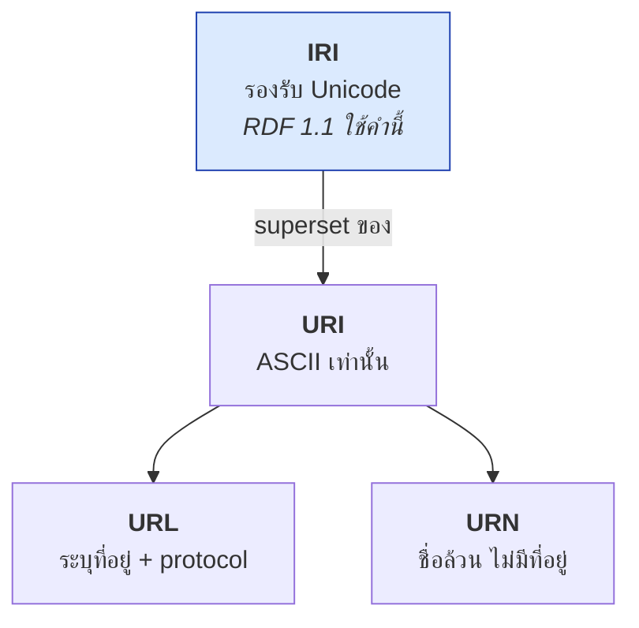
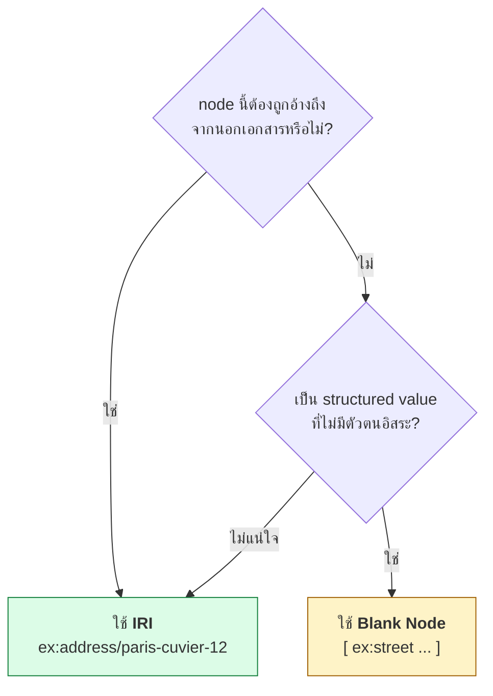
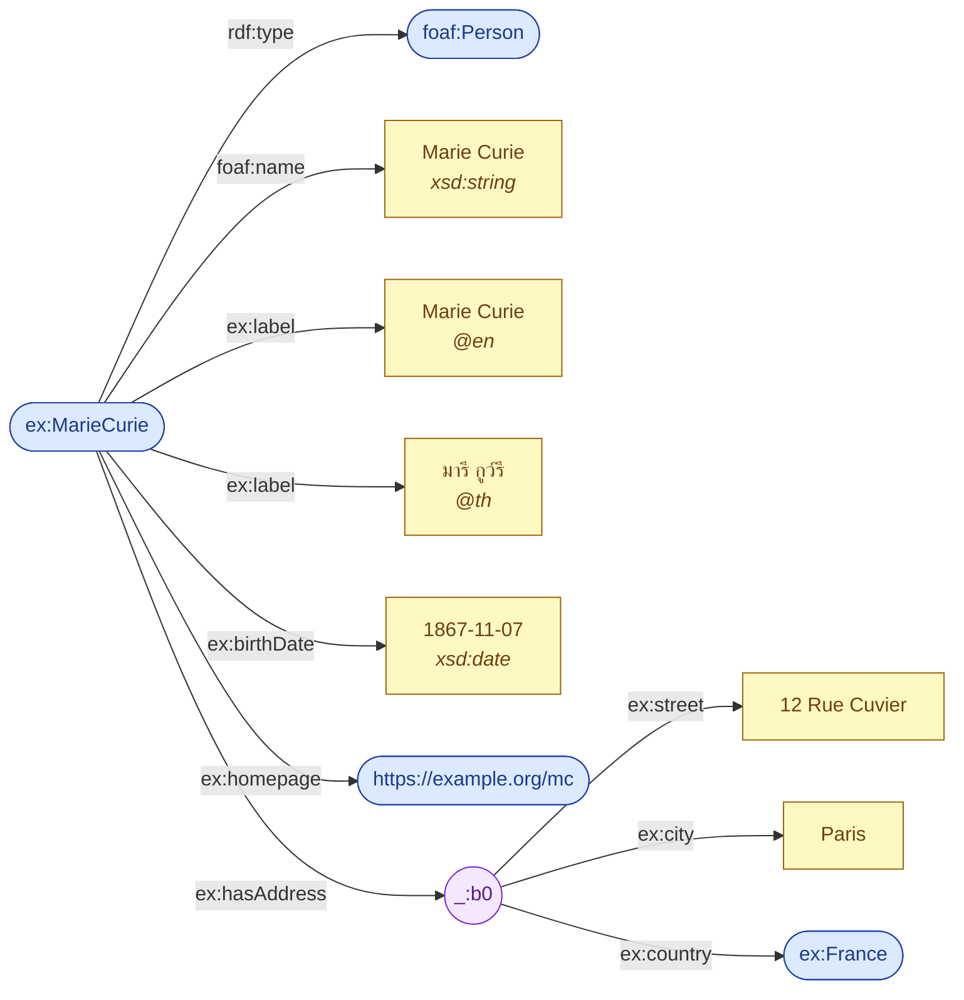

# 02.02 URI, Literal และ Blank Node

RDF มี node อยู่สามชนิดเท่านั้น: **IRI**, **Literal** และ **Blank Node** การเข้าใจว่าแต่ละชนิดคืออะไร ใช้เมื่อไหร่
และมีข้อจำกัดอะไร คือพื้นฐานที่จำเป็นก่อนเขียน RDF จริงจัง บทนี้ยังเคลียร์ความสับสนคลาสสิกระหว่าง **URI, URL และ IRI**

---

## URI vs URL vs URN vs IRI

| คำ | ย่อมาจาก | หมายถึง | ตัวอย่าง |
| --- | --- | --- | --- |
| **URI** | Uniform Resource **Identifier** | ชื่อที่ระบุ resource — อาจ locate ได้หรือไม่ก็ได้ | `http://example.org/person/marie` |
| **URL** | Uniform Resource **Locator** | URI ที่บอก **ที่อยู่** และวิธีเข้าถึงด้วย | `https://example.org/index.html` |
| **URN** | Uniform Resource **Name** | URI ที่เป็นชื่อล้วน ไม่บอกที่อยู่ | `urn:isbn:0451450523` |
| **IRI** | **Internationalized** Resource Identifier | URI ที่รองรับอักขระ Unicode | `http://example.org/นักวิทยาศาสตร์` |



**สรุปความสัมพันธ์**: ทุก URL เป็น URI แต่ไม่ใช่ทุก URI ที่เป็น URL — และ **IRI เป็น superset ของ URI**
มาตรฐาน **RDF 1.1 ใช้คำว่า IRI** อย่างเป็นทางการ แต่ในทางปฏิบัติคนยังพูดว่า "URI" กันติดปาก

### ประเด็นสำคัญ: http:// IRI ไม่ได้แปลว่าเป็นหน้าเว็บ

```turtle
@prefix ex: <http://example.org/> .

# นี่คือ "คน" ไม่ใช่ "หน้าเว็บของคน"
ex:MarieCurie a ex:Person .
```

การใช้ `http://` เป็น scheme เพราะมันเป็น namespace ที่ **มีเจ้าของชัดเจน** และ **dereference ได้** ถ้าเจ้าของต้องการ
ไม่ได้แปลว่า resource นั้นเป็นเอกสาร (ประเด็นนี้เรียกว่า **httpRange-14** ดู [12.04 URI Design](../12-linked-open-data/12.04-uri-design.md))

---

## Literal

**Literal** คือค่าข้อมูลดิบ — string, ตัวเลข, วันที่, boolean มี 3 องค์ประกอบ:

1. **lexical form** — ตัวอักษรที่เขียน เช่น `"42"`
2. **datatype IRI** — ระบุชนิด เช่น `xsd:integer`
3. **language tag** — เฉพาะ literal ที่เป็น `rdf:langString`

### รูปแบบการเขียน 3 แบบ

```turtle
@prefix ex:  <http://example.org/> .
@prefix xsd: <http://www.w3.org/2001/XMLSchema#> .

ex:MarieCurie
    # (1) plain literal — โดยปริยายเป็น xsd:string
    ex:nickname  "Madame Curie" ;

    # (2) typed literal — ระบุ datatype ด้วย ^^
    ex:birthDate "1867-11-07"^^xsd:date ;
    ex:age       "66"^^xsd:integer ;
    ex:isNobelLaureate "true"^^xsd:boolean ;

    # (3) language-tagged literal — ระบุภาษาด้วย @
    ex:label     "Marie Curie"@en ,
                 "มารี กูว์รี"@th ,
                 "Maria Skłodowska-Curie"@pl .
```

> ⚠️ **ห้ามใส่ทั้ง datatype และ language tag พร้อมกัน** — `"text"@en^^xsd:string` ผิด syntax
> language tag บังคับให้ datatype เป็น `rdf:langString` โดยอัตโนมัติ

### Datatype ที่ใช้บ่อย (XML Schema)

| Datatype | ตัวอย่าง lexical form | ใช้กับ |
| --- | --- | --- |
| `xsd:string` | `"Marie Curie"` | ข้อความทั่วไป (default) |
| `xsd:integer` | `"66"` | จำนวนเต็ม |
| `xsd:decimal` | `"3.14"` | ทศนิยมแม่นยำ |
| `xsd:double` | `"1.0E9"` | floating point |
| `xsd:boolean` | `"true"` / `"false"` | ค่าตรรกะ |
| `xsd:date` | `"1867-11-07"` | วันที่ |
| `xsd:dateTime` | `"2024-11-11T09:30:00Z"` | วันเวลา |
| `xsd:gYear` | `"1867"` | ปีอย่างเดียว |
| `xsd:anyURI` | `"https://example.org"` | URI ในฐานะ **ค่า** ไม่ใช่ link |

### Literal ที่เท่ากันและไม่เท่ากัน

```turtle
# ทั้งสามบรรทัดนี้เป็นคนละ literal!
ex:a ex:value "42" .                  # xsd:string
ex:b ex:value "42"^^xsd:integer .     # xsd:integer
ex:c ex:value "42"@en .               # rdf:langString

# "1"^^xsd:integer เท่ากับ "01"^^xsd:integer  (value space เดียวกัน)
# "1"^^xsd:string  ไม่เท่ากับ "01"^^xsd:string (คนละ string)
```

จุดนี้เป็นบ่อเกิด bug ที่พบบ่อยมาก — SPARQL query ที่ `FILTER(?age = 66)` จะไม่ match `"66"` ที่เป็น string

---

## Blank Node

**Blank Node (bnode)** คือ node ที่ **มีอยู่จริงแต่ไม่มีชื่อสากล** ใช้เมื่อเราต้องการพูดว่า "มีบางสิ่ง" โดยไม่จำเป็นต้องตั้งชื่อให้มัน

### เขียนอย่างไร

```turtle
@prefix ex:   <http://example.org/> .
@prefix foaf: <http://xmlns.com/foaf/0.1/> .

# วิธีที่ 1: ใช้ label _:xxx (อ้างซ้ำได้ในไฟล์เดียวกัน)
ex:MarieCurie ex:hasAddress _:addr1 .
_:addr1 ex:street "12 Rue Cuvier" .
_:addr1 ex:city   "Paris" .

# วิธีที่ 2: ใช้ [] — สั้นกว่า แต่อ้างซ้ำไม่ได้
ex:PierreCurie ex:hasAddress [
    ex:street "12 Rue Cuvier" ;
    ex:city   "Paris"
] .
```

### เมื่อไหร่ควรใช้ bnode

| สถานการณ์ | ควรใช้ bnode? | เหตุผล |
| --- | :---: | --- |
| structured value ที่ไม่มีตัวตนอิสระ (address, ช่วงเวลา) | ✅ | ไม่มีใครต้องอ้างถึงมันจากภายนอก |
| OWL restriction, RDF collection | ✅ | เป็น syntax construct ภายใน |
| entity หลักของ dataset (คน, สินค้า, เอกสาร) | ❌ | ต้อง link จากภายนอกได้ |
| ข้อมูลที่จะ publish เป็น LOD | ❌ | bnode ข้าม dataset อ้างถึงกันไม่ได้ |

### ข้อจำกัดสำคัญของ bnode

1. **Scope จำกัดอยู่ในเอกสารเดียว** — `_:addr1` ของไฟล์ A กับไฟล์ B **ไม่ใช่ node เดียวกัน**
2. **อ้างจากภายนอกไม่ได้** — ไม่มี IRI ให้ `owl:sameAs` ชี้เข้ามา
3. **ID เปลี่ยนได้ทุกครั้งที่ parse** — `_:addr1` อาจกลายเป็น `_:b0` หลัง serialize ใหม่
4. **ทำให้ diff และ merge ยุ่งยาก** — เพราะเทียบ node ตรง ๆ ไม่ได้

> 💡 **หลักปฏิบัติ**: ถ้าไม่แน่ใจ ให้ **ตั้ง IRI ให้มันไปเลย** — IRI ราคาถูก แต่ bnode ที่ต้องแปลงกลับเป็น IRI ทีหลังนั้นแพง



---

## เปรียบเทียบทั้งสามชนิด

| | IRI | Literal | Blank Node |
| --- | --- | --- | --- |
| มีชื่อสากล | ✅ | — | ❌ |
| เป็น subject ได้ | ✅ | ❌ | ✅ |
| เป็น predicate ได้ | ✅ | ❌ | ❌ |
| เป็น object ได้ | ✅ | ✅ | ✅ |
| มี outgoing edge ได้ | ✅ | ❌ | ✅ |
| อ้างข้ามเอกสารได้ | ✅ | — | ❌ |
| ตัวอย่าง | `ex:MarieCurie` | `"Marie"@en` | `_:b0` |

---

## ตัวอย่างรวม

```turtle
@prefix ex:   <http://example.org/> .
@prefix foaf: <http://xmlns.com/foaf/0.1/> .
@prefix xsd:  <http://www.w3.org/2001/XMLSchema#> .

ex:MarieCurie a foaf:Person ;
    foaf:name       "Marie Curie" ;                       # plain literal
    ex:label        "Marie Curie"@en , "มารี กูว์รี"@th ;  # language-tagged
    ex:birthDate    "1867-11-07"^^xsd:date ;              # typed literal
    ex:homepage     <https://example.org/mc> ;            # IRI
    ex:hasAddress   [                                     # blank node
        ex:street  "12 Rue Cuvier" ;
        ex:city    "Paris" ;
        ex:country ex:France                              # IRI ภายใน bnode
    ] .
```



---

## Key Points

- **IRI** เป็น superset ของ URI (รองรับ Unicode) — RDF 1.1 ใช้คำว่า IRI อย่างเป็นทางการ
- `http://` IRI **ไม่ได้แปลว่า resource นั้นเป็นหน้าเว็บ** — เลือกใช้เพราะมีเจ้าของชัดและ dereference ได้
- **Literal** ประกอบด้วย lexical form + datatype (+ language tag) — **ห้ามใส่ datatype กับ language tag พร้อมกัน**
- `"42"`, `"42"^^xsd:integer` และ `"42"@en` เป็น **คนละ literal** — เป็นสาเหตุ bug ใน SPARQL ที่พบบ่อยที่สุด
- **Blank Node** = "มีบางสิ่ง" ที่ไม่มีชื่อสากล มี scope แค่ในเอกสารเดียว และอ้างจากภายนอกไม่ได้
- ใช้ bnode กับ structured value และ OWL construct — **หลีกเลี่ยง** กับ entity หลักและข้อมูลที่จะ publish เป็น LOD
- เมื่อไม่แน่ใจ ให้ตั้ง IRI ไปเลย เพราะแปลง bnode → IRI ภายหลังมีต้นทุนสูงกว่ามาก
