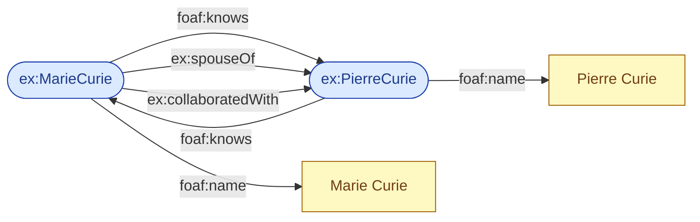
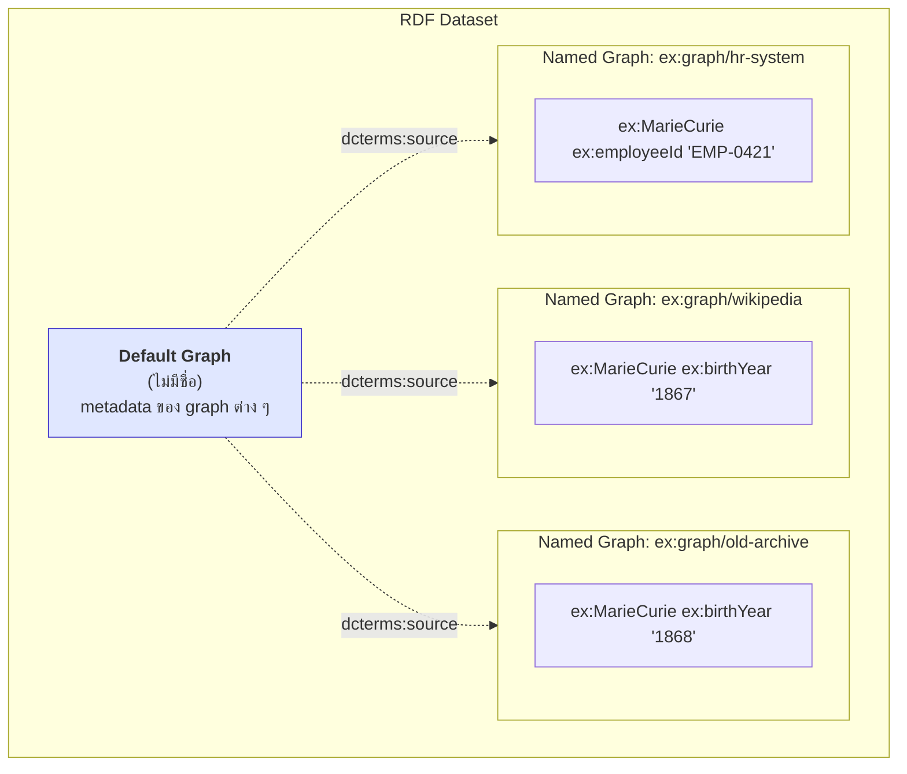

# 02.03 RDF Graph และ Named Graph

เมื่อนำ triple หลายตัวมารวมกัน สิ่งที่ได้คือ **RDF Graph** — และเนื่องจาก graph นิยามเป็น **เซต (set)** ของ triple
จึงมีคุณสมบัติทางคณิตศาสตร์ที่ส่งผลโดยตรงต่อการทำงานจริง บทนี้อธิบายคุณสมบัติเหล่านั้น
พร้อมแนะนำ **Named Graph** และ **RDF Dataset** ซึ่งเป็นกลไกจัดการ provenance ที่ใช้ในทุก triplestore

---

## RDF Graph = เซตของ triple

นิยามอย่างเป็นทางการ: *An RDF graph is a set of RDF triples.*

คำว่า **"เซต"** ให้ผลตามมา 3 ข้อ:

### 1. ไม่มีลำดับ (unordered)

```turtle
# --- ไฟล์ A ---
ex:MarieCurie foaf:name  "Marie Curie" .
ex:MarieCurie ex:worksAt ex:UniversityOfParis .

# --- ไฟล์ B ---
ex:MarieCurie ex:worksAt ex:UniversityOfParis .
ex:MarieCurie foaf:name  "Marie Curie" .
```

ทั้งสองไฟล์แทน **graph เดียวกันทุกประการ** — ลำดับใน serialization ไม่มีความหมายเชิงตรรกะ

### 2. ไม่มีตัวซ้ำ (no duplicates)

```turtle
ex:MarieCurie foaf:name "Marie Curie" .
ex:MarieCurie foaf:name "Marie Curie" .   # เขียนซ้ำ → ยังคงมี 1 triple
```

ผลตามมาที่สำคัญ: **RDF นับซ้ำไม่ได้โดยธรรมชาติ** ถ้าต้องการเก็บ "ยืมหนังสือเล่มนี้ 3 ครั้ง" ต้องสร้าง resource แทนแต่ละครั้ง

### 3. Merge = union

```
G1 ∪ G2 = graph ที่มี triple ทั้งหมดของทั้งสอง
```

การรวมข้อมูลจึงไม่มีวัน conflict ในเชิง syntax — conflict เกิดได้เฉพาะเชิง semantics (เช่นขัดกับ OWL axiom)

---

## Graph structure: directed labeled multigraph

RDF graph เป็น **directed labeled graph** ที่:

- **node** = IRI, literal หรือ blank node
- **edge** = predicate (มี label เป็น IRI) และ **มีทิศทาง** จาก subject ไป object
- ระหว่าง node คู่เดียวกันมี edge ได้หลายเส้น ถ้า predicate ต่างกัน (multigraph)



สังเกตว่าระหว่าง `ex:MarieCurie` กับ `ex:PierreCurie` มี edge ถึง 4 เส้น (สองทิศทาง สามความสัมพันธ์)

---

## ปัญหา: graph เดียวเก็บทุกอย่างไม่ไหว

สมมติเรารวมข้อมูลจาก 3 แหล่ง แล้วเกิดคำถาม:

```turtle
@prefix ex: <http://example.org/> .

ex:MarieCurie ex:birthYear "1867" .    # จาก Wikipedia
ex:MarieCurie ex:birthYear "1868" .    # จากเอกสารเก่าที่ผิด
```

- ข้อมูลไหนมาจากแหล่งไหน?
- ดึงเข้ามาเมื่อไหร่?
- ถ้าอยากลบเฉพาะข้อมูลจากแหล่งที่ไม่น่าเชื่อถือ จะลบอย่างไร?

Graph เปล่า ๆ ตอบไม่ได้ เพราะ **triple ไม่มีที่ให้แปะ metadata**

---

## Named Graph

**Named Graph** คือการจับกลุ่ม triple แล้วให้ IRI แก่กลุ่มนั้น ทำให้พูดถึง "ชุดข้อมูล" ได้ทั้งชุด



### RDF Dataset

**RDF Dataset** = default graph (หนึ่งอัน ไม่มีชื่อ) + named graph ศูนย์ตัวหรือมากกว่า

```
Dataset = { G_default , (n₁, G₁) , (n₂, G₂) , ... }
```

### เขียนด้วย TriG (Turtle ที่รองรับ named graph)

```turtle
@prefix ex:      <http://example.org/> .
@prefix dcterms: <http://purl.org/dc/terms/> .
@prefix xsd:     <http://www.w3.org/2001/XMLSchema#> .

# --- default graph: เก็บ metadata ของแต่ละ named graph ---
ex:graph/wikipedia
    dcterms:source    <https://en.wikipedia.org/wiki/Marie_Curie> ;
    dcterms:created   "2025-03-01T10:00:00Z"^^xsd:dateTime ;
    ex:trustScore     "0.9"^^xsd:decimal .

ex:graph/old-archive
    dcterms:source    <http://archive.example.org/1950/> ;
    dcterms:created   "2025-03-01T10:05:00Z"^^xsd:dateTime ;
    ex:trustScore     "0.3"^^xsd:decimal .

# --- named graphs ---
ex:graph/wikipedia {
    ex:MarieCurie ex:birthYear "1867"^^xsd:gYear ;
                  ex:birthPlace ex:Warsaw .
}

ex:graph/old-archive {
    ex:MarieCurie ex:birthYear "1868"^^xsd:gYear .
}
```

### Query ด้วย SPARQL GRAPH keyword

```sparql
PREFIX ex: <http://example.org/>
PREFIX xsd: <http://www.w3.org/2001/XMLSchema#>

# เอาเฉพาะข้อมูลจาก graph ที่ trustScore สูงกว่า 0.5
SELECT ?g ?year
WHERE {
  GRAPH ?g {
    ex:MarieCurie ex:birthYear ?year .
  }
  ?g ex:trustScore ?score .
  FILTER(?score > 0.5)
}
```

Expected result:

| ?g | ?year |
| --- | --- |
| `ex:graph/wikipedia` | `"1867"^^xsd:gYear` |

---

## Use case ของ Named Graph

| Use case | วิธีใช้ |
| --- | --- |
| **Provenance** | หนึ่ง named graph ต่อหนึ่งแหล่งข้อมูล + metadata ใน default graph |
| **Versioning** | `ex:graph/v1`, `ex:graph/v2` — เก็บ snapshot แต่ละรุ่น |
| **Access control** | ให้สิทธิ์รายกลุ่ม graph แทนรายบุคคล triple |
| **แยก inferred จาก asserted** | `ex:graph/asserted` vs `ex:graph/inferred` — ล้าง inference แล้ว re-run ได้ง่าย |
| **Multi-tenancy** | หนึ่ง named graph ต่อหนึ่งลูกค้าใน triplestore เดียวกัน |
| **ETL batch** | หนึ่ง graph ต่อหนึ่งรอบ load — rollback ด้วย `DROP GRAPH` |

ตัวอย่าง pattern แยก asserted/inferred:

```sparql
# ล้างเฉพาะ triple ที่ reasoner สร้าง แล้ว re-run ใหม่
DROP GRAPH <http://example.org/graph/inferred> ;

INSERT { GRAPH <http://example.org/graph/inferred> { ?s a ?superClass } }
WHERE  {
  GRAPH <http://example.org/graph/asserted> { ?s a ?class }
  ?class <http://www.w3.org/2000/01/rdf-schema#subClassOf>+ ?superClass .
}
```

---

## RDF Reification: อีกทางเลือกที่ควรรู้ (แต่ไม่ค่อยแนะนำ)

ก่อนมี named graph RDF ใช้ **reification** เพื่อพูดถึง triple:

```turtle
@prefix ex:  <http://example.org/> .
@prefix rdf: <http://www.w3.org/1999/02/22-rdf-syntax-ns#> .

ex:statement1 a rdf:Statement ;
    rdf:subject   ex:MarieCurie ;
    rdf:predicate ex:birthYear ;
    rdf:object    "1867" ;
    ex:statedBy   ex:Wikipedia ;
    ex:confidence "0.9" .
```

| | Reification | Named Graph |
| --- | --- | --- |
| จำนวน triple ที่เพิ่ม | 4 ต่อ 1 statement | 0 |
| ประสิทธิภาพ query | แย่ | ดี |
| การรองรับใน triplestore | ทั่วไป | ทั่วไปและ optimize มาแล้ว |
| ระดับความละเอียด | ราย triple | รายกลุ่ม |

> 💡 ในทางปฏิบัติ **ใช้ named graph** เป็นหลัก ส่วน reification เก็บไว้ใช้เมื่อจำเป็นต้องแปะ metadata ราย triple จริง ๆ
> (RDF-star / RDF 1.2 กำลังมาแก้ปัญหานี้ให้ดีขึ้น)

---

## Key Points

- **RDF Graph = เซตของ triple** → ไม่มีลำดับ, ไม่มีตัวซ้ำ, merge คือ union
- เป็น **directed labeled multigraph**: node คือ IRI/literal/bnode, edge คือ predicate ที่มีทิศทาง
- เพราะเป็นเซต RDF จึง **นับซ้ำไม่ได้** ต้องสร้าง resource แทนแต่ละเหตุการณ์ถ้าต้องการนับ
- **Named Graph** = กลุ่ม triple ที่มี IRI ทำให้แปะ metadata เช่น source, timestamp, trust score ได้
- **RDF Dataset** = default graph หนึ่งอัน + named graph หลายอัน — เขียนด้วย **TriG**, query ด้วย `GRAPH` keyword
- Use case หลัก: provenance, versioning, access control, แยก asserted/inferred, multi-tenancy, ETL rollback
- **Reification** ทำได้แต่เพิ่ม triple 4 เท่าและ query ช้า — ปัจจุบันนิยม named graph มากกว่า
