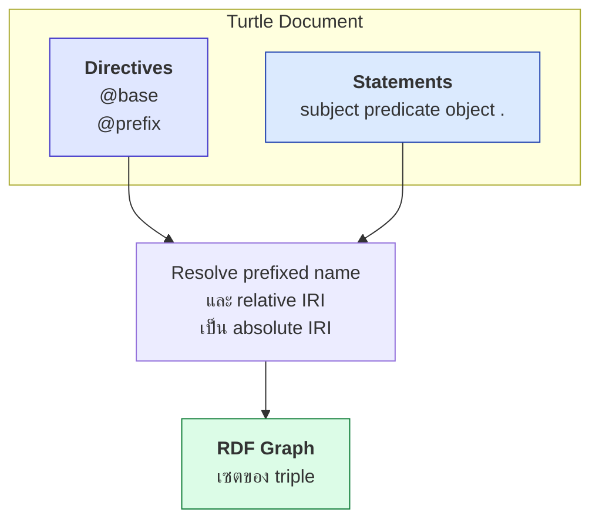

# 02.04 Turtle — Full Form

**Turtle (Terse RDF Triple Language)** เป็น serialization format ที่อ่านง่ายที่สุดสำหรับมนุษย์ และเป็น **format หลักของคอร์สนี้**
บทนี้สอน Turtle ใน **full form** คือเขียนทุก triple แยกบรรทัดครบ subject–predicate–object ไม่ใช้ตัวย่อใด ๆ
เพื่อให้เห็นโครงสร้างที่แท้จริงก่อน แล้วค่อยเรียน shorthand ใน [02.05](02.05-turtle-shorthand.md)

---

## โครงสร้างเอกสาร Turtle

เอกสาร Turtle ประกอบด้วยสองส่วน:

```turtle
# ---------- (1) Directives ----------
@base   <http://example.org/> .
@prefix ex:   <http://example.org/> .
@prefix foaf: <http://xmlns.com/foaf/0.1/> .

# ---------- (2) Triple statements ----------
ex:MarieCurie foaf:name "Marie Curie" .
ex:MarieCurie foaf:knows ex:PierreCurie .
```

---

## Directive: `@prefix`

`@prefix` ประกาศตัวย่อของ namespace IRI เพื่อไม่ต้องเขียน IRI เต็มทุกครั้ง

```turtle
@prefix foaf: <http://xmlns.com/foaf/0.1/> .

# สองบรรทัดนี้มีความหมายเหมือนกัน 100%
ex:MarieCurie foaf:name "Marie Curie" .
ex:MarieCurie <http://xmlns.com/foaf/0.1/name> "Marie Curie" .
```

**กฎที่ต้องจำ**

| กฎ | ตัวอย่าง |
| --- | --- |
| ต้องมี `:` ปิดท้าย prefix label | `@prefix foaf: <...> .` ✅ / `@prefix foaf <...> .` ❌ |
| ต้องมี `.` ปิดท้าย directive | `@prefix ex: <http://example.org/> .` |
| IRI ต้องอยู่ใน `< >` | `<http://example.org/>` |
| prefix ว่าง (`:`) ใช้ได้ | `@prefix : <http://example.org/> .` แล้วเขียน `:MarieCurie` |
| ประกาศซ้ำได้ ตัวหลังทับตัวแรก | (ควรหลีกเลี่ยง — ทำให้อ่านสับสน) |
| ต้องประกาศ **ก่อน** ใช้ | Turtle parse แบบ streaming |

**การเชื่อม prefix กับ local name** เป็นการต่อ string ตรง ๆ:

```
foaf:  →  http://xmlns.com/foaf/0.1/
name   →  name
────────────────────────────────────
foaf:name  →  http://xmlns.com/foaf/0.1/name
```

> ⚠️ นี่คือเหตุผลที่ namespace IRI ควรลงท้ายด้วย `/` หรือ `#` เสมอ
> ถ้าเขียน `@prefix foaf: <http://xmlns.com/foaf/0.1>` (ไม่มี `/`) จะได้ `...0.1name` ซึ่งผิด

---

## Directive: `@base`

`@base` กำหนด IRI ฐานสำหรับ **relative IRI**

```turtle
@base <http://example.org/data/> .

<marie>       <http://example.org/name> "Marie Curie" .
<pierre>      <http://example.org/name> "Pierre Curie" .
<../about>    <http://example.org/name> "About page" .
```

ผลลัพธ์หลัง resolve:

| Relative IRI | Absolute IRI |
| --- | --- |
| `<marie>` | `http://example.org/data/marie` |
| `<pierre>` | `http://example.org/data/pierre` |
| `<../about>` | `http://example.org/about` |
| `<>` | `http://example.org/data/` (เอกสารปัจจุบัน) |

การ resolve ใช้กฎเดียวกับ URL resolution ของเว็บทั่วไป (RFC 3986)

---

## รูปแบบ SPARQL-style: `PREFIX` และ `BASE`

Turtle 1.1 รองรับรูปแบบที่เหมือน SPARQL ด้วย **ไม่มีจุดปิดท้าย และไม่มี `@`**

```turtle
PREFIX ex: <http://example.org/>
BASE <http://example.org/>

ex:MarieCurie ex:name "Marie Curie" .
```

ใช้ได้ทั้งสองแบบ แต่ **ควรเลือกใช้แบบเดียวทั้งไฟล์** คอร์สนี้ใช้ `@prefix` เป็นหลักเพราะพบบ่อยกว่าในเอกสารทั่วไป

---

## Triple statement แบบเต็ม

Full form คือ: **หนึ่งบรรทัด หนึ่ง triple ปิดด้วยจุด**

```turtle
@prefix ex:   <http://example.org/> .
@prefix rdf:  <http://www.w3.org/1999/02/22-rdf-syntax-ns#> .
@prefix foaf: <http://xmlns.com/foaf/0.1/> .
@prefix xsd:  <http://www.w3.org/2001/XMLSchema#> .

ex:MarieCurie rdf:type ex:Scientist .
ex:MarieCurie foaf:name "Marie Curie" .
ex:MarieCurie foaf:givenName "Marie" .
ex:MarieCurie foaf:familyName "Curie" .
ex:MarieCurie ex:birthDate "1867-11-07"^^xsd:date .
ex:MarieCurie ex:birthPlace ex:Warsaw .
ex:MarieCurie ex:worksAt ex:UniversityOfParis .
ex:MarieCurie foaf:knows ex:PierreCurie .
ex:MarieCurie foaf:knows ex:AlbertEinstein .
ex:MarieCurie ex:wonAward ex:NobelPrizeInPhysics .
ex:MarieCurie ex:wonAward ex:NobelPrizeInChemistry .
```

ข้อดีของ full form: **เห็นชัดว่ามีกี่ triple** (นับบรรทัดได้เลย — 11 triple)
ข้อเสีย: **ซ้ำซาก** — `ex:MarieCurie` ปรากฏ 11 ครั้ง

---

## กฎ syntax ทั้งหมด

### 1. Comment

```turtle
# comment เริ่มด้วย # ไปจนจบบรรทัด
ex:MarieCurie foaf:name "Marie Curie" .   # comment ท้ายบรรทัดก็ได้
```

Turtle **ไม่มี block comment** (`/* */` ใช้ไม่ได้)

### 2. IRI

```turtle
<http://example.org/MarieCurie>            # absolute IRI
<marie>                                     # relative IRI (ต้องมี @base)
ex:MarieCurie                               # prefixed name
ex:                                         # prefixed name ที่ local part ว่าง → http://example.org/
```

### 3. Literal

```turtle
"simple string"                             # xsd:string
'single quotes ก็ได้'                        # เหมือนกัน
"""multi-line
string ข้ามบรรทัดได้"""                      # triple-quoted
'''ใช้ single quote สามตัวก็ได้'''
"typed"^^xsd:string                         # typed literal
"tagged"@en                                 # language-tagged
```

**Escape sequence ใน string**

| Escape | ความหมาย |
| --- | --- |
| `\"` | double quote |
| `\'` | single quote |
| `\\` | backslash |
| `\n` | newline |
| `\t` | tab |
| `\u00E9` | Unicode 4 หลัก (é) |
| `\U0001F600` | Unicode 8 หลัก |

```turtle
ex:quote ex:text "She said \"Nothing in life is to be feared\"." .
ex:path  ex:value "C:\\Users\\marie" .
```

### 4. Numeric literal — เขียนแบบไม่มีเครื่องหมายคำพูดได้

```turtle
ex:a ex:count 42 .          # เท่ากับ "42"^^xsd:integer
ex:b ex:price 3.14 .        # เท่ากับ "3.14"^^xsd:decimal
ex:c ex:big   1.0e6 .       # เท่ากับ "1.0e6"^^xsd:double
ex:d ex:flag  true .        # เท่ากับ "true"^^xsd:boolean
```

| เขียนย่อ | ขยายเป็น |
| --- | --- |
| `42` | `"42"^^xsd:integer` |
| `-17` | `"-17"^^xsd:integer` |
| `3.14` | `"3.14"^^xsd:decimal` |
| `1.0e6` | `"1.0e6"^^xsd:double` |
| `true` / `false` | `"true"^^xsd:boolean` |

### 5. `a` เป็นตัวย่อของ `rdf:type`

```turtle
ex:MarieCurie a ex:Scientist .
# เหมือนกับ
ex:MarieCurie rdf:type ex:Scientist .
# เหมือนกับ
ex:MarieCurie <http://www.w3.org/1999/02/22-rdf-syntax-ns#type> ex:Scientist .
```

`a` ใช้ได้เฉพาะตำแหน่ง **predicate** เท่านั้น

### 6. Blank node label

```turtle
_:addr1 ex:city "Paris" .
_:addr1 ex:street "12 Rue Cuvier" .
```

label ต้องขึ้นต้นด้วย `_:` และมี scope แค่ในเอกสารนั้น

### 7. Whitespace

Turtle ไม่สนใจ whitespace — จะเขียนหลายบรรทัดหรือบรรทัดเดียวก็ได้ แต่ควรจัดให้อ่านง่าย

---

## ตัวอักษรที่ต้อง escape ใน local name

ถ้า local name มีอักขระพิเศษ ต้อง escape ด้วย `\`

```turtle
@prefix ex: <http://example.org/> .

ex:file\.txt      ex:type "text" .     # ex:file.txt
ex:a\-b           ex:type "hyphen" .   # ex:a-b
ex:100\%          ex:value 1 .         # ex:100%
```

อักขระที่ต้อง escape: `~ . - ! $ & ' ( ) * + , ; = / ? # @ %`

> 💡 ถ้าเลี่ยงได้ **อย่าใส่อักขระพิเศษใน IRI** ตั้งแต่แรก — ใช้ `-` หรือ camelCase แทน

---

## ตัวอย่างเอกสาร Turtle เต็มรูปแบบ

```turtle
# ============================================================
# Scientists dataset — full form
# ============================================================

@base   <http://example.org/> .
@prefix ex:   <http://example.org/> .
@prefix rdf:  <http://www.w3.org/1999/02/22-rdf-syntax-ns#> .
@prefix rdfs: <http://www.w3.org/2000/01/rdf-schema#> .
@prefix foaf: <http://xmlns.com/foaf/0.1/> .
@prefix xsd:  <http://www.w3.org/2001/XMLSchema#> .

# ----- Schema -----
ex:Scientist rdf:type rdfs:Class .
ex:Scientist rdfs:label "Scientist"@en .
ex:Scientist rdfs:comment "A person who conducts scientific research."@en .

# ----- Instances -----
ex:MarieCurie rdf:type ex:Scientist .
ex:MarieCurie foaf:name "Marie Curie" .
ex:MarieCurie ex:birthDate "1867-11-07"^^xsd:date .
ex:MarieCurie ex:awardCount 2 .
ex:MarieCurie ex:isLaureate true .
ex:MarieCurie foaf:knows ex:PierreCurie .

ex:PierreCurie rdf:type ex:Scientist .
ex:PierreCurie foaf:name "Pierre Curie" .
ex:PierreCurie ex:birthDate "1859-05-15"^^xsd:date .
ex:PierreCurie foaf:knows ex:MarieCurie .

# ----- Blank node -----
ex:MarieCurie ex:hasAddress _:addr1 .
_:addr1 ex:street "12 Rue Cuvier" .
_:addr1 ex:city "Paris" .
```

รวม **17 triple** — นับได้ตรง ๆ จากจำนวนบรรทัดที่ลงท้ายด้วย `.` (ไม่นับ directive)



---

## ตรวจสอบไฟล์ Turtle

```python
from rdflib import Graph

g = Graph()
g.parse("data/sample_triples.ttl", format="turtle")
print(f"{len(g)} triples")

# แสดง triple ทั้งหมดในรูป full form
for s, p, o in sorted(g):
    print(f"{s.n3(g.namespace_manager)} {p.n3(g.namespace_manager)} {o.n3(g.namespace_manager)} .")
```

หรือใช้ validator ออนไลน์ที่ `ttl.summerofcode.be` / `www.easyrdf.org/converter`

---

## Key Points

- เอกสาร Turtle = **directives** (`@prefix`, `@base`) + **triple statements** ทุก statement ปิดด้วย `.`
- `@prefix` เป็นการต่อ string ตรง ๆ — namespace IRI ต้องลงท้ายด้วย `/` หรือ `#` เสมอ
- `@base` ใช้ resolve **relative IRI** ตามกฎ RFC 3986 เหมือน URL ปกติ
- Turtle 1.1 รองรับรูปแบบ SPARQL-style (`PREFIX`/`BASE` ไม่มี `@` และไม่มีจุด) — เลือกใช้แบบเดียวทั้งไฟล์
- `a` เป็นตัวย่อของ `rdf:type` ใช้ได้เฉพาะตำแหน่ง predicate
- ตัวเลขและ `true`/`false` เขียนโดยไม่ต้องมีเครื่องหมายคำพูดได้ ระบบเติม datatype ให้อัตโนมัติ
- **Full form** ซ้ำซากแต่ **นับ triple ได้ตรง ๆ** เหมาะกับการเรียนและการ debug — [02.05](02.05-turtle-shorthand.md) จะสอนวิธีย่อ
