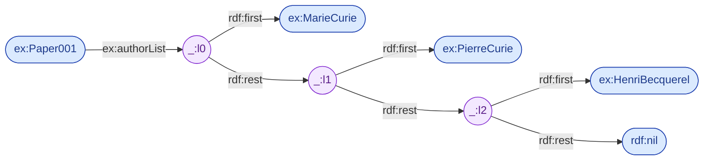

# 02.05 Turtle — Shorthand Syntax

Turtle มีตัวย่อ 4 กลุ่มที่ทำให้เอกสารสั้นลงมากโดย **ความหมายไม่เปลี่ยนแม้แต่น้อย**: `;` (subject เดิม), `,` (predicate เดิม),
`[]` (blank node) และ `()` (collection) บทนี้แสดง **full form คู่กับ shorthand แบบ side-by-side** ทุกกรณี
เพื่อให้เห็นชัดว่าตัวย่อขยายกลับเป็นอะไร — ซึ่งเป็นทักษะที่ต้องใช้ตลอดคอร์ส

---

## สรุปตัวย่อทั้งหมด

| สัญลักษณ์ | ชื่อ | ความหมาย |
| --- | --- | --- |
| `;` | predicate-object list | ใช้ **subject เดิม** ต่อ |
| `,` | object list | ใช้ **subject + predicate เดิม** ต่อ |
| `[ ... ]` | blank node property list | สร้าง blank node แบบ inline |
| `( ... )` | collection | สร้าง RDF list (`rdf:first`/`rdf:rest`) |
| `a` | — | ย่อของ `rdf:type` |
| `[]` | anonymous bnode | blank node เปล่า ๆ |

---

## 1. เครื่องหมาย `;` — subject เดียวกัน

<table>
<tr><th width="50%">Full form</th><th width="50%">Shorthand</th></tr>
<tr valign="top">
<td>

```turtle
@prefix ex:   <http://example.org/> .
@prefix foaf: <http://xmlns.com/foaf/0.1/> .

ex:MarieCurie a ex:Scientist .
ex:MarieCurie foaf:name "Marie Curie" .
ex:MarieCurie foaf:givenName "Marie" .
ex:MarieCurie foaf:familyName "Curie" .
ex:MarieCurie ex:worksAt ex:UniversityOfParis .
```

**5 triple** — เขียน `ex:MarieCurie` 5 ครั้ง

</td>
<td>

```turtle
@prefix ex:   <http://example.org/> .
@prefix foaf: <http://xmlns.com/foaf/0.1/> .

ex:MarieCurie a ex:Scientist ;
              foaf:name "Marie Curie" ;
              foaf:givenName "Marie" ;
              foaf:familyName "Curie" ;
              ex:worksAt ex:UniversityOfParis .
```

**5 triple เท่ากัน** — เขียน subject ครั้งเดียว

</td>
</tr>
</table>

**กฎ**: หลัง `;` ให้เขียนต่อด้วย `predicate object` เท่านั้น และ **statement สุดท้ายปิดด้วย `.`**

```turtle
ex:A ex:p1 ex:v1 ;      # ← ยังไม่จบ
     ex:p2 ex:v2 ;      # ← ยังไม่จบ
     ex:p3 ex:v3 .      # ← จบ statement
```

> 💡 `;` ตัวสุดท้ายก่อน `.` ใส่ได้ (`ex:p3 ex:v3 ; .`) parser ยอมรับ แต่ไม่แนะนำเพราะอ่านสับสน

---

## 2. เครื่องหมาย `,` — subject + predicate เดียวกัน

<table>
<tr><th width="50%">Full form</th><th width="50%">Shorthand</th></tr>
<tr valign="top">
<td>

```turtle
@prefix ex:   <http://example.org/> .
@prefix foaf: <http://xmlns.com/foaf/0.1/> .

ex:MarieCurie foaf:knows ex:PierreCurie .
ex:MarieCurie foaf:knows ex:AlbertEinstein .
ex:MarieCurie foaf:knows ex:HenriBecquerel .
ex:MarieCurie ex:wonAward ex:NobelPrizeInPhysics .
ex:MarieCurie ex:wonAward ex:NobelPrizeInChemistry .
```

**5 triple**

</td>
<td>

```turtle
@prefix ex:   <http://example.org/> .
@prefix foaf: <http://xmlns.com/foaf/0.1/> .

ex:MarieCurie
    foaf:knows  ex:PierreCurie ,
                ex:AlbertEinstein ,
                ex:HenriBecquerel ;
    ex:wonAward ex:NobelPrizeInPhysics ,
                ex:NobelPrizeInChemistry .
```

**5 triple เท่ากัน**

</td>
</tr>
</table>

**สังเกต**: `,` ใช้กับ object ที่เป็น **literal** ได้เช่นกัน — มีประโยชน์มากกับ multilingual label

```turtle
ex:Scientist rdfs:label "Scientist"@en ,
                        "นักวิทยาศาสตร์"@th ,
                        "Wissenschaftler"@de .
```

---

## 3. เครื่องหมาย `[ ]` — blank node

### 3.1 Blank node ที่มี property

<table>
<tr><th width="50%">Full form</th><th width="50%">Shorthand</th></tr>
<tr valign="top">
<td>

```turtle
@prefix ex: <http://example.org/> .

ex:MarieCurie ex:hasAddress _:b0 .
_:b0 ex:street "12 Rue Cuvier" .
_:b0 ex:city "Paris" .
_:b0 ex:postalCode "75005" .
```

**4 triple**

</td>
<td>

```turtle
@prefix ex: <http://example.org/> .

ex:MarieCurie ex:hasAddress [
    ex:street     "12 Rue Cuvier" ;
    ex:city       "Paris" ;
    ex:postalCode "75005"
] .
```

**4 triple เท่ากัน**

</td>
</tr>
</table>

### 3.2 Blank node เป็น subject

<table>
<tr><th width="50%">Full form</th><th width="50%">Shorthand</th></tr>
<tr valign="top">
<td>

```turtle
@prefix ex: <http://example.org/> .

_:b1 a ex:Person .
_:b1 ex:name "Anonymous Reviewer" .
_:b1 ex:reviewed ex:Paper001 .
```

</td>
<td>

```turtle
@prefix ex: <http://example.org/> .

[ a ex:Person ;
  ex:name "Anonymous Reviewer" ;
  ex:reviewed ex:Paper001 ] .
```

</td>
</tr>
</table>

### 3.3 Blank node ซ้อนกัน

```turtle
@prefix ex: <http://example.org/> .

ex:MarieCurie ex:hasEmployment [
    ex:employer ex:UniversityOfParis ;
    ex:period [
        ex:start 1906 ;
        ex:end   1934
    ]
] .
```

ขยายเป็น full form:

```turtle
ex:MarieCurie ex:hasEmployment _:b0 .
_:b0 ex:employer ex:UniversityOfParis .
_:b0 ex:period _:b1 .
_:b1 ex:start 1906 .
_:b1 ex:end 1934 .
```

### 3.4 `[]` เปล่า — anonymous bnode

```turtle
# "Marie รู้จักใครสักคน (แต่เราไม่รู้ว่าใคร)"
ex:MarieCurie foaf:knows [] .
```

ประโยชน์: ประกาศการมีอยู่โดยไม่ต้องระบุตัวตน — เป็นการใช้ **existential quantification** ในรูป RDF

---

## 4. วงเล็บ `( )` — RDF Collection (list)

RDF ไม่มีชนิดข้อมูล "list" โดยตรง แต่จำลองด้วย linked list ที่ใช้ `rdf:first`, `rdf:rest` และ `rdf:nil`

<table>
<tr><th width="50%">Full form</th><th width="50%">Shorthand</th></tr>
<tr valign="top">
<td>

```turtle
@prefix ex:  <http://example.org/> .
@prefix rdf: <http://www.w3.org/1999/02/22-rdf-syntax-ns#> .

ex:Paper001 ex:authorList _:l0 .

_:l0 rdf:first ex:MarieCurie .
_:l0 rdf:rest  _:l1 .

_:l1 rdf:first ex:PierreCurie .
_:l1 rdf:rest  _:l2 .

_:l2 rdf:first ex:HenriBecquerel .
_:l2 rdf:rest  rdf:nil .
```

**7 triple**

</td>
<td>

```turtle
@prefix ex:  <http://example.org/> .
@prefix rdf: <http://www.w3.org/1999/02/22-rdf-syntax-ns#> .

ex:Paper001 ex:authorList (
    ex:MarieCurie
    ex:PierreCurie
    ex:HenriBecquerel
) .
```

**7 triple เท่ากัน**

</td>
</tr>
</table>



**list เปล่า** เขียนเป็น `()` ซึ่งขยายเป็น `rdf:nil` โดยตรง (0 triple เพิ่ม):

```turtle
ex:Paper002 ex:authorList () .
# = ex:Paper002 ex:authorList rdf:nil .
```

> ⚠️ **ข้อควรระวัง**: RDF collection **query ด้วย SPARQL ยาก** ต้องไล่ `rdf:rest*`
> ถ้าไม่จำเป็นต้องมีลำดับจริง ๆ ให้ใช้ `,` (multiple object) แทน จะ query ง่ายกว่ามาก

| ต้องการ | ใช้ |
| --- | --- |
| ชุดของค่าที่ **ไม่สนลำดับ** | `ex:p v1 , v2 , v3 .` |
| ลำดับที่ **สำคัญ** (ลำดับผู้แต่ง, ขั้นตอน) | `ex:p ( v1 v2 v3 ) .` |
| ลำดับที่สำคัญแต่ query บ่อย | ใช้ `ex:position` ระบุเลขลำดับเอง |

---

## ตัวอย่างรวม: ก่อนและหลัง

<table>
<tr><th width="50%">Full form (23 บรรทัด)</th><th width="50%">Shorthand (13 บรรทัด)</th></tr>
<tr valign="top">
<td>

```turtle
@prefix ex:   <http://example.org/> .
@prefix rdf:  <http://www.w3.org/1999/02/22-rdf-syntax-ns#> .
@prefix rdfs: <http://www.w3.org/2000/01/rdf-schema#> .
@prefix foaf: <http://xmlns.com/foaf/0.1/> .
@prefix xsd:  <http://www.w3.org/2001/XMLSchema#> .

ex:MarieCurie rdf:type ex:Scientist .
ex:MarieCurie foaf:name "Marie Curie" .
ex:MarieCurie rdfs:label "Marie Curie"@en .
ex:MarieCurie rdfs:label "มารี กูว์รี"@th .
ex:MarieCurie ex:birthDate "1867-11-07"^^xsd:date .
ex:MarieCurie foaf:knows ex:PierreCurie .
ex:MarieCurie foaf:knows ex:AlbertEinstein .
ex:MarieCurie ex:hasAddress _:b0 .
_:b0 ex:street "12 Rue Cuvier" .
_:b0 ex:city "Paris" .
ex:MarieCurie ex:awardList _:l0 .
_:l0 rdf:first ex:NobelPhysics .
_:l0 rdf:rest _:l1 .
_:l1 rdf:first ex:NobelChemistry .
_:l1 rdf:rest rdf:nil .
```

</td>
<td>

```turtle
@prefix ex:   <http://example.org/> .
@prefix rdf:  <http://www.w3.org/1999/02/22-rdf-syntax-ns#> .
@prefix rdfs: <http://www.w3.org/2000/01/rdf-schema#> .
@prefix foaf: <http://xmlns.com/foaf/0.1/> .
@prefix xsd:  <http://www.w3.org/2001/XMLSchema#> .

ex:MarieCurie a ex:Scientist ;
    foaf:name    "Marie Curie" ;
    rdfs:label   "Marie Curie"@en , "มารี กูว์รี"@th ;
    ex:birthDate "1867-11-07"^^xsd:date ;
    foaf:knows   ex:PierreCurie , ex:AlbertEinstein ;
    ex:hasAddress [ ex:street "12 Rue Cuvier" ;
                    ex:city   "Paris" ] ;
    ex:awardList ( ex:NobelPhysics ex:NobelChemistry ) .
```

</td>
</tr>
</table>

**ทั้งสองฝั่งคือ graph เดียวกันทุกประการ — 14 triple เท่ากัน**

พิสูจน์ด้วย rdflib:

```python
from rdflib import Graph
from rdflib.compare import isomorphic

g_full  = Graph().parse("full.ttl", format="turtle")
g_short = Graph().parse("short.ttl", format="turtle")

print(len(g_full), len(g_short))          # 14 14
print(isomorphic(g_full, g_short))         # True
```

> `isomorphic()` เทียบ graph โดยไม่สนใจ label ของ blank node — เป็นวิธีที่ถูกต้องในการเทียบ RDF graph สองอัน

---

## แนวทางการจัดรูปแบบที่แนะนำ

```turtle
# ✅ ดี — จัด indent ให้ predicate ตรงกัน
ex:MarieCurie a ex:Scientist ;
    foaf:name    "Marie Curie" ;
    foaf:knows   ex:PierreCurie ,
                 ex:AlbertEinstein ;
    ex:worksAt   ex:UniversityOfParis .

# ❌ แย่ — อ่านยาก แม้จะถูก syntax
ex:MarieCurie a ex:Scientist;foaf:name "Marie Curie";foaf:knows ex:PierreCurie,ex:AlbertEinstein;ex:worksAt ex:UniversityOfParis.
```

**Convention ที่ใช้ในคอร์สนี้**

1. วาง `a` (rdf:type) เป็น predicate แรกเสมอ
2. เว้นบรรทัดว่างระหว่าง subject แต่ละตัว
3. indent predicate 4 spaces
4. เรียง object ที่มีหลายตัวลงบรรทัดใหม่เมื่อยาวเกิน 80 คอลัมน์
5. จัดกลุ่ม `@prefix` ไว้บนสุดและเรียงตามลำดับตัวอักษร

---

## Key Points

- ตัวย่อทั้งหมดเป็นเพียง **syntactic sugar** — graph ที่ได้เหมือนกันทุกประการกับ full form
- `;` = ใช้ **subject เดิม**, `,` = ใช้ **subject + predicate เดิม**
- `[ ... ]` สร้าง blank node แบบ inline ซ้อนกันได้ และ `[]` เปล่าคือ bnode ที่ไม่มี property
- `( ... )` สร้าง **RDF collection** ซึ่งขยายเป็น `rdf:first`/`rdf:rest`/`rdf:nil` — 1 item = 2 triple
- **collection query ยาก** ใช้เมื่อลำดับสำคัญจริงเท่านั้น มิฉะนั้นใช้ `,` แทน
- เทียบ graph สองอันด้วย `rdflib.compare.isomorphic()` ไม่ใช่เทียบข้อความในไฟล์
- ตั้งแต่บทนี้เป็นต้นไป คอร์สจะแสดง **full form คู่กับ shorthand** ทุกครั้งที่แนะนำ syntax ใหม่
