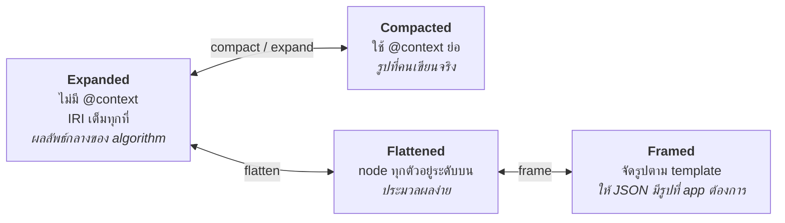
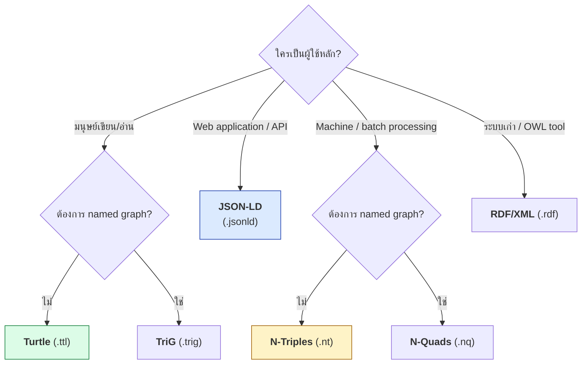

# 02.06 RDF Serialization Formats อื่น ๆ

RDF graph หนึ่งอันเขียนลงไฟล์ได้หลายรูปแบบ โดย **ความหมายไม่เปลี่ยน** — เหมือนข้อมูลชุดเดียวกันเก็บเป็น CSV, JSON หรือ Parquet ก็ได้
บทนี้แนะนำ **RDF/XML**, **N-Triples**, **N-Quads**, **TriG** และ **JSON-LD** พร้อมตารางเทียบว่าเมื่อไหร่ควรใช้อะไร
โดยใช้ graph เดียวกันทั้งหมดเป็นตัวอย่างเปรียบเทียบ

---

## Graph ตัวอย่างที่ใช้เปรียบเทียบ

```turtle
@prefix ex:   <http://example.org/> .
@prefix foaf: <http://xmlns.com/foaf/0.1/> .
@prefix xsd:  <http://www.w3.org/2001/XMLSchema#> .

ex:MarieCurie a foaf:Person ;
    foaf:name    "Marie Curie" ;
    ex:birthDate "1867-11-07"^^xsd:date ;
    foaf:knows   ex:PierreCurie .
```

**4 triple** — ต่อไปนี้คือ graph เดียวกันนี้ในทุก format

---

## 1. N-Triples

format ที่ **ง่ายที่สุด**: หนึ่งบรรทัดหนึ่ง triple, IRI เต็มเสมอ, ไม่มี prefix, ASCII เท่านั้น

```
<http://example.org/MarieCurie> <http://www.w3.org/1999/02/22-rdf-syntax-ns#type> <http://xmlns.com/foaf/0.1/Person> .
<http://example.org/MarieCurie> <http://xmlns.com/foaf/0.1/name> "Marie Curie" .
<http://example.org/MarieCurie> <http://example.org/birthDate> "1867-11-07"^^<http://www.w3.org/2001/XMLSchema#date> .
<http://example.org/MarieCurie> <http://xmlns.com/foaf/0.1/knows> <http://example.org/PierreCurie> .
```

| ข้อดี | ข้อเสีย |
| --- | --- |
| parse ง่ายและเร็วมาก | ไฟล์ใหญ่ (IRI ซ้ำทุกบรรทัด) |
| **streaming** ได้ — อ่านทีละบรรทัด | มนุษย์อ่านลำบาก |
| `diff`, `sort`, `grep`, `wc -l` ใช้ได้ตรง ๆ | ไม่มี named graph |
| line-based → แบ่งไฟล์ทำ parallel ได้ | |

**Use case จริง**: dump ขนาด TB, ข้อมูลเข้า Hadoop/Spark, การเทียบ graph สองเวอร์ชันด้วย `diff`

```bash
# นับ triple ในไฟล์ N-Triples ขนาดใหญ่ — ไม่ต้อง parse
wc -l dbpedia-dump.nt

# หา triple ที่เปลี่ยนระหว่างสองรุ่น
sort v1.nt > a.nt && sort v2.nt > b.nt && diff a.nt b.nt
```

---

## 2. N-Quads

N-Triples + คอลัมน์ที่ 4 สำหรับ **graph name**

```
<http://example.org/MarieCurie> <http://xmlns.com/foaf/0.1/name> "Marie Curie" <http://example.org/graph/wikipedia> .
<http://example.org/MarieCurie> <http://example.org/birthDate> "1868-01-01"^^<http://www.w3.org/2001/XMLSchema#date> <http://example.org/graph/old-archive> .
```

ใช้เมื่อต้อง dump **RDF Dataset ทั้งชุด** พร้อม provenance

---

## 3. Turtle

format หลักของคอร์สนี้ — ดูรายละเอียดใน [02.04](02.04-turtle-full.md) และ [02.05](02.05-turtle-shorthand.md)

| ข้อดี | ข้อเสีย |
| --- | --- |
| อ่านและเขียนด้วยมือง่ายที่สุด | parse ช้ากว่า N-Triples |
| กระชับ (prefix, `;`, `,`, `[]`, `()`) | streaming ทำได้ยากกว่า |
| เป็น subset ของ SPARQL syntax | ไม่มี named graph (ต้องใช้ TriG) |

---

## 4. TriG

Turtle + named graph

```turtle
@prefix ex:   <http://example.org/> .
@prefix foaf: <http://xmlns.com/foaf/0.1/> .

ex:graph/wikipedia {
    ex:MarieCurie a foaf:Person ;
        foaf:name "Marie Curie" .
}

ex:graph/hr {
    ex:MarieCurie ex:employeeId "EMP-0421" .
}
```

---

## 5. RDF/XML

format แรกสุดของ RDF (W3C Recommendation ปี 2004) — เขียนบน XML

```xml
<?xml version="1.0" encoding="UTF-8"?>
<rdf:RDF
    xmlns:rdf="http://www.w3.org/1999/02/22-rdf-syntax-ns#"
    xmlns:foaf="http://xmlns.com/foaf/0.1/"
    xmlns:ex="http://example.org/"
    xmlns:xsd="http://www.w3.org/2001/XMLSchema#">

  <foaf:Person rdf:about="http://example.org/MarieCurie">
    <foaf:name>Marie Curie</foaf:name>
    <ex:birthDate rdf:datatype="http://www.w3.org/2001/XMLSchema#date"
      >1867-11-07</ex:birthDate>
    <foaf:knows rdf:resource="http://example.org/PierreCurie"/>
  </foaf:Person>

</rdf:RDF>
```

| ข้อดี | ข้อเสีย |
| --- | --- |
| ใช้ XML tooling ได้ (XSLT, XPath, schema validation) | **verbose มาก** |
| รองรับกว้างที่สุดในระบบเก่า | มีหลายวิธีเขียน graph เดียวกัน → สับสน |
| OWL file จำนวนมากยังใช้ format นี้ | เขียนด้วยมือแทบเป็นไปไม่ได้ |

> ⚠️ **ข้อควรระวังที่คลาสสิก**: `rdf:about` = IRI ของ subject, `rdf:resource` = IRI ของ object
> สลับกันเมื่อไหร่ graph ผิดทันทีโดยไม่มี error

---

## 6. JSON-LD

RDF ที่เขียนในรูป JSON ปกติ — **format ที่ควรใช้เมื่อทำงานกับ Web API และ JavaScript**

```json
{
  "@context": {
    "ex": "http://example.org/",
    "foaf": "http://xmlns.com/foaf/0.1/",
    "xsd": "http://www.w3.org/2001/XMLSchema#",
    "name": "foaf:name",
    "knows": { "@id": "foaf:knows", "@type": "@id" },
    "birthDate": { "@id": "ex:birthDate", "@type": "xsd:date" }
  },
  "@id": "ex:MarieCurie",
  "@type": "foaf:Person",
  "name": "Marie Curie",
  "birthDate": "1867-11-07",
  "knows": "ex:PierreCurie"
}
```

### Keyword หลักของ JSON-LD

| Keyword | ความหมาย |
| --- | --- |
| `@context` | map ชื่อ field → IRI และกำหนด datatype |
| `@id` | IRI ของ node (= subject) |
| `@type` | `rdf:type` |
| `@value` | ค่าของ literal (ใช้เมื่อต้องระบุ datatype/language) |
| `@language` | language tag |
| `@graph` | ชุดของ node หลายตัว หรือ named graph |
| `@list` | RDF collection (มีลำดับ) |
| `@set` | ชุดที่ไม่มีลำดับ (เป็น default อยู่แล้ว) |
| `@reverse` | กลับทิศความสัมพันธ์ |

### รูปแบบ (JSON-LD Document Forms)



**ตัวอย่าง expanded form** ของข้อมูลชุดเดิม:

```json
[{
  "@id": "http://example.org/MarieCurie",
  "@type": ["http://xmlns.com/foaf/0.1/Person"],
  "http://xmlns.com/foaf/0.1/name": [{ "@value": "Marie Curie" }],
  "http://example.org/birthDate": [
    { "@value": "1867-11-07", "@type": "http://www.w3.org/2001/XMLSchema#date" }
  ],
  "http://xmlns.com/foaf/0.1/knows": [{ "@id": "http://example.org/PierreCurie" }]
}]
```

| ข้อดี | ข้อเสีย |
| --- | --- |
| เป็น JSON — ทุกภาษาโปรแกรม parse ได้ทันที | verbose กว่า Turtle |
| ฝังใน HTML ได้ (`<script type="application/ld+json">`) | `@context` ที่ซับซ้อนอ่านยาก |
| ระบบเดิมที่ใช้ JSON ค่อย ๆ เติม `@context` เข้าไปได้ | ต้อง fetch remote context (ควร cache) |
| Google/Bing รองรับเป็นทางการ | |

---

## 7. RDFa และ Microdata

ฝัง semantics ลงใน **HTML attribute** โดยตรง

```html
<!-- RDFa -->
<div vocab="https://schema.org/" typeof="Person" resource="http://example.org/MarieCurie">
  <span property="name">Marie Curie</span>
  <span property="birthDate" datatype="xsd:date" content="1867-11-07">7 Nov 1867</span>
</div>

<!-- Microdata -->
<div itemscope itemtype="https://schema.org/Person" itemid="http://example.org/MarieCurie">
  <span itemprop="name">Marie Curie</span>
  <meta itemprop="birthDate" content="1867-11-07">
</div>
```

**ข้อดี**: ข้อมูลที่แสดงกับข้อมูลที่ machine อ่านเป็นชุดเดียวกัน จึงไม่มีวันไม่ตรงกัน
**ข้อเสีย**: markup รกและแก้ยาก — ปัจจุบันจึงนิยม JSON-LD มากกว่า

---

## ตารางเปรียบเทียบ: เลือกใช้อะไรเมื่อไหร่

| Format | นามสกุล | MIME type | Named graph | อ่านง่าย | Streaming | ใช้เมื่อ |
| --- | --- | --- | :---: | :---: | :---: | --- |
| **Turtle** | `.ttl` | `text/turtle` | ❌ | ⭐⭐⭐⭐⭐ | ⚠️ | เขียน ontology, สอน, config |
| **TriG** | `.trig` | `application/trig` | ✅ | ⭐⭐⭐⭐ | ⚠️ | dataset ที่มี provenance |
| **N-Triples** | `.nt` | `application/n-triples` | ❌ | ⭐ | ✅ | dump ใหญ่, diff, big data |
| **N-Quads** | `.nq` | `application/n-quads` | ✅ | ⭐ | ✅ | dump dataset ทั้งชุด |
| **RDF/XML** | `.rdf`, `.owl` | `application/rdf+xml` | ❌ | ⭐⭐ | ⚠️ | ระบบเก่า, XML toolchain |
| **JSON-LD** | `.jsonld` | `application/ld+json` | ✅ | ⭐⭐⭐ | ❌ | Web API, ฝังใน HTML, JS |
| **RDFa** | (ใน `.html`) | `text/html` | ❌ | ⭐⭐ | ❌ | markup หน้าเว็บ (legacy) |

### Decision tree



---

## แปลง format ด้วย rdflib

รายละเอียดเต็มใน [02.08](02.08-python-rdflib.md) — ตัวอย่างเร็ว ๆ:

```python
from rdflib import Graph

g = Graph()
g.parse("data/sample_triples.ttl", format="turtle")

# serialize เป็น format ต่าง ๆ
g.serialize("out.nt",     format="nt")
g.serialize("out.rdf",    format="xml")
g.serialize("out.jsonld", format="json-ld", indent=2)
g.serialize("out.ttl",    format="turtle")

print(g.serialize(format="nt")[:200])
```

หรือแปลงจาก command line ด้วย `rapper` (จาก raptor2):

```bash
rapper -i turtle -o ntriples input.ttl > output.nt
rapper -i rdfxml -o turtle   input.rdf > output.ttl
```

---

## Key Points

- Serialization format คือ **เปลือกนอก** — graph เดียวกันเขียนได้ทุกรูปแบบโดยความหมายไม่เปลี่ยน
- **Turtle** = อ่านง่ายที่สุด เป็น default ของคอร์สนี้; **TriG** = Turtle + named graph
- **N-Triples/N-Quads** = หนึ่งบรรทัดหนึ่ง triple, streaming ได้, ใช้ `diff`/`sort`/`wc` ได้ตรง ๆ เหมาะกับ dump ขนาดใหญ่
- **RDF/XML** verbose และเขียนด้วยมือยาก แต่ยังพบใน OWL file และระบบเก่า — ระวังสับสน `rdf:about` กับ `rdf:resource`
- **JSON-LD** คือ RDF ที่เป็น JSON — เหมาะกับ Web API และฝังใน HTML; keyword หลักคือ `@context`, `@id`, `@type`, `@graph`
- JSON-LD มี 4 รูปแบบ: **expanded, compacted, flattened, framed** ใช้ต่างวัตถุประสงค์กัน
- **RDFa/Microdata** ฝังใน HTML attribute — ยังใช้ได้แต่ปัจจุบันนิยม JSON-LD มากกว่าเพราะแยกจาก layout
- แปลง format ได้ทันทีด้วย `rdflib` (`parse` → `serialize`) หรือ CLI `rapper`
