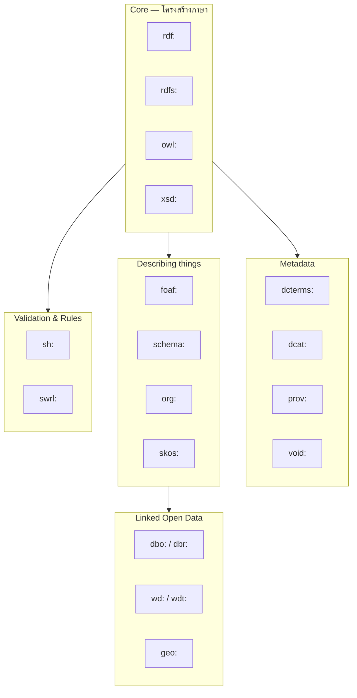

# 02.07 Prefix ที่พบบ่อย — Cheat Sheet

การจำ prefix มาตรฐานให้ได้ช่วยประหยัดเวลามหาศาล เพราะทุกไฟล์ RDF ที่คุณจะเจอในโลกจริงล้วนใช้ชุดเดิม ๆ ซ้ำ ๆ
บทนี้รวบรวม prefix ที่ต้องรู้ พร้อมบอกว่าแต่ละอันใช้ทำอะไร มี term สำคัญอะไรบ้าง
และเตือน **กับดักที่พบบ่อย** เช่น `dc:` กับ `dcterms:` ที่ไม่เหมือนกัน

---

## Core prefixes — ต้องจำให้ได้

```turtle
@prefix rdf:    <http://www.w3.org/1999/02/22-rdf-syntax-ns#> .
@prefix rdfs:   <http://www.w3.org/2000/01/rdf-schema#> .
@prefix owl:    <http://www.w3.org/2002/07/owl#> .
@prefix xsd:    <http://www.w3.org/2001/XMLSchema#> .
```

| Prefix | Namespace IRI | ใช้ทำอะไร |
| --- | --- | --- |
| `rdf:` | `http://www.w3.org/1999/02/22-rdf-syntax-ns#` | คำศัพท์แกนของ RDF |
| `rdfs:` | `http://www.w3.org/2000/01/rdf-schema#` | นิยาม class/property พื้นฐาน |
| `owl:` | `http://www.w3.org/2002/07/owl#` | ontology language ที่ expressive กว่า |
| `xsd:` | `http://www.w3.org/2001/XMLSchema#` | datatype ของ literal |

> 💡 สังเกตว่า **ทั้งสี่ลงท้ายด้วย `#`** ไม่ใช่ `/` — เขียนผิดเมื่อไหร่ IRI ผิดทันทีโดยไม่มี error

### Term ที่ใช้บ่อยในแต่ละ core prefix

```turtle
# ---------- rdf: ----------
rdf:type          # ชนิดของ resource (เขียนย่อว่า `a`)
rdf:Property      # class ของ property
rdf:first         # องค์ประกอบแรกของ collection
rdf:rest          # ส่วนที่เหลือของ collection
rdf:nil           # จุดจบของ collection
rdf:langString    # datatype ของ language-tagged literal
rdf:Statement     # ใช้ใน reification

# ---------- rdfs: ----------
rdfs:Class        # class ของ class
rdfs:subClassOf   # ความสัมพันธ์ลำดับชั้นของ class
rdfs:subPropertyOf
rdfs:domain       # class ของ subject ที่ใช้ property นี้
rdfs:range        # class ของ object
rdfs:label        # ชื่อที่มนุษย์อ่าน
rdfs:comment      # คำอธิบาย
rdfs:seeAlso      # ข้อมูลเพิ่มเติม
rdfs:isDefinedBy  # แหล่งนิยาม

# ---------- owl: ----------
owl:Class
owl:ObjectProperty
owl:DatatypeProperty
owl:sameAs
owl:differentFrom
owl:equivalentClass
owl:disjointWith
owl:inverseOf
owl:Restriction
owl:imports

# ---------- xsd: ----------
xsd:string  xsd:integer  xsd:decimal  xsd:double
xsd:boolean xsd:date     xsd:dateTime xsd:time
xsd:gYear   xsd:gMonth   xsd:anyURI   xsd:duration
```

---

## Metadata & description prefixes

```turtle
@prefix dc:      <http://purl.org/dc/elements/1.1/> .
@prefix dcterms: <http://purl.org/dc/terms/> .
@prefix dcat:    <http://www.w3.org/ns/dcat#> .
@prefix void:    <http://rdfs.org/ns/void#> .
@prefix prov:    <http://www.w3.org/ns/prov#> .
```

### ⚠️ กับดัก: `dc:` ไม่เท่ากับ `dcterms:`

| | `dc:` (DC Elements 1.1) | `dcterms:` (DCMI Terms) |
| --- | --- | --- |
| Namespace | `purl.org/dc/elements/1.1/` | `purl.org/dc/terms/` |
| จำนวน term | 15 | 70+ |
| Range | ไม่กำหนด (เป็น literal ก็ได้) | **กำหนดชัดเจน** |
| ตัวอย่าง | `dc:creator "Marie Curie"` | `dcterms:creator ex:MarieCurie` |
| สถานะ | legacy | **แนะนำให้ใช้** |

```turtle
# ❌ ไม่แนะนำ — creator เป็นแค่ string
ex:Paper001 dc:creator "Marie Curie" .

# ✅ แนะนำ — creator เป็น resource ที่ link ต่อได้
ex:Paper001 dcterms:creator ex:MarieCurie .
```

---

## Social & people prefixes

```turtle
@prefix foaf: <http://xmlns.com/foaf/0.1/> .
@prefix vcard: <http://www.w3.org/2006/vcard/ns#> .
@prefix org:   <http://www.w3.org/ns/org#> .
```

| Term ที่ใช้บ่อย | ความหมาย |
| --- | --- |
| `foaf:Person` | คน |
| `foaf:Organization` | องค์กร |
| `foaf:name`, `foaf:givenName`, `foaf:familyName` | ชื่อ |
| `foaf:knows` | รู้จัก |
| `foaf:mbox` | email (เป็น `mailto:` IRI) |
| `foaf:homepage` | หน้าเว็บ |
| `foaf:Document` | เอกสาร |

---

## Web markup prefix

```turtle
@prefix schema: <https://schema.org/> .
```

> ⚠️ **ต้องเป็น `https://` และลงท้ายด้วย `/`** — เดิมเคยใช้ `http://schema.org/`
> ปัจจุบัน schema.org ยอมรับทั้งสองแบบ แต่ **รูปแบบทางการคือ `https://schema.org/`**

---

## Knowledge organization prefix

```turtle
@prefix skos:    <http://www.w3.org/2004/02/skos/core#> .
@prefix skosxl:  <http://www.w3.org/2008/05/skos-xl#> .
```

| Term | ความหมาย |
| --- | --- |
| `skos:Concept` | แนวคิดใน thesaurus |
| `skos:ConceptScheme` | ชุดของแนวคิด |
| `skos:prefLabel` | ชื่อหลัก (หนึ่งเดียวต่อภาษา) |
| `skos:altLabel` | ชื่อพ้อง |
| `skos:broader` / `skos:narrower` | กว้างกว่า / แคบกว่า |
| `skos:related` | เกี่ยวข้องกัน |

---

## Linked Open Data prefixes

```turtle
@prefix dbo:   <http://dbpedia.org/ontology/> .
@prefix dbr:   <http://dbpedia.org/resource/> .
@prefix dbp:   <http://dbpedia.org/property/> .
@prefix wd:    <http://www.wikidata.org/entity/> .
@prefix wdt:   <http://www.wikidata.org/prop/direct/> .
@prefix wikibase: <http://wikiba.se/ontology#> .
@prefix geo:   <http://www.w3.org/2003/01/geo/wgs84_pos#> .
@prefix geonames: <http://www.geonames.org/ontology#> .
```

| Prefix | ใช้กับ |
| --- | --- |
| `dbr:` | **resource** ของ DBpedia (instance) เช่น `dbr:Marie_Curie` |
| `dbo:` | **ontology** ของ DBpedia (class/property ที่ผ่านการ curate) |
| `dbp:` | property ดิบจาก infobox (คุณภาพต่ำกว่า `dbo:`) |
| `wd:` | Wikidata item เช่น `wd:Q7186` |
| `wdt:` | Wikidata property แบบ direct (ค่าล้วน ไม่มี qualifier) |

---

## Validation & rules

```turtle
@prefix sh:   <http://www.w3.org/ns/shacl#> .
@prefix swrl: <http://www.w3.org/2003/11/swrl#> .
@prefix swrlb: <http://www.w3.org/2003/11/swrlb#> .
```

---

## Domain-specific prefixes ที่พบบ่อย

```turtle
@prefix obo:  <http://purl.obolibrary.org/obo/> .      # biomedical ontologies
@prefix bibo: <http://purl.org/ontology/bibo/> .       # bibliographic
@prefix mo:   <http://purl.org/ontology/mo/> .         # music
@prefix gr:   <http://purl.org/goodrelations/v1#> .    # e-commerce
@prefix time: <http://www.w3.org/2006/time#> .         # temporal
@prefix qudt: <http://qudt.org/schema/qudt/> .         # units & quantities
```

---

## Prefix block มาตรฐานที่แนะนำให้คัดลอกไปใช้

```turtle
@prefix rdf:     <http://www.w3.org/1999/02/22-rdf-syntax-ns#> .
@prefix rdfs:    <http://www.w3.org/2000/01/rdf-schema#> .
@prefix owl:     <http://www.w3.org/2002/07/owl#> .
@prefix xsd:     <http://www.w3.org/2001/XMLSchema#> .
@prefix dcterms: <http://purl.org/dc/terms/> .
@prefix foaf:    <http://xmlns.com/foaf/0.1/> .
@prefix skos:    <http://www.w3.org/2004/02/skos/core#> .
@prefix schema:  <https://schema.org/> .
@prefix sh:      <http://www.w3.org/ns/shacl#> .
@prefix ex:      <http://example.org/> .
```

---

## แผนที่ prefix ตามบทบาท



---

## ค้นหา prefix ที่ไม่รู้จัก

| เครื่องมือ | URL | ใช้ทำอะไร |
| --- | --- | --- |
| **prefix.cc** | `prefix.cc` | ค้นหา namespace จาก prefix และกลับกัน |
| **LOV** | `lov.linkeddata.es` | Linked Open Vocabularies — ค้น vocabulary ตามคำ |
| **BioPortal** | `bioportal.bioontology.org` | ontology ทางชีวการแพทย์ |

`prefix.cc` มี API ที่ใช้ในสคริปต์ได้:

```bash
curl -s https://prefix.cc/foaf.file.ttl
# @prefix foaf: <http://xmlns.com/foaf/0.1/> .
```

```python
import requests

def lookup_prefix(prefix: str) -> str:
    """ดึง namespace IRI จาก prefix.cc"""
    url = f"https://prefix.cc/{prefix}.file.json"
    return requests.get(url, timeout=10).json()[prefix]

print(lookup_prefix("skos"))
# http://www.w3.org/2004/02/skos/core#
```

---

## กับดักที่พบบ่อย

| กับดัก | ผิดอย่างไร | แก้ |
| --- | --- | --- |
| ลืม `#` ท้าย core namespace | `rdfs:label` → `...rdf-schemalabel` | ตรวจให้ลงท้าย `#` |
| ใช้ `dc:` แทน `dcterms:` | range ไม่ชัด link ไม่ได้ | ใช้ `dcterms:` |
| `http://schema.org/` | ไม่ตรงกับรูปแบบทางการ | ใช้ `https://schema.org/` |
| สร้าง prefix เอง ทั้งที่มีมาตรฐานอยู่แล้ว | ไม่ interoperable | ค้น LOV ก่อนเสมอ |
| ใช้ `dbp:` แทน `dbo:` | ข้อมูลดิบคุณภาพต่ำ | ใช้ `dbo:` ถ้ามี |
| ประกาศ prefix แต่ไม่ได้ใช้ | ไฟล์รก | ลบออก (rdflib serialize จะตัดให้เอง) |

---

## Key Points

- Core prefix ที่ต้องจำ: **`rdf:` `rdfs:` `owl:` `xsd:`** — ทั้งสี่ลงท้ายด้วย **`#`**
- **`dc:` ≠ `dcterms:`** — ใช้ `dcterms:` เสมอเพราะ range กำหนดชัดและ link ต่อได้
- schema.org รูปแบบทางการคือ **`https://schema.org/`** (มี `s` และลงท้าย `/`)
- DBpedia แยกสาม namespace: `dbr:` (instance), `dbo:` (ontology ที่ curate แล้ว), `dbp:` (ข้อมูลดิบ)
- Wikidata ใช้ `wd:` สำหรับ item (Q-number) และ `wdt:` สำหรับ property แบบ direct (P-number)
- ค้น prefix ที่ไม่รู้จักได้ที่ **prefix.cc** และค้น vocabulary ทั้งตัวได้ที่ **LOV**
- **อย่าสร้าง vocabulary เองก่อนค้นหาว่ามีมาตรฐานอยู่แล้วหรือไม่** — เป็นหลักสำคัญของ [Chapter 09](../09-well-known-ontologies/09.09-reusing-ontologies.md)
