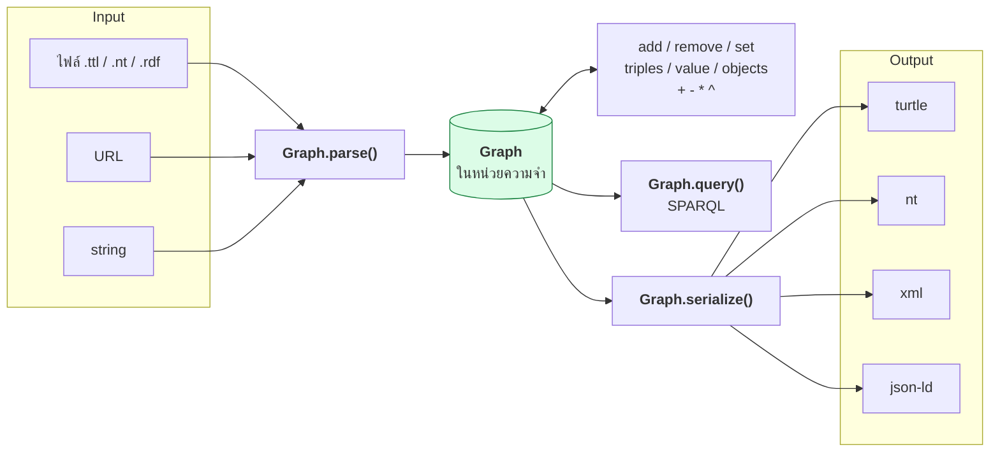

# 02.08 Python: rdflib

**rdflib** คือ library หลักสำหรับทำงานกับ RDF ใน Python — สร้าง graph, เพิ่ม/ลบ triple, parse และ serialize ทุก format
รวมถึงรัน SPARQL ได้ในตัว บทนี้พาใช้ API ที่จำเป็นทั้งหมดสำหรับ Chapter 02 พร้อมโค้ดที่รันได้จริง

> 📁 ไฟล์เต็ม: [`code/ch02/create_graph.py`](../code/ch02/create_graph.py) และ [`code/ch02/serialize_formats.py`](../code/ch02/serialize_formats.py)

---

## ติดตั้งและ import

```bash
pip install rdflib
```

```python
from rdflib import BNode, Graph, Literal, Namespace, URIRef
from rdflib.namespace import DCTERMS, FOAF, OWL, RDF, RDFS, SKOS, XSD
```

| Class | แทนอะไรใน RDF |
| --- | --- |
| `Graph` | RDF graph (เซตของ triple) |
| `URIRef` | IRI |
| `Literal` | literal (มี `datatype` และ `lang`) |
| `BNode` | blank node |
| `Namespace` | ตัวช่วยสร้าง URIRef จาก namespace |

---

## สร้าง Graph และ Namespace

```python
from rdflib import Graph, Namespace
from rdflib.namespace import FOAF, RDF, RDFS

EX = Namespace("http://example.org/")

g = Graph()

# bind ทำให้ serialize ออกมาเป็น ex: แทน IRI เต็ม
g.bind("ex", EX)
g.bind("foaf", FOAF)
```

`Namespace` ใช้ได้สองแบบ:

```python
EX.MarieCurie          # attribute access  -> http://example.org/MarieCurie
EX["person/marie"]     # item access (ใช้เมื่อชื่อมี / หรืออักขระพิเศษ)
```

---

## เพิ่ม triple

```python
from rdflib import BNode, Literal
from rdflib.namespace import XSD

# object เป็น IRI
g.add((EX.MarieCurie, RDF.type, EX.Scientist))
g.add((EX.MarieCurie, FOAF.knows, EX.PierreCurie))

# object เป็น plain literal
g.add((EX.MarieCurie, FOAF.name, Literal("Marie Curie")))

# language-tagged literal
g.add((EX.MarieCurie, RDFS.label, Literal("Marie Curie", lang="en")))
g.add((EX.MarieCurie, RDFS.label, Literal("มารี กูว์รี", lang="th")))

# typed literal — ระบุเองหรือให้ rdflib เดาจากชนิดข้อมูล Python
g.add((EX.MarieCurie, EX.birthDate, Literal("1867-11-07", datatype=XSD.date)))
g.add((EX.MarieCurie, EX.awardCount, Literal(2)))       # -> xsd:integer
g.add((EX.MarieCurie, EX.isLaureate, Literal(True)))    # -> xsd:boolean

# blank node
address = BNode()
g.add((EX.MarieCurie, EX.hasAddress, address))
g.add((address, EX.city, Literal("Paris")))
```

### rdflib เดา datatype จากชนิด Python อย่างไร

| Python | Datatype ที่ได้ |
| --- | --- |
| `str` | `xsd:string` (ถ้าไม่ระบุ lang) |
| `int` | `xsd:integer` |
| `float` | `xsd:double` |
| `decimal.Decimal` | `xsd:decimal` |
| `bool` | `xsd:boolean` |
| `datetime.date` | `xsd:date` |
| `datetime.datetime` | `xsd:dateTime` |

> ⚠️ `Literal("2")` ≠ `Literal(2)` — ตัวแรกเป็น string ตัวหลังเป็น integer

---

## RDF Collection

```python
from rdflib import BNode
from rdflib.collection import Collection

head = BNode()
g.add((EX.MarieCurie, EX.awardList, head))
Collection(g, head, [EX.NobelPrizeInPhysics, EX.NobelPrizeInChemistry])
```

Serialize ออกมาได้ shorthand `( ... )` ตรงกับที่เรียนใน [02.05](02.05-turtle-shorthand.md)

---

## ค้นหาใน graph

```python
# triples() — pattern matching, None = wildcard
for s, p, o in g.triples((EX.MarieCurie, None, None)):
    print(p, o)

# subjects / predicates / objects — คืน generator ของตำแหน่งเดียว
for s in g.subjects(RDF.type, EX.Scientist):
    print(s)

for label in g.objects(EX.MarieCurie, RDFS.label):
    print(label, label.language)

# value() — คืนค่าเดียว (หรือ None) ใช้เมื่อรู้ว่ามีค่าเดียว
name = g.value(EX.MarieCurie, FOAF.name)

# ตรวจการมีอยู่ของ triple
if (EX.MarieCurie, FOAF.knows, EX.PierreCurie) in g:
    print("Marie knows Pierre")

# iterate ทุก triple
for s, p, o in g:
    ...

print(len(g))   # จำนวน triple
```

---

## แก้ไขและลบ

```python
# ลบ triple เดียว
g.remove((EX.MarieCurie, EX.awardCount, Literal(2)))

# ลบตาม pattern (None = ทุกค่า)
g.remove((EX.MarieCurie, EX.awardCount, None))

# set() — แทนที่ค่าเดิมทั้งหมดของ (subject, predicate)
g.set((EX.MarieCurie, EX.awardCount, Literal(3)))
```

---

## Graph operations

```python
from rdflib.compare import isomorphic

g3 = g1 + g2     # union
g3 = g1 * g2     # intersection
g3 = g1 - g2     # difference
g3 = g1 ^ g2     # symmetric difference (xor)

# เทียบ graph สองอันอย่างถูกต้อง — จัดการ blank node ให้
print(isomorphic(g1, g2))
```

> ⚠️ **อย่าเทียบ graph ด้วยการเทียบข้อความในไฟล์** เพราะลำดับ triple และ label ของ bnode เปลี่ยนได้
> ให้ใช้ `isomorphic()` เสมอ

---

## Parse — อ่านเข้ามา

```python
g = Graph()

g.parse("data/sample_triples.ttl", format="turtle")       # จากไฟล์
g.parse("https://schema.org/version/latest/schemaorg-current-https.ttl")  # จาก URL
g.parse(data=turtle_string, format="turtle")              # จาก string

# rdflib เดา format จากนามสกุลไฟล์ได้ ถ้าไม่ระบุ
g.parse("data/sample_triples.ttl")
```

| ค่า `format` | Serialization |
| --- | --- |
| `"turtle"` / `"ttl"` | Turtle |
| `"nt"` | N-Triples |
| `"xml"` | RDF/XML |
| `"json-ld"` | JSON-LD |
| `"trig"` | TriG |
| `"nquads"` | N-Quads |
| `"n3"` | Notation3 |

---

## Serialize — เขียนออก

```python
# คืนเป็น string
turtle_text = g.serialize(format="turtle")
print(turtle_text)

# เขียนลงไฟล์
g.serialize(destination="out.ttl",    format="turtle")
g.serialize(destination="out.nt",     format="nt")
g.serialize(destination="out.rdf",    format="xml")
g.serialize(destination="out.jsonld", format="json-ld", indent=2)
```

### ตัวอย่าง output ของ graph เดียวกันทุก format

```python
from rdflib import Graph, Literal, Namespace
from rdflib.namespace import FOAF, RDF

EX = Namespace("http://example.org/")
g = Graph()
g.bind("ex", EX)
g.bind("foaf", FOAF)
g.add((EX.MarieCurie, RDF.type, FOAF.Person))
g.add((EX.MarieCurie, FOAF.name, Literal("Marie Curie")))

for fmt in ["turtle", "nt", "xml", "json-ld"]:
    print(f"===== {fmt} =====")
    print(g.serialize(format=fmt))
```

Expected output:

```
===== turtle =====
@prefix ex: <http://example.org/> .
@prefix foaf: <http://xmlns.com/foaf/0.1/> .

ex:MarieCurie a foaf:Person ;
    foaf:name "Marie Curie" .

===== nt =====
<http://example.org/MarieCurie> <http://www.w3.org/1999/02/22-rdf-syntax-ns#type> <http://xmlns.com/foaf/0.1/Person> .
<http://example.org/MarieCurie> <http://xmlns.com/foaf/0.1/name> "Marie Curie" .

===== xml =====
<?xml version="1.0" encoding="utf-8"?>
<rdf:RDF xmlns:foaf="http://xmlns.com/foaf/0.1/"
   xmlns:rdf="http://www.w3.org/1999/02/22-rdf-syntax-ns#">
  <foaf:Person rdf:about="http://example.org/MarieCurie">
    <foaf:name>Marie Curie</foaf:name>
  </foaf:Person>
</rdf:RDF>

===== json-ld =====
[{"@id":"http://example.org/MarieCurie","@type":["http://xmlns.com/foaf/0.1/Person"],
  "http://xmlns.com/foaf/0.1/name":[{"@value":"Marie Curie"}]}]
```

### JSON-LD แบบ compacted ด้วย context

```python
context = {
    "ex": "http://example.org/",
    "foaf": "http://xmlns.com/foaf/0.1/",
    "name": "foaf:name",
}
print(g.serialize(format="json-ld", context=context, indent=2))
```

```json
{
  "@context": { "ex": "http://example.org/", "foaf": "http://xmlns.com/foaf/0.1/", "name": "foaf:name" },
  "@id": "ex:MarieCurie",
  "@type": "foaf:Person",
  "name": "Marie Curie"
}
```

---

## รัน SPARQL บน graph ในหน่วยความจำ

```python
q = """
PREFIX foaf: <http://xmlns.com/foaf/0.1/>
PREFIX ex:   <http://example.org/>

SELECT ?person ?name
WHERE {
  ?person a ex:Scientist ;
          foaf:name ?name .
}
ORDER BY ?name
"""

for row in g.query(q):
    print(row.person, "->", row.name)
```

รายละเอียด SPARQL เต็มอยู่ใน [Chapter 06](../06-sparql/06.01-sparql-intro.md)

---

## Flow การทำงานทั้งหมด



---

## กับดักที่พบบ่อยใน rdflib

| ปัญหา | สาเหตุ | วิธีแก้ |
| --- | --- | --- |
| `Literal(2) != Literal("2")` | คนละ datatype | ระบุ `datatype=` ให้ชัด |
| เทียบ graph ด้วย string แล้วไม่ตรง | ลำดับและ bnode label เปลี่ยน | ใช้ `isomorphic()` |
| serialize แล้วเห็น IRI เต็ม | ลืม `g.bind()` | bind prefix ก่อน serialize |
| `EX.person/marie` ผิด syntax | มี `/` ในชื่อ | ใช้ `EX["person/marie"]` |
| parse URL แล้วช้า/ค้าง | ดึงผ่าน network ทุกครั้ง | cache ไฟล์ไว้ local |
| `g.value()` คืน `None` | มีหลายค่าหรือไม่มีเลย | ใช้ `g.objects()` แทน |

---

## Key Points

- rdflib มี class หลัก 5 ตัว: **`Graph`, `URIRef`, `Literal`, `BNode`, `Namespace`**
- `g.bind(prefix, namespace)` จำเป็นเสมอถ้าอยากให้ serialize ออกมาอ่านง่าย
- `Literal` เดา datatype จากชนิด Python — `Literal(2)` เป็น `xsd:integer` แต่ `Literal("2")` เป็น `xsd:string`
- ค้นหาด้วย `triples()` (pattern + `None` เป็น wildcard), `subjects()/objects()`, `value()` (ค่าเดียว)
- Graph รองรับ operator ทางเซต: `+` union, `*` intersection, `-` difference, `^` xor
- **เทียบ graph ด้วย `rdflib.compare.isomorphic()`** ไม่ใช่เทียบข้อความ
- `parse()` และ `serialize()` แปลง format ได้ทุกทิศทาง — turtle, nt, xml, json-ld, trig, nquads
- `g.query()` รัน SPARQL บน graph ในหน่วยความจำได้ทันที ไม่ต้องมี triplestore
