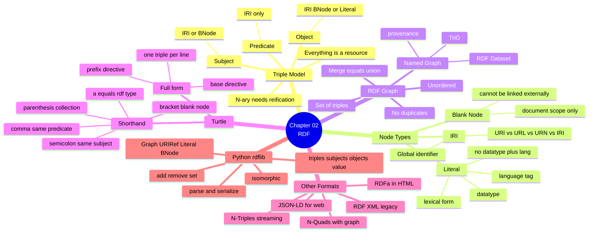

# 02.09 สรุป Chapter 02 + Turtle Cheat Sheet

Chapter 02 วาง**รากฐานที่ทั้งคอร์สยืนอยู่บน**: RDF triple model, ชนิดของ node, RDF graph
และ Turtle ทั้ง full form กับ shorthand บทสรุปนี้รวบยอดเป็น cheat sheet ที่เปิดค้างไว้ใช้งานได้จริง
พร้อม concept map และภาพว่า Chapter 03 จะต่อยอดอย่างไร

---

## Concept Map



---

## Turtle Cheat Sheet: Full Form ↔ Shorthand

### กฎพื้นฐาน

| สิ่งที่ต้องการ | เขียนอย่างไร |
| --- | --- |
| ประกาศ prefix | `@prefix ex: <http://example.org/> .` |
| ประกาศ base | `@base <http://example.org/> .` |
| รูปแบบ SPARQL-style | `PREFIX ex: <http://example.org/>` (ไม่มี `.`) |
| Comment | `# comment ถึงท้ายบรรทัด` |
| จบ statement | `.` |
| `rdf:type` | `a` |

### ตารางเทียบ full form กับ shorthand

| กรณี | Full form | Shorthand |
| --- | --- | --- |
| subject เดียวกัน | `ex:A ex:p1 ex:v1 .`<br/>`ex:A ex:p2 ex:v2 .` | `ex:A ex:p1 ex:v1 ;`<br/>`     ex:p2 ex:v2 .` |
| predicate เดียวกัน | `ex:A ex:p ex:v1 .`<br/>`ex:A ex:p ex:v2 .` | `ex:A ex:p ex:v1 , ex:v2 .` |
| blank node | `ex:A ex:p _:b0 .`<br/>`_:b0 ex:q "x" .` | `ex:A ex:p [ ex:q "x" ] .` |
| bnode เป็น subject | `_:b0 ex:p "x" .` | `[ ex:p "x" ] .` |
| bnode เปล่า | `ex:A ex:p _:b0 .` | `ex:A ex:p [] .` |
| collection | `ex:A ex:p _:l0 .`<br/>`_:l0 rdf:first ex:v1 .`<br/>`_:l0 rdf:rest _:l1 .`<br/>`_:l1 rdf:first ex:v2 .`<br/>`_:l1 rdf:rest rdf:nil .` | `ex:A ex:p ( ex:v1 ex:v2 ) .` |
| type | `ex:A rdf:type ex:C .` | `ex:A a ex:C .` |
| list เปล่า | `ex:A ex:p rdf:nil .` | `ex:A ex:p () .` |

### Literal

| ต้องการ | เขียน | ได้ datatype |
| --- | --- | --- |
| string | `"Marie Curie"` | `xsd:string` |
| string ข้ามบรรทัด | `"""line1`<br/>`line2"""` | `xsd:string` |
| ระบุ datatype | `"1867-11-07"^^xsd:date` | ตามที่ระบุ |
| ระบุภาษา | `"Marie Curie"@en` | `rdf:langString` |
| จำนวนเต็ม | `42` | `xsd:integer` |
| ทศนิยม | `3.14` | `xsd:decimal` |
| floating point | `1.0e6` | `xsd:double` |
| boolean | `true` / `false` | `xsd:boolean` |

> ⚠️ ใส่ทั้ง `^^` และ `@` พร้อมกัน**ไม่ได้**

### Escape sequence

| Escape | ได้ |
| --- | --- |
| `\"` `\'` `\\` | `"` `'` `\` |
| `\n` `\t` `\r` | newline, tab, carriage return |
| `é` | é |
| `\U0001F600` | 😀 |

---

## ตัวอย่างเปรียบเทียบครบชุด

<table>
<tr><th width="50%">Full form</th><th width="50%">Shorthand</th></tr>
<tr valign="top">
<td>

```turtle
@prefix ex:   <http://example.org/> .
@prefix rdf:  <http://www.w3.org/1999/02/22-rdf-syntax-ns#> .
@prefix rdfs: <http://www.w3.org/2000/01/rdf-schema#> .
@prefix foaf: <http://xmlns.com/foaf/0.1/> .
@prefix xsd:  <http://www.w3.org/2001/XMLSchema#> .

ex:MarieCurie rdf:type ex:Scientist .
ex:MarieCurie foaf:name "Marie Curie" .
ex:MarieCurie rdfs:label "Marie Curie"@en .
ex:MarieCurie rdfs:label "มารี กูว์รี"@th .
ex:MarieCurie ex:birthDate "1867-11-07"^^xsd:date .
ex:MarieCurie ex:awardCount 2 .
ex:MarieCurie foaf:knows ex:PierreCurie .
ex:MarieCurie foaf:knows ex:AlbertEinstein .
ex:MarieCurie ex:hasAddress _:b0 .
_:b0 ex:street "12 Rue Cuvier" .
_:b0 ex:city "Paris" .
ex:MarieCurie ex:awardList _:l0 .
_:l0 rdf:first ex:NobelPhysics .
_:l0 rdf:rest _:l1 .
_:l1 rdf:first ex:NobelChemistry .
_:l1 rdf:rest rdf:nil .
```

</td>
<td>

```turtle
@prefix ex:   <http://example.org/> .
@prefix rdf:  <http://www.w3.org/1999/02/22-rdf-syntax-ns#> .
@prefix rdfs: <http://www.w3.org/2000/01/rdf-schema#> .
@prefix foaf: <http://xmlns.com/foaf/0.1/> .
@prefix xsd:  <http://www.w3.org/2001/XMLSchema#> .

ex:MarieCurie a ex:Scientist ;
    foaf:name     "Marie Curie" ;
    rdfs:label    "Marie Curie"@en ,
                  "มารี กูว์รี"@th ;
    ex:birthDate  "1867-11-07"^^xsd:date ;
    ex:awardCount 2 ;
    foaf:knows    ex:PierreCurie ,
                  ex:AlbertEinstein ;
    ex:hasAddress [ ex:street "12 Rue Cuvier" ;
                    ex:city   "Paris" ] ;
    ex:awardList  ( ex:NobelPhysics
                    ex:NobelChemistry ) .
```

</td>
</tr>
<tr><td colspan="2" align="center"><b>16 triple เท่ากันทั้งสองฝั่ง</b></td></tr>
</table>

---

## Format Selection Cheat Sheet

| ต้องการ | ใช้ |
| --- | --- |
| เขียน ontology ด้วยมือ / สอน | **Turtle** `.ttl` |
| named graph + อ่านง่าย | **TriG** `.trig` |
| dump ขนาดใหญ่ / diff / streaming | **N-Triples** `.nt` |
| dump dataset พร้อม graph name | **N-Quads** `.nq` |
| Web API / ฝังใน HTML | **JSON-LD** `.jsonld` |
| ระบบเก่า / OWL tool | **RDF/XML** `.rdf` |

---

## rdflib Cheat Sheet

```python
from rdflib import BNode, Graph, Literal, Namespace, URIRef
from rdflib.namespace import FOAF, OWL, RDF, RDFS, SKOS, XSD
from rdflib.compare import isomorphic
from rdflib.collection import Collection

EX = Namespace("http://example.org/")

g = Graph()
g.bind("ex", EX)                                  # ให้ serialize สวย

g.add((EX.A, RDF.type, EX.C))                     # เพิ่ม triple
g.add((EX.A, RDFS.label, Literal("A", lang="en")))
g.add((EX.A, EX.n, Literal(42)))                  # -> xsd:integer
g.remove((EX.A, EX.n, None))                      # ลบตาม pattern
g.set((EX.A, EX.n, Literal(7)))                   # แทนที่ค่าเดิม

len(g)                                            # จำนวน triple
(EX.A, RDF.type, EX.C) in g                       # มีหรือไม่
g.value(EX.A, RDFS.label)                         # ค่าเดียว
list(g.objects(EX.A, RDFS.label))                 # หลายค่า
list(g.subjects(RDF.type, EX.C))                  # subject ที่ตรง
list(g.triples((EX.A, None, None)))               # pattern matching

g.parse("data.ttl", format="turtle")              # อ่าน
g.serialize("out.jsonld", format="json-ld")       # เขียน

g1 + g2 ; g1 * g2 ; g1 - g2 ; g1 ^ g2             # set operations
isomorphic(g1, g2)                                # เทียบ graph ที่ถูกต้อง

g.query("SELECT ?s WHERE { ?s a <http://example.org/C> }")
```

---

## Self-check

1. ตำแหน่งไหนใน triple ที่เป็น literal ไม่ได้ และเพราะอะไร
2. `"42"`, `"42"^^xsd:integer`, `42` — อันไหนเหมือนกัน อันไหนต่างกัน
3. `ex:A ex:p ex:v1 , ex:v2 ;` แล้วต่อด้วยอะไรได้บ้าง
4. ทำไม RDF จึงนับ triple ซ้ำไม่ได้ และถ้าต้องนับต้องทำอย่างไร
5. Blank node ในไฟล์ A กับไฟล์ B ที่ label เหมือนกัน เป็น node เดียวกันหรือไม่
6. `( ex:a ex:b )` สร้าง triple กี่ตัว
7. จะเทียบว่า graph สองอันเหมือนกันหรือไม่ ต้องใช้ฟังก์ชันอะไรใน rdflib

---

## Preview: Chapter 03 — RDFS

จนถึงตอนนี้เรามีแค่ **ข้อเท็จจริง** แต่ยังไม่มี **ความหมายเชิงโครงสร้าง** — ระบบยังไม่รู้ว่า `ex:Scientist` คืออะไร
หรือว่าถ้าเป็น Scientist แล้วจะเป็นอะไรอีก Chapter 03 เพิ่มชั้น **schema** ด้วย RDFS

| จะได้เรียน | สาระ |
| --- | --- |
| `rdfs:Class`, `rdf:type` | class กับ instance ต่างกันอย่างไร |
| `rdfs:subClassOf` | ลำดับชั้นและ **transitivity** |
| `rdfs:subPropertyOf` | ลำดับชั้นของ property |
| `rdfs:domain` / `rdfs:range` | เป็น **inference trigger ไม่ใช่ constraint** |
| `rdfs:label`, `rdfs:comment` | annotation สำหรับมนุษย์ |
| RDFS entailment | กฎอนุมานและการ trace ทีละขั้น |
| ข้อจำกัดของ RDFS | สิ่งที่ RDFS แสดงไม่ได้ (disjoint, cardinality, inverse) |
| `owlrl` | รัน reasoner ใน Python |

ตัวอย่างพลังของ RDFS: จาก triple ที่เขียนไว้เพียง 3 ตัว

```turtle
@prefix ex:   <http://example.org/> .
@prefix rdfs: <http://www.w3.org/2000/01/rdf-schema#> .

ex:Scientist rdfs:subClassOf ex:Person .
ex:Person    rdfs:subClassOf ex:Agent .
ex:MarieCurie a ex:Scientist .
```

reasoner จะอนุมานเพิ่มให้เองว่า:

```turtle
ex:MarieCurie a ex:Person .        # จาก subClassOf
ex:MarieCurie a ex:Agent .         # จาก transitivity
ex:Scientist rdfs:subClassOf ex:Agent .
```

**นี่คือจุดที่ Semantic Web เริ่มต่างจากฐานข้อมูลธรรมดาอย่างแท้จริง**

---

## Key Points

- **Triple** คือหน่วยเดียวของ RDF: predicate ต้องเป็น IRI, literal เป็น object ได้เท่านั้น
- Node มี 3 ชนิด: **IRI** (ชื่อสากล), **Literal** (ค่า), **Blank Node** (มีอยู่แต่ไม่มีชื่อ, scope แค่ในเอกสาร)
- **Graph = เซตของ triple** → ไม่มีลำดับ ไม่มีตัวซ้ำ และ merge คือ union
- **Named Graph / RDF Dataset** ใช้แปะ provenance และแยก asserted กับ inferred
- Turtle shorthand (`;` `,` `[]` `()` `a`) เป็นเพียง syntactic sugar — graph ที่ได้เหมือน full form ทุกประการ
- เลือก format ตามผู้ใช้: **Turtle** สำหรับมนุษย์, **N-Triples** สำหรับ batch, **JSON-LD** สำหรับ Web
- **rdflib** ครอบคลุมทุกอย่าง: สร้าง, ค้นหา, แก้ไข, parse/serialize, set operations และ SPARQL
- Chapter 03 จะเพิ่มชั้น schema ด้วย **RDFS** ทำให้เกิด **inference** เป็นครั้งแรก
