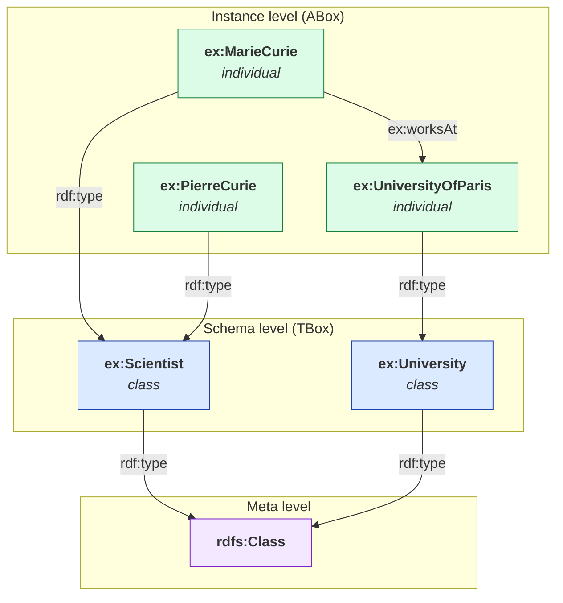
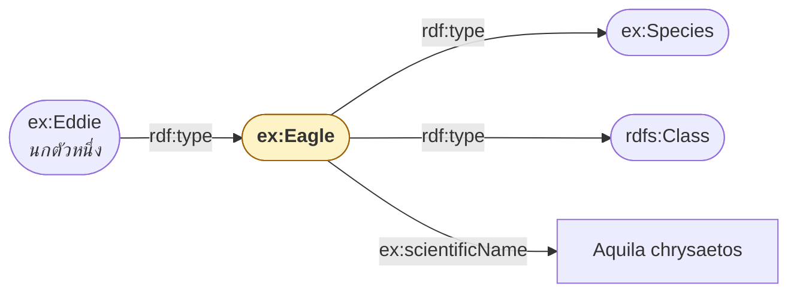

# 03.01 Class และ Instance

**RDFS (RDF Schema)** เพิ่มชั้น **schema** ให้ RDF โดยให้คำศัพท์สำหรับนิยาม **class** และ **property**
บทนี้เริ่มจากแนวคิดพื้นฐานที่สุดคือ `rdfs:Class` กับ `rdf:type` และความต่างระหว่าง **class** (ประเภท) กับ **instance** (สมาชิก)
ซึ่งเป็นเส้นแบ่งที่คนมักสับสนเมื่อออกแบบ ontology จริง

---

## RDFS คืออะไร

RDFS ไม่ใช่ภาษาใหม่ — มันคือ **vocabulary ชุดหนึ่งที่เขียนด้วย RDF เอง** ประกอบด้วย term ราว 15 ตัว
ที่ทุก reasoner เข้าใจความหมายตรงกัน

```turtle
@prefix rdfs: <http://www.w3.org/2000/01/rdf-schema#> .
```

| กลุ่ม | Term |
| --- | --- |
| Class | `rdfs:Class`, `rdfs:Resource`, `rdfs:Literal`, `rdfs:Datatype` |
| ลำดับชั้น | `rdfs:subClassOf`, `rdfs:subPropertyOf` |
| Typing | `rdfs:domain`, `rdfs:range` |
| Annotation | `rdfs:label`, `rdfs:comment`, `rdfs:seeAlso`, `rdfs:isDefinedBy` |
| Container | `rdfs:member`, `rdfs:Container` |

---

## `rdf:type` — บอกว่าเป็นสมาชิกของ class ใด

```turtle
@prefix ex:  <http://example.org/> .
@prefix rdf: <http://www.w3.org/1999/02/22-rdf-syntax-ns#> .

ex:MarieCurie rdf:type ex:Scientist .
# shorthand
ex:MarieCurie a ex:Scientist .
```

**อ่านว่า**: `ex:MarieCurie` เป็น **instance** ของ **class** `ex:Scientist`

resource หนึ่งตัวเป็น instance ของหลาย class พร้อมกันได้ (**multiple typing**) — ต่างจาก OOP ส่วนใหญ่

```turtle
ex:MarieCurie a ex:Scientist , ex:Professor , foaf:Person .
```

---

## `rdfs:Class` — ประกาศว่าอะไรเป็น class

```turtle
@prefix ex:   <http://example.org/> .
@prefix rdfs: <http://www.w3.org/2000/01/rdf-schema#> .

ex:Scientist a rdfs:Class ;
    rdfs:label   "Scientist"@en ;
    rdfs:comment "A person who conducts scientific research."@en .
```

**สังเกตความย้อนกลับ (reflexivity)**: `ex:Scientist` เป็น **instance ของ `rdfs:Class`**
นั่นแปลว่า class เองก็เป็น resource ธรรมดาที่พูดถึงได้ ตามหลัก *everything is a resource* จาก [02.01](../02-rdf/02.01-triple-model.md)

```turtle
# rdfs:Class เองก็เป็น instance ของ rdfs:Class
rdfs:Class a rdfs:Class .

# ทุกอย่างเป็น instance ของ rdfs:Resource
ex:MarieCurie a rdfs:Resource .
ex:Scientist  a rdfs:Resource .
```

---

## Class vs Instance — เส้นแบ่งที่ต้องคิดให้ชัด



### คำถามชี้ขาด: "นับจำนวนได้ไหม"

| สิ่งที่พิจารณา | เป็น class หรือ instance | เหตุผล |
| --- | --- | --- |
| `ex:Scientist` | **class** | มีนักวิทยาศาสตร์ได้หลายคน |
| `ex:MarieCurie` | **instance** | มีคนเดียวในโลก |
| `ex:University` | **class** | มีมหาวิทยาลัยหลายแห่ง |
| `ex:UniversityOfParis` | **instance** | มีแห่งเดียว |
| `ex:NobelPrize` | **class** | มีรางวัลโนเบลหลายสาขา/หลายปี |
| `ex:NobelPrizeInPhysics1903` | **instance** | ครั้งเดียวในประวัติศาสตร์ |

> 💡 **หลักปฏิบัติ**: ถ้าถามว่า "มีกี่อัน" แล้วตอบว่า "หลายอัน" → เป็น **class**
> ถ้าตอบว่า "อันเดียว" → เป็น **instance**

---

## กรณีที่กำกวม: Class ที่เป็น Instance ด้วย (Metaclass)

บางครั้งสิ่งเดียวกันเป็นทั้ง class และ instance ขึ้นกับมุมมอง — เรียกว่า **punning**

```turtle
@prefix ex:   <http://example.org/> .
@prefix rdfs: <http://www.w3.org/2000/01/rdf-schema#> .

# "Eagle" เป็น class ของนกอินทรีแต่ละตัว
ex:Eagle a rdfs:Class .
ex:Eddie a ex:Eagle .

# แต่ "Eagle" ก็เป็น instance ของ "Species" ด้วย (มี 60 species ของ eagle)
ex:Species a rdfs:Class .
ex:Eagle a ex:Species ;
    ex:conservationStatus "Least Concern" ;
    ex:scientificName     "Aquila chrysaetos" .
```

RDFS อนุญาตให้ทำได้อย่างอิสระ แต่ **OWL DL ห้าม** (ต้องใช้ OWL 2 punning ซึ่งมีข้อจำกัด — ดู [08.01](../08-owl/08.01-owl-species.md))



---

## ตัวอย่างเต็ม: schema ของมหาวิทยาลัย

<table>
<tr><th width="50%">Full form</th><th width="50%">Shorthand</th></tr>
<tr valign="top">
<td>

```turtle
@prefix ex:   <http://example.org/> .
@prefix rdf:  <http://www.w3.org/1999/02/22-rdf-syntax-ns#> .
@prefix rdfs: <http://www.w3.org/2000/01/rdf-schema#> .

ex:Person rdf:type rdfs:Class .
ex:Person rdfs:label "Person"@en .
ex:Person rdfs:comment "A human being."@en .

ex:Student rdf:type rdfs:Class .
ex:Student rdfs:label "Student"@en .

ex:Course rdf:type rdfs:Class .
ex:Course rdfs:label "Course"@en .

ex:alice rdf:type ex:Student .
ex:alice rdfs:label "Alice Johnson"@en .

ex:cs101 rdf:type ex:Course .
ex:cs101 rdfs:label "Introduction to Programming"@en .

ex:alice ex:enrolledIn ex:cs101 .
```

</td>
<td>

```turtle
@prefix ex:   <http://example.org/> .
@prefix rdf:  <http://www.w3.org/1999/02/22-rdf-syntax-ns#> .
@prefix rdfs: <http://www.w3.org/2000/01/rdf-schema#> .

ex:Person a rdfs:Class ;
    rdfs:label   "Person"@en ;
    rdfs:comment "A human being."@en .

ex:Student a rdfs:Class ;
    rdfs:label "Student"@en .

ex:Course a rdfs:Class ;
    rdfs:label "Course"@en .

ex:alice a ex:Student ;
    rdfs:label "Alice Johnson"@en ;
    ex:enrolledIn ex:cs101 .

ex:cs101 a ex:Course ;
    rdfs:label "Introduction to Programming"@en .
```

</td>
</tr>
</table>

---

## RDFS vs OOP — อย่าเอาสัญชาตญาณจาก Java มาใช้ทั้งหมด

| ประเด็น | OOP (Java/Python) | RDFS |
| --- | --- | --- |
| ประกาศ class ก่อนใช้ | **บังคับ** | ไม่บังคับ — ใช้ก่อนประกาศได้ |
| object เป็นได้กี่ class | หนึ่ง (+ interface) | **หลาย class พร้อมกัน** |
| property เป็นของ class | ✅ อยู่ใน class | ❌ **property เป็นอิสระ** มีตัวตนของตัวเอง |
| เพิ่ม attribute หลัง compile | ไม่ได้ | **ได้ตลอดเวลา** |
| class เป็น object ได้ | จำกัด (reflection) | **ได้เต็มที่** |
| ตรวจ type ผิด | compile error | **ไม่ error — จะอนุมานแทน** (ดู [03.04](03.04-domain-range.md)) |

ข้อที่ 3 สำคัญมาก: ใน RDFS **property ไม่ได้ "อยู่ใน" class**

```turtle
# ประกาศ property แยกอิสระ — ไม่ได้อยู่ใต้ class ใด
ex:enrolledIn a rdf:Property ;
    rdfs:domain ex:Student ;
    rdfs:range  ex:Course .
```

`rdfs:domain` ไม่ได้แปลว่า "property นี้เป็นของ class Student" แต่แปลว่า
"**อะไรก็ตามที่ใช้ property นี้ ให้อนุมานว่าเป็น Student**" — รายละเอียดใน [03.04](03.04-domain-range.md)

---

## ตรวจสอบด้วย rdflib

```python
from rdflib import Graph, Namespace
from rdflib.namespace import RDF, RDFS

EX = Namespace("http://example.org/")
g = Graph().parse("university-schema.ttl", format="turtle")

print("Classes ที่ประกาศไว้:")
for cls in g.subjects(RDF.type, RDFS.Class):
    label = g.value(cls, RDFS.label)
    print(f"  {cls}  ({label})")

print("\nInstances ของแต่ละ class:")
for cls in g.subjects(RDF.type, RDFS.Class):
    members = list(g.subjects(RDF.type, cls))
    print(f"  {cls}: {len(members)} instances")
    for m in members:
        print(f"    - {m}")
```

Expected output:

```
Classes ที่ประกาศไว้:
  http://example.org/Person  (Person)
  http://example.org/Student  (Student)
  http://example.org/Course  (Course)

Instances ของแต่ละ class:
  http://example.org/Person: 0 instances
  http://example.org/Student: 1 instances
    - http://example.org/alice
  http://example.org/Course: 1 instances
    - http://example.org/cs101
```

> สังเกตว่า `ex:Person` มี 0 instance ทั้งที่ `ex:alice` ควรเป็น Person ด้วย — เพราะยังไม่มี `rdfs:subClassOf` และยังไม่ได้รัน reasoner
> เรื่องนี้แก้ใน [03.02](03.02-class-hierarchy.md)

---

## Key Points

- **RDFS คือ vocabulary ที่เขียนด้วย RDF เอง** ไม่ใช่ภาษาใหม่ — reasoner ทุกตัวเข้าใจ term ชุดนี้ตรงกัน
- `rdf:type` (ย่อว่า `a`) เชื่อม **instance** เข้ากับ **class**; resource หนึ่งตัวมีหลาย type พร้อมกันได้
- `rdfs:Class` ประกาศว่า resource นั้นเป็น class — และตัว class เองก็เป็น resource ที่พูดถึงได้
- **เกณฑ์แยก class กับ instance**: ถามว่า "มีกี่อัน" — หลายอัน = class, อันเดียว = instance
- สิ่งเดียวกันเป็นทั้ง class และ instance ได้ (**punning**) — RDFS อนุญาต แต่ OWL DL ห้าม
- **RDFS ต่างจาก OOP ตรงที่ property เป็นอิสระจาก class** และไม่ต้องประกาศอะไรก่อนใช้
- RDFS **ไม่ตรวจ type ผิด** — ถ้าใช้ผิดจะ **อนุมาน** ให้แทนที่จะ error (ตามหลัก OWA)
