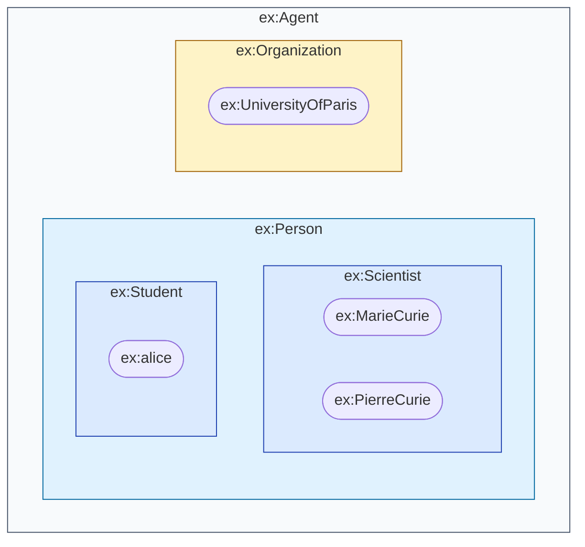
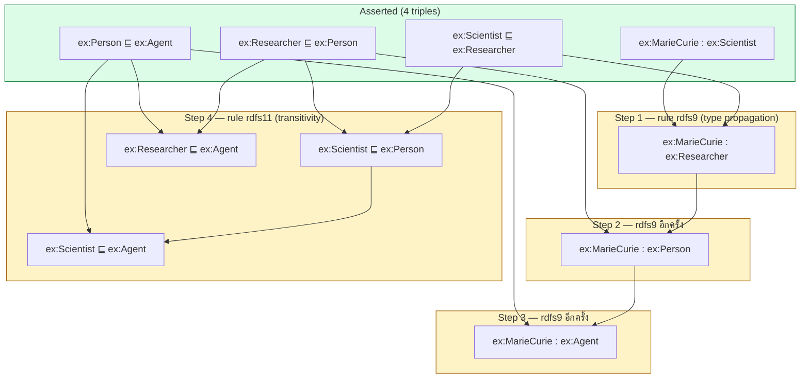
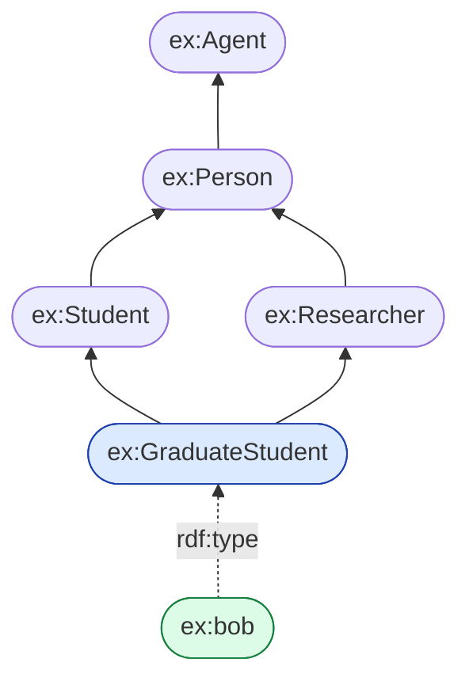

# 03.02 Class Hierarchy: `rdfs:subClassOf`

`rdfs:subClassOf` คือ term ที่ทรงพลังที่สุดของ RDFS เพราะเป็นตัวเปิดประตูสู่ **inference** เป็นครั้งแรกในคอร์สนี้
บทนี้อธิบายความหมายเชิงเซตของ subclass, คุณสมบัติ **transitivity** และไล่ **trace การอนุมานทีละขั้น**
ให้เห็นว่า reasoner คิดอย่างไรจนได้ triple ใหม่ที่ไม่มีใครเขียนไว้

---

## ความหมายเชิงเซต

```turtle
@prefix ex:   <http://example.org/> .
@prefix rdfs: <http://www.w3.org/2000/01/rdf-schema#> .

ex:Scientist rdfs:subClassOf ex:Person .
```

**อ่านว่า**: เซตของ instance ทั้งหมดของ `ex:Scientist` เป็น **subset** ของเซตของ instance ทั้งหมดของ `ex:Person`

```
∀x ( Scientist(x) → Person(x) )
```



> ⚠️ **สำคัญ**: `rdfs:subClassOf` **ไม่ใช่** "inheritance" แบบ OOP ที่สืบทอด method
> มันคือคำกล่าวเชิงตรรกะว่า "ทุก instance ของ A เป็น instance ของ B ด้วย"

---

## กฎอนุมานสองข้อ

### กฎ 1: Type propagation (rdfs9)

```
ถ้า  C1 rdfs:subClassOf C2
และ  x  rdf:type        C1
แล้ว x  rdf:type        C2
```

### กฎ 2: Transitivity (rdfs11)

```
ถ้า  C1 rdfs:subClassOf C2
และ  C2 rdfs:subClassOf C3
แล้ว C1 rdfs:subClassOf C3
```

---

## Trace การอนุมานทีละขั้น

### ข้อมูลที่เขียนไว้ (asserted)

```turtle
@prefix ex:   <http://example.org/> .
@prefix rdfs: <http://www.w3.org/2000/01/rdf-schema#> .

# --- schema ---
ex:Scientist rdfs:subClassOf ex:Researcher .
ex:Researcher rdfs:subClassOf ex:Person .
ex:Person rdfs:subClassOf ex:Agent .

# --- data ---
ex:MarieCurie a ex:Scientist .
```

**รวม 4 triple**

### ขั้นตอนการอนุมาน



### ผลลัพธ์หลัง reasoning

```turtle
# --- asserted (4) ---
ex:Scientist  rdfs:subClassOf ex:Researcher .
ex:Researcher rdfs:subClassOf ex:Person .
ex:Person     rdfs:subClassOf ex:Agent .
ex:MarieCurie a ex:Scientist .

# --- inferred (6) ---
ex:MarieCurie a ex:Researcher .           # rdfs9
ex:MarieCurie a ex:Person .               # rdfs9
ex:MarieCurie a ex:Agent .                # rdfs9
ex:Scientist  rdfs:subClassOf ex:Person . # rdfs11
ex:Researcher rdfs:subClassOf ex:Agent .  # rdfs11
ex:Scientist  rdfs:subClassOf ex:Agent .  # rdfs11
```

**เขียน 4 ได้ 10** — นี่คือคุณค่าที่จับต้องได้ของ inference

> 💡 กฎ RDFS ยังบวก triple อีกชุด เช่น `ex:Scientist rdfs:subClassOf ex:Scientist` (reflexive, rdfs10)
> และ `ex:MarieCurie a rdfs:Resource` — reasoner จริงจะสร้างครบทั้งหมด ดูเต็มใน [03.06](03.06-entailment.md)

---

## ทำไม inference จึงมีค่า: query ที่ไม่ต้องรู้โครงสร้างล่วงหน้า

```sparql
PREFIX ex: <http://example.org/>

# ก่อน reasoning -> ได้ 0 ผลลัพธ์
# หลัง reasoning -> ได้ ex:MarieCurie
SELECT ?person WHERE {
  ?person a ex:Person .
}
```

ถ้าไม่มี reasoner ต้องเขียน query ที่รู้ลำดับชั้นทั้งหมดเอง:

```sparql
# ทางเลือกที่ไม่มี reasoner — เปราะบางและต้องแก้ทุกครั้งที่ schema เปลี่ยน
SELECT ?person WHERE {
  { ?person a ex:Person }    UNION
  { ?person a ex:Researcher } UNION
  { ?person a ex:Scientist }
}

# หรือใช้ property path (ทำงานได้โดยไม่ต้องมี reasoner)
SELECT ?person WHERE {
  ?person a/rdfs:subClassOf* ex:Person .
}
```

| วิธี | ข้อดี | ข้อเสีย |
| --- | --- | --- |
| **Materialized inference** (รัน reasoner แล้วเก็บ) | query เร็ว, เขียนง่าย | ต้อง re-run เมื่อข้อมูลเปลี่ยน, กิน storage |
| **Property path** `rdfs:subClassOf*` | ไม่ต้อง materialize | query ช้ากว่า, ต้องเขียนเองทุกครั้ง |
| **Query rewriting** (backward chaining) | ไม่กิน storage | ต้องมี engine ที่รองรับ |

---

## Multiple inheritance

class หนึ่งเป็น subclass ของหลาย class พร้อมกันได้

```turtle
@prefix ex:   <http://example.org/> .
@prefix rdfs: <http://www.w3.org/2000/01/rdf-schema#> .

ex:GraduateStudent rdfs:subClassOf ex:Student , ex:Researcher .

ex:bob a ex:GraduateStudent .
```

อนุมานได้:

```turtle
ex:bob a ex:Student .
ex:bob a ex:Researcher .
ex:bob a ex:Person .      # ผ่าน Student -> Person และ Researcher -> Person
ex:bob a ex:Agent .
```



---

## Cycle: subclass วนกลับ = equivalent class

```turtle
ex:Automobile rdfs:subClassOf ex:Car .
ex:Car        rdfs:subClassOf ex:Automobile .
```

จาก transitivity จะได้ว่าทั้งสองเป็น subclass ของกันและกัน ซึ่งเชิงเซตแปลว่า **เป็นเซตเดียวกัน**
RDFS ไม่มองว่าเป็น error แต่ถ้าตั้งใจจะสื่อความนี้ ควรใช้ OWL ให้ชัดกว่า:

```turtle
@prefix owl: <http://www.w3.org/2002/07/owl#> .
ex:Automobile owl:equivalentClass ex:Car .
```

---

## ตัวอย่างจริง: ลำดับชั้นของ schema.org

```turtle
@prefix schema: <https://schema.org/> .
@prefix rdfs:   <http://www.w3.org/2000/01/rdf-schema#> .

schema:Person       rdfs:subClassOf schema:Thing .
schema:Organization rdfs:subClassOf schema:Thing .
schema:Place        rdfs:subClassOf schema:Thing .
schema:CreativeWork rdfs:subClassOf schema:Thing .

schema:Book         rdfs:subClassOf schema:CreativeWork .
schema:Article      rdfs:subClassOf schema:CreativeWork .
schema:ScholarlyArticle rdfs:subClassOf schema:Article .

schema:EducationalOrganization rdfs:subClassOf schema:Organization .
schema:CollegeOrUniversity rdfs:subClassOf schema:EducationalOrganization .
```

ค้นหา "ทุกอย่างที่เป็น `schema:Thing`" ได้ครบทันทีหลังรัน reasoner
โดยไม่ต้องรู้ว่ามี subclass ทั้งหมดกี่ตัว

---

## รันจริงด้วย Python

```python
from rdflib import Graph, Namespace
from rdflib.namespace import RDF, RDFS
import owlrl

EX = Namespace("http://example.org/")

data = """
@prefix ex:   <http://example.org/> .
@prefix rdfs: <http://www.w3.org/2000/01/rdf-schema#> .

ex:Scientist  rdfs:subClassOf ex:Researcher .
ex:Researcher rdfs:subClassOf ex:Person .
ex:Person     rdfs:subClassOf ex:Agent .
ex:MarieCurie a ex:Scientist .
"""

g = Graph().parse(data=data, format="turtle")
print(f"ก่อน reasoning: {len(g)} triples")

# type ของ MarieCurie ก่อน reasoning
print("types ก่อน:", sorted(str(t) for t in g.objects(EX.MarieCurie, RDF.type)))

# รัน RDFS reasoner
owlrl.DeductiveClosure(owlrl.RDFS_Semantics).expand(g)

print(f"หลัง reasoning: {len(g)} triples")
print("types หลัง:", sorted(str(t) for t in g.objects(EX.MarieCurie, RDF.type)))
```

Expected output:

```
ก่อน reasoning: 4 triples
types ก่อน: ['http://example.org/Scientist']
หลัง reasoning: 47 triples
types หลัง: ['http://example.org/Agent', 'http://example.org/Person',
             'http://example.org/Researcher', 'http://example.org/Scientist',
             'http://www.w3.org/2000/01/rdf-schema#Resource']
```

> จำนวน triple พุ่งจาก 4 เป็น 47 เพราะ RDFS entailment รวมกฎ axiomatic triple จำนวนมากด้วย
> รายละเอียดใน [03.06](03.06-entailment.md)

---

## Key Points

- `rdfs:subClassOf` มีความหมายเชิงเซต: **ทุก instance ของ subclass เป็น instance ของ superclass** ไม่ใช่ inheritance แบบ OOP
- กฎอนุมานหลักสองข้อ: **type propagation** (rdfs9) และ **transitivity** (rdfs11)
- inference ทำให้ **เขียนน้อยแต่ query ได้มาก** — จาก 4 triple ได้ความรู้ 10 ข้อ
- ทางเลือกแทน reasoner คือใช้ **property path** `a/rdfs:subClassOf*` ใน SPARQL — ไม่กิน storage แต่ query ช้ากว่า
- **Multiple inheritance** ทำได้อิสระ — ประกาศ `rdfs:subClassOf A , B` ได้เลย
- subclass ที่วนเป็น cycle เชิงเซตแปลว่า **class เท่ากัน** — ถ้าตั้งใจให้เท่ากันควรใช้ `owl:equivalentClass`
- ใช้ `owlrl.DeductiveClosure(owlrl.RDFS_Semantics).expand(g)` รัน RDFS reasoning ใน rdflib ได้ทันที
