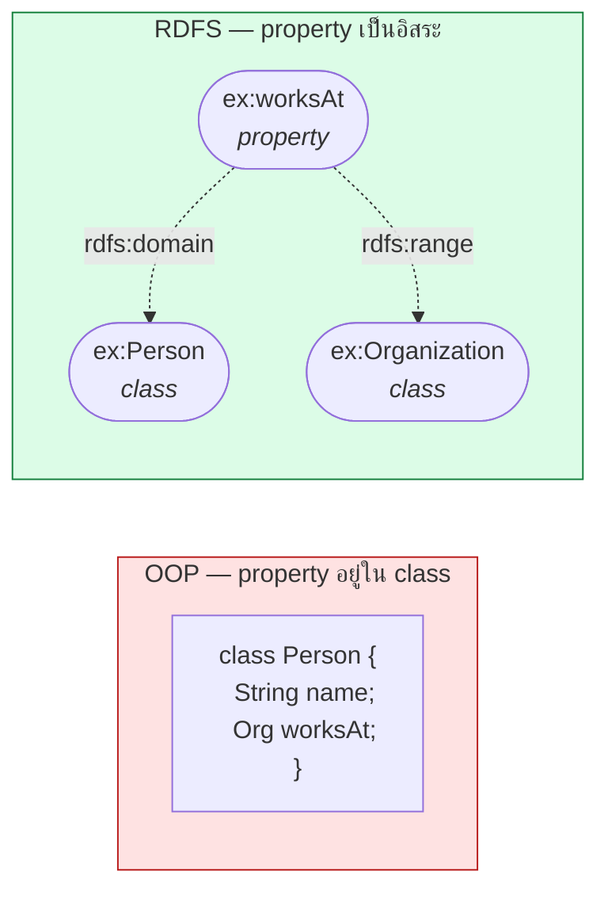
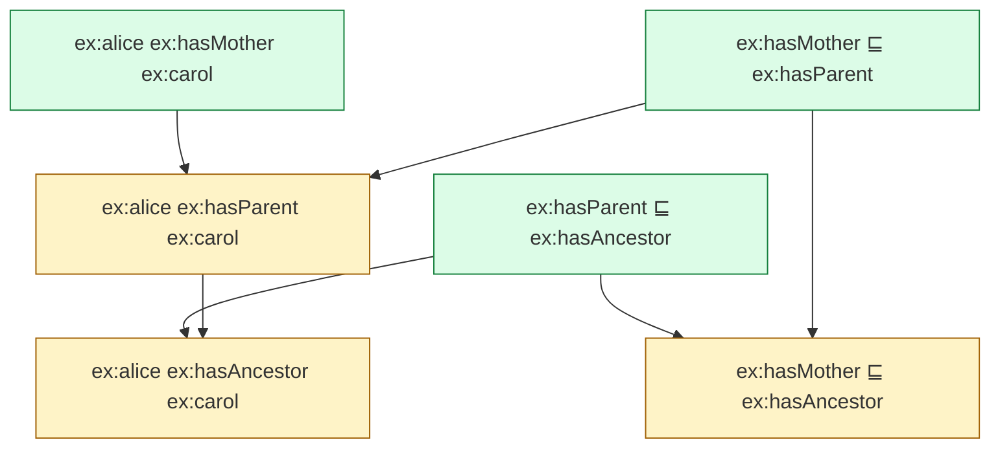
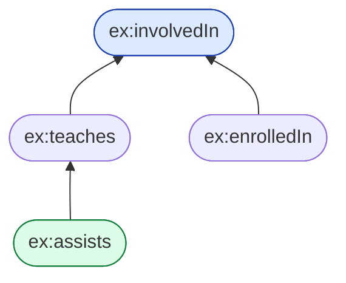

# 03.03 Property และ `rdfs:subPropertyOf`

ใน RDFS **property เป็น first-class citizen** — มีตัวตนอิสระ ไม่ได้สังกัดอยู่ใน class ใด และมีลำดับชั้นของตัวเองได้
บทนี้อธิบาย `rdf:Property`, `rdfs:subPropertyOf` และเหตุผลว่าทำไมการออกแบบลำดับชั้นของ property
จึงสำคัญไม่แพ้ลำดับชั้นของ class

---

## `rdf:Property` — ประกาศ property

```turtle
@prefix ex:   <http://example.org/> .
@prefix rdf:  <http://www.w3.org/1999/02/22-rdf-syntax-ns#> .
@prefix rdfs: <http://www.w3.org/2000/01/rdf-schema#> .

ex:worksAt a rdf:Property ;
    rdfs:label   "works at"@en ;
    rdfs:comment "Relates a person to the organization they work for."@en .
```

**ข้อสังเกตสำคัญ**: property ไม่ได้อยู่ "ใน" class — ต่างจาก OOP โดยสิ้นเชิง



ผลตามมาที่ใช้ประโยชน์ได้จริง: **property หนึ่งตัวใช้กับหลาย domain ได้** และ **เพิ่ม property ใหม่โดยไม่ต้องแตะ class เดิม**

---

## `rdfs:subPropertyOf` — ลำดับชั้นของ property

```turtle
@prefix ex:   <http://example.org/> .
@prefix rdfs: <http://www.w3.org/2000/01/rdf-schema#> .

ex:hasMother rdfs:subPropertyOf ex:hasParent .
ex:hasFather rdfs:subPropertyOf ex:hasParent .
ex:hasParent rdfs:subPropertyOf ex:hasAncestor .
```

**ความหมาย**: ถ้า `x ex:hasMother y` แล้ว `x ex:hasParent y` ด้วยเสมอ

```
∀x,y ( hasMother(x,y) → hasParent(x,y) )
```

### กฎอนุมานสองข้อ

| กฎ | เนื้อหา |
| --- | --- |
| **rdfs7** — property propagation | ถ้า `P1 rdfs:subPropertyOf P2` และ `x P1 y` แล้ว `x P2 y` |
| **rdfs5** — transitivity | ถ้า `P1 rdfs:subPropertyOf P2` และ `P2 rdfs:subPropertyOf P3` แล้ว `P1 rdfs:subPropertyOf P3` |

---

## Trace การอนุมาน

### Asserted

```turtle
@prefix ex:   <http://example.org/> .
@prefix rdfs: <http://www.w3.org/2000/01/rdf-schema#> .

ex:hasMother rdfs:subPropertyOf ex:hasParent .
ex:hasParent rdfs:subPropertyOf ex:hasAncestor .

ex:alice ex:hasMother ex:carol .
```

### Inferred



```turtle
# --- inferred ---
ex:alice ex:hasParent   ex:carol .   # rdfs7
ex:alice ex:hasAncestor ex:carol .   # rdfs7 (ต่อจากบรรทัดบน)
ex:hasMother rdfs:subPropertyOf ex:hasAncestor .   # rdfs5
```

---

## Use case จริง: รวม property จากหลายแหล่งให้ query ได้ที่เดียว

ปัญหาคลาสสิก — สามระบบใช้ property ต่างกันสื่อความหมายเดียวกัน

<table>
<tr><th width="50%">ปัญหา: query ต้อง UNION สามครั้ง</th><th width="50%">ทางแก้: สร้าง super-property</th></tr>
<tr valign="top">
<td>

```turtle
@prefix ex: <http://example.org/> .

ex:alice   ex:employedBy  ex:AcmeCorp .
ex:bob     ex:worksFor    ex:AcmeCorp .
ex:carol   ex:affiliation ex:AcmeCorp .
```

```sparql
SELECT ?p WHERE {
  { ?p ex:employedBy  ex:AcmeCorp } UNION
  { ?p ex:worksFor    ex:AcmeCorp } UNION
  { ?p ex:affiliation ex:AcmeCorp }
}
```

</td>
<td>

```turtle
@prefix ex:   <http://example.org/> .
@prefix rdfs: <http://www.w3.org/2000/01/rdf-schema#> .

ex:employedBy  rdfs:subPropertyOf ex:worksAt .
ex:worksFor    rdfs:subPropertyOf ex:worksAt .
ex:affiliation rdfs:subPropertyOf ex:worksAt .

ex:alice ex:employedBy  ex:AcmeCorp .
ex:bob   ex:worksFor    ex:AcmeCorp .
ex:carol ex:affiliation ex:AcmeCorp .
```

```sparql
SELECT ?p WHERE {
  ?p ex:worksAt ex:AcmeCorp .
}
```

</td>
</tr>
</table>

**นี่คือวิธีมาตรฐานในการทำ vocabulary alignment** โดยไม่ต้องแก้ข้อมูลต้นทางแม้แต่ triple เดียว

---

## เชื่อม vocabulary ของเรากับ vocabulary มาตรฐาน

```turtle
@prefix ex:      <http://example.org/> .
@prefix rdfs:    <http://www.w3.org/2000/01/rdf-schema#> .
@prefix foaf:    <http://xmlns.com/foaf/0.1/> .
@prefix dcterms: <http://purl.org/dc/terms/> .
@prefix schema:  <https://schema.org/> .

# property ของเรา -> mapping ไปยังมาตรฐาน
ex:fullName    rdfs:subPropertyOf foaf:name , schema:name .
ex:writtenBy   rdfs:subPropertyOf dcterms:creator .
ex:publishDate rdfs:subPropertyOf dcterms:issued .
```

ผลลัพธ์: ข้อมูลของเราถูก consume ได้ด้วย tool ที่รู้จักเฉพาะ `foaf:` และ `dcterms:` โดยอัตโนมัติ
เป็นหลักการสำคัญของ [Chapter 09](../09-well-known-ontologies/09.09-reusing-ontologies.md)

---

## ตัวอย่างเต็ม: ลำดับชั้น property ของมหาวิทยาลัย

<table>
<tr><th width="50%">Full form</th><th width="50%">Shorthand</th></tr>
<tr valign="top">
<td>

```turtle
@prefix ex:   <http://example.org/> .
@prefix rdf:  <http://www.w3.org/1999/02/22-rdf-syntax-ns#> .
@prefix rdfs: <http://www.w3.org/2000/01/rdf-schema#> .

ex:involvedIn rdf:type rdf:Property .
ex:involvedIn rdfs:label "involved in"@en .

ex:teaches rdf:type rdf:Property .
ex:teaches rdfs:label "teaches"@en .
ex:teaches rdfs:subPropertyOf ex:involvedIn .

ex:enrolledIn rdf:type rdf:Property .
ex:enrolledIn rdfs:label "enrolled in"@en .
ex:enrolledIn rdfs:subPropertyOf ex:involvedIn .

ex:assists rdf:type rdf:Property .
ex:assists rdfs:subPropertyOf ex:teaches .

ex:profSmith ex:teaches ex:cs101 .
ex:alice ex:enrolledIn ex:cs101 .
ex:bob ex:assists ex:cs101 .
```

</td>
<td>

```turtle
@prefix ex:   <http://example.org/> .
@prefix rdf:  <http://www.w3.org/1999/02/22-rdf-syntax-ns#> .
@prefix rdfs: <http://www.w3.org/2000/01/rdf-schema#> .

ex:involvedIn a rdf:Property ;
    rdfs:label "involved in"@en .

ex:teaches a rdf:Property ;
    rdfs:label "teaches"@en ;
    rdfs:subPropertyOf ex:involvedIn .

ex:enrolledIn a rdf:Property ;
    rdfs:label "enrolled in"@en ;
    rdfs:subPropertyOf ex:involvedIn .

ex:assists a rdf:Property ;
    rdfs:subPropertyOf ex:teaches .

ex:profSmith ex:teaches    ex:cs101 .
ex:alice     ex:enrolledIn ex:cs101 .
ex:bob       ex:assists    ex:cs101 .
```

</td>
</tr>
</table>

Query "ใครเกี่ยวข้องกับ cs101 บ้าง" หลัง reasoning:

```sparql
PREFIX ex: <http://example.org/>

SELECT ?who WHERE {
  ?who ex:involvedIn ex:cs101 .
}
```

| ?who |
| --- |
| `ex:profSmith` |
| `ex:alice` |
| `ex:bob` |

`ex:bob` ติดมาด้วยผ่านสองขั้น: `assists` → `teaches` → `involvedIn`



---

## ข้อควรระวังในการออกแบบ

| ข้อผิดพลาด | ปัญหา | ทางแก้ |
| --- | --- | --- |
| ทำ `rdfs:subPropertyOf` โดยความหมายไม่ครอบคลุมจริง | อนุมานผิด | ตรวจว่า "P1 จริง → P2 จริงเสมอ" หรือไม่ |
| ใช้ subPropertyOf แทน `owl:equivalentProperty` | อนุมานได้ทางเดียว | ถ้าเท่ากันจริงให้ใช้ `owl:equivalentProperty` |
| ทำลำดับชั้นลึกเกินจำเป็น | อ่านยาก, reasoning ช้า | ลึกไม่เกิน 3–4 ระดับ |
| ตั้งชื่อ property เป็นคำนาม | อ่านเป็นประโยคไม่ได้ | ใช้กริยา: `worksAt`, `hasParent`, `teaches` |

> 💡 **แบบทดสอบก่อนประกาศ subPropertyOf**: เขียนประโยค "ถ้า X *(P1)* Y แล้ว X *(P2)* Y **เสมอ**" — ถ้ามีข้อยกเว้นแม้กรณีเดียว แสดงว่าไม่ใช่ subproperty

---

## รันจริงด้วย Python

```python
from rdflib import Graph, Namespace
import owlrl

EX = Namespace("http://example.org/")

data = """
@prefix ex:   <http://example.org/> .
@prefix rdfs: <http://www.w3.org/2000/01/rdf-schema#> .

ex:assists    rdfs:subPropertyOf ex:teaches .
ex:teaches    rdfs:subPropertyOf ex:involvedIn .
ex:enrolledIn rdfs:subPropertyOf ex:involvedIn .

ex:profSmith ex:teaches    ex:cs101 .
ex:alice     ex:enrolledIn ex:cs101 .
ex:bob       ex:assists    ex:cs101 .
"""

g = Graph().parse(data=data, format="turtle")
owlrl.DeductiveClosure(owlrl.RDFS_Semantics).expand(g)

print("ผู้ที่ involvedIn cs101:")
for s in g.subjects(EX.involvedIn, EX.cs101):
    print(f"  {s}")
```

Expected output:

```
ผู้ที่ involvedIn cs101:
  http://example.org/profSmith
  http://example.org/alice
  http://example.org/bob
```

---

## Key Points

- **Property เป็นอิสระจาก class** — ประกาศด้วย `rdf:Property` และใช้กับ resource ใดก็ได้
- `rdfs:subPropertyOf` หมายถึง "ถ้าความสัมพันธ์ย่อยจริง ความสัมพันธ์แม่ก็จริงเสมอ" (`P1(x,y) → P2(x,y)`)
- กฎอนุมาน: **rdfs7** (property propagation) และ **rdfs5** (transitivity ของ subPropertyOf)
- Use case ที่ทรงพลังที่สุดคือ **vocabulary alignment** — รวม property ที่ชื่อต่างกันให้ query ที่เดียวได้ โดยไม่แตะข้อมูลเดิม
- ใช้ `rdfs:subPropertyOf` เชื่อม vocabulary ของเราเข้ากับ `foaf:`, `dcterms:`, `schema:` เพื่อให้ tool ภายนอกใช้ข้อมูลเราได้
- **แบบทดสอบก่อนประกาศ**: "P1 จริง → P2 จริงเสมอ" ต้องเป็นจริงโดยไม่มีข้อยกเว้น
- ถ้าสอง property มีความหมายเท่ากันจริง ให้ใช้ `owl:equivalentProperty` แทน subPropertyOf ทางเดียว
