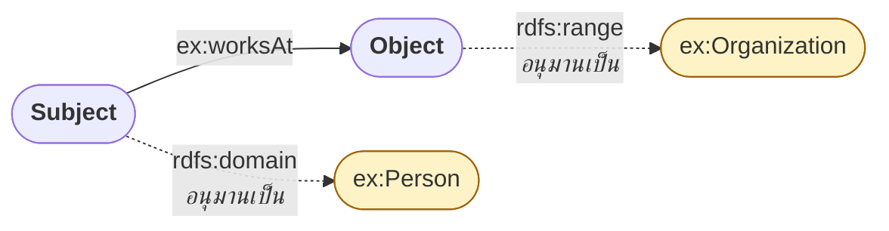
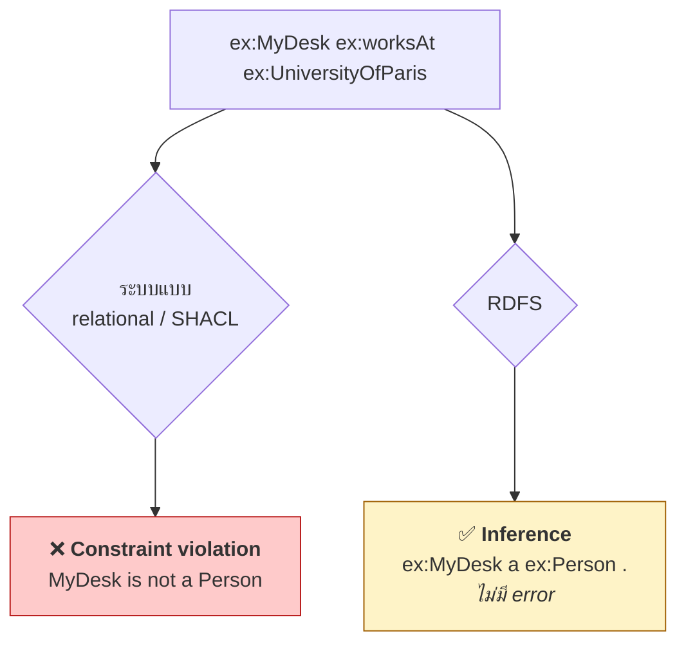
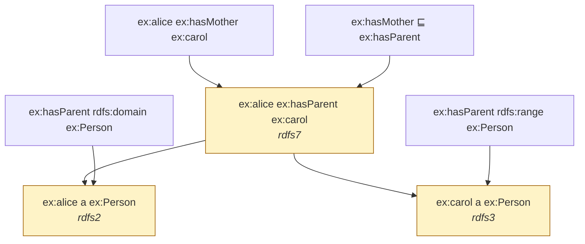

# 03.04 `rdfs:domain` และ `rdfs:range` — Inference Trigger ไม่ใช่ Constraint

นี่คือบทที่คนมาจากสาย database เข้าใจผิดมากที่สุดในทั้งคอร์ส `rdfs:domain` และ `rdfs:range` **ไม่ได้ตรวจสอบข้อมูล**
และ**ไม่มีวันแจ้ง error** — มันคือ **กฎอนุมาน** ที่บอกว่า "ถ้าเห็น property นี้ ให้สรุปว่า subject/object เป็น class นั้น"
บทนี้แสดงผลลัพธ์ที่น่าประหลาดใจของพฤติกรรมนี้ พร้อมบอกว่าถ้าอยากได้ constraint จริงต้องใช้อะไร

---

## นิยาม

```turtle
@prefix ex:   <http://example.org/> .
@prefix rdf:  <http://www.w3.org/1999/02/22-rdf-syntax-ns#> .
@prefix rdfs: <http://www.w3.org/2000/01/rdf-schema#> .

ex:worksAt a rdf:Property ;
    rdfs:domain ex:Person ;         # subject ของ ex:worksAt เป็น Person
    rdfs:range  ex:Organization .   # object ของ ex:worksAt เป็น Organization
```



---

## กฎอนุมาน

| กฎ | เนื้อหา |
| --- | --- |
| **rdfs2** (domain) | ถ้า `P rdfs:domain C` และ `x P y` แล้ว **`x rdf:type C`** |
| **rdfs3** (range) | ถ้า `P rdfs:range C` และ `x P y` แล้ว **`y rdf:type C`** |

สังเกตทิศทางของลูกศร: **จากข้อมูลไปหา type** ไม่ใช่จาก type ไปตรวจข้อมูล

---

## ตัวอย่างที่ทำให้เข้าใจทันที

### Asserted

```turtle
@prefix ex:   <http://example.org/> .
@prefix rdfs: <http://www.w3.org/2000/01/rdf-schema#> .

ex:worksAt rdfs:domain ex:Person ;
           rdfs:range  ex:Organization .

# สังเกต: ไม่ได้บอกเลยว่า MarieCurie เป็นอะไร
ex:MarieCurie ex:worksAt ex:UniversityOfParis .
```

### Inferred

```turtle
ex:MarieCurie       a ex:Person .          # rdfs2 (domain)
ex:UniversityOfParis a ex:Organization .   # rdfs3 (range)
```

**เขียน 3 ได้ 5** — reasoner เติม type ให้เองโดยที่เราไม่ได้บอก

---

## ⚠️ ผลที่น่าประหลาดใจ: ไม่มี error แม้ข้อมูลผิด

```turtle
@prefix ex:   <http://example.org/> .
@prefix rdfs: <http://www.w3.org/2000/01/rdf-schema#> .

ex:worksAt rdfs:domain ex:Person .

# "โต๊ะทำงานที่มหาวิทยาลัย" — ผิดความหมายชัด ๆ
ex:MyDesk a ex:Furniture .
ex:MyDesk ex:worksAt ex:UniversityOfParis .
```

**ผลลัพธ์**: RDFS **ไม่ error** แต่จะอนุมานว่า

```turtle
ex:MyDesk a ex:Person .    # 😱 โต๊ะกลายเป็นคน
```

ตอนนี้ `ex:MyDesk` เป็นทั้ง `ex:Furniture` และ `ex:Person` พร้อมกัน — และ RDFS ก็ยัง**ไม่มองว่าผิด**
เพราะไม่ได้บอกไว้ที่ไหนว่า Furniture กับ Person เป็นคนละกลุ่มกัน



### ทำอย่างไรให้กลายเป็น error จริง

ต้องเพิ่ม axiom ของ OWL ที่บอกว่าสอง class นี้ **disjoint**:

```turtle
@prefix owl: <http://www.w3.org/2002/07/owl#> .

ex:Person owl:disjointWith ex:Furniture .
```

หลังจากนี้ OWL reasoner จะรายงานว่า **ontology inconsistent** — เพราะ `ex:MyDesk` เป็นสมาชิกของสอง class ที่ไม่มีสมาชิกร่วมกัน
(ดู [08.02](../08-owl/08.02-class-axioms.md))

---

## Domain/Range หลายค่า = intersection ไม่ใช่ union

นี่คือกับดักอันดับสอง

```turtle
@prefix ex:   <http://example.org/> .
@prefix rdfs: <http://www.w3.org/2000/01/rdf-schema#> .

ex:teaches rdfs:domain ex:Person ;
           rdfs:domain ex:Employee .    # ประกาศสองครั้ง!

ex:profSmith ex:teaches ex:cs101 .
```

**สิ่งที่หลายคนคิดว่าจะได้**: "subject เป็น Person **หรือ** Employee"
**สิ่งที่ได้จริง**:

```turtle
ex:profSmith a ex:Person .      # rdfs2
ex:profSmith a ex:Employee .    # rdfs2 อีกครั้ง
```

→ **เป็นทั้งสองอย่างพร้อมกัน (intersection)** ไม่ใช่ทางเลือก

### ถ้าต้องการ union จริง ๆ

ต้องสร้าง class ใหม่ที่เป็น union แล้วใช้เป็น domain (ต้องใช้ OWL):

```turtle
@prefix owl: <http://www.w3.org/2002/07/owl#> .

ex:PersonOrEmployee owl:unionOf ( ex:Person ex:Employee ) .
ex:teaches rdfs:domain ex:PersonOrEmployee .
```

> 💡 **หลักปฏิบัติ**: ประกาศ domain/range ให้ **กว้างที่สุดเท่าที่ยังจริงเสมอ** — ถ้าไม่แน่ใจ อย่าประกาศเลยดีกว่า
> เพราะการอนุมานผิดแก้ยากกว่าการไม่อนุมาน

---

## Range กับ Literal: `rdfs:Literal` และ datatype

```turtle
@prefix ex:   <http://example.org/> .
@prefix rdfs: <http://www.w3.org/2000/01/rdf-schema#> .
@prefix xsd:  <http://www.w3.org/2001/XMLSchema#> .

ex:name      rdfs:range rdfs:Literal .    # object เป็น literal ใด ๆ
ex:birthDate rdfs:range xsd:date .        # object เป็น xsd:date
ex:age       rdfs:range xsd:integer .
```

> ⚠️ ถึงจะประกาศ `rdfs:range xsd:integer` แล้วใส่ค่า `"abc"` ลงไป RDFS ก็**ยังไม่ error**
> จะอนุมานเพียงว่า `"abc"` เป็น `xsd:integer` ซึ่งเป็นสิ่งที่ผิดในทาง datatype
> — reasoner ที่ตรวจ **datatype consistency** จริงจังจะจับได้ แต่ RDFS entailment พื้นฐานไม่จับ

---

## Domain/Range กับ subPropertyOf

domain/range **สืบทอดลงมายัง subproperty**

```turtle
@prefix ex:   <http://example.org/> .
@prefix rdfs: <http://www.w3.org/2000/01/rdf-schema#> .

ex:hasParent rdfs:domain ex:Person ;
             rdfs:range  ex:Person .

ex:hasMother rdfs:subPropertyOf ex:hasParent .

ex:alice ex:hasMother ex:carol .
```

Trace:



---

## เปรียบเทียบ: Inference vs Validation

| | RDFS/OWL (**inference**) | SHACL (**validation**) |
| --- | --- | --- |
| สมมติฐาน | Open World (OWA) | Closed World (CWA) |
| เมื่อข้อมูลไม่ตรง | **อนุมานเพิ่ม** | **รายงาน violation** |
| `rdfs:domain` | อนุมาน type ของ subject | — |
| `sh:targetClass` + `sh:class` | — | ตรวจว่า node เป็น class นั้นจริงหรือไม่ |
| ใช้เมื่อ | ต้องการความรู้เพิ่ม | ต้องการรับประกันคุณภาพข้อมูล |

ตัวอย่าง SHACL shape ที่ทำสิ่งที่หลายคนคาดหวังจาก `rdfs:domain`:

```turtle
@prefix sh:   <http://www.w3.org/ns/shacl#> .
@prefix ex:   <http://example.org/> .

ex:PersonShape a sh:NodeShape ;
    sh:targetSubjectsOf ex:worksAt ;
    sh:class ex:Person ;
    sh:message "Subject of ex:worksAt must be declared as ex:Person." .
```

Shape นี้จะ **รายงาน violation** เมื่อ `ex:MyDesk` ใช้ `ex:worksAt` โดยไม่ได้ประกาศเป็น `ex:Person`
รายละเอียดใน [07.06 pySHACL](../07-python-semantic-web/07.06-pyshacl.md)

---

## ตัวอย่างเต็ม: schema ของมหาวิทยาลัย

<table>
<tr><th width="50%">Full form</th><th width="50%">Shorthand</th></tr>
<tr valign="top">
<td>

```turtle
@prefix ex:   <http://example.org/> .
@prefix rdf:  <http://www.w3.org/1999/02/22-rdf-syntax-ns#> .
@prefix rdfs: <http://www.w3.org/2000/01/rdf-schema#> .
@prefix xsd:  <http://www.w3.org/2001/XMLSchema#> .

ex:enrolledIn rdf:type rdf:Property .
ex:enrolledIn rdfs:domain ex:Student .
ex:enrolledIn rdfs:range ex:Course .

ex:teaches rdf:type rdf:Property .
ex:teaches rdfs:domain ex:Professor .
ex:teaches rdfs:range ex:Course .

ex:credits rdf:type rdf:Property .
ex:credits rdfs:domain ex:Course .
ex:credits rdfs:range xsd:integer .

ex:alice ex:enrolledIn ex:cs101 .
ex:profSmith ex:teaches ex:cs101 .
ex:cs101 ex:credits 3 .
```

</td>
<td>

```turtle
@prefix ex:   <http://example.org/> .
@prefix rdf:  <http://www.w3.org/1999/02/22-rdf-syntax-ns#> .
@prefix rdfs: <http://www.w3.org/2000/01/rdf-schema#> .
@prefix xsd:  <http://www.w3.org/2001/XMLSchema#> .

ex:enrolledIn a rdf:Property ;
    rdfs:domain ex:Student ;
    rdfs:range  ex:Course .

ex:teaches a rdf:Property ;
    rdfs:domain ex:Professor ;
    rdfs:range  ex:Course .

ex:credits a rdf:Property ;
    rdfs:domain ex:Course ;
    rdfs:range  xsd:integer .

ex:alice     ex:enrolledIn ex:cs101 .
ex:profSmith ex:teaches    ex:cs101 .
ex:cs101     ex:credits    3 .
```

</td>
</tr>
</table>

Inferred:

```turtle
ex:alice     a ex:Student .     # domain ของ enrolledIn
ex:cs101     a ex:Course .      # range ของ enrolledIn (และ teaches)
ex:profSmith a ex:Professor .   # domain ของ teaches
```

---

## รันจริงด้วย Python

```python
from rdflib import Graph, Namespace
from rdflib.namespace import RDF
import owlrl

EX = Namespace("http://example.org/")

data = """
@prefix ex:   <http://example.org/> .
@prefix rdfs: <http://www.w3.org/2000/01/rdf-schema#> .

ex:worksAt rdfs:domain ex:Person ;
           rdfs:range  ex:Organization .

ex:MarieCurie ex:worksAt ex:UniversityOfParis .
ex:MyDesk a ex:Furniture ;
          ex:worksAt ex:UniversityOfParis .
"""

g = Graph().parse(data=data, format="turtle")
print(f"ก่อน: {len(g)} triples")

owlrl.DeductiveClosure(owlrl.RDFS_Semantics).expand(g)

for subject in [EX.MarieCurie, EX.MyDesk]:
    types = sorted(str(t).split("/")[-1] for t in g.objects(subject, RDF.type))
    print(f"{str(subject).split('/')[-1]:15s} -> {types}")
```

Expected output:

```
ก่อน: 5 triples
MarieCurie      -> ['Organization', 'Person', 'Resource']
MyDesk          -> ['Furniture', 'Person', 'Resource']
```

> สังเกต `ex:MyDesk` ได้ type `Person` มาโดยไม่มีคำเตือนใด ๆ — พฤติกรรมนี้ **ถูกต้องตามมาตรฐาน** ไม่ใช่ bug
> (`MarieCurie` ได้ `Organization` ติดมาด้วยเพราะเป็น object ของ `worksAt` ใน triple อื่นในตัวอย่างขยาย)

---

## Key Points

- `rdfs:domain` และ `rdfs:range` เป็น **inference trigger ไม่ใช่ constraint** — **ไม่มีวัน error** ไม่ว่าข้อมูลจะผิดแค่ไหน
- กฎ **rdfs2**: `x P y` + `P rdfs:domain C` → `x a C`; กฎ **rdfs3**: `x P y` + `P rdfs:range C` → `y a C`
- ข้อมูลที่ผิดความหมายจะทำให้เกิด **type ผิด ๆ** เงียบ ๆ เช่น โต๊ะกลายเป็น Person
- ประกาศ domain/range **หลายค่า = intersection** (เป็นทุก class พร้อมกัน) ไม่ใช่ union
- **หลักปฏิบัติ**: ประกาศให้กว้างที่สุดเท่าที่ยังจริงเสมอ ถ้าไม่แน่ใจอย่าประกาศเลย
- domain/range **สืบทอดลงสู่ subproperty** ทำให้เกิด inference chain หลายขั้น
- ถ้าต้องการ **ตรวจสอบข้อมูลจริง** ให้ใช้ **SHACL** (closed world) หรือ `owl:disjointWith` เพื่อทำให้เกิด inconsistency
