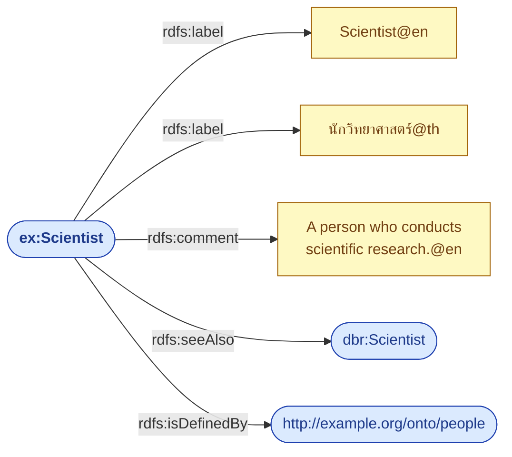

# 03.05 Annotation Properties

RDFS มี property กลุ่มหนึ่งที่ **ไม่มีผลต่อ reasoning เลย** แต่สำคัญมากในทางปฏิบัติ เพราะเป็นสิ่งที่ทำให้มนุษย์เข้าใจ ontology ได้
ได้แก่ `rdfs:label`, `rdfs:comment`, `rdfs:seeAlso` และ `rdfs:isDefinedBy`
บทนี้อธิบายแต่ละตัว พร้อมแนวปฏิบัติที่ทำให้ ontology ของคุณ "ใช้ได้จริง" แทนที่จะเป็นแค่ไฟล์ที่ถูกต้องตาม syntax

---

## ภาพรวม

| Property | Range | ใช้ทำอะไร |
| --- | --- | --- |
| `rdfs:label` | `rdfs:Literal` | ชื่อที่มนุษย์อ่าน |
| `rdfs:comment` | `rdfs:Literal` | คำอธิบายละเอียด |
| `rdfs:seeAlso` | `rdfs:Resource` | ชี้ไปยังข้อมูลเพิ่มเติม |
| `rdfs:isDefinedBy` | `rdfs:Resource` | ชี้ไปยังแหล่งที่นิยาม resource นี้ |



---

## `rdfs:label` — ชื่อสำหรับมนุษย์

IRI อ่านไม่รู้เรื่องสำหรับผู้ใช้ทั่วไป `rdfs:label` คือสะพานเชื่อม

```turtle
@prefix ex:   <http://example.org/> .
@prefix rdfs: <http://www.w3.org/2000/01/rdf-schema#> .

ex:Scientist a rdfs:Class ;
    rdfs:label "Scientist"@en ,
               "นักวิทยาศาสตร์"@th ,
               "Wissenschaftler"@de ,
               "科学者"@ja .
```

**หลักปฏิบัติ**

1. **ใส่ `rdfs:label` ให้ทุก class และทุก property เสมอ** — ไม่มีข้อยกเว้น
2. **ใส่ language tag เสมอ** อย่างน้อย `@en`
3. ใช้ **noun phrase** สำหรับ class (`"Course"`) และ **verb phrase** สำหรับ property (`"enrolled in"`)
4. **หนึ่ง label ต่อหนึ่งภาษา** — ถ้ามีชื่อพ้อง ให้ใช้ `skos:altLabel`

```turtle
@prefix skos: <http://www.w3.org/2004/02/skos/core#> .

ex:Automobile a rdfs:Class ;
    rdfs:label     "Automobile"@en ;      # ชื่อหลัก
    skos:altLabel  "Car"@en ,             # ชื่อพ้อง
                   "Motor vehicle"@en .
```

### ผลต่อ UI จริง

```sparql
PREFIX rdfs: <http://www.w3.org/2000/01/rdf-schema#>
PREFIX ex:   <http://example.org/>

# แสดงผลให้ผู้ใช้ภาษาไทย โดย fallback เป็นอังกฤษถ้าไม่มี
SELECT ?class ?display
WHERE {
  ?class a rdfs:Class .
  OPTIONAL { ?class rdfs:label ?thLabel . FILTER(LANG(?thLabel) = "th") }
  OPTIONAL { ?class rdfs:label ?enLabel . FILTER(LANG(?enLabel) = "en") }
  BIND(COALESCE(?thLabel, ?enLabel, STR(?class)) AS ?display)
}
```

---

## `rdfs:comment` — คำอธิบายที่ควรอ่านก่อนใช้

```turtle
@prefix ex:   <http://example.org/> .
@prefix rdfs: <http://www.w3.org/2000/01/rdf-schema#> .

ex:enrolledIn a rdf:Property ;
    rdfs:label   "enrolled in"@en ;
    rdfs:comment """Relates a student to a course they are currently
enrolled in for the active academic term. Does not include courses
that have been completed or dropped; use ex:completedCourse or
ex:droppedCourse for those cases."""@en ;
    rdfs:domain ex:Student ;
    rdfs:range  ex:Course .
```

**comment ที่ดีต้องตอบคำถามเหล่านี้**

| คำถาม | ตัวอย่างในข้อความข้างบน |
| --- | --- |
| ใช้เมื่อไหร่ | "currently enrolled ... active academic term" |
| **ไม่**ใช้เมื่อไหร่ | "Does not include completed or dropped" |
| ควรใช้อะไรแทน | "use ex:completedCourse or ex:droppedCourse" |

> 💡 comment ที่แค่เขียนซ้ำชื่อ (`rdfs:comment "The enrolled in property."`) ไม่มีค่าใด ๆ
> ให้เขียน **ขอบเขตและกรณีที่ไม่ใช้** เพราะนั่นคือสิ่งที่คนอ่าน ontology อยากรู้จริง ๆ

---

## `rdfs:seeAlso` — ข้อมูลเพิ่มเติม

```turtle
@prefix ex:   <http://example.org/> .
@prefix rdfs: <http://www.w3.org/2000/01/rdf-schema#> .
@prefix dbr:  <http://dbpedia.org/resource/> .

ex:MarieCurie a ex:Scientist ;
    rdfs:label   "Marie Curie"@en ;
    rdfs:seeAlso dbr:Marie_Curie ,
                 <https://www.wikidata.org/entity/Q7186> ,
                 <https://www.nobelprize.org/prizes/physics/1903/marie-curie/> .
```

> ⚠️ `rdfs:seeAlso` **ไม่ได้แปลว่าเป็นสิ่งเดียวกัน** — เป็นเพียง "ดูเพิ่มเติมที่นี่"
> ถ้าจะบอกว่าเป็น resource เดียวกันจริง ต้องใช้ `owl:sameAs`

| Property | ความหมาย | reasoner ใช้อนุมานไหม |
| --- | --- | :---: |
| `rdfs:seeAlso` | ดูข้อมูลเพิ่มเติม | ❌ |
| `owl:sameAs` | เป็น resource เดียวกัน | ✅ merge ทุก property |
| `skos:closeMatch` | ใกล้เคียงกันมาก | ❌ (แต่ tool บางตัวใช้) |
| `skos:exactMatch` | ตรงกันในบริบท SKOS | ❌ |

---

## `rdfs:isDefinedBy` — บอกแหล่งนิยาม

```turtle
@prefix ex:   <http://example.org/> .
@prefix rdfs: <http://www.w3.org/2000/01/rdf-schema#> .
@prefix owl:  <http://www.w3.org/2002/07/owl#> .

<http://example.org/onto/university> a owl:Ontology ;
    rdfs:label "University Ontology"@en .

ex:Student a rdfs:Class ;
    rdfs:label       "Student"@en ;
    rdfs:isDefinedBy <http://example.org/onto/university> .
```

มีประโยชน์มากเมื่อ graph รวม term จากหลาย ontology — ทำให้ตอบได้ว่า term นี้ "มาจากไหน"

```sparql
PREFIX rdfs: <http://www.w3.org/2000/01/rdf-schema#>

# term ไหนมาจาก ontology ไหน
SELECT ?ontology (COUNT(?term) AS ?termCount)
WHERE {
  ?term rdfs:isDefinedBy ?ontology .
}
GROUP BY ?ontology
ORDER BY DESC(?termCount)
```

---

## Annotation อื่นที่ควรใส่คู่กัน (ไม่ใช่ RDFS แต่ใช้บ่อยมาก)

```turtle
@prefix ex:      <http://example.org/> .
@prefix rdfs:    <http://www.w3.org/2000/01/rdf-schema#> .
@prefix owl:     <http://www.w3.org/2002/07/owl#> .
@prefix dcterms: <http://purl.org/dc/terms/> .
@prefix skos:    <http://www.w3.org/2004/02/skos/core#> .
@prefix vann:    <http://purl.org/vocab/vann/> .
@prefix xsd:     <http://www.w3.org/2001/XMLSchema#> .

<http://example.org/onto/university> a owl:Ontology ;
    dcterms:title       "University Ontology"@en ;
    dcterms:description "An ontology for modelling students, courses and staff."@en ;
    dcterms:creator     <https://orcid.org/0000-0002-1825-0097> ;
    dcterms:created     "2025-01-15"^^xsd:date ;
    dcterms:modified    "2025-06-01"^^xsd:date ;
    dcterms:license     <https://creativecommons.org/licenses/by/4.0/> ;
    owl:versionInfo     "1.2.0" ;
    vann:preferredNamespacePrefix "uni" ;
    vann:preferredNamespaceUri    "http://example.org/onto/university#" .

ex:Student a rdfs:Class ;
    rdfs:label       "Student"@en ;
    rdfs:comment     "A person enrolled in at least one course."@en ;
    skos:example     "ex:alice is a Student enrolled in ex:cs101."@en ;
    rdfs:isDefinedBy <http://example.org/onto/university> ;
    owl:versionInfo  "added in 1.0.0" .
```

| Property | ใช้ทำอะไร |
| --- | --- |
| `owl:versionInfo` | เลข version หรือประวัติการเปลี่ยนแปลง |
| `owl:deprecated` | ทำเครื่องหมายว่าเลิกใช้แล้ว |
| `dcterms:creator` / `dcterms:license` | ผู้สร้างและสัญญาอนุญาต |
| `vann:preferredNamespacePrefix` | prefix ที่แนะนำ (tool อ่านไปใช้ได้) |
| `skos:example` | ตัวอย่างการใช้งาน |

### ทำเครื่องหมาย deprecated

```turtle
@prefix owl: <http://www.w3.org/2002/07/owl#> .

ex:studentId a rdf:Property ;
    rdfs:label      "student ID"@en ;
    owl:deprecated  true ;
    rdfs:comment    "Deprecated since 2.0.0. Use ex:identifier instead."@en ;
    rdfs:seeAlso    ex:identifier .
```

---

## ตัวอย่างเต็ม: class ที่ annotate ครบถ้วน

<table>
<tr><th width="50%">Full form</th><th width="50%">Shorthand</th></tr>
<tr valign="top">
<td>

```turtle
@prefix ex:   <http://example.org/> .
@prefix rdf:  <http://www.w3.org/1999/02/22-rdf-syntax-ns#> .
@prefix rdfs: <http://www.w3.org/2000/01/rdf-schema#> .
@prefix skos: <http://www.w3.org/2004/02/skos/core#> .

ex:Course rdf:type rdfs:Class .
ex:Course rdfs:label "Course"@en .
ex:Course rdfs:label "รายวิชา"@th .
ex:Course skos:altLabel "Class"@en .
ex:Course skos:altLabel "Subject"@en .
ex:Course rdfs:comment "A unit of teaching..."@en .
ex:Course rdfs:seeAlso <https://schema.org/Course> .
ex:Course rdfs:isDefinedBy <http://example.org/onto/university> .
```

</td>
<td>

```turtle
@prefix ex:   <http://example.org/> .
@prefix rdf:  <http://www.w3.org/1999/02/22-rdf-syntax-ns#> .
@prefix rdfs: <http://www.w3.org/2000/01/rdf-schema#> .
@prefix skos: <http://www.w3.org/2004/02/skos/core#> .

ex:Course a rdfs:Class ;
    rdfs:label       "Course"@en , "รายวิชา"@th ;
    skos:altLabel    "Class"@en , "Subject"@en ;
    rdfs:comment     "A unit of teaching..."@en ;
    rdfs:seeAlso     <https://schema.org/Course> ;
    rdfs:isDefinedBy <http://example.org/onto/university> .
```

</td>
</tr>
</table>

---

## ตรวจความครบถ้วนของ annotation ด้วย Python

```python
from rdflib import Graph, Namespace
from rdflib.namespace import RDF, RDFS

g = Graph().parse("university-schema.ttl", format="turtle")

missing_label, missing_comment = [], []

for term in set(g.subjects(RDF.type, RDFS.Class)) | set(g.subjects(RDF.type, RDF.Property)):
    if not list(g.objects(term, RDFS.label)):
        missing_label.append(term)
    if not list(g.objects(term, RDFS.comment)):
        missing_comment.append(term)

print(f"ขาด rdfs:label   : {len(missing_label)} terms")
for t in missing_label:
    print(f"  - {t}")
print(f"ขาด rdfs:comment : {len(missing_comment)} terms")
for t in missing_comment:
    print(f"  - {t}")
```

Expected output:

```
ขาด rdfs:label   : 0 terms
ขาด rdfs:comment : 2 terms
  - http://example.org/credits
  - http://example.org/semester
```

> การตรวจแบบนี้เป็นหนึ่งใน pitfall ที่ **OOPS!** ตรวจให้อัตโนมัติ (P08: Missing annotations)
> ดู [10.08 Evaluation](../10-ontology-design/10.08-evaluation.md)

---

## Key Points

- Annotation property **ไม่มีผลต่อ reasoning** แต่เป็นสิ่งที่ทำให้ ontology ใช้งานได้จริงโดยมนุษย์
- **ใส่ `rdfs:label` พร้อม language tag ให้ทุก class และทุก property เสมอ** — ไม่มีข้อยกเว้น
- `rdfs:comment` ที่ดีต้องบอก **ขอบเขต**, **กรณีที่ไม่ใช้** และ **ควรใช้อะไรแทน** ไม่ใช่เขียนซ้ำชื่อ
- `rdfs:seeAlso` = "ดูเพิ่มเติม" — **ไม่ได้แปลว่าเป็นสิ่งเดียวกัน** (ต้องใช้ `owl:sameAs` ถ้าเป็นสิ่งเดียวกัน)
- `rdfs:isDefinedBy` บอกว่า term นี้มาจาก ontology ใด มีประโยชน์มากเมื่อรวมหลาย vocabulary
- ควรใส่ `owl:versionInfo`, `dcterms:creator/license`, `vann:preferredNamespacePrefix` ที่ระดับ ontology ด้วย
- ใช้ `owl:deprecated true` แทนการลบ term ทิ้ง เพื่อไม่ให้ผู้ใช้เดิมพัง
- เขียนสคริปต์ตรวจ annotation ที่ขาดหายเป็นส่วนหนึ่งของ CI ได้ — เป็น pitfall P08 ของ OOPS!
