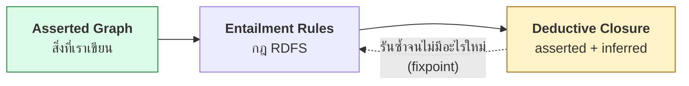
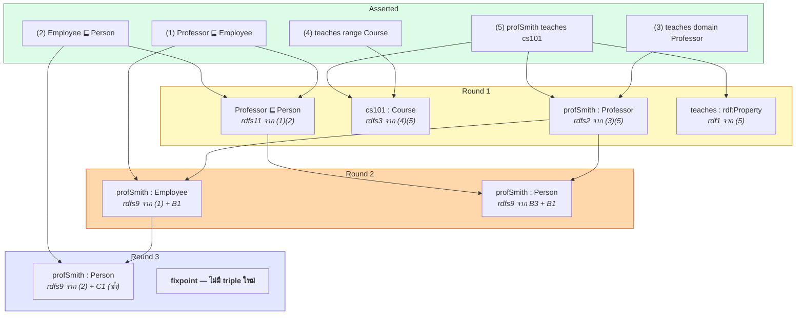
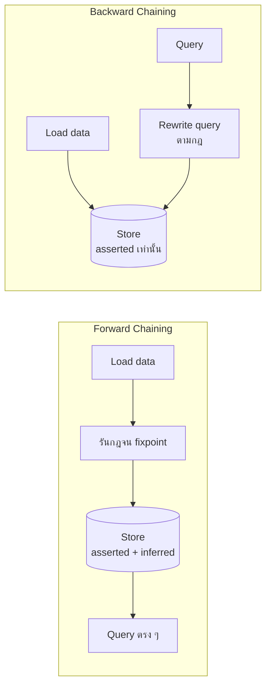

# 03.06 RDFS Entailment Rules

**Entailment** คือหัวใจของ Semantic Web: การที่ graph หนึ่งบังคับให้ triple อื่นเป็นจริงโดยอัตโนมัติ
บทนี้รวบรวม **กฎ entailment ของ RDFS ครบทุกข้อ** ในตารางเดียว พร้อม trace ตัวอย่างจริงทีละขั้น
และอธิบายว่าทำไม graph 5 triple จึงขยายเป็นเกือบ 50 triple หลังรัน reasoner

---

## Entailment คืออะไร

> Graph **G1 entails** G2 ถ้าทุก interpretation ที่ทำให้ G1 เป็นจริง ทำให้ G2 เป็นจริงด้วย

ในทางปฏิบัติ: **G2 คือสิ่งที่ต้องเป็นจริง ถ้า G1 เป็นจริง**



**Deductive closure** = ผลลัพธ์เมื่อรันกฎซ้ำจนไม่เกิด triple ใหม่อีก (**fixpoint**)

---

## ตารางกฎ RDFS Entailment ครบทุกข้อ

### กลุ่ม 1: Literal และ Datatype

| Rule | ถ้ามี | อนุมานได้ |
| --- | --- | --- |
| **rdf1** | `s p o` | `p rdf:type rdf:Property` |
| **rdfs1** | `s p l` โดย `l` เป็น literal | `l rdf:type rdfs:Literal` |

### กลุ่ม 2: Domain และ Range

| Rule | ถ้ามี | อนุมานได้ |
| --- | --- | --- |
| **rdfs2** | `p rdfs:domain c` และ `s p o` | **`s rdf:type c`** |
| **rdfs3** | `p rdfs:range c` และ `s p o` | **`o rdf:type c`** |

### กลุ่ม 3: Resource ทั่วไป

| Rule | ถ้ามี | อนุมานได้ |
| --- | --- | --- |
| **rdfs4a** | `s p o` | `s rdf:type rdfs:Resource` |
| **rdfs4b** | `s p o` | `o rdf:type rdfs:Resource` |

### กลุ่ม 4: Property Hierarchy

| Rule | ถ้ามี | อนุมานได้ |
| --- | --- | --- |
| **rdfs5** | `p1 rdfs:subPropertyOf p2` และ `p2 rdfs:subPropertyOf p3` | **`p1 rdfs:subPropertyOf p3`** (transitive) |
| **rdfs6** | `p rdf:type rdf:Property` | `p rdfs:subPropertyOf p` (reflexive) |
| **rdfs7** | `p1 rdfs:subPropertyOf p2` และ `s p1 o` | **`s p2 o`** |

### กลุ่ม 5: Class Hierarchy

| Rule | ถ้ามี | อนุมานได้ |
| --- | --- | --- |
| **rdfs8** | `c rdf:type rdfs:Class` | `c rdfs:subClassOf rdfs:Resource` |
| **rdfs9** | `c1 rdfs:subClassOf c2` และ `s rdf:type c1` | **`s rdf:type c2`** |
| **rdfs10** | `c rdf:type rdfs:Class` | `c rdfs:subClassOf c` (reflexive) |
| **rdfs11** | `c1 rdfs:subClassOf c2` และ `c2 rdfs:subClassOf c3` | **`c1 rdfs:subClassOf c3`** (transitive) |

### กลุ่ม 6: Container Membership และ Datatype

| Rule | ถ้ามี | อนุมานได้ |
| --- | --- | --- |
| **rdfs12** | `p rdf:type rdfs:ContainerMembershipProperty` | `p rdfs:subPropertyOf rdfs:member` |
| **rdfs13** | `d rdf:type rdfs:Datatype` | `d rdfs:subClassOf rdfs:Literal` |

> **กฎที่ใช้บ่อยที่สุด 4 ข้อ**: **rdfs2, rdfs3** (domain/range) และ **rdfs7, rdfs9** (propagation)
> ส่วนกฎที่เหลือมักสร้าง triple "พื้นฐาน" จำนวนมากที่ไม่ค่อยมีประโยชน์เชิงข้อมูล

---

## Trace ตัวอย่างเต็ม

### Asserted graph (5 triple)

```turtle
@prefix ex:   <http://example.org/> .
@prefix rdfs: <http://www.w3.org/2000/01/rdf-schema#> .

ex:Professor  rdfs:subClassOf ex:Employee .          # (1)
ex:Employee   rdfs:subClassOf ex:Person .            # (2)
ex:teaches    rdfs:domain     ex:Professor .         # (3)
ex:teaches    rdfs:range      ex:Course .            # (4)
ex:profSmith  ex:teaches      ex:cs101 .             # (5)
```

### การอนุมานทีละรอบ



### ผลลัพธ์ที่มีความหมายจริง

```turtle
# --- inferred (เฉพาะที่มีค่าเชิงข้อมูล) ---
ex:profSmith a ex:Professor .              # rdfs2
ex:cs101     a ex:Course .                 # rdfs3
ex:profSmith a ex:Employee .               # rdfs9
ex:profSmith a ex:Person .                 # rdfs9
ex:Professor rdfs:subClassOf ex:Person .   # rdfs11
```

### บวกกับ triple "พื้นฐาน" อีกจำนวนมาก

```turtle
ex:teaches    a rdf:Property .                   # rdf1
ex:profSmith  a rdfs:Resource .                  # rdfs4a
ex:cs101      a rdfs:Resource .                  # rdfs4b
ex:teaches    rdfs:subPropertyOf ex:teaches .    # rdfs6
ex:Professor  rdfs:subClassOf ex:Professor .     # rdfs10
ex:Employee   rdfs:subClassOf ex:Employee .      # rdfs10
ex:Person     rdfs:subClassOf ex:Person .        # rdfs10
ex:Professor  rdfs:subClassOf rdfs:Resource .    # rdfs8
# ... และ axiomatic triple ของ RDFS vocabulary เองอีกหลายสิบ triple
```

**นี่คือเหตุผลที่ 5 triple กลายเป็นเกือบ 50** — ส่วนใหญ่เป็น triple ที่ถูกต้องแต่ไม่มีประโยชน์ในทางปฏิบัติ

---

## Forward vs Backward Chaining

| | Forward chaining (materialization) | Backward chaining (query rewriting) |
| --- | --- | --- |
| ทำเมื่อไหร่ | ตอน load ข้อมูล | ตอน query |
| เก็บผลลัพธ์ | เก็บ inferred triple ลง store | ไม่เก็บ |
| Query เร็ว | ✅ มาก | ⚠️ ช้ากว่า |
| Storage | ❌ โตขึ้นหลายเท่า | ✅ เท่าเดิม |
| ข้อมูลเปลี่ยนบ่อย | ❌ ต้อง re-run | ✅ ทันสมัยเสมอ |
| ตัวอย่าง | `owlrl`, Jena `RDFSRuleReasoner` | Ontop, Stardog (บาง mode) |



---

## รัน RDFS reasoning ด้วย owlrl

```python
from rdflib import Graph, Namespace
from rdflib.namespace import RDF
import owlrl

EX = Namespace("http://example.org/")

data = """
@prefix ex:   <http://example.org/> .
@prefix rdfs: <http://www.w3.org/2000/01/rdf-schema#> .

ex:Professor rdfs:subClassOf ex:Employee .
ex:Employee  rdfs:subClassOf ex:Person .
ex:teaches   rdfs:domain ex:Professor ;
             rdfs:range  ex:Course .
ex:profSmith ex:teaches ex:cs101 .
"""

g = Graph().parse(data=data, format="turtle")
asserted = set(g)
print(f"Asserted: {len(asserted)} triples")

owlrl.DeductiveClosure(owlrl.RDFS_Semantics).expand(g)
print(f"หลัง closure: {len(g)} triples")

inferred = set(g) - asserted
print(f"Inferred: {len(inferred)} triples\n")

# แสดงเฉพาะ inferred ที่เกี่ยวกับ ex: namespace (ตัด axiomatic triple ออก)
print("Inferred triples ที่เกี่ยวกับข้อมูลของเรา:")
for s, p, o in sorted(inferred):
    if str(s).startswith(str(EX)):
        print(f"  {s.n3(g.namespace_manager)} {p.n3(g.namespace_manager)} {o.n3(g.namespace_manager)} .")
```

Expected output (ย่อ):

```
Asserted: 5 triples
หลัง closure: 48 triples
Inferred: 43 triples

Inferred triples ที่เกี่ยวกับข้อมูลของเรา:
  ex:Employee rdfs:subClassOf ex:Employee .
  ex:Employee rdfs:subClassOf rdfs:Resource .
  ex:Person rdfs:subClassOf ex:Person .
  ex:Professor rdfs:subClassOf ex:Person .
  ex:Professor rdfs:subClassOf ex:Professor .
  ex:cs101 a ex:Course .
  ex:cs101 a rdfs:Resource .
  ex:profSmith a ex:Employee .
  ex:profSmith a ex:Person .
  ex:profSmith a ex:Professor .
  ex:teaches a rdf:Property .
  ...
```

---

## กรองเฉพาะ inference ที่มีประโยชน์

ในทางปฏิบัติเรามัก **ไม่ต้องการ** triple พื้นฐานเหล่านั้น

```python
from rdflib import RDF, RDFS

NOISE_OBJECTS = {RDFS.Resource, RDFS.Literal, RDFS.Class}

def is_useful(s, p, o) -> bool:
    """กรอง triple ที่เป็นเพียง axiomatic noise ออก"""
    if o in NOISE_OBJECTS:
        return False
    if p == RDFS.subClassOf and s == o:       # reflexive
        return False
    if p == RDFS.subPropertyOf and s == o:    # reflexive
        return False
    return True

useful = [t for t in inferred if is_useful(*t)]
print(f"Inferred ที่มีประโยชน์: {len(useful)} triples")
```

หรือใช้ **named graph** แยก inferred ออกจาก asserted ตามที่เรียนใน [02.03](../02-rdf/02.03-rdf-graph.md)

---

## ข้อสังเกตสำคัญ: RDFS entailment เป็น monotonic

**เพิ่มข้อมูลใหม่ → ข้อสรุปเดิมไม่มีวันถูกยกเลิก** มีแต่จะเพิ่มขึ้น

```turtle
# ตอนแรก
ex:alice a ex:Student .
ex:Student rdfs:subClassOf ex:Person .
# -> อนุมาน: ex:alice a ex:Person

# ภายหลังเพิ่ม
ex:Student rdfs:subClassOf ex:Minor .
# -> อนุมานเพิ่ม: ex:alice a ex:Minor
# -> ex:alice a ex:Person ยังคงเป็นจริงเสมอ
```

คุณสมบัตินี้มาจาก **OWA** ที่เรียนใน [01.04](../01-introduction/01.04-key-concepts.md)
และเป็นสิ่งที่ทำให้การรวมข้อมูลจากหลายแหล่งบน Web ปลอดภัย

---

## Key Points

- **Entailment** = triple ที่ต้องเป็นจริงถ้า graph ต้นทางเป็นจริง; **deductive closure** = ผลลัพธ์เมื่อรันกฎจน fixpoint
- RDFS มีกฎทั้งหมด 13 ข้อ แต่ที่ใช้จริงคือ 4 ข้อ: **rdfs2/rdfs3** (domain/range) และ **rdfs7/rdfs9** (propagation)
- กฎ rdfs4a/4b, rdfs6, rdfs8, rdfs10 สร้าง triple พื้นฐานจำนวนมหาศาลที่ถูกต้องแต่ไม่มีประโยชน์เชิงข้อมูล
- **Forward chaining** (materialize) query เร็วแต่กิน storage; **backward chaining** ประหยัดพื้นที่แต่ query ช้ากว่า
- ใช้ `owlrl.DeductiveClosure(owlrl.RDFS_Semantics).expand(g)` รัน RDFS reasoning ใน Python
- ควร **กรอง axiomatic noise** ออก หรือแยก inferred ไว้ใน named graph ต่างหาก
- RDFS entailment เป็น **monotonic** — ข้อมูลใหม่ไม่ลบล้างข้อสรุปเดิม ซึ่งเป็นผลโดยตรงจาก Open World Assumption
