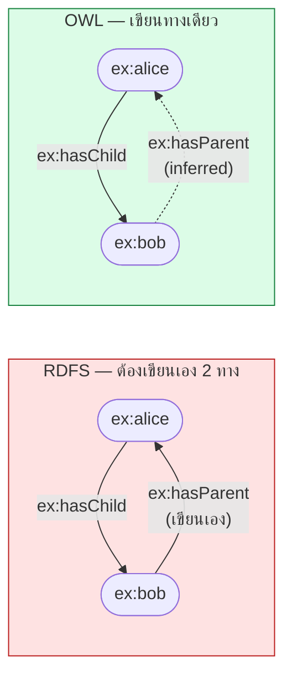
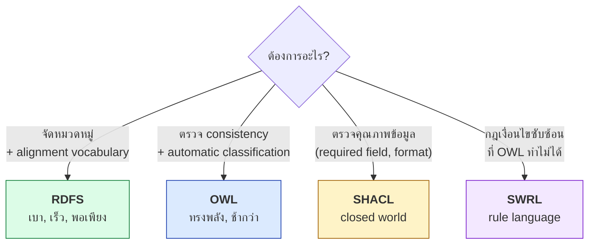

# 03.07 ข้อจำกัดของ RDFS

RDFS ทำได้เพียง 4 อย่างหลัก: ลำดับชั้นของ class, ลำดับชั้นของ property, domain/range และ annotation
บทนี้แสดง **สิ่งที่ RDFS แสดงไม่ได้เลย** ผ่านตัวอย่างที่เป็นความต้องการปกติของงานจริง
เพื่อให้เห็นชัดว่าทำไมต้องมี OWL และทำไมต้องเรียน Description Logic ก่อน

---

## สรุปสิ่งที่ RDFS ทำไม่ได้

| ต้องการแสดงว่า | RDFS | ต้องใช้ |
| --- | :---: | --- |
| Male กับ Female ไม่มีสมาชิกร่วมกัน | ❌ | `owl:disjointWith` |
| นักศึกษาต้องลงเรียนอย่างน้อย 1 วิชา | ❌ | `owl:minCardinality` |
| คนหนึ่งมีแม่ได้คนเดียว | ❌ | `owl:FunctionalProperty` |
| `hasChild` เป็นตรงข้ามกับ `hasParent` | ❌ | `owl:inverseOf` |
| `hasAncestor` เป็น transitive | ❌ | `owl:TransitiveProperty` |
| `marriedTo` เป็น symmetric | ❌ | `owl:SymmetricProperty` |
| Parent = คนที่มี child อย่างน้อยหนึ่งคน | ❌ | `owl:equivalentClass` + restriction |
| `ex:Car` กับ `ex:Automobile` เป็น class เดียวกัน | ❌ | `owl:equivalentClass` |
| `ex:alice` กับ `wd:Q123` เป็นคนเดียวกัน | ❌ | `owl:sameAs` |
| Weekday มีสมาชิกเพียง 7 ตัวที่ระบุไว้ | ❌ | `owl:oneOf` |

---

## ข้อจำกัด 1: ไม่มี Disjointness

```turtle
@prefix ex:   <http://example.org/> .
@prefix rdfs: <http://www.w3.org/2000/01/rdf-schema#> .

ex:Male   rdfs:subClassOf ex:Person .
ex:Female rdfs:subClassOf ex:Person .

ex:alex a ex:Male , ex:Female .    # RDFS: ไม่มีปัญหาใด ๆ
```

RDFS **ไม่มีทางบอกว่านี่ผิด** เพราะไม่มีคำศัพท์แสดงว่าสอง class ไม่มีสมาชิกร่วมกัน

<table>
<tr><th width="50%">RDFS — ทำไม่ได้</th><th width="50%">OWL — ทำได้</th></tr>
<tr valign="top">
<td>

```turtle
@prefix ex:   <http://example.org/> .
@prefix rdfs: <http://www.w3.org/2000/01/rdf-schema#> .

ex:Male   rdfs:subClassOf ex:Person .
ex:Female rdfs:subClassOf ex:Person .

# ไม่มีวิธีบอกว่า Male ∩ Female = ∅
```

</td>
<td>

```turtle
@prefix ex:  <http://example.org/> .
@prefix owl: <http://www.w3.org/2002/07/owl#> .

ex:Male   rdfs:subClassOf ex:Person .
ex:Female rdfs:subClassOf ex:Person .
ex:Male   owl:disjointWith ex:Female .

# reasoner รายงาน inconsistency ทันที
ex:alex a ex:Male , ex:Female .
```

</td>
</tr>
</table>

**ผลกระทบ**: RDFS **แทบตรวจจับข้อผิดพลาดอะไรไม่ได้เลย** เพราะไม่มีทางเกิด contradiction

---

## ข้อจำกัด 2: ไม่มี Cardinality

```turtle
# ต้องการบอกว่า "นักศึกษาต้องลงเรียนอย่างน้อย 1 วิชา"
# และ "คนหนึ่งมีแม่ทางสายเลือดได้คนเดียว"
# RDFS: ทำไม่ได้ทั้งสองอย่าง
```

<table>
<tr><th width="50%">RDFS — ทำได้แค่นี้</th><th width="50%">OWL — ทำได้ตามต้องการ</th></tr>
<tr valign="top">
<td>

```turtle
@prefix ex:   <http://example.org/> .
@prefix rdfs: <http://www.w3.org/2000/01/rdf-schema#> .

ex:enrolledIn rdfs:domain ex:Student ;
              rdfs:range  ex:Course .

# บอกได้แค่ว่าถ้าใช้ property นี้
# subject เป็น Student
# บอกจำนวนไม่ได้เลย
```

</td>
<td>

```turtle
@prefix ex:   <http://example.org/> .
@prefix owl:  <http://www.w3.org/2002/07/owl#> .
@prefix rdfs: <http://www.w3.org/2000/01/rdf-schema#> .
@prefix xsd:  <http://www.w3.org/2001/XMLSchema#> .

ex:Student rdfs:subClassOf [
    a owl:Restriction ;
    owl:onProperty ex:enrolledIn ;
    owl:minCardinality "1"^^xsd:nonNegativeInteger
] .

ex:hasBiologicalMother a owl:FunctionalProperty .
```

</td>
</tr>
</table>

---

## ข้อจำกัด 3: ไม่มี Inverse Property

```turtle
@prefix ex: <http://example.org/> .

ex:alice ex:hasChild ex:bob .
# ต้องการให้อนุมานว่า: ex:bob ex:hasParent ex:alice
# RDFS: ทำไม่ได้
```

**ทางออกที่ไม่ดีใน RDFS**: เขียนทั้งสองทิศทางเองทุกครั้ง

```turtle
ex:alice ex:hasChild  ex:bob .
ex:bob   ex:hasParent ex:alice .     # ต้องเขียนเองและอาจลืม → ข้อมูลไม่สอดคล้อง
```

**ทางออกใน OWL**:

```turtle
@prefix owl: <http://www.w3.org/2002/07/owl#> .

ex:hasChild owl:inverseOf ex:hasParent .

ex:alice ex:hasChild ex:bob .
# reasoner อนุมานให้เอง: ex:bob ex:hasParent ex:alice
```



---

## ข้อจำกัด 4: ไม่มี Property Characteristics

RDFS ไม่มีทางบอกว่า property มีคุณสมบัติทางคณิตศาสตร์อย่างไร

| Characteristic | ความหมาย | ตัวอย่าง | RDFS |
| --- | --- | --- | :---: |
| Transitive | `P(a,b) ∧ P(b,c) → P(a,c)` | `hasAncestor` | ❌ |
| Symmetric | `P(a,b) → P(b,a)` | `marriedTo` | ❌ |
| Functional | มีค่าได้ค่าเดียว | `hasBiologicalMother` | ❌ |
| Inverse Functional | ค่าระบุ subject ได้ตัวเดียว | `hasEmail` | ❌ |
| Reflexive | `P(a,a)` เสมอ | `knows` (ในบางนิยาม) | ❌ |
| Asymmetric | `P(a,b) → ¬P(b,a)` | `hasParent` | ❌ |
| Irreflexive | `¬P(a,a)` | `hasParent` | ❌ |

ตัวอย่าง transitive ที่ต้องการบ่อยที่สุด — ลำดับชั้นสถานที่:

```turtle
@prefix ex: <http://example.org/> .

ex:UniversityOfParis ex:locatedIn ex:Paris .
ex:Paris             ex:locatedIn ex:France .
ex:France            ex:locatedIn ex:Europe .

# ต้องการ: ex:UniversityOfParis ex:locatedIn ex:Europe
# RDFS: ทำไม่ได้
```

```turtle
# OWL ทำได้ด้วยบรรทัดเดียว
@prefix owl: <http://www.w3.org/2002/07/owl#> .
ex:locatedIn a owl:TransitiveProperty .
```

> 💡 **ข้อยกเว้นที่ต้องรู้**: `rdfs:subClassOf` และ `rdfs:subPropertyOf` **เป็น transitive อยู่แล้ว**
> เพราะกฎ rdfs11/rdfs5 กำหนดไว้ แต่เราไม่สามารถประกาศให้ property ของเราเองเป็น transitive ได้

---

## ข้อจำกัด 5: ไม่มี Class Constructor

RDFS ไม่มีทางนิยาม class จาก class อื่น

```turtle
# ต้องการ:
#   ex:Parent   = คนที่มี ex:hasChild อย่างน้อย 1
#   ex:Adult    = Person ที่ age >= 18
#   ex:NonHuman = ทุกอย่างที่ไม่ใช่ Person
#   ex:Weekday  = { Mon, Tue, Wed, Thu, Fri } เท่านั้น
# RDFS: ทำไม่ได้ทั้งหมด
```

| Constructor | OWL | ความหมาย |
| --- | --- | --- |
| Intersection | `owl:intersectionOf` | A ⊓ B |
| Union | `owl:unionOf` | A ⊔ B |
| Complement | `owl:complementOf` | ¬A |
| Enumeration | `owl:oneOf` | { a, b, c } |
| Existential restriction | `owl:someValuesFrom` | ∃r.C |
| Universal restriction | `owl:allValuesFrom` | ∀r.C |

ตัวอย่าง defined class ใน OWL:

```turtle
@prefix ex:  <http://example.org/> .
@prefix owl: <http://www.w3.org/2002/07/owl#> .

# Parent = Person ที่มี hasChild อย่างน้อยหนึ่งคน
ex:Parent owl:equivalentClass [
    a owl:Class ;
    owl:intersectionOf (
        ex:Person
        [ a owl:Restriction ;
          owl:onProperty     ex:hasChild ;
          owl:someValuesFrom ex:Person ]
    )
] .
```

ผลลัพธ์: reasoner จะ **จัดประเภทให้อัตโนมัติ** — ใครก็ตามที่เป็น Person และมี `ex:hasChild` จะถูกอนุมานเป็น `ex:Parent`
โดยไม่ต้องประกาศเอง นี่คือความสามารถที่เรียกว่า **automatic classification**

---

## ข้อจำกัด 6: ไม่มี Identity (sameAs / differentFrom)

```turtle
@prefix ex: <http://example.org/> .

ex:alice          ex:email "alice@example.org" .
ex:alice_johnson  ex:phone "+66-2-123-4567" .

# ต้องการบอกว่าสอง IRI นี้คือคนเดียวกัน แล้วให้ merge property
# RDFS: ทำไม่ได้
```

```turtle
@prefix owl: <http://www.w3.org/2002/07/owl#> .

ex:alice owl:sameAs ex:alice_johnson .
# reasoner รวม property ของทั้งสองให้อัตโนมัติ
```

ข้อจำกัดนี้สำคัญมากใน Linked Open Data เพราะการเชื่อม dataset ข้ามแหล่งพึ่ง `owl:sameAs` เป็นหลัก
(ดู [12.09](../12-linked-open-data/12.09-consuming-lod.md))

---

## แล้ว RDFS ยังมีประโยชน์อยู่ไหม

**มีมาก** — และหลายกรณี RDFS คือทางเลือกที่ถูกต้องกว่า OWL



| เกณฑ์ | RDFS | OWL 2 DL |
| --- | --- | --- |
| ความซับซ้อนในการเรียน | ต่ำ | สูง |
| ความเร็ว reasoning | เร็วมาก (P) | ช้า (N2ExpTime worst case) |
| ขนาด dataset ที่รองรับ | พันล้าน triple | จำกัดกว่ามาก |
| ตรวจจับ error | ❌ แทบไม่ได้ | ✅ ดี |
| Automatic classification | ❌ | ✅ |
| เหมาะกับ | LOD ขนาดใหญ่, vocabulary alignment | domain ที่ต้องการความแม่นยำ (medical, legal) |

**Wikidata และ DBpedia ใช้ RDFS-level semantics เป็นหลัก** เพราะขนาดข้อมูลใหญ่เกินกว่าจะรัน OWL DL reasoner ได้

---

## Key Points

- RDFS ทำได้เพียง 4 อย่าง: **class hierarchy, property hierarchy, domain/range, annotation**
- **RDFS ไม่มีทางเกิด contradiction** เพราะไม่มี disjointness, cardinality หรือ negation — จึงตรวจจับ error แทบไม่ได้
- สิ่งที่ทำไม่ได้และต้องใช้ OWL: `disjointWith`, cardinality, `inverseOf`, property characteristics, class constructor, `sameAs`
- `rdfs:subClassOf` และ `rdfs:subPropertyOf` เป็น transitive อยู่แล้ว แต่**ประกาศ property ของเราเองให้ transitive ไม่ได้**
- ความสามารถที่ขาดหายที่สำคัญที่สุดคือ **automatic classification** — การให้ reasoner จัดประเภท individual จากคุณสมบัติของมัน
- **RDFS ยังเหมาะมากกับ LOD ขนาดใหญ่** เพราะ reasoning อยู่ในระดับ polynomial และรองรับข้อมูลพันล้าน triple
- เลือกเครื่องมือให้ตรงงาน: **RDFS** (จัดหมวด), **OWL** (inference แม่นยำ), **SHACL** (validate), **SWRL** (rule)
