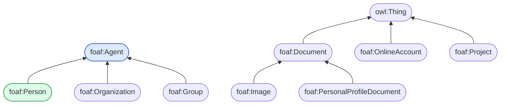
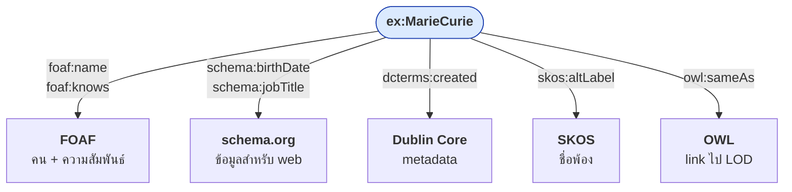
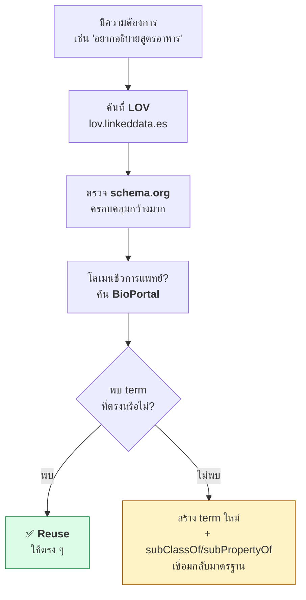

# 03.08 อ่านและใช้ Vocabulary จริง: FOAF และ Dublin Core

การอ่าน vocabulary ที่คนอื่นเขียนเป็นทักษะที่สำคัญกว่าการเขียนเองเสียอีก เพราะหลักการอันดับหนึ่งของ Semantic Web คือ **reuse ก่อน reinvent**
บทนี้พาเปิด **FOAF** และ **Dublin Core** ของจริง อ่านโครงสร้าง RDFS ของมัน แล้วนำมาใช้กับข้อมูลของเรา
พร้อมสอนวิธีค้นหา vocabulary ใหม่เมื่อเจอโดเมนที่ไม่คุ้นเคย

---

## ทำไมต้อง reuse

| ถ้าสร้าง vocabulary เอง | ถ้า reuse vocabulary มาตรฐาน |
| --- | --- |
| ต้องอธิบายให้คนอื่นเข้าใจทุกครั้ง | คนรู้จักอยู่แล้ว |
| tool ภายนอกไม่รู้จัก | Google, Wikidata, tool ต่าง ๆ เข้าใจทันที |
| ต้อง maintain เอง | มีชุมชนดูแล |
| link กับ dataset อื่นไม่ได้ | link ได้ทันที |

> 💡 **หลักปฏิบัติ**: สร้าง term ใหม่เฉพาะเมื่อค้นแล้วไม่มีจริง ๆ และให้ `rdfs:subClassOf` / `rdfs:subPropertyOf`
> เชื่อมกลับไปยัง term มาตรฐานที่ใกล้เคียงที่สุดเสมอ

---

## FOAF (Friend of a Friend)

FOAF เป็น vocabulary สำหรับอธิบาย **คน องค์กร และความสัมพันธ์ระหว่างกัน** เผยแพร่ตั้งแต่ปี 2000
namespace: `http://xmlns.com/foaf/0.1/`

### โครงสร้าง class



ดูนิยามจริงของ FOAF (ตัดมาบางส่วน):

```turtle
@prefix foaf: <http://xmlns.com/foaf/0.1/> .
@prefix rdfs: <http://www.w3.org/2000/01/rdf-schema#> .
@prefix rdf:  <http://www.w3.org/1999/02/22-rdf-syntax-ns#> .
@prefix owl:  <http://www.w3.org/2002/07/owl#> .

foaf:Person a rdfs:Class , owl:Class ;
    rdfs:label      "Person" ;
    rdfs:comment    "A person." ;
    rdfs:subClassOf foaf:Agent ;
    rdfs:isDefinedBy <http://xmlns.com/foaf/0.1/> .

foaf:knows a rdf:Property , owl:ObjectProperty ;
    rdfs:label   "knows" ;
    rdfs:comment "A person known by this person (indicating some level of reciprocated interaction between the parties)." ;
    rdfs:domain  foaf:Person ;
    rdfs:range   foaf:Person .

foaf:name a rdf:Property , owl:DatatypeProperty ;
    rdfs:label        "name" ;
    rdfs:comment      "A name for some thing." ;
    rdfs:domain       owl:Thing ;
    rdfs:range        rdfs:Literal ;
    rdfs:subPropertyOf rdfs:label .
```

**สังเกตสิ่งที่เรียนมาแล้วทั้งหมด**: `rdfs:subClassOf`, `rdfs:domain`, `rdfs:range`, `rdfs:label`, `rdfs:comment`,
`rdfs:subPropertyOf` และ `rdfs:isDefinedBy` — FOAF คือ RDFS ที่ใช้งานจริง

### Property ที่ใช้บ่อย

| Property | Domain | Range | หมายเหตุ |
| --- | --- | --- | --- |
| `foaf:name` | `owl:Thing` | Literal | ชื่อเต็ม |
| `foaf:givenName` | — | Literal | ชื่อต้น |
| `foaf:familyName` | — | Literal | นามสกุล |
| `foaf:knows` | `foaf:Person` | `foaf:Person` | รู้จักกัน |
| `foaf:mbox` | `owl:Thing` | `owl:Thing` | email เป็น `mailto:` IRI, **inverse functional** |
| `foaf:mbox_sha1sum` | — | Literal | hash ของ email (เพื่อความเป็นส่วนตัว) |
| `foaf:homepage` | — | `foaf:Document` | **inverse functional** |
| `foaf:member` | `foaf:Group` | `foaf:Agent` | สมาชิกของกลุ่ม |
| `foaf:made` / `foaf:maker` | — | — | ผลงาน / ผู้สร้าง |
| `foaf:img` | `foaf:Person` | `foaf:Image` | รูปภาพ |

### ตัวอย่างการใช้จริง: social graph

<table>
<tr><th width="50%">Full form</th><th width="50%">Shorthand</th></tr>
<tr valign="top">
<td>

```turtle
@prefix ex:   <http://example.org/> .
@prefix rdf:  <http://www.w3.org/1999/02/22-rdf-syntax-ns#> .
@prefix foaf: <http://xmlns.com/foaf/0.1/> .

ex:alice rdf:type foaf:Person .
ex:alice foaf:name "Alice Johnson" .
ex:alice foaf:givenName "Alice" .
ex:alice foaf:familyName "Johnson" .
ex:alice foaf:mbox <mailto:alice@example.org> .
ex:alice foaf:homepage <https://alice.example.org/> .
ex:alice foaf:knows ex:bob .
ex:alice foaf:knows ex:carol .

ex:bob rdf:type foaf:Person .
ex:bob foaf:name "Bob Smith" .
ex:bob foaf:knows ex:alice .

ex:acme rdf:type foaf:Organization .
ex:acme foaf:name "Acme Research Lab" .
ex:acme foaf:member ex:alice .
ex:acme foaf:member ex:bob .
```

</td>
<td>

```turtle
@prefix ex:   <http://example.org/> .
@prefix rdf:  <http://www.w3.org/1999/02/22-rdf-syntax-ns#> .
@prefix foaf: <http://xmlns.com/foaf/0.1/> .

ex:alice a foaf:Person ;
    foaf:name       "Alice Johnson" ;
    foaf:givenName  "Alice" ;
    foaf:familyName "Johnson" ;
    foaf:mbox       <mailto:alice@example.org> ;
    foaf:homepage   <https://alice.example.org/> ;
    foaf:knows      ex:bob , ex:carol .

ex:bob a foaf:Person ;
    foaf:name  "Bob Smith" ;
    foaf:knows ex:alice .

ex:acme a foaf:Organization ;
    foaf:name   "Acme Research Lab" ;
    foaf:member ex:alice , ex:bob .
```

</td>
</tr>
</table>

> ⚠️ `foaf:mbox` ต้องเป็น **IRI แบบ `mailto:`** ไม่ใช่ string
> `foaf:mbox "alice@example.org"` ผิด, `foaf:mbox <mailto:alice@example.org>` ถูก

---

## Dublin Core

Dublin Core เป็น vocabulary สำหรับ **metadata ของเอกสารและทรัพยากร** เกิดจากการประชุมที่เมือง Dublin รัฐ Ohio ปี 1995

### สอง namespace ที่ต้องแยกให้ออก

| | `dc:` — DC Elements 1.1 | `dcterms:` — DCMI Metadata Terms |
| --- | --- | --- |
| Namespace | `http://purl.org/dc/elements/1.1/` | `http://purl.org/dc/terms/` |
| จำนวน term | 15 | 70+ |
| Range | ไม่กำหนด | **กำหนดชัดเจน** |
| สถานะ | legacy | **แนะนำให้ใช้** |

### 15 element ดั้งเดิม

```
title       creator     subject     description
publisher   contributor date        type
format      identifier  source      language
relation    coverage    rights
```

`dcterms:` ขยายแต่ละตัวให้ละเอียดขึ้น เช่น `date` แตกเป็น `created`, `issued`, `modified`, `available`, `dateAccepted`

### โครงสร้างจริงของ dcterms

```turtle
@prefix dcterms: <http://purl.org/dc/terms/> .
@prefix rdfs:    <http://www.w3.org/2000/01/rdf-schema#> .
@prefix rdf:     <http://www.w3.org/1999/02/22-rdf-syntax-ns#> .

dcterms:creator a rdf:Property ;
    rdfs:label   "Creator"@en ;
    rdfs:comment "An entity responsible for making the resource."@en ;
    rdfs:range   dcterms:Agent ;
    rdfs:subPropertyOf dcterms:contributor .

dcterms:issued a rdf:Property ;
    rdfs:label   "Date Issued"@en ;
    rdfs:comment "Date of formal issuance of the resource."@en ;
    rdfs:subPropertyOf dcterms:date .

dcterms:date a rdf:Property ;
    rdfs:label "Date"@en ;
    rdfs:range rdfs:Literal .
```

**สังเกต `rdfs:subPropertyOf`**: `dcterms:issued` เป็น subproperty ของ `dcterms:date`
ดังนั้น query หา `dcterms:date` จะได้ `dcterms:issued` มาด้วยหลังรัน reasoner — เป็นตัวอย่างที่ดีของสิ่งที่เรียนใน [03.03](03.03-properties.md)

### ตัวอย่างการใช้จริง: metadata ของบทความ

<table>
<tr><th width="50%">Full form</th><th width="50%">Shorthand</th></tr>
<tr valign="top">
<td>

```turtle
@prefix ex:      <http://example.org/> .
@prefix rdf:     <http://www.w3.org/1999/02/22-rdf-syntax-ns#> .
@prefix dcterms: <http://purl.org/dc/terms/> .
@prefix foaf:    <http://xmlns.com/foaf/0.1/> .
@prefix xsd:     <http://www.w3.org/2001/XMLSchema#> .

ex:paper001 rdf:type dcterms:BibliographicResource .
ex:paper001 dcterms:title "On the Radiation of Uranium" .
ex:paper001 dcterms:creator ex:MarieCurie .
ex:paper001 dcterms:issued "1898-04-12"^^xsd:date .
ex:paper001 dcterms:language "en" .
ex:paper001 dcterms:subject "radioactivity" .
ex:paper001 dcterms:subject "uranium" .
ex:paper001 dcterms:format "application/pdf" .
ex:paper001 dcterms:license <https://creativecommons.org/licenses/by/4.0/> .

ex:MarieCurie rdf:type foaf:Person .
ex:MarieCurie foaf:name "Marie Curie" .
```

</td>
<td>

```turtle
@prefix ex:      <http://example.org/> .
@prefix rdf:     <http://www.w3.org/1999/02/22-rdf-syntax-ns#> .
@prefix dcterms: <http://purl.org/dc/terms/> .
@prefix foaf:    <http://xmlns.com/foaf/0.1/> .
@prefix xsd:     <http://www.w3.org/2001/XMLSchema#> .

ex:paper001 a dcterms:BibliographicResource ;
    dcterms:title    "On the Radiation of Uranium" ;
    dcterms:creator  ex:MarieCurie ;
    dcterms:issued   "1898-04-12"^^xsd:date ;
    dcterms:language "en" ;
    dcterms:subject  "radioactivity" , "uranium" ;
    dcterms:format   "application/pdf" ;
    dcterms:license  <https://creativecommons.org/licenses/by/4.0/> .

ex:MarieCurie a foaf:Person ;
    foaf:name "Marie Curie" .
```

</td>
</tr>
</table>

---

## ผสม vocabulary หลายตัวใน graph เดียว

นี่คือสิ่งที่ทำได้อย่างเป็นธรรมชาติใน RDF และเป็นเหตุผลหลักที่ RDF ชนะ schema แบบตายตัว

```turtle
@prefix ex:      <http://example.org/> .
@prefix rdf:     <http://www.w3.org/1999/02/22-rdf-syntax-ns#> .
@prefix rdfs:    <http://www.w3.org/2000/01/rdf-schema#> .
@prefix foaf:    <http://xmlns.com/foaf/0.1/> .
@prefix dcterms: <http://purl.org/dc/terms/> .
@prefix schema:  <https://schema.org/> .
@prefix skos:    <http://www.w3.org/2004/02/skos/core#> .
@prefix owl:     <http://www.w3.org/2002/07/owl#> .
@prefix xsd:     <http://www.w3.org/2001/XMLSchema#> .

ex:MarieCurie a foaf:Person , schema:Person ;
    # จาก FOAF
    foaf:name       "Marie Curie" ;
    foaf:homepage   <https://example.org/mc> ;
    foaf:knows      ex:PierreCurie ;
    # จาก schema.org
    schema:birthDate "1867-11-07"^^xsd:date ;
    schema:jobTitle  "Professor of Physics" ;
    schema:affiliation ex:UniversityOfParis ;
    # จาก Dublin Core
    dcterms:created  "2025-01-15"^^xsd:date ;
    # จาก SKOS
    skos:altLabel    "Maria Skłodowska"@pl ;
    # จาก OWL — เชื่อมไปยัง LOD
    owl:sameAs       <http://www.wikidata.org/entity/Q7186> ,
                     <http://dbpedia.org/resource/Marie_Curie> .
```



---

## เชื่อม vocabulary ของเราเข้ากับมาตรฐาน

เมื่อจำเป็นต้องสร้าง term เอง ให้เชื่อมกลับเสมอ

```turtle
@prefix ex:      <http://example.org/> .
@prefix rdfs:    <http://www.w3.org/2000/01/rdf-schema#> .
@prefix foaf:    <http://xmlns.com/foaf/0.1/> .
@prefix dcterms: <http://purl.org/dc/terms/> .
@prefix schema:  <https://schema.org/> .

# class ของเรา — เชื่อมขึ้นไปหามาตรฐาน
ex:GraduateStudent a rdfs:Class ;
    rdfs:label      "Graduate Student"@en ;
    rdfs:subClassOf foaf:Person , schema:Person .

# property ของเรา — เชื่อมขึ้นไปหามาตรฐาน
ex:advisorOf a rdf:Property ;
    rdfs:label "advisor of"@en ;
    rdfs:subPropertyOf foaf:knows .

ex:thesisTitle a rdf:Property ;
    rdfs:subPropertyOf dcterms:title .
```

ผลลัพธ์: ระบบภายนอกที่รู้จักแค่ `foaf:` และ `dcterms:` ก็ใช้ข้อมูลของเราได้ทันทีหลังรัน reasoner

---

## ค้นหา vocabulary สำหรับโดเมนใหม่



| เครื่องมือ | URL | เหมาะกับ |
| --- | --- | --- |
| **LOV** | `lov.linkeddata.es` | ค้น vocabulary ทั่วไป มี metric คุณภาพ |
| **prefix.cc** | `prefix.cc` | ค้น namespace จาก prefix |
| **schema.org** | `schema.org/docs/full.html` | โดเมนทั่วไปที่เกี่ยวกับเว็บ |
| **BioPortal** | `bioportal.bioontology.org` | ชีวการแพทย์ (900+ ontologies) |
| **AgroPortal** | `agroportal.lirmm.fr` | เกษตรและอาหาร |

---

## โหลด vocabulary จริงมาสำรวจด้วย Python

```python
from rdflib import Graph
from rdflib.namespace import RDF, RDFS, OWL

# โหลด FOAF จาก URL จริง
foaf = Graph()
foaf.parse("http://xmlns.com/foaf/0.1/", format="xml")
print(f"FOAF: {len(foaf)} triples")

# ลิสต์ class ทั้งหมด
print("\n--- FOAF Classes ---")
classes = set(foaf.subjects(RDF.type, RDFS.Class)) | set(foaf.subjects(RDF.type, OWL.Class))
for cls in sorted(classes):
    label = foaf.value(cls, RDFS.label)
    parent = foaf.value(cls, RDFS.subClassOf)
    parent_str = f" ⊑ {parent.split('/')[-1]}" if parent else ""
    print(f"  {str(cls).split('/')[-1]:30s} {label}{parent_str}")

# ลิสต์ property พร้อม domain/range
print("\n--- FOAF Properties ---")
props = set(foaf.subjects(RDF.type, RDF.Property))
for prop in sorted(props):
    domain = foaf.value(prop, RDFS.domain)
    range_ = foaf.value(prop, RDFS.range)
    d = str(domain).split("/")[-1] if domain else "?"
    r = str(range_).split("/")[-1] if range_ else "?"
    print(f"  {str(prop).split('/')[-1]:25s} {d:20s} -> {r}")
```

Expected output (ย่อ):

```
FOAF: 631 triples

--- FOAF Classes ---
  Agent                          Agent
  Document                       Document
  Group                          Group ⊑ Agent
  Image                          Image ⊑ Document
  Organization                   Organization ⊑ Agent
  Person                         Person ⊑ Agent
  ...

--- FOAF Properties ---
  familyName                ?                    -> Literal
  homepage                  Thing                -> Document
  knows                     Person               -> Person
  mbox                      Agent                -> Thing
  name                      Thing                -> Literal
  ...
```

---

## Key Points

- **Reuse ก่อน reinvent** — vocabulary มาตรฐานทำให้ข้อมูลของเราถูกเข้าใจโดยไม่ต้องอธิบาย
- **FOAF** อธิบายคน องค์กร และความสัมพันธ์: `foaf:Person`, `foaf:knows`, `foaf:name`, `foaf:mbox` (ต้องเป็น `mailto:` IRI)
- **Dublin Core** อธิบาย metadata ของทรัพยากร — ใช้ **`dcterms:`** ไม่ใช่ `dc:` เพราะ range กำหนดชัดและ link ต่อได้
- vocabulary จริงเหล่านี้ **ล้วนเขียนด้วย RDFS** ที่เราเรียนมาทั้งบท — เปิดอ่านได้และเข้าใจได้ทันที
- `dcterms:issued rdfs:subPropertyOf dcterms:date` เป็นตัวอย่างจริงของประโยชน์จาก property hierarchy
- **ผสมหลาย vocabulary ในกราฟเดียวได้อย่างอิสระ** — เป็นข้อได้เปรียบหลักของ RDF เหนือ schema แบบตายตัว
- เมื่อต้องสร้าง term เอง ให้ `rdfs:subClassOf` / `rdfs:subPropertyOf` เชื่อมกลับไปยังมาตรฐานเสมอ
- ค้น vocabulary ใหม่ที่ **LOV**, **schema.org** และ **BioPortal** ก่อนลงมือสร้างเอง
