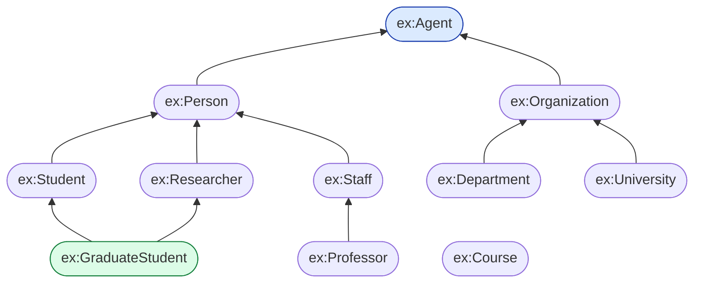
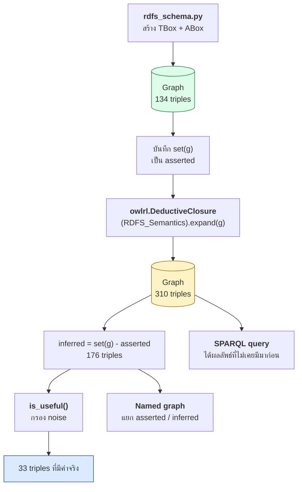

# 03.09 Python: สร้าง RDFS Schema และรัน Reasoner

บทนี้ลงมือสร้าง **RDFS schema ของมหาวิทยาลัย** ด้วย rdflib แล้วรัน **RDFS reasoner** ด้วย `owlrl`
เพื่อดูว่า triple ใหม่ที่อนุมานได้มีอะไรบ้าง และ query ให้ผลต่างกันอย่างไรก่อนกับหลัง reasoning
พร้อมเทคนิคแยก inferred ออกจาก asserted ด้วย named graph

> 📁 ไฟล์เต็ม: [`code/ch03/rdfs_schema.py`](../code/ch03/rdfs_schema.py) และ [`code/ch03/rdfs_reasoning.py`](../code/ch03/rdfs_reasoning.py)

---

## ติดตั้ง

```bash
pip install rdflib owlrl
```

| Library | ทำอะไร |
| --- | --- |
| `rdflib` | สร้างและจัดการ RDF graph |
| `owlrl` | RDFS และ OWL 2 RL reasoner ที่ทำงานบน rdflib โดยตรง |

---

## 1. สร้าง class hierarchy

เขียน helper function เพื่อลดโค้ดซ้ำและบังคับให้ใส่ annotation ครบทุกครั้ง

```python
from rdflib import Graph, Literal, Namespace, URIRef
from rdflib.namespace import DCTERMS, OWL, RDF, RDFS, XSD

EX = Namespace("http://example.org/university#")
ONTO = URIRef("http://example.org/university")


def declare_class(g: Graph, cls, label: str, comment: str, parent=None) -> None:
    """ประกาศ rdfs:Class พร้อม annotation ครบถ้วน"""
    g.add((cls, RDF.type, RDFS.Class))
    g.add((cls, RDFS.label, Literal(label, lang="en")))
    g.add((cls, RDFS.comment, Literal(comment, lang="en")))
    g.add((cls, RDFS.isDefinedBy, ONTO))
    if parent is not None:
        g.add((cls, RDFS.subClassOf, parent))
```

ใช้งาน:

```python
g = Graph()
g.bind("ex", EX)

declare_class(g, EX.Agent, "Agent", "Anything that can act.")
declare_class(g, EX.Person, "Person", "A human being.", parent=EX.Agent)
declare_class(g, EX.Student, "Student",
              "A person enrolled in at least one course.", parent=EX.Person)
declare_class(g, EX.Staff, "Staff",
              "A person employed by the university.", parent=EX.Person)
declare_class(g, EX.Professor, "Professor",
              "A staff member who teaches.", parent=EX.Staff)
declare_class(g, EX.Course, "Course",
              "A unit of teaching delivered over one academic term.")

# multiple inheritance
declare_class(g, EX.Researcher, "Researcher",
              "A person who conducts research.", parent=EX.Person)
declare_class(g, EX.GraduateStudent, "Graduate Student",
              "A student in a graduate programme.", parent=EX.Student)
g.add((EX.GraduateStudent, RDFS.subClassOf, EX.Researcher))
```

ลำดับชั้นที่ได้:



---

## 2. สร้าง property hierarchy พร้อม domain/range

```python
def declare_property(g: Graph, prop, label: str, comment: str,
                     domain=None, range_=None, parent=None) -> None:
    g.add((prop, RDF.type, RDF.Property))
    g.add((prop, RDFS.label, Literal(label, lang="en")))
    g.add((prop, RDFS.comment, Literal(comment, lang="en")))
    g.add((prop, RDFS.isDefinedBy, ONTO))
    if domain is not None:
        g.add((prop, RDFS.domain, domain))
    if range_ is not None:
        g.add((prop, RDFS.range, range_))
    if parent is not None:
        g.add((prop, RDFS.subPropertyOf, parent))


declare_property(g, EX.involvedIn, "involved in",
                 "Generic relation between a person and a course.",
                 domain=EX.Person, range_=EX.Course)

declare_property(g, EX.enrolledIn, "enrolled in",
                 "Relates a student to a course they currently attend.",
                 domain=EX.Student, range_=EX.Course, parent=EX.involvedIn)

declare_property(g, EX.teaches, "teaches",
                 "Relates a professor to a course they deliver.",
                 domain=EX.Professor, range_=EX.Course, parent=EX.involvedIn)

declare_property(g, EX.assists, "assists",
                 "Relates a teaching assistant to a course.",
                 range_=EX.Course, parent=EX.teaches)

declare_property(g, EX.credits, "credits",
                 "The number of credit units awarded by a course.",
                 domain=EX.Course, range_=XSD.integer)
```

---

## 3. เพิ่มข้อมูล instance (ABox)

**สังเกตว่าเราจงใจไม่ประกาศ `rdf:type` ให้ `ex:cs101`** เพื่อดูว่า reasoner จะอนุมานให้เองจาก `rdfs:range`

```python
# people
g.add((EX.alice, RDF.type, EX.GraduateStudent))
g.add((EX.alice, RDFS.label, Literal("Alice Johnson", lang="en")))
g.add((EX.alice, EX.enrolledIn, EX.cs101))
g.add((EX.alice, EX.enrolledIn, EX.cs501))

g.add((EX.bob, RDF.type, EX.Student))
g.add((EX.bob, EX.enrolledIn, EX.cs101))
g.add((EX.bob, EX.assists, EX.cs101))          # bob เป็น TA ด้วย

g.add((EX.profSmith, RDF.type, EX.Professor))
g.add((EX.profSmith, EX.teaches, EX.cs101))

# courses -- ไม่ได้ประกาศ type เลย!
g.add((EX.cs101, RDFS.label, Literal("Introduction to Programming", lang="en")))
g.add((EX.cs101, EX.credits, Literal(3)))
```

---

## 4. รัน reasoner

```python
import owlrl

asserted = set(g)                                       # เก็บของเดิมไว้ก่อน
owlrl.DeductiveClosure(owlrl.RDFS_Semantics).expand(g)  # ขยายแบบ in-place
inferred = set(g) - asserted

print(f"asserted : {len(asserted)} triples")
print(f"inferred : {len(inferred)} triples")
print(f"total    : {len(g)} triples")
```

Expected output:

```
asserted : 134 triples
inferred : 176 triples
total    : 310 triples
```

### Semantics ที่ owlrl รองรับ

| Class | ระดับ | ใช้เมื่อ |
| --- | --- | --- |
| `owlrl.RDFS_Semantics` | RDFS entailment | schema ระดับ RDFS — **ใช้ในบทนี้** |
| `owlrl.OWLRL_Semantics` | OWL 2 RL | ต้องการ `sameAs`, `inverseOf`, `TransitiveProperty` |
| `owlrl.RDFS_OWLRL_Semantics` | ทั้งสองรวมกัน | ครอบคลุมที่สุด แต่ช้าที่สุด |

```python
# ตัวเลือกอื่น
owlrl.DeductiveClosure(owlrl.OWLRL_Semantics).expand(g)
owlrl.DeductiveClosure(owlrl.RDFS_OWLRL_Semantics).expand(g)
```

---

## 5. เทียบผล query ก่อนและหลัง

```python
QUERIES = {
    "ทุกคนที่เป็น ex:Person": """
        PREFIX ex: <http://example.org/university#>
        SELECT ?p WHERE { ?p a ex:Person . }
    """,
    "ทุกอย่างที่เป็น ex:Course": """
        PREFIX ex: <http://example.org/university#>
        SELECT ?c WHERE { ?c a ex:Course . }
    """,
    "ทุกคนที่ ex:involvedIn cs101": """
        PREFIX ex: <http://example.org/university#>
        SELECT ?p WHERE { ?p ex:involvedIn ex:cs101 . }
    """,
}

for title, query in QUERIES.items():
    rows = sorted(str(r[0]).split("#")[-1] for r in g.query(query))
    print(f"{title}: {rows}")
```

Expected output:

| Query | ก่อน reasoning | หลัง reasoning |
| --- | --- | --- |
| `?p a ex:Person` | `[]` | `['alice', 'bob', 'profSmith']` |
| `?c a ex:Course` | `[]` | `['cs101', 'cs501']` |
| `?p ex:involvedIn ex:cs101` | `[]` | `['alice', 'bob', 'profSmith']` |

**อธิบายผลลัพธ์**

| ผลลัพธ์ | มาจากกฎ | เส้นทางการอนุมาน |
| --- | --- | --- |
| `alice a ex:Person` | rdfs9 | `GraduateStudent ⊑ Student ⊑ Person` |
| `cs101 a ex:Course` | rdfs3 | `enrolledIn rdfs:range ex:Course` |
| `bob ex:involvedIn cs101` | rdfs7 ×2 | `assists ⊑ teaches ⊑ involvedIn` |
| `profSmith a ex:Person` | rdfs9 ×2 | `Professor ⊑ Staff ⊑ Person` |

---

## 6. กรอง axiomatic noise

จาก 176 triple ที่อนุมานได้ มีเพียง ~33 ตัวที่มีความหมายเชิงข้อมูลจริง

```python
from rdflib.namespace import RDF, RDFS

NOISE_OBJECTS = {RDFS.Resource, RDFS.Literal, RDFS.Class, RDF.Property}


def is_useful(triple) -> bool:
    """คัดเฉพาะ inferred triple ที่มีความหมายเชิงข้อมูลจริง"""
    s, p, o = triple
    if o in NOISE_OBJECTS:
        return False
    # reflexive subClassOf / subPropertyOf จากกฎ rdfs10 / rdfs6
    if p in (RDFS.subClassOf, RDFS.subPropertyOf) and s == o:
        return False
    return str(s).startswith(str(EX))


useful = sorted(t for t in inferred if is_useful(t))
print(f"inferred ที่มีความหมายจริง: {len(useful)} triples")

nsm = g.namespace_manager
for s, p, o in useful:
    print(f"  {s.n3(nsm):<28} {p.n3(nsm):<20} {o.n3(nsm)}")
```

Expected output (ย่อ):

```
inferred ที่มีความหมายจริง: 33 triples
  ex:Department              rdfs:subClassOf      ex:Agent
  ex:GraduateStudent         rdfs:subClassOf      ex:Agent
  ex:GraduateStudent         rdfs:subClassOf      ex:Person
  ex:Professor               rdfs:subClassOf      ex:Agent
  ex:Professor               rdfs:subClassOf      ex:Person
  ex:alice                   rdf:type             ex:Person
  ex:alice                   rdf:type             ex:Researcher
  ex:alice                   rdf:type             ex:Student
  ex:alice                   ex:involvedIn        ex:cs101
  ex:bob                     ex:teaches           ex:cs101
  ex:bob                     ex:involvedIn        ex:cs101
  ex:cs101                   rdf:type             ex:Course
  ...
```

> ⚠️ สังเกต `ex:bob ex:teaches ex:cs101` และ `ex:bob a ex:Professor` — เพราะ `ex:assists ⊑ ex:teaches`
> และ `ex:teaches rdfs:domain ex:Professor` ทำให้ TA ถูกอนุมานเป็น Professor
> **นี่คือตัวอย่างจริงของอันตรายจาก `rdfs:domain`** ที่เตือนไว้ใน [03.04](03.04-domain-range.md)
> ทางแก้: ถอด `rdfs:domain` ออกจาก `ex:teaches` หรือแยก `ex:assists` ไม่ให้เป็น subproperty ของ `ex:teaches`

---

## 7. แยก inferred ไว้ใน named graph

การเก็บ inferred ปนกับ asserted ทำให้ล้าง reasoning ใหม่ยาก — วิธีที่ดีกว่าคือแยก graph

```python
from rdflib import Dataset, URIRef

def split_into_named_graphs(asserted, inferred) -> Dataset:
    ds = Dataset()
    ds.bind("ex", EX)

    g_asserted = ds.graph(URIRef("http://example.org/graph/asserted"))
    g_inferred = ds.graph(URIRef("http://example.org/graph/inferred"))

    for t in asserted:
        g_asserted.add(t)
    for t in inferred:
        g_inferred.add(t)
    return ds


ds = split_into_named_graphs(asserted, inferred)
ds.serialize("university-dataset.trig", format="trig")
```

ประโยชน์:

```sparql
# ล้างเฉพาะ inferred แล้วรัน reasoner ใหม่
DROP GRAPH <http://example.org/graph/inferred>

# query เฉพาะข้อมูลที่มนุษย์เขียนจริง
SELECT ?s ?p ?o WHERE {
  GRAPH <http://example.org/graph/asserted> { ?s ?p ?o }
}
```

---

## Flow ทั้งหมด



---

## รันจริง

```bash
python code/ch03/rdfs_schema.py                    # ดู schema ที่สร้าง
python code/ch03/rdfs_schema.py university.ttl     # บันทึกลงไฟล์
python code/ch03/rdfs_reasoning.py                 # รัน reasoning + เทียบผล
```

---

## Troubleshooting

| อาการ | สาเหตุ | วิธีแก้ |
| --- | --- | --- |
| triple พุ่งเป็นหมื่นหลัง reasoning | RDFS สร้าง axiomatic triple มหาศาล | กรองด้วย `is_useful()` หรือใช้ named graph |
| `owlrl` ช้ามากกับ graph ใหญ่ | forward chaining เป็น O(n²) ในบางกรณี | ใช้ triplestore ที่มี reasoner ในตัว (Jena, GraphDB) |
| ได้ type แปลก ๆ ที่ไม่ได้ตั้งใจ | `rdfs:domain`/`rdfs:range` กว้างหรือแคบเกินไป | ทบทวน domain/range ตาม [03.04](03.04-domain-range.md) |
| อยากได้ `owl:sameAs` ทำงาน | RDFS ไม่รองรับ | เปลี่ยนเป็น `owlrl.OWLRL_Semantics` |
| รัน `expand()` ซ้ำแล้ว triple โตขึ้นอีก | reasoning บน graph ที่ closure แล้ว | เก็บ asserted ไว้แล้วสร้าง graph ใหม่ทุกครั้ง |

---

## Key Points

- ใช้ **helper function** ประกาศ class/property เพื่อบังคับให้ใส่ `rdfs:label` และ `rdfs:comment` ครบทุกครั้ง
- `owlrl.DeductiveClosure(owlrl.RDFS_Semantics).expand(g)` รัน RDFS reasoning แบบ **in-place** — เก็บ `set(g)` ไว้ก่อนถ้าอยากเทียบ
- เลือก semantics ได้ 3 ระดับ: `RDFS_Semantics`, `OWLRL_Semantics`, `RDFS_OWLRL_Semantics`
- Query ที่ได้ **0 ผลลัพธ์ก่อน reasoning** กลายเป็นได้ครบหลัง reasoning — นี่คือคุณค่าที่จับต้องได้
- inferred ส่วนใหญ่เป็น **axiomatic noise** — ควรกรองด้วย filter หรือแยกไว้ใน **named graph**
- ตัวอย่างจริงในบทนี้แสดงอันตรายของ `rdfs:domain`: TA ถูกอนุมานเป็น Professor เพราะ `assists ⊑ teaches`
- แยก **asserted / inferred** เป็นคนละ named graph ทำให้ `DROP GRAPH` แล้ว re-run reasoning ได้ง่าย
