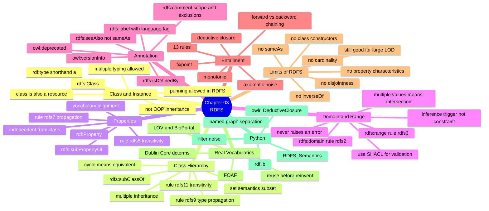

# 03.10 สรุป Chapter 03 + RDFS Cheat Sheet

Chapter 03 เพิ่มชั้น **schema** ให้ RDF และทำให้เกิด **inference** เป็นครั้งแรกในคอร์ส
เราได้เรียนคำศัพท์ RDFS ครบทุกตัว กฎ entailment ทั้ง 13 ข้อ และที่สำคัญที่สุดคือเข้าใจว่า
`rdfs:domain`/`rdfs:range` เป็น **inference trigger ไม่ใช่ constraint** — ความเข้าใจนี้จะติดตัวไปทั้ง OWL และ SHACL

---

## Concept Map



---

## RDFS Vocabulary Cheat Sheet

### Class

| Term | ใช้อย่างไร | ผลต่อ reasoning |
| --- | --- | --- |
| `rdfs:Class` | `ex:C a rdfs:Class .` | ทำให้ `ex:C ⊑ rdfs:Resource` (rdfs8) |
| `rdfs:Resource` | class ของทุกสิ่ง | ทุก node เป็น instance โดยอัตโนมัติ (rdfs4) |
| `rdfs:Literal` | class ของ literal ทั้งหมด | rdfs1 |
| `rdfs:Datatype` | class ของ datatype | rdfs13 |
| `rdfs:subClassOf` | `ex:C1 rdfs:subClassOf ex:C2 .` | **rdfs9** type propagation, **rdfs11** transitivity |

### Property

| Term | ใช้อย่างไร | ผลต่อ reasoning |
| --- | --- | --- |
| `rdf:Property` | `ex:p a rdf:Property .` | rdfs6 reflexive |
| `rdfs:subPropertyOf` | `ex:p1 rdfs:subPropertyOf ex:p2 .` | **rdfs7** propagation, **rdfs5** transitivity |
| `rdfs:domain` | `ex:p rdfs:domain ex:C .` | **rdfs2** — subject ได้ type `ex:C` |
| `rdfs:range` | `ex:p rdfs:range ex:C .` | **rdfs3** — object ได้ type `ex:C` |

### Annotation (ไม่มีผลต่อ reasoning)

| Term | ใช้อย่างไร |
| --- | --- |
| `rdfs:label` | `ex:C rdfs:label "Course"@en .` |
| `rdfs:comment` | `ex:C rdfs:comment "A unit of teaching..."@en .` |
| `rdfs:seeAlso` | `ex:C rdfs:seeAlso <https://schema.org/Course> .` |
| `rdfs:isDefinedBy` | `ex:C rdfs:isDefinedBy <http://example.org/onto> .` |

---

## กฎ Entailment ที่ใช้จริง 4 ข้อ

```
rdfs2   p rdfs:domain c   +  s p o        →  s rdf:type c
rdfs3   p rdfs:range  c   +  s p o        →  o rdf:type c
rdfs7   p1 ⊑ p2           +  s p1 o       →  s p2 o
rdfs9   c1 ⊑ c2           +  s rdf:type c1 →  s rdf:type c2
```

บวก transitivity อีกสองข้อ:

```
rdfs5   p1 ⊑ p2  +  p2 ⊑ p3  →  p1 ⊑ p3
rdfs11  c1 ⊑ c2  +  c2 ⊑ c3  →  c1 ⊑ c3
```

---

## Template: RDFS schema ที่สมบูรณ์

<table>
<tr><th width="50%">Full form</th><th width="50%">Shorthand</th></tr>
<tr valign="top">
<td>

```turtle
@prefix ex:      <http://example.org/> .
@prefix rdf:     <http://www.w3.org/1999/02/22-rdf-syntax-ns#> .
@prefix rdfs:    <http://www.w3.org/2000/01/rdf-schema#> .
@prefix owl:     <http://www.w3.org/2002/07/owl#> .
@prefix dcterms: <http://purl.org/dc/terms/> .
@prefix xsd:     <http://www.w3.org/2001/XMLSchema#> .

<http://example.org/onto> rdf:type owl:Ontology .
<http://example.org/onto> dcterms:title "My Ontology"@en .
<http://example.org/onto> owl:versionInfo "1.0.0" .

ex:Person rdf:type rdfs:Class .
ex:Person rdfs:label "Person"@en .
ex:Person rdfs:comment "A human being."@en .
ex:Person rdfs:isDefinedBy <http://example.org/onto> .

ex:Student rdf:type rdfs:Class .
ex:Student rdfs:label "Student"@en .
ex:Student rdfs:subClassOf ex:Person .

ex:enrolledIn rdf:type rdf:Property .
ex:enrolledIn rdfs:label "enrolled in"@en .
ex:enrolledIn rdfs:domain ex:Student .
ex:enrolledIn rdfs:range ex:Course .

ex:alice rdf:type ex:Student .
ex:alice ex:enrolledIn ex:cs101 .
```

</td>
<td>

```turtle
@prefix ex:      <http://example.org/> .
@prefix rdf:     <http://www.w3.org/1999/02/22-rdf-syntax-ns#> .
@prefix rdfs:    <http://www.w3.org/2000/01/rdf-schema#> .
@prefix owl:     <http://www.w3.org/2002/07/owl#> .
@prefix dcterms: <http://purl.org/dc/terms/> .
@prefix xsd:     <http://www.w3.org/2001/XMLSchema#> .

<http://example.org/onto> a owl:Ontology ;
    dcterms:title   "My Ontology"@en ;
    owl:versionInfo "1.0.0" .

ex:Person a rdfs:Class ;
    rdfs:label       "Person"@en ;
    rdfs:comment     "A human being."@en ;
    rdfs:isDefinedBy <http://example.org/onto> .

ex:Student a rdfs:Class ;
    rdfs:label      "Student"@en ;
    rdfs:subClassOf ex:Person .

ex:enrolledIn a rdf:Property ;
    rdfs:label  "enrolled in"@en ;
    rdfs:domain ex:Student ;
    rdfs:range  ex:Course .

ex:alice a ex:Student ;
    ex:enrolledIn ex:cs101 .
```

</td>
</tr>
</table>

---

## Python Cheat Sheet

```python
from rdflib import Graph, Literal, Namespace
from rdflib.namespace import RDF, RDFS, OWL, XSD
import owlrl

EX = Namespace("http://example.org/")
g = Graph(); g.bind("ex", EX)

# --- ประกาศ class ---
g.add((EX.Student, RDF.type, RDFS.Class))
g.add((EX.Student, RDFS.subClassOf, EX.Person))
g.add((EX.Student, RDFS.label, Literal("Student", lang="en")))

# --- ประกาศ property ---
g.add((EX.enrolledIn, RDF.type, RDF.Property))
g.add((EX.enrolledIn, RDFS.domain, EX.Student))
g.add((EX.enrolledIn, RDFS.range, EX.Course))

# --- reasoning ---
asserted = set(g)
owlrl.DeductiveClosure(owlrl.RDFS_Semantics).expand(g)
inferred = set(g) - asserted

# --- สำรวจ hierarchy ---
list(g.objects(EX.Student, RDFS.subClassOf))       # superclass ตรง
list(g.subjects(RDFS.subClassOf, EX.Person))       # subclass ตรง
list(g.transitive_objects(EX.Student, RDFS.subClassOf))   # ทุกชั้นขึ้นไป
list(g.transitive_subjects(RDFS.subClassOf, EX.Person))   # ทุกชั้นลงมา
```

---

## เลือกใช้เครื่องมือให้ถูกงาน

| ต้องการ | ใช้ | สมมติฐาน |
| --- | --- | --- |
| จัดหมวดหมู่ + alignment vocabulary | **RDFS** | OWA |
| ตรวจ consistency + automatic classification | **OWL** | OWA |
| ตรวจว่าข้อมูลครบถ้วน/ถูก format | **SHACL** | CWA |
| กฎเงื่อนไขที่ OWL แสดงไม่ได้ | **SWRL** | OWA |

---

## Self-check

1. `rdfs:subClassOf` ต่างจาก inheritance ของ Java อย่างไร
2. ถ้าเขียน `ex:MyDesk ex:worksAt ex:Univ .` โดย `ex:worksAt rdfs:domain ex:Person` จะเกิดอะไรขึ้น
3. ประกาศ `rdfs:domain` สองค่ากับ property เดียว หมายถึง intersection หรือ union
4. กฎ rdfs7 กับ rdfs9 ต่างกันตรงไหน
5. RDFS แสดงอะไรไม่ได้บ้าง — ตอบให้ได้อย่างน้อย 5 ข้อ
6. ทำไม `dcterms:` จึงดีกว่า `dc:`
7. ทำไม graph 5 triple จึงกลายเป็น 48 triple หลังรัน reasoner
8. จะแยก inferred ออกจาก asserted อย่างไร และทำไมจึงควรทำ

---

## Preview: Chapter 04 — Logics

Chapter 03 จบลงที่คำถามค้างคาว่า *"RDFS ทำอะไรไม่ได้บ้าง และทำไม"* — คำตอบอยู่ที่ **formal logic**
Chapter 04 จะพาไปดูรากฐานทางตรรกะของทั้ง RDFS และ OWL

| จะได้เรียน | สาระ |
| --- | --- |
| Why formal logic | ทำไม natural language ไม่พอ |
| **FOL** | Predicate, variable, `∀` `∃`, `∧` `∨` `¬` `→` |
| FOL ↔ RDF | ประโยค FOL แปลงเป็น triple อย่างไร |
| ข้อจำกัดของ FOL | **undecidability** และทำไม FOL เต็มรูปแบบใช้จริงไม่ได้ |
| **Description Logic** | fragment ของ FOL ที่ decidable |
| **ALC** | `⊓` `⊔` `¬` `∀r.C` `∃r.C` |
| DL family | AL → ALC → SHOIN → SROIQ |
| DL ↔ OWL | OWL Lite/DL/Full map กับ DL species ใด |
| Reasoning tasks | Satisfiability, Subsumption, Instance checking, Realization |
| Reasoners | HermiT, Pellet, FaCT++, ELK |
| `owlready2` | สร้าง TBox + ABox แล้วรัน HermiT |

ตัวอย่างสิ่งที่จะอ่านออกตอนจบ Chapter 04:

```
Parent ≡ Person ⊓ ∃hasChild.Person
Male ⊓ Female ⊑ ⊥
GraduateStudent ⊑ Student ⊓ Researcher
```

สามบรรทัดนี้คือสิ่งที่ RDFS เขียนไม่ได้เลยแม้แต่บรรทัดเดียว

---

## Key Points

- **RDFS = 4 ความสามารถ**: class hierarchy, property hierarchy, domain/range, annotation
- `rdfs:subClassOf` มีความหมายเชิงเซต (subset) — **ไม่ใช่ inheritance ของ OOP**
- **`rdfs:domain` / `rdfs:range` เป็น inference trigger ไม่ใช่ constraint** และไม่มีวัน error
- ประกาศ domain/range หลายค่า = **intersection** ไม่ใช่ union
- กฎที่ใช้จริงมี 4 ข้อ: **rdfs2, rdfs3, rdfs7, rdfs9** บวก transitivity **rdfs5, rdfs11**
- Annotation (`rdfs:label`, `rdfs:comment`) ไม่มีผลต่อ reasoning แต่จำเป็นต่อการใช้งานจริง — **ใส่ให้ครบเสมอ**
- RDFS **ตรวจจับ error ไม่ได้เลย** เพราะไม่มี disjointness, cardinality หรือ negation
- ใช้ `owlrl.DeductiveClosure(owlrl.RDFS_Semantics).expand(g)` และแยก inferred ไว้ใน **named graph**
- Chapter 04 จะอธิบายรากฐานทางตรรกะที่ทำให้เข้าใจว่า **ทำไม** RDFS จึงจำกัด และ OWL แก้อย่างไร
