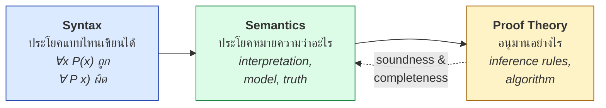
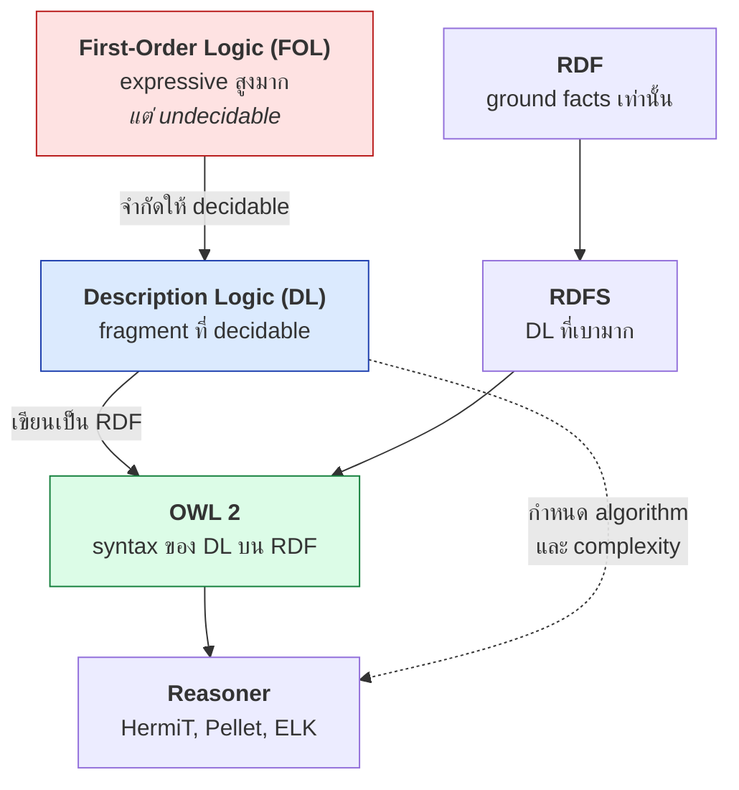
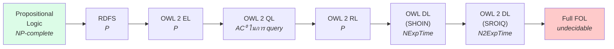
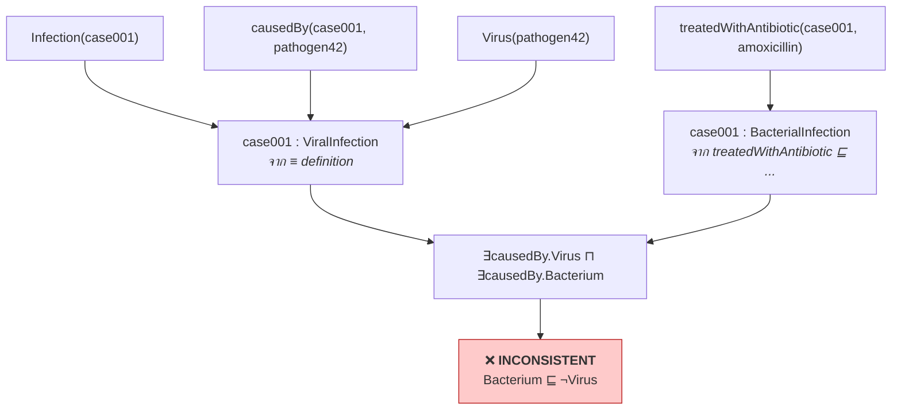

# 04.01 ทำไมต้อง Formal Logic

Chapter 03 จบด้วยคำถามค้างคาว่า RDFS ทำอะไรไม่ได้บ้าง — คำตอบที่แท้จริงไม่ได้อยู่ที่รายการคำศัพท์ที่ขาดไป
แต่อยู่ที่ **รากฐานทางตรรกะ** ที่กำหนดว่าภาษาหนึ่งแสดงอะไรได้และแลกมาด้วยอะไร
บทนี้อธิบายว่าทำไม Semantic Web จึงต้องพึ่ง formal logic แทนที่จะใช้ภาษาธรรมชาติหรือ ad-hoc rule

---

## ปัญหาของ Informal Reasoning

พิจารณาข้อความภาษาอังกฤษต่อไปนี้

> "All professors teach courses. Jane is a professor. Every course has students."

มนุษย์อ่านแล้วสรุปได้ทันทีว่า *Jane สอนวิชาหนึ่ง และวิชานั้นมีนักศึกษา* แต่ machine ติดปัญหาหลายชั้น

| ปัญหา | ตัวอย่าง |
| --- | --- |
| **Ambiguity** | "All professors teach courses" — สอนคนละวิชา หรือสอนวิชาเดียวกันทุกคน? |
| **Scope กำกวม** | "Every course has students" — student ชุดเดียวกันทุกวิชา หรือคนละชุด? |
| **Implicit assumption** | "teach" หมายถึงสอนอยู่ตอนนี้ หรือเคยสอน? |
| **ไม่มีกฎอนุมานที่ชัดเจน** | จะรู้ได้อย่างไรว่าอะไรสรุปได้ อะไรสรุปไม่ได้ |
| **Consistency ตรวจไม่ได้** | ถ้ามีข้อความ 10,000 ข้อ จะรู้ได้อย่างไรว่าไม่ขัดกันเอง |

**Formal logic แก้ทั้งหมดนี้** ด้วยการกำหนด **syntax ที่ชัดเจน** และ **semantics ที่ชัดเจน**

```
∀x ( Professor(x) → ∃y ( Course(y) ∧ teaches(x, y) ) )
Professor(jane)
∀y ( Course(y) → ∃z ( Student(z) ∧ hasStudent(y, z) ) )
```

ตอนนี้ไม่มีอะไรกำกวม: `∃y` บอกชัดว่าเป็นวิชา**บางวิชา** ไม่ใช่ทุกวิชา และเป็นคนละ `y` สำหรับแต่ละ `x`

---

## องค์ประกอบสามอย่างของ Formal Logic



| องค์ประกอบ | ตอบคำถาม | ตัวอย่างใน RDF |
| --- | --- | --- |
| **Syntax** | เขียนอย่างไรจึงถูกกฎ | Turtle grammar |
| **Semantics** | ประโยคนั้นเป็นจริงเมื่อไหร่ | RDF Semantics spec |
| **Proof theory** | อนุมานอะไรได้บ้าง | กฎ rdfs1–rdfs13 |

### Soundness และ Completeness

| คุณสมบัติ | ความหมาย | ถ้าขาดจะเกิดอะไร |
| --- | --- | --- |
| **Soundness** | ทุกอย่างที่พิสูจน์ได้ **เป็นจริง** | reasoner สรุปสิ่งที่ผิด |
| **Completeness** | ทุกอย่างที่เป็นจริง **พิสูจน์ได้** | reasoner พลาดข้อสรุปที่ควรได้ |

reasoner ของ Semantic Web (HermiT, Pellet) เป็นทั้ง sound และ complete สำหรับ OWL DL
ซึ่งเป็นสิ่งที่ **รับประกันได้ทางคณิตศาสตร์** — ต่างจากระบบ heuristic หรือ machine learning

---

## บทบาทของ Logic ใน Semantic Web



**ทุกอย่างใน stack นี้มีนิยามทางตรรกะรองรับ** — RDF triple แต่ละตัวคือ ground atomic formula
และ RDFS/OWL axiom แต่ละข้อคือประโยคใน fragment ของ FOL

### RDF triple = ground atom

```turtle
ex:MarieCurie ex:worksAt ex:UniversityOfParis .
```

```
worksAt(marieCurie, universityOfParis)
```

### RDFS axiom = ประโยค FOL

```turtle
ex:Scientist rdfs:subClassOf ex:Person .
```

```
∀x ( Scientist(x) → Person(x) )
```

```turtle
ex:worksAt rdfs:domain ex:Person .
```

```
∀x,y ( worksAt(x,y) → Person(x) )
```

**นี่คือเหตุผลว่าทำไมกฎ rdfs2 จึงเป็น inference ไม่ใช่ constraint** — ประโยค FOL ข้างบนบอกว่า
"ถ้า worksAt เป็นจริง แล้ว Person เป็นจริง" ไม่ได้บอกว่า "ห้ามใช้ worksAt กับสิ่งที่ไม่ใช่ Person"

---

## Trade-off ที่หนีไม่พ้น: Expressivity vs Complexity

นี่คือ trade-off กลางของทั้ง chapter นี้ และของงาน ontology engineering ทั้งหมด



| ภาษา | แสดงอะไรได้ | ราคา |
| --- | --- | --- |
| RDFS | hierarchy, domain/range | เร็วมาก, ปลอดภัย |
| OWL 2 EL | existential restriction, intersection | polynomial — ใช้กับ SNOMED CT ได้ |
| OWL 2 DL | ทุกอย่างที่ DL ทำได้ | worst case ช้ามาก |
| Full FOL | ทุกอย่าง | **ไม่มีวันหยุด** ในบางกรณี |

> 💡 **หลักที่ต้องจำ**: ยิ่งแสดงได้มาก ยิ่งช้าและเสี่ยงที่ reasoner จะไม่จบ
> งานออกแบบ ontology ที่ดีคือการ **เลือกภาษาที่เบาที่สุดที่ยังตอบ competency question ได้**

---

## ตัวอย่างที่ทำให้เห็นคุณค่าของ formal semantics

สมมติมี ontology ทางการแพทย์ที่มี axiom เหล่านี้

```
Bacterium ⊑ ¬Virus                       # แบคทีเรียไม่ใช่ไวรัส
ViralInfection ≡ Infection ⊓ ∃causedBy.Virus
BacterialInfection ≡ Infection ⊓ ∃causedBy.Bacterium
treatedWithAntibiotic ⊑ ∃treats.BacterialInfection
```

แล้วมีข้อมูล

```
Infection(case001)
causedBy(case001, pathogen42)
Virus(pathogen42)
treatedWithAntibiotic(case001, amoxicillin)
```

**reasoner จะรายงาน inconsistency ทันที** เพราะ:

1. `case001` เป็น `ViralInfection` (จาก definition)
2. `treatedWithAntibiotic` บังคับให้ `case001` เป็น `BacterialInfection`
3. `case001` จึงต้องมี `causedBy` ทั้ง Virus และ Bacterium
4. แต่ `Bacterium ⊑ ¬Virus` ทำให้เป็นไปไม่ได้

**นี่คือสิ่งที่ RDFS ทำไม่ได้เลย** เพราะไม่มี negation และไม่มี defined class
และเป็นสิ่งที่ระบบ heuristic ทำไม่ได้อย่างรับประกัน เพราะไม่มีนิยามความจริงที่ตรวจสอบได้



---

## Formal vs Informal — สรุปเปรียบเทียบ

| ประเด็น | Informal (natural language / ad-hoc rules) | Formal (FOL / DL) |
| --- | --- | --- |
| ความกำกวม | สูง | ไม่มี |
| ตรวจ consistency | ทำไม่ได้ | ทำได้อัตโนมัติ |
| รับประกันความถูกต้อง | ไม่มี | soundness + completeness |
| อธิบายข้อสรุป | ยาก | ได้ derivation ที่ตรวจสอบได้ |
| ปรับขนาด (scale) | ขึ้นกับคน | ขึ้นกับ complexity class |
| ต้นทุนการเรียนรู้ | ต่ำ | สูง |
| ยืดหยุ่นกับข้อยกเว้น | สูง | ต่ำ (ต้องระบุทุกกรณี) |

> ⚠️ Formal logic **ไม่ได้ดีกว่าเสมอไป** — โดเมนที่เต็มไปด้วยข้อยกเว้น ความไม่แน่นอน หรือความรู้เชิงสถิติ
> เหมาะกับ machine learning มากกว่า formal ontology จุดแข็งของ logic อยู่ที่โดเมนที่มี **นิยามชัดเจน**
> และ **ต้องการคำอธิบายที่ตรวจสอบย้อนกลับได้** เช่น medical coding, legal compliance, product configuration

---

## Key Points

- ภาษาธรรมชาติกำกวมเกินกว่าที่ machine จะอนุมานได้อย่างเชื่อถือได้ — formal logic กำจัดความกำกวมทั้งหมด
- Formal logic มีสามองค์ประกอบ: **syntax**, **semantics**, **proof theory** — และต้องการ **soundness** กับ **completeness**
- **RDF triple = ground atom** และ **RDFS/OWL axiom = ประโยคใน fragment ของ FOL** — ทุกอย่างมีรากทางตรรกะ
- `rdfs:domain` เป็น inference เพราะประโยค FOL ของมันคือ `∀x,y (P(x,y) → C(x))` ไม่ใช่ข้อห้าม
- **Trade-off กลาง**: expressivity สูงขึ้น → complexity สูงขึ้น → reasoning ช้าลงหรือไม่จบ
- คุณค่าที่จับต้องได้ของ formal semantics คือ **การตรวจ inconsistency อัตโนมัติ** และ **คำอธิบายที่ตรวจสอบได้**
- Formal logic ไม่เหมาะกับทุกโดเมน — เหมาะกับโดเมนที่มีนิยามชัดและต้องการความถูกต้องที่พิสูจน์ได้
