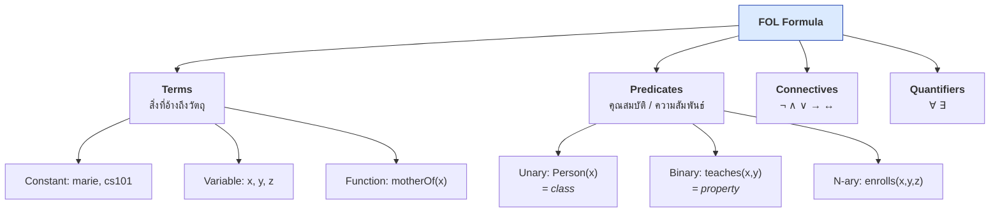
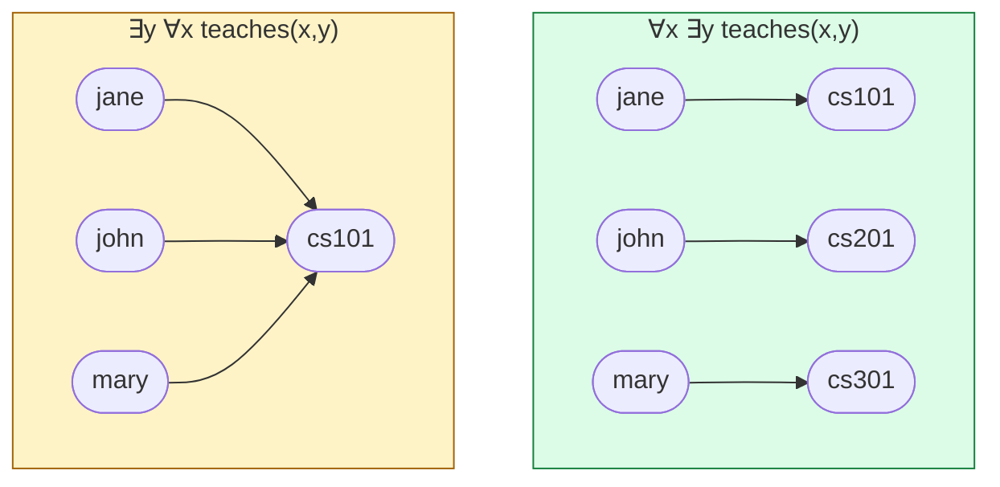

# 04.02 First-Order Logic: พื้นฐาน

**First-Order Logic (FOL)** หรือ **Predicate Logic** เป็นภาษาตรรกะที่ทรงพลังพอจะแสดงความรู้เกือบทุกอย่างในโดเมนใด ๆ
บทนี้สอนองค์ประกอบทั้งหมดของ FOL — predicate, term, variable, quantifier และ connective —
ในระดับที่พอใช้เข้าใจ Description Logic และ OWL ในบทต่อ ๆ ไป

---

## องค์ประกอบของ FOL



---

## 1. Terms — สิ่งที่อ้างถึงวัตถุ

| ชนิด | เขียนอย่างไร | ตัวอย่าง | ใน RDF ตรงกับ |
| --- | --- | --- | --- |
| **Constant** | ตัวพิมพ์เล็ก | `marie`, `cs101`, `paris` | IRI ของ individual |
| **Variable** | `x`, `y`, `z` | `x` | ตัวแปรใน SPARQL |
| **Function** | `f(t₁,...,tₙ)` | `motherOf(marie)` | ❌ **ไม่มีใน RDF/OWL** |

> ⚠️ **DL และ OWL ไม่มี function symbol** — เขียน `motherOf(x)` ไม่ได้ ต้องใช้ predicate แทน: `hasMother(x, y)`
> นี่คือข้อจำกัดแรกที่ DL ตัดออกจาก FOL เพื่อให้ decidable

---

## 2. Predicates — คุณสมบัติและความสัมพันธ์

| Arity | เรียกว่า | ตัวอย่าง | ใน OWL ตรงกับ |
| --- | --- | --- | --- |
| **1** (unary) | property/class | `Person(marie)` | **Class** |
| **2** (binary) | relation | `teaches(jane, cs101)` | **Property** |
| **≥3** (n-ary) | n-ary relation | `enrolls(alice, cs101, fall2024)` | ❌ ต้อง reify |

```
Person(marie)                    # marie เป็นคน
Course(cs101)                    # cs101 เป็นรายวิชา
teaches(jane, cs101)             # jane สอน cs101
enrolledIn(alice, cs101)         # alice ลงเรียน cs101
```

**สังเกตความสอดคล้องกับ RDF อย่างสมบูรณ์**

| FOL | RDF (Turtle) |
| --- | --- |
| `Person(marie)` | `ex:marie a ex:Person .` |
| `teaches(jane, cs101)` | `ex:jane ex:teaches ex:cs101 .` |

---

## 3. Connectives — ตัวเชื่อมทางตรรกะ

| สัญลักษณ์ | ชื่อ | อ่านว่า | ตัวอย่าง |
| --- | --- | --- | --- |
| `¬` | negation | ไม่ | `¬Student(jane)` |
| `∧` | conjunction | และ | `Person(x) ∧ Employee(x)` |
| `∨` | disjunction | หรือ | `Student(x) ∨ Staff(x)` |
| `→` | implication | ถ้า...แล้ว | `Professor(x) → Staff(x)` |
| `↔` | biconditional | ก็ต่อเมื่อ | `Parent(x) ↔ ∃y hasChild(x,y)` |

### Truth table

| P | Q | ¬P | P ∧ Q | P ∨ Q | P → Q | P ↔ Q |
| :-: | :-: | :-: | :-: | :-: | :-: | :-: |
| T | T | F | T | T | **T** | T |
| T | F | F | F | T | **F** | F |
| F | T | T | F | T | **T** | F |
| F | F | T | F | F | **T** | T |

> ⚠️ **จุดที่คนสับสนมากที่สุด**: `P → Q` เป็น **จริง** เมื่อ `P` เป็นเท็จ (แถวที่ 3 และ 4)
> เรียกว่า **vacuous truth** — "ถ้าฝนตก ฉันจะพกร่ม" เป็นจริงเสมอในวันที่ฝนไม่ตก
> นี่คือเหตุผลที่ `∀y (P(x,y) → C(y))` (universal restriction) เป็นจริงเมื่อ `x` ไม่มี `P` เลย — จุดสำคัญใน [08.07](../08-owl/08.07-restrictions.md)

### สมมูลที่ใช้บ่อย

```
P → Q          ≡  ¬P ∨ Q
¬(P ∧ Q)       ≡  ¬P ∨ ¬Q          (De Morgan)
¬(P ∨ Q)       ≡  ¬P ∧ ¬Q          (De Morgan)
P ↔ Q          ≡  (P → Q) ∧ (Q → P)
¬¬P            ≡  P
```

---

## 4. Quantifiers — ตัวบ่งปริมาณ

| สัญลักษณ์ | ชื่อ | อ่านว่า | ความหมาย |
| --- | --- | --- | --- |
| `∀` | universal | "สำหรับทุก" | เป็นจริงกับทุกวัตถุในโดเมน |
| `∃` | existential | "มีอย่างน้อยหนึ่ง" | มีวัตถุอย่างน้อยหนึ่งตัวที่เป็นจริง |

### รูปแบบที่ใช้คู่กันเสมอ

```
∀x ( P(x) → Q(x) )        # ทุก P เป็น Q         -- ใช้กับ ∀ เสมอเป็น →
∃x ( P(x) ∧ Q(x) )        # มีบางสิ่งที่เป็นทั้ง P และ Q  -- ใช้กับ ∃ เสมอเป็น ∧
```

> ⚠️ **ข้อผิดพลาดคลาสสิก**
>
> - `∀x ( P(x) ∧ Q(x) )` = "**ทุกสิ่งในจักรวาล**เป็นทั้ง P และ Q" — แรงเกินไป มักไม่ใช่สิ่งที่ต้องการ
> - `∃x ( P(x) → Q(x) )` = จริงเกือบเสมอ (เพราะ vacuous truth) — อ่อนเกินไป ไม่มีประโยชน์

### ความสัมพันธ์ระหว่าง ∀ กับ ∃

```
¬∀x P(x)   ≡   ∃x ¬P(x)        # "ไม่ใช่ทุกตัวที่ P" = "มีบางตัวที่ไม่ P"
¬∃x P(x)   ≡   ∀x ¬P(x)        # "ไม่มีตัวไหน P" = "ทุกตัวไม่ P"
```

### Quantifier ซ้อนกัน — ลำดับสำคัญมาก

```
∀x ∃y teaches(x, y)      # ทุกคนสอน "วิชาบางวิชา" (คนละวิชาก็ได้)
∃y ∀x teaches(x, y)      # มี "วิชาหนึ่ง" ที่ทุกคนสอนวิชานั้น
```

**สองประโยคนี้ต่างกันโดยสิ้นเชิง** — ประโยคที่สองแรงกว่ามาก



---

## Free variable และ Bound variable

```
∀x ( Person(x) → mortal(x) )         # x เป็น bound — ประโยคสมบูรณ์ (sentence)
Person(x) → mortal(x)                # x เป็น free — ยังไม่เป็นประโยคสมบูรณ์
∀x ( Person(x) → knows(x, y) )       # x bound, y free
```

**FOL sentence** = formula ที่ไม่มี free variable — เท่านั้นที่ประเมินค่าจริง/เท็จได้

---

## Model และ Interpretation

FOL semantics นิยามด้วย **interpretation** `I = (Δ, ·ᴵ)`

| ส่วนประกอบ | คืออะไร |
| --- | --- |
| `Δ` (domain) | เซตของวัตถุทั้งหมดที่มีอยู่ |
| `cᴵ ∈ Δ` | constant `c` ชี้ไปที่วัตถุตัวไหน |
| `Pᴵ ⊆ Δ` | unary predicate `P` คือ **เซตย่อยของ Δ** |
| `Rᴵ ⊆ Δ × Δ` | binary predicate `R` คือ **เซตของคู่อันดับ** |

### ตัวอย่าง interpretation

```
Δ = { 👩, 👨, 📕 }

marieᴵ  = 👩
pierreᴵ = 👨
book1ᴵ  = 📕

Personᴵ = { 👩, 👨 }
Bookᴵ   = { 📕 }
knowsᴵ  = { (👩, 👨), (👨, 👩) }
```

ตรวจสอบประโยค:

| ประโยค | เป็นจริงใน I นี้หรือไม่ |
| --- | --- |
| `Person(marie)` | ✅ เพราะ 👩 ∈ Personᴵ |
| `Book(marie)` | ❌ เพราะ 👩 ∉ Bookᴵ |
| `knows(marie, pierre)` | ✅ เพราะ (👩,👨) ∈ knowsᴵ |
| `∀x ( Person(x) → ∃y knows(x,y) )` | ✅ ทั้ง 👩 และ 👨 ต่างรู้จักกัน |
| `∀x Person(x)` | ❌ เพราะ 📕 ไม่อยู่ใน Personᴵ |

> **Model** ของเซตประโยค `S` = interpretation ที่ทำให้ทุกประโยคใน `S` เป็นจริง
> `S` **satisfiable** ถ้ามี model อย่างน้อยหนึ่งตัว; **unsatisfiable** ถ้าไม่มีเลย

---

## Entailment ใน FOL

```
S ⊨ φ    หมายถึง    ทุก model ของ S เป็น model ของ φ ด้วย
```

ตัวอย่าง:

```
S = { ∀x (Professor(x) → Staff(x)),
      ∀x (Staff(x) → Person(x)),
      Professor(jane) }

S ⊨ Staff(jane)     ✅
S ⊨ Person(jane)    ✅
S ⊨ Student(jane)   ❌ (ไม่มีอะไรบอก — และไม่ได้แปลว่าเป็นเท็จ ตาม OWA)
```

**นี่คือนิยามเดียวกับ RDFS entailment ใน [03.06](../03-rdfs/03.06-entailment.md)** เพียงแต่เขียนในภาษา FOL

---

## แปล RDFS เป็น FOL

| RDFS/RDF | FOL |
| --- | --- |
| `ex:marie a ex:Person .` | `Person(marie)` |
| `ex:marie ex:worksAt ex:univ .` | `worksAt(marie, univ)` |
| `ex:Student rdfs:subClassOf ex:Person .` | `∀x ( Student(x) → Person(x) )` |
| `ex:hasMother rdfs:subPropertyOf ex:hasParent .` | `∀x,y ( hasMother(x,y) → hasParent(x,y) )` |
| `ex:worksAt rdfs:domain ex:Person .` | `∀x,y ( worksAt(x,y) → Person(x) )` |
| `ex:worksAt rdfs:range ex:Org .` | `∀x,y ( worksAt(x,y) → Org(y) )` |

**ทั้ง RDFS คือ FOL 6 รูปแบบนี้เท่านั้น** — ซึ่งอธิบายได้ทันทีว่าทำไม RDFS จึงจำกัดขนาดนั้น
ไม่มี `¬`, ไม่มี `∨`, ไม่มี `∃` และไม่มีการนับ

---

## ตาราง reference สัญลักษณ์

| สัญลักษณ์ | อ่านว่า | ตัวอย่างประโยค | ความหมายภาษาไทย |
| --- | --- | --- | --- |
| `¬` | not | `¬Student(x)` | x ไม่ใช่นักศึกษา |
| `∧` | and | `Person(x) ∧ Rich(x)` | x เป็นคนและรวย |
| `∨` | or | `Cat(x) ∨ Dog(x)` | x เป็นแมวหรือหมา |
| `→` | implies | `Dog(x) → Animal(x)` | ถ้า x เป็นหมา x เป็นสัตว์ |
| `↔` | iff | `Bachelor(x) ↔ Man(x) ∧ ¬Married(x)` | x เป็นโสดก็ต่อเมื่อ... |
| `∀` | for all | `∀x Mortal(x)` | ทุกสิ่งเป็นมรรตัย |
| `∃` | exists | `∃x Immortal(x)` | มีบางสิ่งเป็นอมตะ |
| `⊨` | entails | `S ⊨ φ` | S บังคับให้ φ เป็นจริง |
| `≡` | equivalent | `P → Q ≡ ¬P ∨ Q` | สองประโยคสมมูลกัน |
| `⊥` | bottom/false | `A ⊓ B ⊑ ⊥` | A กับ B ไม่มีสมาชิกร่วม |
| `⊤` | top/true | `⊤` | ทุกสิ่ง |

---

## Key Points

- FOL ประกอบด้วย **term** (constant, variable, function), **predicate**, **connective** (`¬ ∧ ∨ → ↔`) และ **quantifier** (`∀ ∃`)
- **unary predicate = class** และ **binary predicate = property** — ตรงกับ RDF อย่างสมบูรณ์
- **DL/OWL ไม่มี function symbol** — ต้องใช้ binary predicate แทนเสมอ
- `P → Q` เป็นจริงเมื่อ `P` เท็จ (**vacuous truth**) — เป็นรากของพฤติกรรม `owl:allValuesFrom`
- คู่ที่ใช้เสมอ: `∀x (P(x) → Q(x))` และ `∃x (P(x) ∧ Q(x))` — สลับ connective เมื่อไหร่ความหมายเพี้ยนทันที
- **ลำดับ quantifier สำคัญ**: `∀x∃y` ต่างจาก `∃y∀x` โดยสิ้นเชิง
- **Semantics** นิยามด้วย interpretation `(Δ, ·ᴵ)`; **model** = interpretation ที่ทำให้ทุกประโยคจริง; **entailment** = ทุก model ของ S เป็น model ของ φ
- **RDFS ทั้งภาษาคือ FOL เพียง 6 รูปแบบ** ที่ไม่มี `¬`, `∨`, `∃` และการนับ — จึงจำกัดอย่างที่เห็นใน [03.07](../03-rdfs/03.07-rdfs-limits.md)
