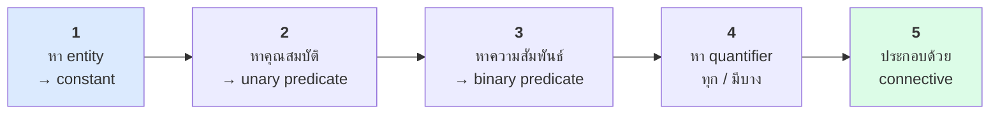
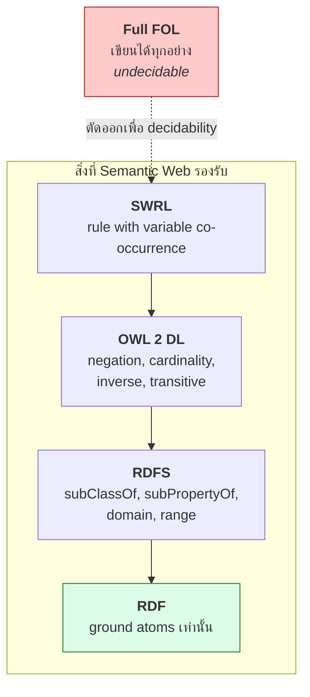

# 04.03 FOL: ตัวอย่างทีละขั้น และการเทียบกับ RDF Triple

บทนี้ฝึก **แปลประโยคภาษาอังกฤษเป็น FOL ทีละขั้น** ซึ่งเป็นทักษะที่ต้องใช้ตลอดเมื่อออกแบบ ontology
จากนั้นเทียบให้เห็นชัดว่า FOL formula แบบไหนเขียนเป็น RDF triple ได้ และแบบไหน **เขียนไม่ได้**
ซึ่งเป็นเหตุผลโดยตรงที่ต้องมี OWL

---

## วิธีแปลทีละขั้น 5 ขั้นตอน



---

## ตัวอย่าง 1: "Every professor teaches at least one course."

**ขั้น 1 — entity**: ไม่มี constant เฉพาะเจาะจง (พูดถึงทุกคน)

**ขั้น 2 — unary predicate**: `Professor(x)`, `Course(y)`

**ขั้น 3 — binary predicate**: `teaches(x, y)`

**ขั้น 4 — quantifier**: "Every professor" → `∀x`; "at least one course" → `∃y`

**ขั้น 5 — ประกอบ**

```
∀x ( Professor(x) → ∃y ( Course(y) ∧ teaches(x, y) ) )
```

> จำหลักจาก [04.02](04.02-fol-basics.md): `∀` คู่กับ `→` และ `∃` คู่กับ `∧`

---

## ตัวอย่าง 2: "No student is a professor."

```
∀x ( Student(x) → ¬Professor(x) )
```

เขียนแบบสมมูลได้อีกสองแบบ:

```
¬∃x ( Student(x) ∧ Professor(x) )
∀x ¬( Student(x) ∧ Professor(x) )
```

ทั้งสามหมายความว่า **เซต Student กับ Professor ไม่มีสมาชิกร่วมกัน** — ใน DL เขียนว่า `Student ⊓ Professor ⊑ ⊥`
และใน OWL คือ `owl:disjointWith`

---

## ตัวอย่าง 3: "A parent is a person who has at least one child."

คำว่า "**is**" ในนิยามหมายถึง **ก็ต่อเมื่อ (↔)** ไม่ใช่แค่ `→`

```
∀x ( Parent(x) ↔ ( Person(x) ∧ ∃y ( Person(y) ∧ hasChild(x, y) ) ) )
```

**ความแตกต่างที่สำคัญมาก**

| เขียนแบบ | ความหมาย | ใน OWL |
| --- | --- | --- |
| `Parent(x) → Person(x) ∧ ∃y hasChild(x,y)` | **necessary condition** — ถ้าเป็น Parent ต้องมีลูก | `rdfs:subClassOf` |
| `Parent(x) ↔ Person(x) ∧ ∃y hasChild(x,y)` | **necessary + sufficient** — ใครมีลูกก็เป็น Parent | `owl:equivalentClass` |

เฉพาะแบบที่สองเท่านั้นที่ทำให้ reasoner **จัดประเภทให้อัตโนมัติ** (automatic classification)
รายละเอียดใน [05.02](../05-knowledge-management/05.02-tbox-deep.md)

---

## ตัวอย่าง 4: "Every student is enrolled in only graduate courses."

```
∀x ( Student(x) → ∀y ( enrolledIn(x, y) → GraduateCourse(y) ) )
```

**สังเกต vacuous truth**: ถ้า `alice` เป็น Student แต่ไม่ได้ลงเรียนอะไรเลย ประโยคนี้ **ยังเป็นจริง**
เพราะไม่มี `y` ที่ทำให้ `enrolledIn(alice, y)` เป็นจริง — นี่คือพฤติกรรมของ `owl:allValuesFrom` ที่คนมักคาดไม่ถึง

---

## ตัวอย่าง 5: "Marie Curie won exactly two Nobel Prizes."

การนับใน FOL ต้องเขียนยาวมาก เพราะไม่มีสัญลักษณ์นับในตัว

```
∃y₁ ∃y₂ ( NobelPrize(y₁) ∧ NobelPrize(y₂) ∧ y₁ ≠ y₂
          ∧ won(marie, y₁) ∧ won(marie, y₂)
          ∧ ∀z ( ( NobelPrize(z) ∧ won(marie, z) ) → ( z = y₁ ∨ z = y₂ ) ) )
```

แยกเป็นสองส่วน:

| ส่วน | ทำหน้าที่ |
| --- | --- |
| `∃y₁ ∃y₂ (... ∧ y₁ ≠ y₂ ...)` | **at least 2** |
| `∀z ( ... → (z = y₁ ∨ z = y₂) )` | **at most 2** |

DL ย่อทั้งหมดนี้เหลือ:

```
marie : (= 2 won.NobelPrize)
```

ซึ่งเป็นเหตุผลว่าทำไม DL จึงใช้งานได้จริงกว่า FOL ดิบ — ดู [08.08 Cardinality](../08-owl/08.08-cardinality.md)

---

## ตัวอย่าง 6: "Somebody who teaches a course they are enrolled in is a teaching assistant."

```
∀x ( ( ∃y ( Course(y) ∧ teaches(x, y) ∧ enrolledIn(x, y) ) ) → TeachingAssistant(x) )
```

**สังเกต**: ตัวแปร `y` ตัวเดียวกันปรากฏใน **สอง predicate** — เรียกว่า **variable co-occurrence**
นี่คือสิ่งที่ **DL แสดงไม่ได้** และเป็นเหตุผลหลักที่ต้องมี **SWRL** (ดู [Chapter 11](../11-swrl/11.01-swrl-intro.md))

---

## ตาราง: FOL ↔ RDF Triple ↔ DL

| FOL | RDF (Turtle) | DL | ทำได้ใน |
| --- | --- | --- | --- |
| `Person(marie)` | `ex:marie a ex:Person .` | `marie : Person` | RDF |
| `teaches(jane, cs101)` | `ex:jane ex:teaches ex:cs101 .` | `(jane, cs101) : teaches` | RDF |
| `∀x (Student(x) → Person(x))` | `ex:Student rdfs:subClassOf ex:Person .` | `Student ⊑ Person` | RDFS |
| `∀x,y (hasMother(x,y) → hasParent(x,y))` | `ex:hasMother rdfs:subPropertyOf ex:hasParent .` | `hasMother ⊑ hasParent` | RDFS |
| `∀x,y (worksAt(x,y) → Person(x))` | `ex:worksAt rdfs:domain ex:Person .` | `∃worksAt.⊤ ⊑ Person` | RDFS |
| `∀x (Male(x) → ¬Female(x))` | `ex:Male owl:disjointWith ex:Female .` | `Male ⊓ Female ⊑ ⊥` | **OWL** |
| `∀x (Parent(x) ↔ ∃y hasChild(x,y))` | `ex:Parent owl:equivalentClass [...] .` | `Parent ≡ ∃hasChild.⊤` | **OWL** |
| `∀x,y,z (P(x,y) ∧ P(y,z) → P(x,z))` | `ex:P a owl:TransitiveProperty .` | `P ∘ P ⊑ P` | **OWL** |
| `∀x,y (hasChild(x,y) ↔ hasParent(y,x))` | `ex:hasChild owl:inverseOf ex:hasParent .` | `hasChild ≡ hasParent⁻` | **OWL** |
| `∀x (∃y (teaches(x,y) ∧ enrolledIn(x,y)) → TA(x))` | ❌ | ❌ | **SWRL** |
| `∀x (P(x) → f(g(x)) = h(x))` | ❌ | ❌ | ไม่มีใน SW |



---

## ตัวอย่างเต็ม: โดเมนมหาวิทยาลัยใน 3 ภาษา

### ภาษาอังกฤษ

> A graduate student is a student who is enrolled in at least one graduate course.
> No student is a professor. Every course is taught by exactly one professor.
> Alice is a graduate student enrolled in CS501.

### FOL

```
∀x ( GraduateStudent(x) ↔ Student(x) ∧ ∃y ( GraduateCourse(y) ∧ enrolledIn(x, y) ) )
∀x ( Student(x) → ¬Professor(x) )
∀y ( Course(y) → ∃!x ( Professor(x) ∧ teaches(x, y) ) )
GraduateStudent(alice)
GraduateCourse(cs501)
enrolledIn(alice, cs501)
```

### DL

```
GraduateStudent ≡ Student ⊓ ∃enrolledIn.GraduateCourse
Student ⊓ Professor ⊑ ⊥
Course ⊑ (= 1 teachedBy.Professor)
alice : GraduateStudent
cs501 : GraduateCourse
(alice, cs501) : enrolledIn
```

### OWL (Turtle)

<table>
<tr><th width="50%">Full form</th><th width="50%">Shorthand</th></tr>
<tr valign="top">
<td>

```turtle
@prefix ex:   <http://example.org/> .
@prefix rdf:  <http://www.w3.org/1999/02/22-rdf-syntax-ns#> .
@prefix owl:  <http://www.w3.org/2002/07/owl#> .
@prefix rdfs: <http://www.w3.org/2000/01/rdf-schema#> .
@prefix xsd:  <http://www.w3.org/2001/XMLSchema#> .

ex:GraduateStudent rdf:type owl:Class .
ex:GraduateStudent owl:equivalentClass _:c1 .
_:c1 rdf:type owl:Class .
_:c1 owl:intersectionOf _:list1 .
_:list1 rdf:first ex:Student .
_:list1 rdf:rest _:list2 .
_:list2 rdf:first _:r1 .
_:list2 rdf:rest rdf:nil .
_:r1 rdf:type owl:Restriction .
_:r1 owl:onProperty ex:enrolledIn .
_:r1 owl:someValuesFrom ex:GraduateCourse .

ex:Student owl:disjointWith ex:Professor .

ex:alice rdf:type ex:GraduateStudent .
ex:cs501 rdf:type ex:GraduateCourse .
ex:alice ex:enrolledIn ex:cs501 .
```

</td>
<td>

```turtle
@prefix ex:   <http://example.org/> .
@prefix rdf:  <http://www.w3.org/1999/02/22-rdf-syntax-ns#> .
@prefix owl:  <http://www.w3.org/2002/07/owl#> .
@prefix rdfs: <http://www.w3.org/2000/01/rdf-schema#> .
@prefix xsd:  <http://www.w3.org/2001/XMLSchema#> .

ex:GraduateStudent a owl:Class ;
    owl:equivalentClass [
        a owl:Class ;
        owl:intersectionOf (
            ex:Student
            [ a owl:Restriction ;
              owl:onProperty     ex:enrolledIn ;
              owl:someValuesFrom ex:GraduateCourse ]
        )
    ] .

ex:Student owl:disjointWith ex:Professor .

ex:alice a ex:GraduateStudent ;
    ex:enrolledIn ex:cs501 .

ex:cs501 a ex:GraduateCourse .
```

</td>
</tr>
</table>

> **สังเกต**: full form ของ OWL ยาวมากเพราะ restriction ต้องใช้ blank node และ RDF collection
> ในทางปฏิบัติจึงเขียน shorthand เสมอ — และนี่คือเหตุผลที่คนนิยมใช้ Protégé แทนการเขียนมือ

---

## แบบฝึกอ่าน: แปล FOL กลับเป็นภาษาอังกฤษ

| FOL | ภาษาอังกฤษ |
| --- | --- |
| `∀x ( Bird(x) ∧ ¬Penguin(x) → CanFly(x) )` | Every bird that is not a penguin can fly. |
| `∃x ( Course(x) ∧ ¬∃y enrolledIn(y, x) )` | There is a course in which nobody is enrolled. |
| `∀x ( Professor(x) → ∀y ( teaches(x,y) → Course(y) ) )` | Everything a professor teaches is a course. |
| `∀x,y ( marriedTo(x,y) → marriedTo(y,x) )` | Being married is symmetric. |
| `¬∃x ( Student(x) ∧ Professor(x) )` | Nobody is both a student and a professor. |

---

## Key Points

- แปลประโยคเป็น FOL ด้วย 5 ขั้น: **entity → unary predicate → binary predicate → quantifier → ประกอบด้วย connective**
- `∀` คู่กับ `→` และ `∃` คู่กับ `∧` เสมอ — สลับเมื่อไหร่ความหมายเพี้ยนทันที
- คำว่า "is" ในนิยาม class มักหมายถึง **`↔` (equivalentClass)** ไม่ใช่ `→` (subClassOf) — ต่างกันมาก
- การนับใน FOL ต้องเขียนยาวมาก — DL ย่อเหลือ `(= 2 R.C)` ซึ่งเป็นข้อได้เปรียบใหญ่ของ DL
- **RDF** เขียนได้แค่ ground atom, **RDFS** เขียนได้ 6 รูปแบบของ implication, **OWL** เพิ่ม `¬`, cardinality, inverse, transitive
- FOL formula ที่มี **variable co-occurrence** (`teaches(x,y) ∧ enrolledIn(x,y)`) **DL แสดงไม่ได้** — ต้องใช้ SWRL
- OWL restriction ใน full form ยาวมากเพราะต้องใช้ blank node + collection — เขียน shorthand หรือใช้ Protégé เสมอ
