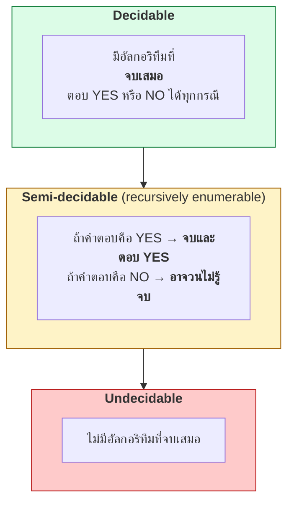
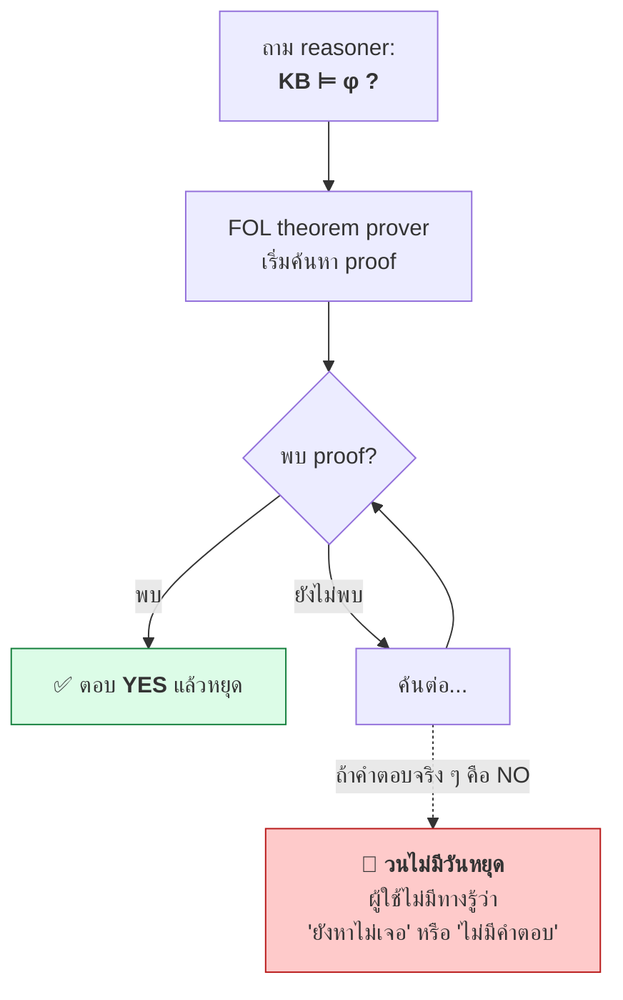
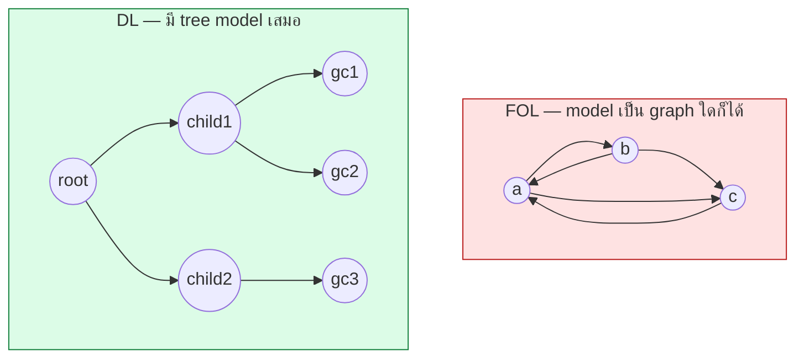
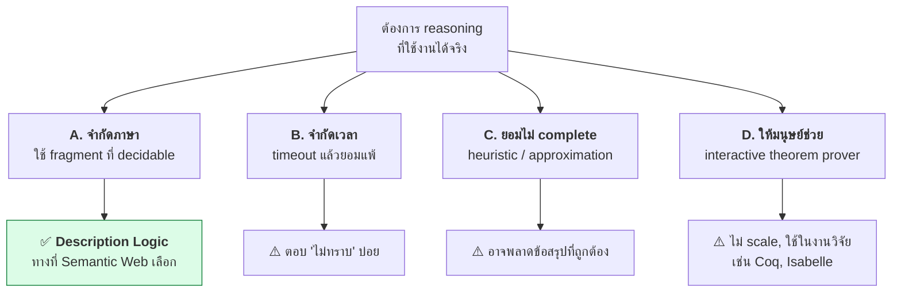
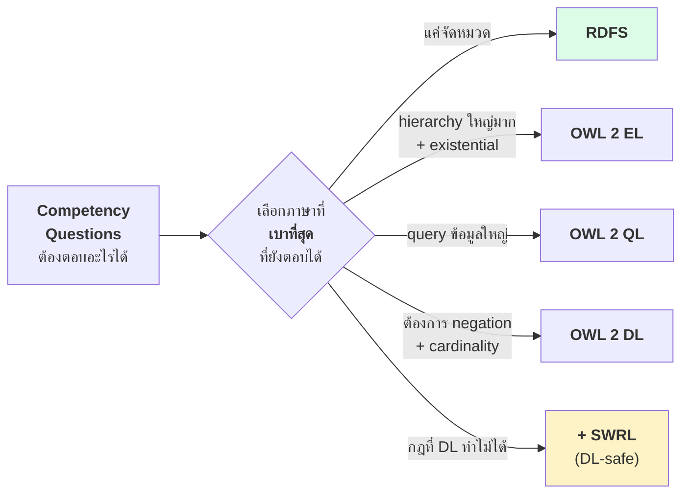

# 04.04 ข้อจำกัดของ FOL: Undecidability

FOL แสดงความรู้ได้แทบทุกอย่าง แต่มีราคาที่จ่ายไม่ไหว: **undecidability** — ไม่มีอัลกอริทึมใดที่ตอบได้ทุกคำถามและจบเสมอ
บทนี้อธิบายว่า decidable/semi-decidable/undecidable ต่างกันอย่างไร ทำไม FOL จึงตกอยู่ในกลุ่มหลัง
และทำไมข้อเท็จจริงนี้จึงบังคับให้ Semantic Web ต้องใช้ **fragment** ของ FOL แทนที่จะใช้ทั้งภาษา

---

## นิยามสามระดับ



| ระดับ | ตัวอย่าง | ใช้งานจริงได้ไหม |
| --- | --- | --- |
| **Decidable** | Propositional logic, **Description Logic**, RDFS | ✅ ได้ |
| **Semi-decidable** | **First-Order Logic** (validity) | ⚠️ เสี่ยง |
| **Undecidable** | FOL satisfiability, Halting problem | ❌ ไม่ได้ |

---

## FOL เป็น semi-decidable

**Church–Turing theorem (1936)**: ปัญหา *"ประโยค FOL นี้เป็น valid หรือไม่"* เป็น **undecidable**
แต่เป็น **semi-decidable** ในความหมายว่า:

- ถ้าประโยคนั้น **valid** → มี proof procedure ที่จะหาข้อพิสูจน์เจอ (ในเวลาที่อาจนานมาก) แล้วหยุด
- ถ้าประโยคนั้น **ไม่ valid** → procedure อาจ**วนไปเรื่อย ๆ ไม่มีวันหยุด**



**ปัญหาในทางปฏิบัติ**: ผู้ใช้ที่รอ 10 นาทีแล้วยังไม่ได้คำตอบ **ไม่มีทางรู้** ว่าควรรอต่อหรือระบบตอบไม่ได้

---

## ทำไม FOL จึง undecidable — สัญชาตญาณ

ต้นตออยู่ที่ **domain อาจเป็นอนันต์** และ **function symbol สร้าง term ใหม่ได้ไม่สิ้นสุด**

```
∀x ∃y ( P(x, y) )
```

เพื่อทำให้ประโยคนี้เป็นจริง อาจต้องมีวัตถุใหม่ไม่รู้จบ:

```
a → b → c → d → ...
```

ยิ่งถ้ามี function symbol:

```
f(a), f(f(a)), f(f(f(a))), ...
```

เซตของ term กลายเป็น**อนันต์** ทำให้การไล่ตรวจทุกความเป็นไปได้ไม่มีวันจบ

### รากปัญหาที่แท้จริง

| ต้นเหตุ | ทำให้ | DL แก้โดย |
| --- | --- | --- |
| **Function symbol** | สร้าง term ใหม่ไม่รู้จบ | **ตัดออกทั้งหมด** |
| **Predicate arity ≥ 3** | ความซับซ้อนเพิ่มแบบ exponential | **จำกัดที่ 2** |
| **Quantifier ซ้อนอิสระ** | ไม่มีโครงสร้างให้ optimize | **จำกัดรูปแบบ** (`∀r.C`, `∃r.C`) |
| **Variable co-occurrence** | ต้องติดตามหลายตัวแปรพร้อมกัน | **ตัดออก** (ใช้ tree structure) |

---

## Tree Model Property — เหตุผลที่ DL decidable

DL มีคุณสมบัติสำคัญคือ **tree model property**: ถ้า concept หนึ่ง satisfiable แล้วมันจะมี model ที่เป็น**โครงสร้างต้นไม้**



โครงสร้างต้นไม้ทำให้ **tableau algorithm** ทำงานได้: ขยายต้นไม้ทีละชั้น มีกฎ **blocking** ที่หยุดเมื่อเจอ node ที่ซ้ำรูปแบบเดิม
จึงรับประกันได้ว่าจะจบเสมอ

---

## ทางเลือกที่มีเมื่อ FOL ใช้ไม่ได้



**Semantic Web เลือกทาง A** — ยอมสละความสามารถในการแสดงบางอย่าง เพื่อแลกกับการรับประกันว่า reasoner จะจบเสมอ

---

## สิ่งที่ DL ต้องสละไปจาก FOL

| ความสามารถของ FOL | DL/OWL | ผลกระทบจริง |
| --- | :---: | --- |
| Function symbol — `motherOf(x)` | ❌ | ใช้ `hasMother(x,y)` แทน |
| Predicate arity ≥ 3 | ❌ | ต้อง reify เป็น class (เช่น `Enrollment`) |
| Variable co-occurrence ในกฎ | ❌ | ต้องใช้ SWRL (ซึ่งทำให้ undecidable ถ้าไม่จำกัด) |
| Quantifier ในตำแหน่งอิสระ | ❌ | ใช้ได้เฉพาะ `∀r.C` และ `∃r.C` |
| Arithmetic ทั่วไป | ❌ | ใช้ datatype facet หรือ SWRL builtin |
| Recursion แบบทั่วไป | ⚠️ | มีเฉพาะ transitive property และ property chain |

### ตัวอย่างที่แสดงไม่ได้ใน DL

```
# 1) variable co-occurrence
∀x ( ∃y ( teaches(x,y) ∧ enrolledIn(x,y) ) → TeachingAssistant(x) )

# 2) ความสัมพันธ์ 3 ทาง
∀x,y,z ( enrolls(x,y,z) → Student(x) ∧ Course(y) ∧ Term(z) )

# 3) arithmetic
∀x ( Course(x) ∧ credits(x, n) ∧ n > 3 → AdvancedCourse(x) )
```

ทั้งสามข้อนี้ต้องใช้ **SWRL** — และ SWRL แบบไม่จำกัดจะทำให้ระบบ **undecidable อีกครั้ง**
จึงต้องจำกัดเป็น **DL-safe rules** (ดู [11.02](../11-swrl/11.02-rule-anatomy.md))

---

## แล้ว "decidable" แปลว่าเร็วหรือไม่

**ไม่** — decidable แปลว่า "จบแน่" ไม่ได้แปลว่า "จบเร็ว"

| ภาษา | Complexity ของ satisfiability | หมายความว่า |
| --- | --- | --- |
| RDFS | **P** (polynomial) | เร็วมาก scale ได้พันล้าน triple |
| OWL 2 EL | **P** | เร็ว — ใช้กับ SNOMED CT (350k concepts) ได้จริง |
| OWL 2 QL | **NLogSpace** | query rewriting ได้ เหมาะกับ database ขนาดใหญ่ |
| OWL 2 RL | **P** | rule-based เหมาะกับ triplestore |
| OWL DL (SHOIN) | **NExpTime-complete** | worst case ช้ามหาศาล |
| OWL 2 DL (SROIQ) | **N2ExpTime-complete** | worst case ยิ่งกว่านั้น |
| FOL | **undecidable** | ไม่มีวันรับประกัน |

> 💡 **ข่าวดีในทางปฏิบัติ**: ontology ที่มนุษย์สร้างจริงมักไม่ตกใน worst case
> reasoner สมัยใหม่ (HermiT, Pellet) จัดการ ontology หลักหมื่น axiom ได้ในไม่กี่วินาที
> **แต่ก็ไม่มีการรับประกัน** — ontology ที่ออกแบบไม่ดีอาจทำให้ reasoner ค้างได้จริง

---

## บทเรียนสำหรับงานออกแบบ ontology



**หลักปฏิบัติ**: อย่าใช้ OWL 2 DL เพียงเพราะ "มันทรงพลังกว่า" — ถ้า competency question ตอบได้ด้วย RDFS
การใช้ RDFS จะทำให้ระบบ scale ได้ดีกว่าหลายเท่า

---

## Key Points

- **Decidable** = มีอัลกอริทึมที่จบเสมอ; **semi-decidable** = จบเมื่อคำตอบเป็น YES แต่อาจวนเมื่อเป็น NO
- **FOL เป็น semi-decidable** (Church–Turing, 1936) — reasoner อาจไม่มีวันหยุด และผู้ใช้ไม่มีทางรู้ว่าควรรอต่อหรือไม่
- ต้นเหตุของ undecidability: **function symbol**, **arity ≥ 3**, **quantifier อิสระ** และ **variable co-occurrence**
- **DL แก้ด้วยการตัดสิ่งเหล่านี้ออก** จนได้ **tree model property** ซึ่งทำให้ tableau algorithm จบเสมอ
- Semantic Web เลือกทาง "**จำกัดภาษา**" แทน "จำกัดเวลา" หรือ "ยอมไม่ complete"
- **Decidable ≠ เร็ว** — OWL 2 DL เป็น N2ExpTime-complete แต่ decidable; RDFS เป็น P
- ontology จริงมักไม่ตก worst case แต่ **ไม่มีการรับประกัน** — ออกแบบไม่ดีทำให้ reasoner ค้างได้
- **หลักออกแบบ**: เลือกภาษาที่เบาที่สุดที่ยังตอบ competency question ได้ ไม่ใช่ภาษาที่ทรงพลังที่สุด
