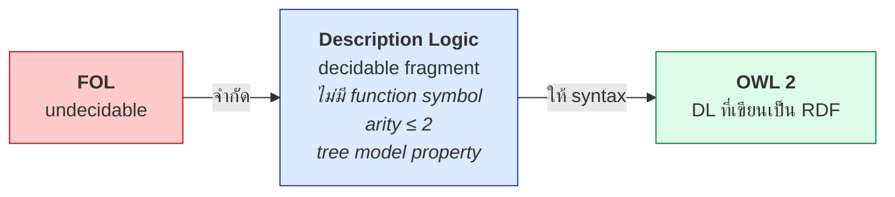
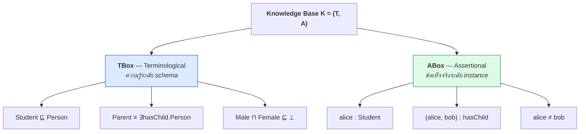

# 04.05 Description Logic: บทนำ

**Description Logic (DL)** คือตระกูลของภาษาตรรกะที่เป็น **fragment ของ FOL ที่ decidable**
และเป็นรากฐานทางคณิตศาสตร์โดยตรงของ **OWL** บทนี้แนะนำสามหน่วยพื้นฐานของ DL — **Concept**, **Role**, **Individual** —
พร้อมสัญกรณ์ที่จะใช้ตลอดคอร์ส และการเทียบกับ RDF/OWL ที่คุ้นเคยแล้ว

---

## DL อยู่ตรงไหน



> **จุดสำคัญที่ต้องเข้าใจ**: OWL ไม่ได้คิดขึ้นใหม่ — OWL คือ **syntax แบบ RDF ของ DL ที่มีอยู่ก่อนแล้ว**
> ดังนั้นทุกอย่างที่เรียนใน chapter นี้จะปรากฏอีกครั้งใน [Chapter 08](../08-owl/08.01-owl-species.md) ในรูป Turtle

---

## สามหน่วยพื้นฐาน

| DL | FOL | RDF/OWL | ตัวอย่าง |
| --- | --- | --- | --- |
| **Concept** | unary predicate | Class | `Person`, `Course` |
| **Role** | binary predicate | Property | `teaches`, `hasChild` |
| **Individual** | constant | Individual | `alice`, `cs101` |

### สัญกรณ์พื้นฐาน

```
Person                       # atomic concept
teaches                      # atomic role
alice                        # individual

alice : Person               # alice เป็น instance ของ Person  (concept assertion)
(alice, cs101) : enrolledIn  # role assertion
```

เทียบกับ RDF:

```turtle
@prefix ex: <http://example.org/> .

ex:alice a ex:Person .                # alice : Person
ex:alice ex:enrolledIn ex:cs101 .     # (alice, cs101) : enrolledIn
```

---

## Concept พิเศษสองตัว

| สัญลักษณ์ | ชื่อ | ความหมาย | ใน OWL |
| --- | --- | --- | --- |
| `⊤` | **top** | concept ที่มีทุก individual | `owl:Thing` |
| `⊥` | **bottom** | concept ที่ไม่มีสมาชิกเลย | `owl:Nothing` |

```
Person ⊑ ⊤              # ทุก concept เป็น subconcept ของ ⊤ เสมอ
⊥ ⊑ Person              # ⊥ เป็น subconcept ของทุกอย่างเสมอ
Male ⊓ Female ⊑ ⊥       # Male กับ Female ไม่มีสมาชิกร่วมกัน (disjoint)
```

---

## สัญลักษณ์หลักที่ต้องจำ

| สัญลักษณ์ | อ่านว่า | ความหมายเชิงเซต | ใน OWL |
| --- | --- | --- | --- |
| `⊑` | subsumed by / is-a | subset (`⊆`) | `rdfs:subClassOf` |
| `≡` | equivalent to | เซตเท่ากัน | `owl:equivalentClass` |
| `⊓` | and / intersection | `∩` | `owl:intersectionOf` |
| `⊔` | or / union | `∪` | `owl:unionOf` |
| `¬` | not / complement | complement | `owl:complementOf` |
| `∃r.C` | exists r to C | `{x \| ∃y: r(x,y) ∧ C(y)}` | `owl:someValuesFrom` |
| `∀r.C` | all r are C | `{x \| ∀y: r(x,y) → C(y)}` | `owl:allValuesFrom` |
| `:` | is instance of | membership | `rdf:type` |
| `⁻` | inverse | `r⁻ = {(y,x) \| r(x,y)}` | `owl:inverseOf` |

---

## Concept expression — ประกอบ concept ใหม่จาก concept เดิม

นี่คือสิ่งที่ RDFS ทำไม่ได้เลย

```
Person ⊓ Female                              # ผู้หญิง
Student ⊔ Staff                              # นักศึกษาหรือพนักงาน
¬Student                                     # ทุกอย่างที่ไม่ใช่นักศึกษา
∃hasChild.Person                             # สิ่งที่มีลูกเป็นคนอย่างน้อยหนึ่ง
∀teaches.GraduateCourse                      # สิ่งที่สอนเฉพาะวิชาระดับบัณฑิต
Person ⊓ ∃hasChild.(Person ⊓ ∃hasChild.⊤)    # คนที่มีหลาน
```

### แปลกลับเป็น FOL

| DL | FOL |
| --- | --- |
| `Person ⊓ Female` | `Person(x) ∧ Female(x)` |
| `Student ⊔ Staff` | `Student(x) ∨ Staff(x)` |
| `¬Student` | `¬Student(x)` |
| `∃hasChild.Person` | `∃y ( hasChild(x,y) ∧ Person(y) )` |
| `∀teaches.Course` | `∀y ( teaches(x,y) → Course(y) )` |

**สังเกต**: DL สั้นกว่ามากเพราะ **ไม่ต้องเขียนตัวแปร** — ตัวแปรถูกซ่อนไว้ในโครงสร้าง
คุณสมบัตินี้เรียกว่า **variable-free notation** และเป็นเหตุผลที่ DL อ่านง่ายกว่า FOL เมื่อคุ้นเคยแล้ว

---

## Axiom — ข้อความที่ประกอบเป็น ontology

| ประเภท | รูปแบบ | ตัวอย่าง | ความหมาย |
| --- | --- | --- | --- |
| **Concept inclusion** | `C ⊑ D` | `Student ⊑ Person` | ทุก Student เป็น Person |
| **Concept equivalence** | `C ≡ D` | `Parent ≡ ∃hasChild.⊤` | Parent คือสิ่งที่มีลูก (ทั้งสองทาง) |
| **Role inclusion** | `r ⊑ s` | `hasMother ⊑ hasParent` | ทุก hasMother เป็น hasParent |
| **Concept assertion** | `a : C` | `alice : Student` | alice เป็น Student |
| **Role assertion** | `(a,b) : r` | `(alice, cs101) : enrolledIn` | alice ลงเรียน cs101 |
| **Equality** | `a = b` | `alice = alice_johnson` | เป็น individual เดียวกัน |
| **Inequality** | `a ≠ b` | `alice ≠ bob` | เป็นคนละ individual |

---

## Knowledge Base = TBox + ABox



| | TBox | ABox |
| --- | --- | --- |
| พูดถึง | **concept และ role** | **individual** |
| เทียบกับ database | schema / DDL | data / rows |
| เปลี่ยนบ่อยไหม | ไม่ค่อย | บ่อย |
| ขนาด | เล็ก (หลักพัน axiom) | ใหญ่ (หลักล้าน assertion) |

บางตำราแยก **RBox** (role axiom) ออกมาเป็นส่วนที่สาม — รายละเอียดใน [Chapter 05](../05-knowledge-management/05.01-knowledge-base.md)

---

## ตัวอย่างเต็ม: KB ของมหาวิทยาลัย

### DL

```
--- TBox ---
Student          ⊑ Person
Professor        ⊑ Staff
Staff            ⊑ Person
Student ⊓ Professor ⊑ ⊥
GraduateStudent  ≡ Student ⊓ ∃enrolledIn.GraduateCourse
Course           ⊑ ∃taughtBy.Professor
TeachingStaff    ≡ Staff ⊓ ∃teaches.Course

--- RBox ---
enrolledIn       ⊑ involvedIn
teaches          ⊑ involvedIn
taughtBy         ≡ teaches⁻

--- ABox ---
alice   : Student
cs501   : GraduateCourse
(alice, cs501) : enrolledIn
profSmith : Professor
(profSmith, cs501) : teaches
alice ≠ profSmith
```

### OWL (Turtle shorthand)

```turtle
@prefix ex:   <http://example.org/> .
@prefix owl:  <http://www.w3.org/2002/07/owl#> .
@prefix rdfs: <http://www.w3.org/2000/01/rdf-schema#> .

# --- TBox ---
ex:Student   rdfs:subClassOf   ex:Person .
ex:Professor rdfs:subClassOf   ex:Staff .
ex:Staff     rdfs:subClassOf   ex:Person .
ex:Student   owl:disjointWith  ex:Professor .

ex:GraduateStudent owl:equivalentClass [
    a owl:Class ;
    owl:intersectionOf (
        ex:Student
        [ a owl:Restriction ;
          owl:onProperty     ex:enrolledIn ;
          owl:someValuesFrom ex:GraduateCourse ]
    )
] .

ex:Course rdfs:subClassOf [
    a owl:Restriction ;
    owl:onProperty     ex:taughtBy ;
    owl:someValuesFrom ex:Professor
] .

# --- RBox ---
ex:enrolledIn rdfs:subPropertyOf ex:involvedIn .
ex:teaches    rdfs:subPropertyOf ex:involvedIn .
ex:taughtBy   owl:inverseOf      ex:teaches .

# --- ABox ---
ex:alice     a ex:Student ;
             ex:enrolledIn ex:cs501 ;
             owl:differentFrom ex:profSmith .
ex:cs501     a ex:GraduateCourse .
ex:profSmith a ex:Professor ;
             ex:teaches ex:cs501 .
```

**reasoner จะอนุมานได้ว่า `alice : GraduateStudent`** — เพราะเป็น Student และมี `enrolledIn` ไปยัง GraduateCourse
ครบตามนิยาม `≡` ซึ่งเป็น **automatic classification** ที่ RDFS ทำไม่ได้

---

## Semantics ของ DL

DL ใช้ interpretation `I = (Δᴵ, ·ᴵ)` เหมือน FOL

| DL construct | Interpretation |
| --- | --- |
| `Aᴵ` | `⊆ Δᴵ` (เซตของ individual) |
| `rᴵ` | `⊆ Δᴵ × Δᴵ` (เซตของคู่) |
| `aᴵ` | `∈ Δᴵ` |
| `⊤ᴵ` | `= Δᴵ` |
| `⊥ᴵ` | `= ∅` |
| `(C ⊓ D)ᴵ` | `= Cᴵ ∩ Dᴵ` |
| `(C ⊔ D)ᴵ` | `= Cᴵ ∪ Dᴵ` |
| `(¬C)ᴵ` | `= Δᴵ \ Cᴵ` |
| `(∃r.C)ᴵ` | `= { x \| ∃y. (x,y) ∈ rᴵ ∧ y ∈ Cᴵ }` |
| `(∀r.C)ᴵ` | `= { x \| ∀y. (x,y) ∈ rᴵ → y ∈ Cᴵ }` |

**Axiom เป็นจริงใน I เมื่อ**

```
C ⊑ D    เป็นจริง  ก็ต่อเมื่อ  Cᴵ ⊆ Dᴵ
C ≡ D    เป็นจริง  ก็ต่อเมื่อ  Cᴵ = Dᴵ
a : C    เป็นจริง  ก็ต่อเมื่อ  aᴵ ∈ Cᴵ
```

> `I` เป็น **model** ของ KB `K` ถ้าทุก axiom ใน `K` เป็นจริงใน `I`
> `K` **consistent** ถ้ามี model อย่างน้อยหนึ่งตัว — และนี่คือคำถามหลักที่ reasoner ตอบ

---

## Key Points

- **Description Logic = fragment ของ FOL ที่ decidable** และเป็นรากฐานโดยตรงของ OWL
- สามหน่วยพื้นฐาน: **Concept** (= class = unary predicate), **Role** (= property = binary predicate), **Individual** (= constant)
- Concept พิเศษ: `⊤` (`owl:Thing`) และ `⊥` (`owl:Nothing`)
- สัญลักษณ์หลัก: `⊑` (subClassOf), `≡` (equivalentClass), `⊓` `⊔` `¬` (intersection/union/complement), `∃r.C` `∀r.C` (restriction)
- DL เป็น **variable-free notation** — สั้นกว่า FOL มากเพราะซ่อนตัวแปรไว้ในโครงสร้าง
- **KB = TBox (schema) + ABox (instance)** และมักแยก **RBox** (role axiom) ออกมาอีกส่วน
- `C ≡ D` ทำให้เกิด **automatic classification** ซึ่งเป็นความสามารถที่ RDFS ไม่มี
- Semantics นิยามด้วย interpretation เดียวกับ FOL — คำถามหลักของ reasoner คือ **KB นี้ consistent หรือไม่**
