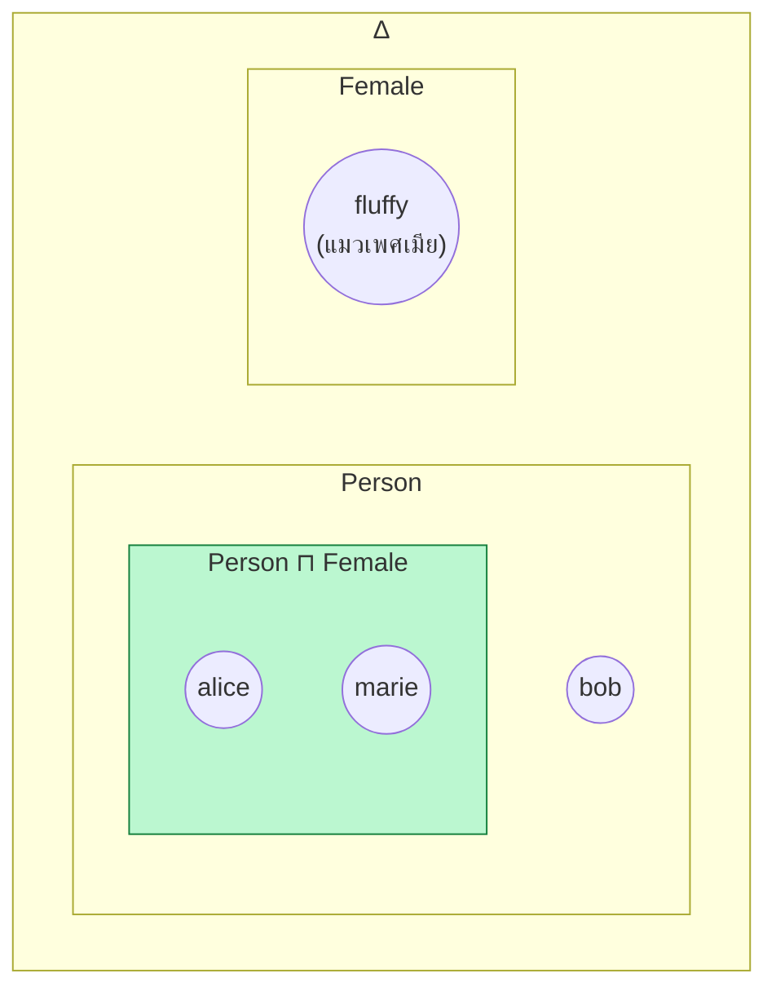
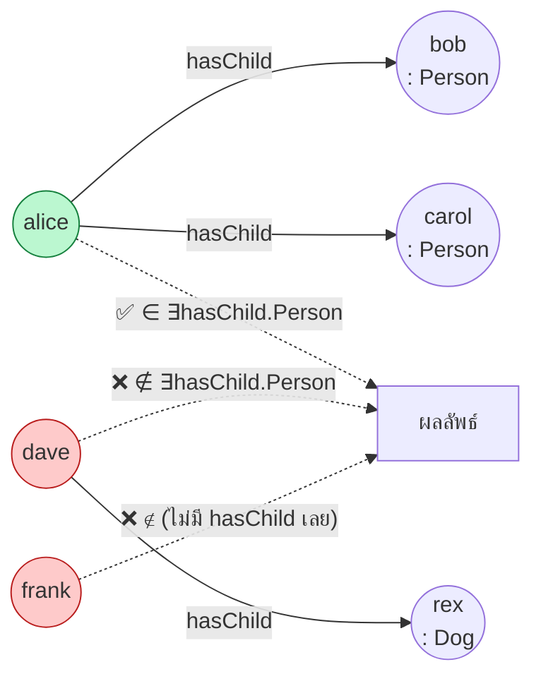
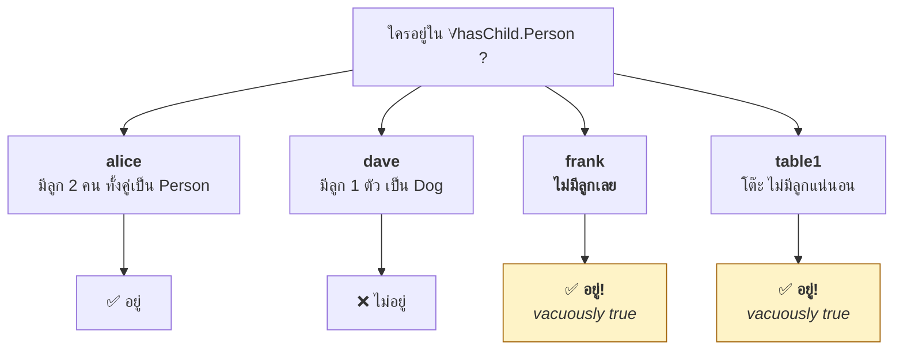
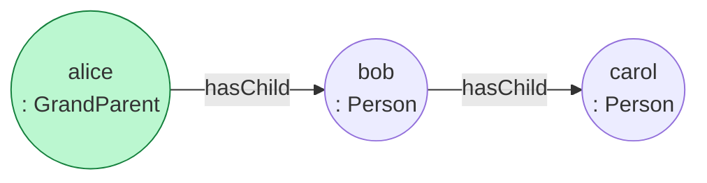

# 04.06 DL Constructors: ภาษา ALC

**ALC (Attributive Language with Complement)** คือ DL พื้นฐานที่สุดที่ยัง "ครบเครื่อง" — มี intersection, union, negation
และ restriction ทั้งสองแบบ ALC เป็นจุดอ้างอิงที่ DL ทุกตัวขยายต่อจากมัน
บทนี้อธิบาย constructor ทั้ง 6 ตัวของ ALC ทั้ง syntax, semantics และตัวอย่างการใช้จริง

---

## Constructor ทั้งหมดของ ALC

| Constructor | Syntax | อ่านว่า | Semantics |
| --- | --- | --- | --- |
| Atomic concept | `A` | — | `Aᴵ ⊆ Δᴵ` |
| Top | `⊤` | everything | `Δᴵ` |
| Bottom | `⊥` | nothing | `∅` |
| **Intersection** | `C ⊓ D` | C and D | `Cᴵ ∩ Dᴵ` |
| **Union** | `C ⊔ D` | C or D | `Cᴵ ∪ Dᴵ` |
| **Negation** | `¬C` | not C | `Δᴵ \ Cᴵ` |
| **Existential restriction** | `∃r.C` | exists r to some C | `{x \| ∃y.(x,y)∈rᴵ ∧ y∈Cᴵ}` |
| **Universal restriction** | `∀r.C` | all r to only C | `{x \| ∀y.(x,y)∈rᴵ → y∈Cᴵ}` |

> **ที่มาของชื่อ**: `AL` = Attributive Language (มี `⊓`, `∀r.C`, `∃r.⊤`, `¬A` เฉพาะ atomic)
> `C` = Complement เต็มรูปแบบ (`¬C` กับ concept ใด ๆ) → ได้ **ALC**

---

## 1. Intersection `⊓`

```
Person ⊓ Female                    # ผู้หญิง
Student ⊓ ¬GraduateStudent         # นักศึกษาที่ไม่ใช่ระดับบัณฑิต
Course ⊓ ∃taughtBy.Professor       # วิชาที่มีอาจารย์สอน
```



**OWL**

```turtle
@prefix ex:  <http://example.org/> .
@prefix owl: <http://www.w3.org/2002/07/owl#> .

ex:Woman owl:equivalentClass [
    a owl:Class ;
    owl:intersectionOf ( ex:Person ex:Female )
] .
```

---

## 2. Union `⊔`

```
Student ⊔ Staff                    # นักศึกษาหรือพนักงาน
Cat ⊔ Dog ⊔ Bird                   # แมว หมา หรือนก
```

**OWL**

```turtle
ex:UniversityMember owl:equivalentClass [
    a owl:Class ;
    owl:unionOf ( ex:Student ex:Staff )
] .
```

> ⚠️ Union ทำให้ reasoning ยากขึ้นมาก เพราะ reasoner ต้อง **แตกกรณี** (case split) ทุกครั้งที่เจอ
> ภาษาอย่าง OWL 2 EL จึงตัด union ออกเพื่อให้ได้ polynomial complexity

---

## 3. Negation `¬`

```
¬Student                           # ทุกอย่างที่ไม่ใช่นักศึกษา (รวมโต๊ะ เก้าอี้ ตัวเลข!)
Person ⊓ ¬Student                  # คนที่ไม่ใช่นักศึกษา  ← ที่ต้องการจริง ๆ
```

> ⚠️ **ข้อควรระวัง**: `¬C` หมายถึงทุกสิ่งใน `Δ` ที่ไม่อยู่ใน `C` — **ไม่ได้จำกัดอยู่ในโดเมนที่เราสนใจ**
> ในทางปฏิบัติจึงต้องเขียน `Person ⊓ ¬Student` เสมอ ไม่ใช่ `¬Student` ลอย ๆ

**OWL**

```turtle
ex:NonStudent owl:equivalentClass [
    a owl:Class ;
    owl:complementOf ex:Student
] .

# ที่ถูกต้องกว่าในทางปฏิบัติ
ex:NonStudentPerson owl:equivalentClass [
    a owl:Class ;
    owl:intersectionOf (
        ex:Person
        [ a owl:Class ; owl:complementOf ex:Student ]
    )
] .
```

### Disjointness เขียนด้วย negation

```
Male ⊑ ¬Female        ≡        Male ⊓ Female ⊑ ⊥
```

---

## 4. Existential Restriction `∃r.C`

**"มีอย่างน้อยหนึ่ง"**

```
∃hasChild.⊤                  # สิ่งที่มีลูก (ไม่สนว่าลูกเป็นอะไร)
∃hasChild.Person             # สิ่งที่มีลูกเป็นคนอย่างน้อยหนึ่ง
∃teaches.GraduateCourse      # สิ่งที่สอนวิชาระดับบัณฑิตอย่างน้อยหนึ่งวิชา
Person ⊓ ∃hasChild.Person    # คนที่มีลูกเป็นคน = Parent
```



**FOL**: `∃y ( hasChild(x,y) ∧ Person(y) )`

**OWL**

```turtle
ex:Parent owl:equivalentClass [
    a owl:Class ;
    owl:intersectionOf (
        ex:Person
        [ a owl:Restriction ;
          owl:onProperty     ex:hasChild ;
          owl:someValuesFrom ex:Person ]
    )
] .
```

---

## 5. Universal Restriction `∀r.C`

**"ทุกตัวที่มี (ถ้ามี) ต้องเป็น C"**

```
∀hasChild.Person             # ถ้ามีลูก ลูกทุกคนต้องเป็นคน
∀teaches.GraduateCourse      # ถ้าสอน ต้องสอนเฉพาะวิชาระดับบัณฑิต
```

### ⚠️ กับดักที่สำคัญที่สุดของ DL: vacuous truth



**เพราะ `∀y ( hasChild(x,y) → Person(y) )` เป็นจริงเมื่อ `hasChild(x,y)` เป็นเท็จเสมอ**
(vacuous truth จาก [04.02](04.02-fol-basics.md))

**ผลในทางปฏิบัติ**: ถ้าอยากบอกว่า "มีลูก และลูกทุกคนเป็นคน" ต้องเขียน **ทั้งสองอย่าง**

```
Person ⊓ ∃hasChild.Person ⊓ ∀hasChild.Person
```

**OWL**

```turtle
ex:GraduateOnlyTeacher owl:equivalentClass [
    a owl:Class ;
    owl:intersectionOf (
        ex:Professor
        [ a owl:Restriction ;
          owl:onProperty     ex:teaches ;
          owl:someValuesFrom ex:GraduateCourse ]     # ต้องสอนอย่างน้อยหนึ่ง
        [ a owl:Restriction ;
          owl:onProperty     ex:teaches ;
          owl:allValuesFrom  ex:GraduateCourse ]     # และสอนเฉพาะระดับบัณฑิต
    )
] .
```

---

## เทียบ `∃r.C` กับ `∀r.C` แบบชัด ๆ

| | `∃r.C` | `∀r.C` |
| --- | --- | --- |
| อ่านว่า | "มีอย่างน้อยหนึ่ง r ที่เป็น C" | "ทุก r ต้องเป็น C" |
| ไม่มี r เลย | ❌ ไม่อยู่ | ✅ **อยู่** (vacuous) |
| มี r บางตัวเป็น C | ✅ อยู่ | ❌ ไม่อยู่ |
| มี r ทุกตัวเป็น C | ✅ อยู่ | ✅ อยู่ |
| OWL | `owl:someValuesFrom` | `owl:allValuesFrom` |
| ใช้เมื่อ | บังคับให้มี | จำกัดชนิดที่มีได้ |

---

## กฎสมมูลที่ใช้บ่อย

```
¬(C ⊓ D)     ≡  ¬C ⊔ ¬D              (De Morgan)
¬(C ⊔ D)     ≡  ¬C ⊓ ¬D              (De Morgan)
¬∃r.C        ≡  ∀r.¬C                # "ไม่มี r ที่เป็น C" = "ทุก r ไม่เป็น C"
¬∀r.C        ≡  ∃r.¬C
∃r.⊥         ≡  ⊥                    # ไม่มีทางมี r ที่เป็น ⊥
∀r.⊤         ≡  ⊤                    # ทุก r เป็น ⊤ เสมอ (จริงเสมอ)
C ⊑ D        ≡  C ⊓ ¬D ⊑ ⊥
```

---

## ตัวอย่างซับซ้อน: ประกอบหลายชั้น

```
GrandParent ≡ Person ⊓ ∃hasChild.( Person ⊓ ∃hasChild.Person )
```

อ่านว่า: "คนที่มีลูกเป็นคน และลูกคนนั้นมีลูกเป็นคน"



**OWL**

```turtle
ex:GrandParent owl:equivalentClass [
    a owl:Class ;
    owl:intersectionOf (
        ex:Person
        [ a owl:Restriction ;
          owl:onProperty     ex:hasChild ;
          owl:someValuesFrom [
              a owl:Class ;
              owl:intersectionOf (
                  ex:Person
                  [ a owl:Restriction ;
                    owl:onProperty     ex:hasChild ;
                    owl:someValuesFrom ex:Person ]
              )
          ] ]
    )
] .
```

---

## ตัวอย่างจริง: โดเมนมหาวิทยาลัยด้วย ALC

```
--- TBox ---
Person          ⊑ ⊤
Student         ⊑ Person
Professor       ⊑ Person
Course          ⊑ ⊤
GraduateCourse  ⊑ Course

Student ⊓ Professor ⊑ ⊥

Parent          ≡ Person ⊓ ∃hasChild.Person
GraduateStudent ≡ Student ⊓ ∃enrolledIn.GraduateCourse
FullTimeStudent ≡ Student ⊓ ∀enrolledIn.Course ⊓ ∃enrolledIn.Course
UntaughtCourse  ≡ Course ⊓ ¬∃taughtBy.Professor
Undergraduate   ≡ Student ⊓ ¬GraduateStudent
```

**สิ่งที่ reasoner ทำได้กับ TBox นี้**

| คำถาม | คำตอบและวิธีคิด |
| --- | --- |
| `GraduateStudent ⊑ Person` ? | ✅ ผ่าน `Student ⊑ Person` |
| `GraduateStudent ⊑ Undergraduate` ? | ❌ ขัดกันตามนิยาม |
| `UntaughtCourse ⊓ ∃taughtBy.Professor` satisfiable ? | ❌ **unsatisfiable** — ขัดกันในตัว |
| `alice : Student` + `(alice, cs501) : enrolledIn` + `cs501 : GraduateCourse` | → `alice : GraduateStudent` |

---

## ข้อจำกัดของ ALC

ALC ยัง**ทำไม่ได้** อีกหลายอย่าง ซึ่งเป็นเหตุผลที่มี DL ตัวอื่น ๆ ต่อจากนี้

| ต้องการ | ALC | ต้องใช้ |
| --- | :---: | --- |
| นับ (`≥ 2 hasChild`) | ❌ | **N** — number restriction |
| Transitive role | ❌ | **S** (ALC + transitivity) |
| Inverse role (`hasChild⁻`) | ❌ | **I** |
| Role hierarchy (`hasMother ⊑ hasParent`) | ❌ | **H** |
| Nominal (`{alice, bob}`) | ❌ | **O** |
| Datatype (`age > 18`) | ❌ | **(D)** |
| Qualified cardinality (`≥ 2 hasChild.Male`) | ❌ | **Q** |

ตัวอักษรเหล่านี้ประกอบกันเป็นชื่อ DL family ที่จะเรียนใน [04.07](04.07-dl-family.md)

---

## Key Points

- **ALC** = DL พื้นฐานที่มี 6 constructor: `⊓`, `⊔`, `¬`, `∃r.C`, `∀r.C` บวก `⊤`/`⊥`
- ชื่อมาจาก **A**ttributive **L**anguage with **C**omplement
- `¬C` หมายถึงทุกสิ่งใน `Δ` ที่ไม่ใช่ C — ในทางปฏิบัติต้องเขียน `Person ⊓ ¬Student` ไม่ใช่ `¬Student` ลอย ๆ
- **`∃r.C`** = "มีอย่างน้อยหนึ่ง" — บังคับให้มีความสัมพันธ์
- **`∀r.C`** = "ทุกตัวต้องเป็น C" — **เป็นจริงโดย vacuous truth เมื่อไม่มี `r` เลย** ซึ่งเป็นกับดักอันดับหนึ่งของ DL
- ถ้าต้องการทั้ง "มี" และ "เฉพาะ" ต้องเขียน **`∃r.C ⊓ ∀r.C`** ทั้งคู่
- `¬∃r.C ≡ ∀r.¬C` และ De Morgan ใช้ได้เหมือน FOL
- ALC **ยังนับไม่ได้ ไม่มี inverse ไม่มี transitive** — ต้องขยายเป็น DL ตัวอื่นที่จะเรียนบทถัดไป
