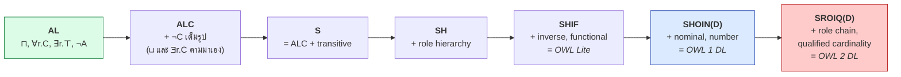
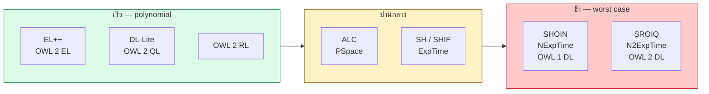
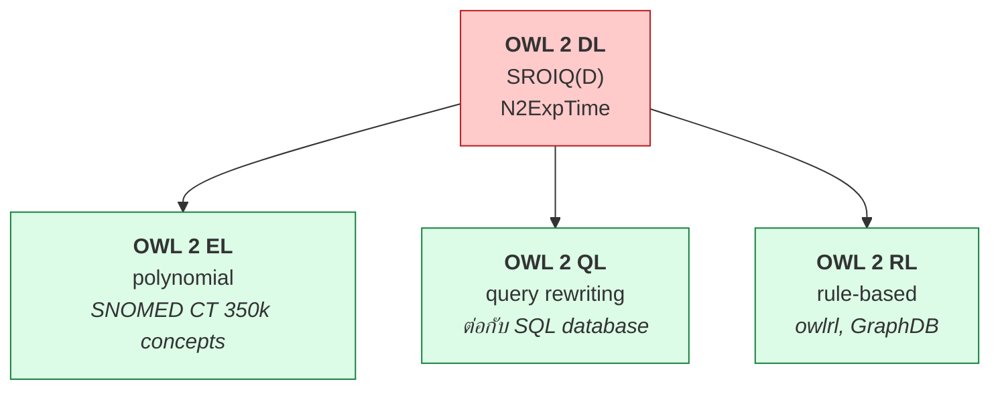
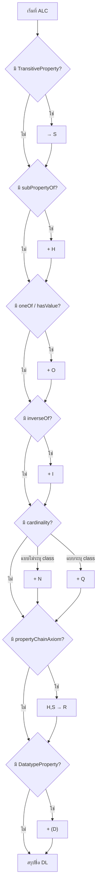

# 04.07 ตระกูลของ Description Logic

ชื่อ DL อย่าง `ALC`, `SHOIN`, `SROIQ` ไม่ใช่รหัสสุ่ม — **แต่ละตัวอักษรแทน constructor หนึ่งอย่างที่ภาษานั้นมี**
บทนี้ถอดรหัสตัวอักษรทั้งหมด แสดงลำดับการขยายจาก AL ไป SROIQ และตารางเทียบ **expressivity กับ complexity**
ซึ่งเป็นเครื่องมือตัดสินใจสำคัญตอนออกแบบ ontology

---

## ถอดรหัสตัวอักษร

| ตัวอักษร | ย่อมาจาก | เพิ่มความสามารถอะไร | ตัวอย่าง |
| --- | --- | --- | --- |
| `AL` | Attributive Language | `⊓`, `∀r.C`, `∃r.⊤`, `¬A` (atomic เท่านั้น) | `Person ⊓ ∀hasChild.Male` |
| `C` | Complement | negation เต็มรูปแบบ `¬C` | `¬(Person ⊓ Student)` |
| `U` | Union | `C ⊔ D` | `Student ⊔ Staff` |
| `E` | Existential | `∃r.C` (ไม่ใช่แค่ `∃r.⊤`) | `∃hasChild.Male` |
| `S` | — | ย่อของ **`ALC` + transitive role** | `hasAncestor` เป็น transitive |
| `H` | Hierarchy | role hierarchy `r ⊑ s` | `hasMother ⊑ hasParent` |
| `R` | Role axioms | role chain, reflexive, irreflexive, disjoint role | `hasParent ∘ hasBrother ⊑ hasUncle` |
| `O` | Nominal | enumerated class `{a, b, c}` | `Weekday ≡ {mon, tue, wed, thu, fri}` |
| `I` | Inverse | inverse role `r⁻` | `hasChild ≡ hasParent⁻` |
| `N` | Number | unqualified cardinality `≥n r` | `≥ 2 hasChild` |
| `Q` | Qualified number | qualified cardinality `≥n r.C` | `≥ 2 hasChild.Male` |
| `F` | Functional | functional role | `hasBiologicalMother` มีค่าเดียว |
| `(D)` | Datatype | datatype property | `age ≥ 18` |

> 💡 **จำง่าย**: `S` = `ALC` + transitivity (เพราะ `ALC` + `S`... เขียนยาว จึงย่อเป็นตัวเดียว)
> และ `Q` แข็งแรงกว่า `N` เพราะระบุ class ของสิ่งที่นับได้

---

## ลำดับการขยาย



**หมายเหตุ**: ใน `ALC` เราได้ `⊔` และ `∃r.C` มาฟรี เพราะสร้างจาก `¬` และ `⊓` ได้:

```
C ⊔ D    ≡  ¬( ¬C ⊓ ¬D )
∃r.C     ≡  ¬∀r.¬C
```

---

## ตารางเปรียบเทียบครบถ้วน

| DL | Constructors | Complexity (concept satisfiability) | ตรงกับ |
| --- | --- | --- | --- |
| `AL` | `⊓`, `∀r.C`, `∃r.⊤`, `¬A` | **PSpace** | — |
| `ALC` | + `¬C`, `⊔`, `∃r.C` | **PSpace-complete** | ฐานของทุกอย่าง |
| `ALCN` | + unqualified number | PSpace-complete | — |
| `S` | ALC + transitive | **PSpace-complete** | — |
| `SH` | + role hierarchy | **ExpTime-complete** | — |
| `SHIF(D)` | + inverse, functional, datatype | **ExpTime-complete** | **OWL Lite** |
| `SHOIN(D)` | + nominal, number | **NExpTime-complete** | **OWL 1 DL** |
| `SROIQ(D)` | + role chain, qualified number, reflexive/irreflexive/disjoint role | **N2ExpTime-complete** | **OWL 2 DL** |
| `EL++` | `⊓`, `∃r.C`, `⊤`, nominal, role chain (ไม่มี `¬`, `⊔`, `∀`) | **P (polynomial)** | **OWL 2 EL** |
| `DL-Lite` | จำกัดมากเพื่อ query rewriting | **AC⁰** ในการ query | **OWL 2 QL** |



---

## ตัวอย่างที่ต้องใช้แต่ละตัวอักษร

### `S` — Transitive role

```
hasAncestor เป็น transitive:   hasAncestor ∘ hasAncestor ⊑ hasAncestor
```

```turtle
ex:hasAncestor a owl:TransitiveProperty .
```

### `H` — Role hierarchy

```
hasMother ⊑ hasParent
```

```turtle
ex:hasMother rdfs:subPropertyOf ex:hasParent .
```

### `O` — Nominal (enumerated class)

```
Weekday ≡ { monday, tuesday, wednesday, thursday, friday }
BloodType ≡ { typeA, typeB, typeAB, typeO }
```

```turtle
ex:Weekday owl:equivalentClass [
    a owl:Class ;
    owl:oneOf ( ex:monday ex:tuesday ex:wednesday ex:thursday ex:friday )
] .
```

> ⚠️ **nominal ทำให้ reasoning แพงขึ้นมาก** เพราะเชื่อม TBox กับ ABox เข้าด้วยกัน
> เป็นหนึ่งในสาเหตุที่ `SHOIN` กระโดดจาก ExpTime เป็น NExpTime

### `I` — Inverse role

```
hasChild ≡ hasParent⁻
Parent ≡ ∃hasChild⁻.⊤       # เขียน "ใครมีเราเป็นลูก" ได้
```

```turtle
ex:hasChild owl:inverseOf ex:hasParent .
```

### `N` vs `Q` — Number restriction

```
≥ 2 hasChild            # มีลูกอย่างน้อย 2 คน (ไม่สนว่าเป็นอะไร)   -- N
≥ 2 hasChild.Male       # มีลูกชายอย่างน้อย 2 คน                  -- Q
= 1 hasBiologicalMother # มีแม่ทางสายเลือด 1 คนพอดี               -- N (หรือ F)
```

```turtle
# N — unqualified
ex:LargeFamily rdfs:subClassOf [
    a owl:Restriction ;
    owl:onProperty ex:hasChild ;
    owl:minCardinality "3"^^xsd:nonNegativeInteger
] .

# Q — qualified (OWL 2 เท่านั้น)
ex:FamilyWithSons rdfs:subClassOf [
    a owl:Restriction ;
    owl:onProperty          ex:hasChild ;
    owl:minQualifiedCardinality "2"^^xsd:nonNegativeInteger ;
    owl:onClass             ex:Male
] .
```

### `R` — Role chain (OWL 2 เท่านั้น)

```
hasParent ∘ hasBrother ⊑ hasUncle
locatedIn ∘ partOf ⊑ locatedIn
```

```turtle
ex:hasUncle owl:propertyChainAxiom ( ex:hasParent ex:hasBrother ) .
```

> นี่คือความสามารถที่ OWL 1 ไม่มี และเป็นเหตุผลหลักที่หลายคนอัปเกรดเป็น OWL 2

---

## OWL 2 Profiles — DL ที่ตัดให้เบา

OWL 2 นิยาม **3 profile** ที่แลก expressivity เพื่อ polynomial complexity

| Profile | DL ฐาน | ตัดอะไรออก | เหมาะกับ |
| --- | --- | --- | --- |
| **OWL 2 EL** | `EL++` | `¬`, `⊔`, `∀r.C`, inverse, cardinality | ontology ขนาดใหญ่ที่มี hierarchy ลึก (SNOMED CT, Gene Ontology) |
| **OWL 2 QL** | `DL-Lite` | เกือบทุกอย่างที่ทำให้ query rewriting ไม่ได้ | query บน relational database ขนาดใหญ่ (OBDA) |
| **OWL 2 RL** | `DLP`-ish | สิ่งที่ rule engine ทำไม่ได้ | triplestore ที่ใช้ forward chaining |



**ข้อสังเกตที่สำคัญ**: SNOMED CT มี concept กว่า 350,000 ตัว และ classify ได้ในไม่กี่นาที
**เพราะออกแบบให้อยู่ใน OWL 2 EL** — ถ้าใช้ OWL 2 DL เต็มรูปแบบจะรันไม่ไหวเลย

---

## วิธีระบุว่า ontology ของคุณอยู่ใน DL ตัวไหน

1. เปิดใน **Protégé** → เมนู `Ontology metrics` จะแสดง **DL expressivity** ให้อัตโนมัติ
2. หรือไล่ตรวจเอง:



**ตัวอย่าง**: ontology ที่มี `owl:TransitiveProperty`, `rdfs:subPropertyOf`, `owl:inverseOf`
และ `owl:minCardinality` → **`SHIN`**; ถ้าเพิ่ม datatype ด้วย → **`SHIN(D)`**

---

## เลือก DL ให้เหมาะกับงาน

| สถานการณ์ | เลือก | เหตุผล |
| --- | --- | --- |
| Vocabulary ขนาดใหญ่ hierarchy ลึก | **OWL 2 EL** | polynomial, scale ได้จริง |
| ต่อ ontology เข้ากับ SQL database | **OWL 2 QL** | query rewriting เข้า SQL ได้ |
| ใช้ triplestore + forward chaining | **OWL 2 RL** | rule engine รันได้ตรง ๆ |
| ต้องการ negation + cardinality ครบ | **OWL 2 DL** | expressive สุด (แต่ระวังเรื่อง performance) |
| แค่จัดหมวดหมู่ + alignment | **RDFS** | เบาที่สุด |

---

## Key Points

- ชื่อ DL ประกอบจากตัวอักษรที่แทน constructor: `S` = ALC+transitive, `H` = role hierarchy, `O` = nominal, `I` = inverse, `N`/`Q` = cardinality, `R` = role chain, `(D)` = datatype
- ลำดับการขยาย: **AL → ALC → S → SH → SHIF (OWL Lite) → SHOIN (OWL 1 DL) → SROIQ (OWL 2 DL)**
- ใน ALC ได้ `⊔` และ `∃r.C` มาฟรีจาก `¬` และ `⊓`
- **Complexity เพิ่มขึ้นชัน**: ALC เป็น PSpace, SHOIN เป็น NExpTime, SROIQ เป็น N2ExpTime
- **Nominal (`O`) และ inverse (`I`) แพงเป็นพิเศษ** เพราะเชื่อม TBox กับ ABox เข้าด้วยกัน
- **OWL 2 profiles** (EL, QL, RL) ตัด expressivity เพื่อแลก **polynomial complexity** — ไม่ใช่ของด้อยกว่าแต่เป็นการเลือกให้เหมาะงาน
- **SNOMED CT ใช้ OWL 2 EL** จึง classify concept 350,000 ตัวได้ในไม่กี่นาที
- ดู DL expressivity ของ ontology ตัวเองได้จาก **Protégé → Ontology metrics**
