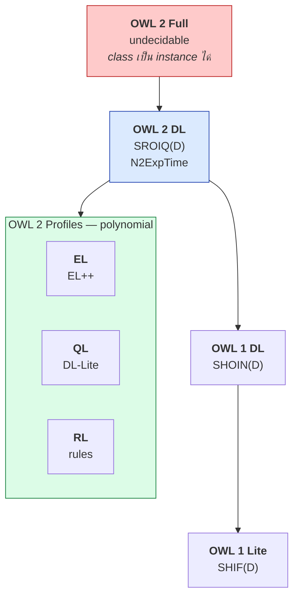

# 04.08 DL ↔ OWL Mapping

บทนี้เชื่อมทฤษฎี DL เข้ากับ syntax ของ OWL ที่จะใช้จริงใน [Chapter 08](../08-owl/08.01-owl-species.md)
มีตารางเทียบ **OWL species ↔ DL family** และ **DL construct ↔ OWL vocabulary** แบบครบทุกตัว
พร้อมตัวอย่าง Turtle ทั้ง full form และ shorthand ให้ใช้เป็น reference

---

## OWL Species ↔ DL Family

### OWL 1 (2004)

| OWL Species | DL ที่ตรงกัน | Decidable | หมายเหตุ |
| --- | --- | :---: | --- |
| **OWL Lite** | `SHIF(D)` | ✅ ExpTime | ตั้งใจให้ง่าย แต่กลับไม่ค่อยง่ายจริง |
| **OWL DL** | `SHOIN(D)` | ✅ NExpTime | จุดสมดุลหลักของ OWL 1 |
| **OWL Full** | — | ❌ **undecidable** | ไม่จำกัด — class เป็น instance ได้อิสระ |

### OWL 2 (2009)

| OWL 2 Species | DL | Complexity | เหมาะกับ |
| --- | --- | --- | --- |
| **OWL 2 DL** | `SROIQ(D)` | N2ExpTime-complete | ทั่วไป expressive สูงสุดที่ยัง decidable |
| **OWL 2 Full** | — | undecidable | compatible กับ RDF เต็มที่ |
| **OWL 2 EL** | `EL++` | **PTime** | ontology ใหญ่ hierarchy ลึก |
| **OWL 2 QL** | `DL-Lite_R` | **AC⁰** (query) | ต่อกับ relational database |
| **OWL 2 RL** | rule fragment | **PTime** | triplestore + forward chaining |



> ⚠️ **OWL Full ไม่ decidable** เพราะอนุญาตให้ class เป็น instance ของ class อื่นได้อิสระ (unrestricted punning)
> และให้ `owl:sameAs` ใช้กับ class/property ได้ — ทำให้ไม่มี reasoner ตัวไหนรับประกันความครบถ้วนได้

---

## DL Construct ↔ OWL Vocabulary (ครบทุกตัว)

### Class expression

| DL | OWL | ตัวอย่าง Turtle |
| --- | --- | --- |
| `A` | class IRI | `ex:Person` |
| `⊤` | `owl:Thing` | `owl:Thing` |
| `⊥` | `owl:Nothing` | `owl:Nothing` |
| `C ⊓ D` | `owl:intersectionOf` | `[ owl:intersectionOf ( ex:Person ex:Female ) ]` |
| `C ⊔ D` | `owl:unionOf` | `[ owl:unionOf ( ex:Student ex:Staff ) ]` |
| `¬C` | `owl:complementOf` | `[ owl:complementOf ex:Student ]` |
| `{a, b}` | `owl:oneOf` | `[ owl:oneOf ( ex:mon ex:tue ) ]` |
| `∃r.C` | `owl:someValuesFrom` | `[ owl:onProperty ex:hasChild ; owl:someValuesFrom ex:Person ]` |
| `∀r.C` | `owl:allValuesFrom` | `[ owl:onProperty ex:hasChild ; owl:allValuesFrom ex:Person ]` |
| `∃r.{a}` | `owl:hasValue` | `[ owl:onProperty ex:country ; owl:hasValue ex:France ]` |
| `∃r.Self` | `owl:hasSelf` | `[ owl:onProperty ex:likes ; owl:hasSelf true ]` |
| `≥n r` | `owl:minCardinality` | `[ owl:onProperty ex:hasChild ; owl:minCardinality 2 ]` |
| `≤n r` | `owl:maxCardinality` | `[ owl:onProperty ex:hasChild ; owl:maxCardinality 5 ]` |
| `=n r` | `owl:cardinality` | `[ owl:onProperty ex:hasMother ; owl:cardinality 1 ]` |
| `≥n r.C` | `owl:minQualifiedCardinality` + `owl:onClass` | OWL 2 เท่านั้น |
| `≤n r.C` | `owl:maxQualifiedCardinality` + `owl:onClass` | OWL 2 เท่านั้น |

### Axiom

| DL | OWL | ตัวอย่าง Turtle |
| --- | --- | --- |
| `C ⊑ D` | `rdfs:subClassOf` | `ex:Student rdfs:subClassOf ex:Person .` |
| `C ≡ D` | `owl:equivalentClass` | `ex:Car owl:equivalentClass ex:Automobile .` |
| `C ⊓ D ⊑ ⊥` | `owl:disjointWith` | `ex:Male owl:disjointWith ex:Female .` |
| `r ⊑ s` | `rdfs:subPropertyOf` | `ex:hasMother rdfs:subPropertyOf ex:hasParent .` |
| `r ≡ s` | `owl:equivalentProperty` | `ex:worksAt owl:equivalentProperty ex:employedBy .` |
| `r ≡ s⁻` | `owl:inverseOf` | `ex:hasChild owl:inverseOf ex:hasParent .` |
| `r ∘ s ⊑ t` | `owl:propertyChainAxiom` | `ex:hasUncle owl:propertyChainAxiom ( ex:hasParent ex:hasBrother ) .` |
| `a : C` | `rdf:type` | `ex:alice a ex:Student .` |
| `(a,b) : r` | triple ธรรมดา | `ex:alice ex:enrolledIn ex:cs101 .` |
| `a = b` | `owl:sameAs` | `ex:alice owl:sameAs wd:Q123 .` |
| `a ≠ b` | `owl:differentFrom` | `ex:alice owl:differentFrom ex:bob .` |
| `¬(a,b) : r` | `owl:NegativePropertyAssertion` | ดู [08.09](../08-owl/08.09-individual-axioms.md) |

### Property characteristics

| DL | OWL |
| --- | --- |
| `r⁺ ⊑ r` (transitive) | `owl:TransitiveProperty` |
| `r ≡ r⁻` (symmetric) | `owl:SymmetricProperty` |
| `r ⊓ r⁻ ⊑ ⊥` (asymmetric) | `owl:AsymmetricProperty` |
| `⊤ ⊑ ≤1 r` (functional) | `owl:FunctionalProperty` |
| `⊤ ⊑ ≤1 r⁻` (inverse functional) | `owl:InverseFunctionalProperty` |
| `⊤ ⊑ ∃r.Self` (reflexive) | `owl:ReflexiveProperty` |
| `∃r.Self ⊑ ⊥` (irreflexive) | `owl:IrreflexiveProperty` |

---

## ตัวอย่างเทียบเต็ม: จาก DL สู่ Turtle

### DL

```
Parent ≡ Person ⊓ ∃hasChild.Person
Male ⊓ Female ⊑ ⊥
Mother ≡ Parent ⊓ Female
hasChild ≡ hasParent⁻
hasAncestor⁺ ⊑ hasAncestor
LargeFamily ≡ Family ⊓ (≥ 3 hasChild.Person)
```

### OWL — Full form

```turtle
@prefix ex:   <http://example.org/> .
@prefix rdf:  <http://www.w3.org/1999/02/22-rdf-syntax-ns#> .
@prefix rdfs: <http://www.w3.org/2000/01/rdf-schema#> .
@prefix owl:  <http://www.w3.org/2002/07/owl#> .
@prefix xsd:  <http://www.w3.org/2001/XMLSchema#> .

# Parent ≡ Person ⊓ ∃hasChild.Person
ex:Parent rdf:type owl:Class .
ex:Parent owl:equivalentClass _:c1 .
_:c1 rdf:type owl:Class .
_:c1 owl:intersectionOf _:l1 .
_:l1 rdf:first ex:Person .
_:l1 rdf:rest _:l2 .
_:l2 rdf:first _:r1 .
_:l2 rdf:rest rdf:nil .
_:r1 rdf:type owl:Restriction .
_:r1 owl:onProperty ex:hasChild .
_:r1 owl:someValuesFrom ex:Person .

# Male ⊓ Female ⊑ ⊥
ex:Male owl:disjointWith ex:Female .

# hasChild ≡ hasParent⁻
ex:hasChild rdf:type owl:ObjectProperty .
ex:hasChild owl:inverseOf ex:hasParent .

# hasAncestor⁺ ⊑ hasAncestor
ex:hasAncestor rdf:type owl:TransitiveProperty .

# LargeFamily ≡ Family ⊓ (≥ 3 hasChild.Person)
ex:LargeFamily owl:equivalentClass _:c2 .
_:c2 rdf:type owl:Class .
_:c2 owl:intersectionOf _:l3 .
_:l3 rdf:first ex:Family .
_:l3 rdf:rest _:l4 .
_:l4 rdf:first _:r2 .
_:l4 rdf:rest rdf:nil .
_:r2 rdf:type owl:Restriction .
_:r2 owl:onProperty ex:hasChild .
_:r2 owl:minQualifiedCardinality "3"^^xsd:nonNegativeInteger .
_:r2 owl:onClass ex:Person .
```

### OWL — Shorthand

```turtle
@prefix ex:   <http://example.org/> .
@prefix rdf:  <http://www.w3.org/1999/02/22-rdf-syntax-ns#> .
@prefix rdfs: <http://www.w3.org/2000/01/rdf-schema#> .
@prefix owl:  <http://www.w3.org/2002/07/owl#> .
@prefix xsd:  <http://www.w3.org/2001/XMLSchema#> .

ex:Parent a owl:Class ;
    owl:equivalentClass [
        a owl:Class ;
        owl:intersectionOf (
            ex:Person
            [ a owl:Restriction ;
              owl:onProperty     ex:hasChild ;
              owl:someValuesFrom ex:Person ]
        )
    ] .

ex:Male owl:disjointWith ex:Female .

ex:hasChild a owl:ObjectProperty ;
    owl:inverseOf ex:hasParent .

ex:hasAncestor a owl:TransitiveProperty .

ex:LargeFamily owl:equivalentClass [
    a owl:Class ;
    owl:intersectionOf (
        ex:Family
        [ a owl:Restriction ;
          owl:onProperty                ex:hasChild ;
          owl:minQualifiedCardinality   "3"^^xsd:nonNegativeInteger ;
          owl:onClass                   ex:Person ]
    )
] .
```

**นับบรรทัด**: full form 38 บรรทัด vs shorthand 25 บรรทัด — และ shorthand อ่านโครงสร้างออกทันที
นี่คือเหตุผลที่ทุกคนเขียน shorthand หรือใช้ Protégé

---

## Manchester Syntax — รูปแบบที่อ่านง่ายที่สุด

Protégé แสดง OWL ด้วย **Manchester Syntax** ซึ่งใกล้กับ DL มากที่สุด

| DL | Manchester Syntax | OWL |
| --- | --- | --- |
| `C ⊓ D` | `C and D` | `owl:intersectionOf` |
| `C ⊔ D` | `C or D` | `owl:unionOf` |
| `¬C` | `not C` | `owl:complementOf` |
| `∃r.C` | `r some C` | `owl:someValuesFrom` |
| `∀r.C` | `r only C` | `owl:allValuesFrom` |
| `∃r.{a}` | `r value a` | `owl:hasValue` |
| `≥n r.C` | `r min n C` | `owl:minQualifiedCardinality` |
| `≤n r.C` | `r max n C` | `owl:maxQualifiedCardinality` |
| `=n r.C` | `r exactly n C` | `owl:qualifiedCardinality` |
| `{a, b}` | `{a, b}` | `owl:oneOf` |

ตัวอย่างเดียวกันใน Manchester Syntax:

```
Class: Parent
    EquivalentTo: Person and (hasChild some Person)

Class: Male
    DisjointWith: Female

ObjectProperty: hasChild
    InverseOf: hasParent

ObjectProperty: hasAncestor
    Characteristics: Transitive

Class: LargeFamily
    EquivalentTo: Family and (hasChild min 3 Person)
```

> 💡 เมื่ออ่าน paper หรือเอกสาร ontology คุณจะเจอทั้งสามรูปแบบ — **DL notation** (paper วิชาการ),
> **Manchester Syntax** (Protégé, เอกสารประกอบ) และ **Turtle** (ไฟล์จริง) ควรอ่านออกทั้งสามแบบ

---

## Cheat sheet: สามภาษาเทียบกัน

| ความหมาย | DL | Manchester | Turtle |
| --- | --- | --- | --- |
| Student เป็น Person | `Student ⊑ Person` | `Student SubClassOf: Person` | `ex:Student rdfs:subClassOf ex:Person .` |
| Car = Automobile | `Car ≡ Automobile` | `Car EquivalentTo: Automobile` | `ex:Car owl:equivalentClass ex:Automobile .` |
| Male กับ Female ไม่ทับกัน | `Male ⊓ Female ⊑ ⊥` | `Male DisjointWith: Female` | `ex:Male owl:disjointWith ex:Female .` |
| คนที่มีลูก | `Person ⊓ ∃hasChild.⊤` | `Person and (hasChild some owl:Thing)` | `[ owl:intersectionOf ( ex:Person [ owl:onProperty ex:hasChild ; owl:someValuesFrom owl:Thing ] ) ]` |
| สอนเฉพาะวิชาบัณฑิต | `∀teaches.GradCourse` | `teaches only GradCourse` | `[ owl:onProperty ex:teaches ; owl:allValuesFrom ex:GradCourse ]` |
| มีลูกชายอย่างน้อย 2 | `≥2 hasChild.Male` | `hasChild min 2 Male` | `[ owl:onProperty ex:hasChild ; owl:minQualifiedCardinality 2 ; owl:onClass ex:Male ]` |

---

## Key Points

- **OWL 1 DL = `SHOIN(D)`**, **OWL 2 DL = `SROIQ(D)`**, **OWL Lite = `SHIF(D)`**
- **OWL Full ไม่ decidable** เพราะอนุญาต unrestricted punning และ `owl:sameAs` กับ class/property
- **OWL 2 profiles**: EL = `EL++`, QL = `DL-Lite`, RL = rule fragment — ทั้งสามเป็น **polynomial**
- Class expression ของ DL แปลงเป็น OWL vocabulary ได้ตรงตัว: `⊓`→`intersectionOf`, `∃r.C`→`someValuesFrom`, `∀r.C`→`allValuesFrom`
- Property characteristics ทั้ง 7 ตัวของ OWL ล้วนเป็น syntactic sugar ของ DL axiom (เช่น functional = `⊤ ⊑ ≤1 r`)
- **Full form ของ OWL ยาวมาก** เพราะ restriction ต้องใช้ blank node + RDF collection — เขียน shorthand เสมอ
- **Manchester Syntax** (`and`, `or`, `not`, `some`, `only`, `min`, `max`, `exactly`) คือรูปแบบที่อ่านง่ายที่สุด และเป็นสิ่งที่ Protégé แสดง
- ควรอ่านออกทั้งสามรูปแบบ: **DL notation** (paper), **Manchester** (tool), **Turtle** (ไฟล์)
