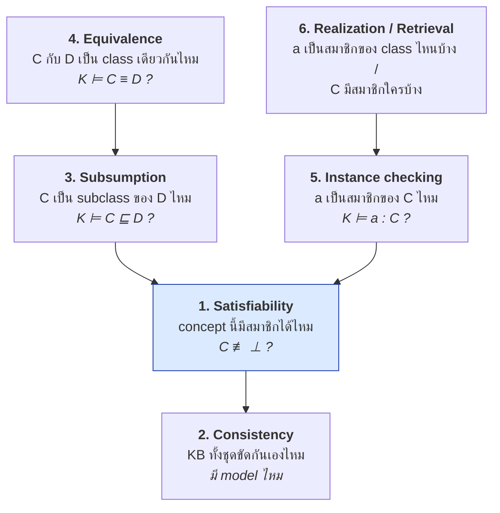
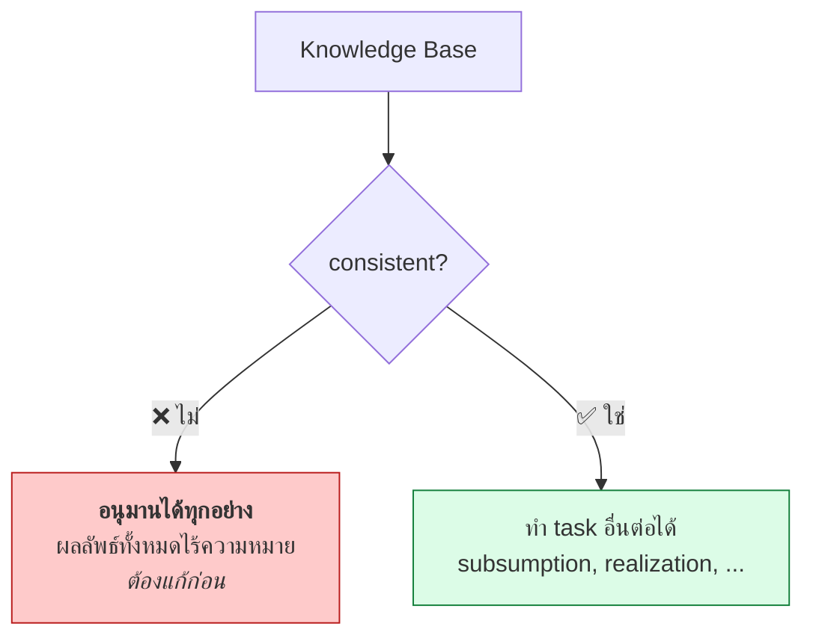
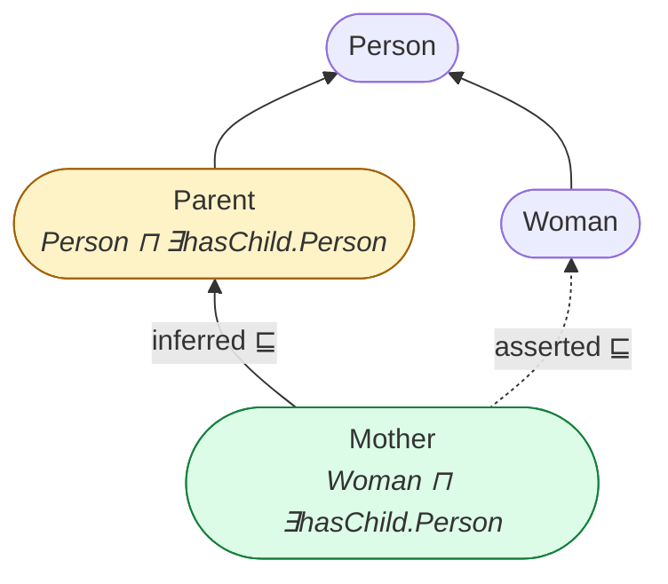
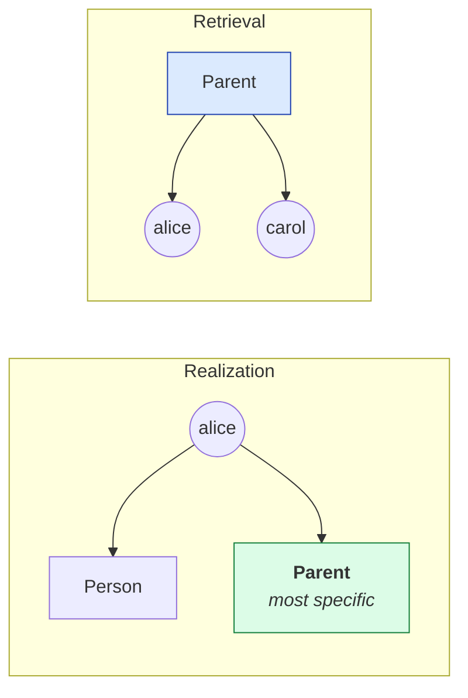

# 04.09 Reasoning Tasks

reasoner ไม่ได้ทำงานเดียว แต่ตอบคำถามมาตรฐาน 6 แบบที่ทุกตัวลดรูปกลับมาที่ปัญหาเดียวคือ **satisfiability**
บทนี้อธิบายแต่ละ task ว่าถามอะไร ตอบอะไร ใช้เมื่อไหร่ พร้อมตัวอย่างที่รันได้จริงใน Protégé หรือ owlready2

---

## ภาพรวม 6 task



**หัวใจ**: ทุก task ลดรูปเป็น **satisfiability check** ได้ ดังนั้น reasoner จริง ๆ implement แค่ตัวเดียว

---

## 1. Concept Satisfiability

**คำถาม**: concept `C` มีสมาชิกได้หรือไม่ — มี model ที่ `Cᴵ ≠ ∅` หรือไม่

```
K ⊭ C ⊑ ⊥
```

### ตัวอย่าง unsatisfiable

```
TBox:
  Male ⊓ Female ⊑ ⊥
  Hermaphrodite ≡ Male ⊓ Female
```

→ `Hermaphrodite` เป็น **unsatisfiable** เพราะเป็น intersection ของสอง class ที่ disjoint กัน

```turtle
@prefix ex:  <http://example.org/> .
@prefix owl: <http://www.w3.org/2002/07/owl#> .

ex:Male owl:disjointWith ex:Female .

ex:Hermaphrodite owl:equivalentClass [
    a owl:Class ;
    owl:intersectionOf ( ex:Male ex:Female )
] .
```

**Protégé จะแสดง class นี้เป็นสีแดงและวางไว้ใต้ `owl:Nothing`**

### ตัวอย่างที่ตรวจยากกว่า

```
TBox:
  Vegetarian     ≡ Person ⊓ ∀eats.¬Meat
  Carnivore      ≡ Person ⊓ ∃eats.Meat
  VegetarianCarnivore ≡ Vegetarian ⊓ Carnivore
```

→ `VegetarianCarnivore` unsatisfiable เพราะ `∀eats.¬Meat` กับ `∃eats.Meat` ขัดกัน

> 💡 **unsatisfiable class คือ bug เกือบเสมอ** — ไม่มีใครตั้งใจสร้าง class ที่ไม่มีวันมีสมาชิก
> การรัน satisfiability check จึงเป็น **การ debug ontology ขั้นพื้นฐานที่สุด**

---

## 2. KB Consistency

**คำถาม**: knowledge base ทั้งชุด (TBox + ABox) มี model หรือไม่

```
∃I : I ⊨ K
```

### ตัวอย่าง inconsistent

```
TBox:
  Student ⊓ Professor ⊑ ⊥

ABox:
  alice : Student
  alice : Professor
```

→ **inconsistent** เพราะไม่มี interpretation ใดที่ `alice` อยู่ในทั้งสองเซตที่ไม่ทับกัน

```turtle
@prefix ex:  <http://example.org/> .
@prefix owl: <http://www.w3.org/2002/07/owl#> .

ex:Student owl:disjointWith ex:Professor .

ex:alice a ex:Student , ex:Professor .
```

### ทำไม inconsistency จึงร้ายแรง

**Ex falso quodlibet** — จาก KB ที่ inconsistent อนุมานได้**ทุกอย่าง**

```
K inconsistent  ⟹  K ⊨ φ  สำหรับทุก φ
```

reasoner จะตอบว่า `alice : Elephant` ก็ได้ เพราะไม่มี model ที่ต้องตรวจ
**ดังนั้นต้องแก้ inconsistency ก่อนเสมอ** ก่อนทำ reasoning task อื่น



### Satisfiability vs Consistency

| | Concept satisfiability | KB consistency |
| --- | --- | --- |
| ถามถึง | class เดียว | ทั้ง KB |
| ผลเมื่อล้มเหลว | class นั้นใช้ไม่ได้ | **ทั้ง KB ใช้ไม่ได้** |
| ตำแหน่งที่พบ | มักอยู่ใน TBox | มักเกิดจาก ABox ขัดกับ TBox |
| ความร้ายแรง | ปานกลาง | **ร้ายแรงมาก** |

---

## 3. Subsumption

**คำถาม**: `C ⊑ D` เป็นจริงในทุก model ของ KB หรือไม่

```
K ⊨ C ⊑ D
```

### ตัวอย่าง

```
TBox:
  Mother ≡ Woman ⊓ ∃hasChild.Person
  Woman  ⊑ Person
  Parent ≡ Person ⊓ ∃hasChild.Person

ถาม: Mother ⊑ Parent ?
```

**ตอบ ✅ ใช่** — เพราะ Mother เป็น Woman (จึงเป็น Person) และมี hasChild ไปยัง Person ครบตามนิยาม Parent



### ลดรูปเป็น satisfiability

```
K ⊨ C ⊑ D     ก็ต่อเมื่อ     C ⊓ ¬D  เป็น unsatisfiable
```

**นี่คือเหตุผลที่ reasoner ต้องการ negation** — และเหตุผลที่ RDFS (ไม่มี `¬`) ทำ subsumption แบบนี้ไม่ได้

### Classification — subsumption ทั้ง ontology

**Classification** = คำนวณ subsumption ระหว่างทุกคู่ของ class แล้วสร้าง **inferred class hierarchy**
เป็น task ที่ Protégé เรียกว่า "Start reasoner" และเป็นงานหนักที่สุดของ reasoner

---

## 4. Equivalence

**คำถาม**: `C ≡ D` เป็นจริงหรือไม่ — ลดรูปเป็น subsumption สองทาง

```
K ⊨ C ≡ D     ก็ต่อเมื่อ     K ⊨ C ⊑ D  และ  K ⊨ D ⊑ C
```

### ตัวอย่าง

```
TBox:
  Bachelor  ≡ Man ⊓ ¬Married
  SingleMan ≡ Man ⊓ ¬Married

→ Bachelor ≡ SingleMan
```

reasoner จะจับ class ที่นิยามเหมือนกันมารวมกันโดยอัตโนมัติ — มีประโยชน์ในการหา **duplicate class**
ที่เกิดจากทีมงานคนละคนสร้างซ้ำกัน

---

## 5. Instance Checking

**คำถาม**: individual `a` เป็นสมาชิกของ concept `C` หรือไม่

```
K ⊨ a : C
```

### ตัวอย่าง

```
TBox:
  Parent ≡ Person ⊓ ∃hasChild.Person

ABox:
  alice : Person
  bob   : Person
  (alice, bob) : hasChild

ถาม: alice : Parent ?
```

**ตอบ ✅ ใช่** — แม้ไม่มีใครเขียนไว้ เพราะ alice ครบเงื่อนไขของนิยาม Parent

### ลดรูปเป็น consistency

```
K ⊨ a : C     ก็ต่อเมื่อ     K ∪ { a : ¬C }  เป็น inconsistent
```

### ⚠️ ผลของ Open World Assumption

```
ถาม: alice : ¬Parent ?     → ❌ ไม่ (ไม่ได้แปลว่า alice ไม่ใช่ Parent)
ถาม: bob : Parent ?        → ❌ ไม่ทราบ (ไม่มีข้อมูลว่า bob มีลูก)
ถาม: bob : ¬Parent ?       → ❌ ไม่ทราบ เช่นกัน!
```

**ทั้ง `bob : Parent` และ `bob : ¬Parent` ต่างตอบไม่ได้** — นี่คือความหมายที่แท้จริงของ OWA

---

## 6. Realization และ Retrieval

| Task | คำถาม | ผลลัพธ์ |
| --- | --- | --- |
| **Realization** | `a` เป็นสมาชิกของ class ไหนบ้าง | หา **most specific class** ของ individual |
| **Retrieval** (instance retrieval) | `C` มีสมาชิกใครบ้าง | หา individual ทั้งหมดใน class |

### Realization

```
ABox: alice : Person, (alice, bob) : hasChild, bob : Person

Realization(alice) = { Person, Parent }
Most specific       = Parent
```

### Retrieval

```
Retrieval(Parent) = { alice }
```



Realization และ Retrieval ใช้บ่อยที่สุดในระบบจริง เพราะเป็นสิ่งที่ตอบคำถามธุรกิจโดยตรง
เช่น *"ลูกค้ารายนี้จัดอยู่ในกลุ่มความเสี่ยงไหน"* (realization) หรือ *"ลูกค้ากลุ่มความเสี่ยงสูงมีใครบ้าง"* (retrieval)

---

## ตารางสรุป

| Task | Input | Output | ลดรูปเป็น | ใช้เมื่อ |
| --- | --- | --- | --- | --- |
| **Satisfiability** | concept `C` | ✅/❌ | — (ปัญหาฐาน) | debug TBox |
| **Consistency** | KB | ✅/❌ | satisfiability | ตรวจ KB ก่อนใช้งาน |
| **Subsumption** | `C`, `D` | ✅/❌ | `C ⊓ ¬D` unsat | สร้าง class hierarchy |
| **Classification** | ทั้ง TBox | inferred hierarchy | subsumption ทุกคู่ | หลังแก้ ontology |
| **Equivalence** | `C`, `D` | ✅/❌ | subsumption 2 ทาง | หา duplicate class |
| **Instance checking** | `a`, `C` | ✅/❌/ไม่ทราบ | consistency | ตรวจสมาชิก |
| **Realization** | `a` | เซตของ class | instance checking | จัดหมวด individual |
| **Retrieval** | `C` | เซตของ individual | instance checking | query สมาชิก |

---

## Explanation — reasoner บอกได้ว่า "ทำไม"

reasoner สมัยใหม่ตอบได้มากกว่าใช่/ไม่ใช่ — มันแสดง **justification** ได้ด้วย

**Justification** = เซตของ axiom ที่เล็กที่สุดที่ทำให้ข้อสรุปนั้นเป็นจริง

ตัวอย่าง: ทำไม `alice : Parent`

```
Justification:
  1. Parent ≡ Person ⊓ ∃hasChild.Person
  2. alice : Person
  3. bob : Person
  4. (alice, bob) : hasChild
```

ตัวอย่าง: ทำไม KB จึง inconsistent

```
Justification:
  1. Student ⊓ Professor ⊑ ⊥
  2. alice : Student
  3. alice : Professor
```

Protégé มีปุ่ม **"?"** ข้าง inferred axiom ทุกตัวที่กดแล้วแสดง justification
นี่คือ **proof layer** ของ Semantic Web Stack ที่ทำงานได้จริงในระดับหนึ่ง (ดู [01.03](../01-introduction/01.03-sw-stack.md))

---

## Key Points

- reasoner ตอบคำถามมาตรฐาน 6 แบบ และ **ทุกแบบลดรูปเป็น satisfiability check ตัวเดียว**
- **Concept satisfiability**: class มีสมาชิกได้ไหม — unsatisfiable class คือ **bug เกือบเสมอ**
- **KB consistency**: KB ทั้งชุดขัดกันไหม — ถ้า inconsistent จะ **อนุมานได้ทุกอย่าง** (ex falso quodlibet) ต้องแก้ก่อนเสมอ
- **Subsumption** `C ⊑ D` ลดรูปเป็น "`C ⊓ ¬D` unsatisfiable" — **ต้องมี negation** จึงทำได้ (RDFS ทำไม่ได้)
- **Classification** = คำนวณ subsumption ทุกคู่ เป็นงานหนักที่สุดและเป็นสิ่งที่ Protégé ทำเมื่อ "Start reasoner"
- **Instance checking** ภายใต้ OWA อาจตอบ "ไม่ทราบ" ได้ — ทั้ง `a : C` และ `a : ¬C` อาจตอบไม่ได้พร้อมกัน
- **Realization** (individual อยู่ class ไหน) และ **Retrieval** (class มีสมาชิกใคร) เป็น task ที่ใช้จริงบ่อยที่สุด
- reasoner สมัยใหม่แสดง **justification** ได้ — เซต axiom ที่เล็กที่สุดที่ทำให้ข้อสรุปเป็นจริง
