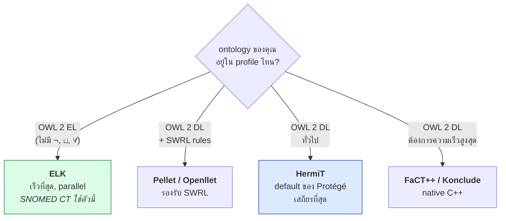
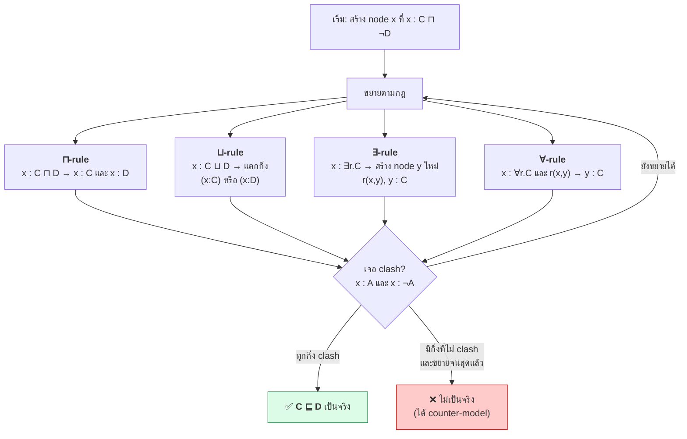
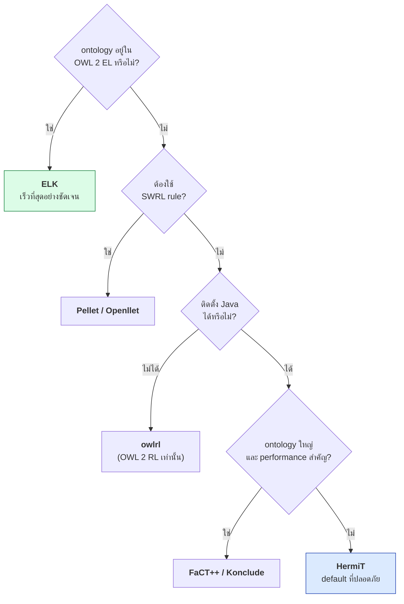

# 04.10 Reasoners: HermiT, Pellet, FaCT++, ELK

reasoner คือโปรแกรมที่รับ ontology แล้วตอบ reasoning task ที่เรียนใน [04.09](04.09-reasoning-tasks.md)
บทนี้เปรียบเทียบ reasoner หลัก 4 ตัว ว่าแต่ละตัวรองรับ profile ไหน ใช้ algorithm อะไร เร็วแค่ไหน
และเลือกใช้ตัวไหนกับงานแบบใด พร้อมวิธีเรียกใช้จาก Python

---

## ตารางเปรียบเทียบ

| Reasoner | ภาษาที่พัฒนา | รองรับ | Algorithm | จุดเด่น | ข้อจำกัด |
| --- | --- | --- | --- | --- | --- |
| **HermiT** | Java | OWL 2 DL (`SROIQ`) | **Hypertableau** | เร็วกับ ontology ที่มี disjunction เยอะ, เสถียร | ต้องมี Java, ไม่รองรับ SWRL builtin ครบ |
| **Pellet** | Java | OWL 2 DL + **SWRL** | Tableau | รองรับ **SWRL rule** และ **SPARQL-DL** | เวอร์ชัน open source หยุดพัฒนา (มี Openllet ต่อ) |
| **FaCT++** | C++ | OWL 2 DL | Tableau ปรับปรุง | **เร็วมาก**, ใช้หน่วยความจำน้อย | native library ติดตั้งยาก, ไม่รองรับ datatype ครบ |
| **ELK** | Java | **OWL 2 EL เท่านั้น** | Consequence-based | **เร็วมหาศาล**, parallel, scale ถึงหลักแสน concept | ไม่รองรับ `¬`, `⊔`, `∀`, cardinality |
| **Openllet** | Java | OWL 2 DL + SWRL | Tableau | fork ที่ยัง maintain ของ Pellet | community เล็ก |
| **JFact** | Java | OWL 2 DL | Tableau | port ของ FaCT++ เป็น Java ล้วน | ช้ากว่า FaCT++ |
| **Konclude** | C++ | OWL 2 DL | Tableau + parallel | ชนะ ORE competition หลายปี | integration น้อยกว่า |



---

## Algorithm: Tableau

reasoner ส่วนใหญ่ใช้ **tableau algorithm** ซึ่งทำงานแบบ **proof by contradiction**

**เพื่อพิสูจน์ `C ⊑ D` ให้พยายามสร้าง model ของ `C ⊓ ¬D`**
ถ้าสร้างไม่ได้ (เจอ contradiction ทุกทาง) แปลว่า `C ⊑ D` เป็นจริง



### Blocking — กลไกที่ทำให้ algorithm จบ

`∃-rule` สร้าง node ใหม่เรื่อย ๆ ซึ่งอาจไม่มีวันจบ

```
∃hasChild.(∃hasChild.(∃hasChild. ... ))
```

**Blocking** หยุดการขยายเมื่อ node ใหม่มี label ซ้ำกับ node บรรพบุรุษ
เพราะแปลว่าเจอรูปแบบวนซ้ำแล้ว — จึงรับประกัน termination

นี่คือกลไกที่ทำให้ DL **decidable** ในขณะที่ FOL ไม่เป็น (ดู [04.04](04.04-fol-limits.md))

---

## Algorithm: Hypertableau (HermiT)

HermiT ใช้ **hypertableau** ซึ่งลดปัญหาการ **แตกกิ่งแบบไม่จำเป็น (non-determinism)**
โดยแปลง ontology เป็น **DL-clauses** ก่อนแล้วใช้ hyper-resolution

| | Tableau | Hypertableau |
| --- | --- | --- |
| จัดการ disjunction | แตกกิ่งทันที | เลื่อนการแตกกิ่งออกไปให้นานที่สุด |
| ขนาด model ที่สร้าง | ใหญ่กว่า | เล็กกว่า |
| ontology ที่มี `⊑` เยอะ | ช้า | **เร็วกว่ามาก** |

---

## Algorithm: Consequence-based (ELK)

ELK ไม่ใช้ tableau เลย แต่ใช้ **consequence-based reasoning** — อนุมาน subsumption ไปข้างหน้าโดยตรง
เหมือนกฎ RDFS แต่ทรงพลังกว่า

**ทำได้เพราะ OWL 2 EL ไม่มี negation และ disjunction** จึงไม่มีการแตกกิ่งเลย

| ผลลัพธ์ | ตัวเลข |
| --- | --- |
| SNOMED CT (350,000 concepts) | classify ได้ใน **ไม่กี่นาที** |
| Gene Ontology (40,000 terms) | ไม่กี่วินาที |
| ontology เดียวกันด้วย HermiT | ช้ากว่ามาก หรือ**รันไม่ไหว** |

> 💡 **บทเรียนสำคัญ**: การออกแบบ ontology ให้อยู่ใน OWL 2 EL อาจให้ผลลัพธ์ที่ดีกว่าการใช้ OWL 2 DL
> เต็มรูปแบบ **หลายร้อยเท่า** ในแง่ performance

---

## ใช้งานจาก Protégé

```
1. เปิด ontology ใน Protégé
2. เมนู Reasoner → เลือก HermiT / ELK / Pellet
3. Reasoner → Start reasoner
4. ดูผลที่ tab "Entities" — inferred axiom แสดงเป็น **สีเหลือง**
5. class ที่ unsatisfiable แสดงเป็น **สีแดง** และอยู่ใต้ owl:Nothing
6. คลิกปุ่ม "?" ข้าง inferred axiom เพื่อดู **justification**
```

---

## ใช้งานจาก Python: owlready2

```python
from owlready2 import (
    Thing, Not, get_ontology, sync_reasoner_hermit, sync_reasoner_pellet
)

onto = get_ontology("http://example.org/university.owl")

with onto:
    class Person(Thing): pass
    class Student(Person): pass
    class Professor(Person): pass
    # Student และ Professor เป็น disjoint
    Student.is_a.append(Not(Professor))

    alice = Student("alice")

# รัน HermiT (ต้องมี Java ติดตั้งอยู่)
try:
    with onto:
        sync_reasoner_hermit(infer_property_values=True)
    print("✅ ontology consistent")
except Exception as exc:
    print(f"❌ inconsistent: {exc}")

# ตรวจ inferred class ของ individual
print(alice.is_a)
```

| ฟังก์ชัน | reasoner | รองรับ SWRL |
| --- | --- | :---: |
| `sync_reasoner_hermit()` | HermiT | ⚠️ บางส่วน |
| `sync_reasoner_pellet()` | Pellet | ✅ |
| `sync_reasoner()` | = HermiT (alias) | ⚠️ |

**Options ที่ใช้บ่อย**

```python
sync_reasoner_pellet(
    infer_property_values=True,        # อนุมานค่าของ object property ด้วย
    infer_data_property_values=True,   # อนุมานค่าของ data property (Pellet เท่านั้น)
    debug=2,                           # แสดง log ละเอียด
)
```

รายละเอียดเต็มใน [04.11](04.11-python-logic.md) และ [07.05](../07-python-semantic-web/07.05-owlready2-reasoning.md)

---

## ใช้งานจาก Python: owlrl (ไม่ต้องมี Java)

ถ้าไม่อยากพึ่ง Java และต้องการแค่ **OWL 2 RL** ใช้ `owlrl` ได้

```python
from rdflib import Graph
import owlrl

g = Graph().parse("university.ttl", format="turtle")

owlrl.DeductiveClosure(owlrl.OWLRL_Semantics).expand(g)
print(len(g))
```

| | owlrl | owlready2 + HermiT |
| --- | --- | --- |
| ต้องมี Java | ❌ ไม่ต้อง | ✅ ต้อง |
| รองรับ | OWL 2 RL | OWL 2 DL เต็ม |
| ตรวจ inconsistency | จำกัด | ✅ ครบ |
| ทำงานกับ | rdflib Graph | owlready2 world |
| ความเร็ว | ปานกลาง | ขึ้นกับ ontology |
| เหมาะกับ | pipeline ที่ใช้ rdflib อยู่แล้ว | ontology ที่ต้องการ DL reasoning จริง |

---

## เกณฑ์เลือก reasoner



---

## Reasoner ใน Triplestore

นอกจาก standalone reasoner ยังมี triplestore ที่มี reasoner ในตัว

| Triplestore | Reasoning ที่รองรับ | หมายเหตุ |
| --- | --- | --- |
| **Apache Jena Fuseki** | RDFS, OWL subset (rule-based) | ตั้งค่า rule เองได้ |
| **GraphDB** | RDFS, OWL 2 RL, custom rules | ปรับ ruleset ได้ละเอียด |
| **Stardog** | OWL 2 QL/EL/RL/DL (query rewriting) | reasoning ตอน query ไม่ materialize |
| **Virtuoso** | RDFS + OWL subset | เน้น scale |
| **AllegroGraph** | RDFS++ | เน้น performance |

> 💡 สำหรับ **production** ที่มีข้อมูลใหญ่ การใช้ reasoning ของ triplestore มักปฏิบัติได้จริงกว่า
> การรัน standalone DL reasoner บนข้อมูลทั้งชุด

---

## ข้อควรรู้เรื่อง performance

| ปัจจัยที่ทำให้ช้า | เหตุผล | ทางแก้ |
| --- | --- | --- |
| **Nominal (`owl:oneOf`)** | เชื่อม TBox กับ ABox | ใช้เท่าที่จำเป็น |
| **Cardinality สูง** | สร้าง node จำนวนมาก | ลดตัวเลข หรือใช้ functional แทน |
| **Disjunction (`⊔`) เยอะ** | แตกกิ่งมหาศาล | ปรับเป็น hierarchy แทนถ้าทำได้ |
| **Inverse property** | ต้องขยายสองทิศทาง | ใช้เท่าที่จำเป็น |
| **ABox ขนาดใหญ่** | reasoning เชิง instance แพง | แยก TBox reasoning ออกจาก ABox, ใช้ OWL 2 QL/RL |
| **Ontology ที่ import กันซับซ้อน** | รวมเป็นก้อนใหญ่ | modularize (ดู [10.07](../10-ontology-design/10.07-modularization.md)) |

---

## Key Points

- **HermiT** (hypertableau) เป็น default ของ Protégé — เสถียรและเร็วกับ ontology ที่มี subclass เยอะ
- **Pellet/Openllet** เป็นตัวเดียวที่รองรับ **SWRL rule** ได้ครบ — จำเป็นสำหรับ [Chapter 11](../11-swrl/11.10-python-swrl.md)
- **FaCT++/Konclude** เขียนด้วย C++ เร็วที่สุดในกลุ่ม OWL 2 DL แต่ติดตั้งยากกว่า
- **ELK** รองรับเฉพาะ OWL 2 EL แต่**เร็วมหาศาล** — เป็นเหตุผลที่ SNOMED CT (350k concepts) classify ได้จริง
- **Tableau algorithm** ทำงานแบบ proof by contradiction และใช้ **blocking** เพื่อรับประกันว่าจะจบ
- **owlrl** ใช้ได้โดยไม่ต้องมี Java แต่รองรับแค่ OWL 2 RL — เหมาะกับ pipeline ที่ใช้ rdflib
- ปัจจัยที่ทำให้ reasoning ช้า: **nominal, cardinality สูง, disjunction เยอะ, inverse, ABox ใหญ่**
- สำหรับ production ที่ข้อมูลใหญ่ **reasoning ใน triplestore** (GraphDB, Stardog) ปฏิบัติได้จริงกว่า standalone reasoner
