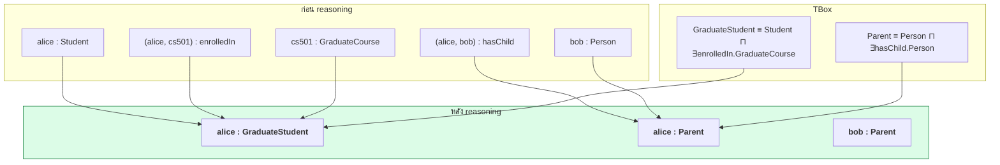
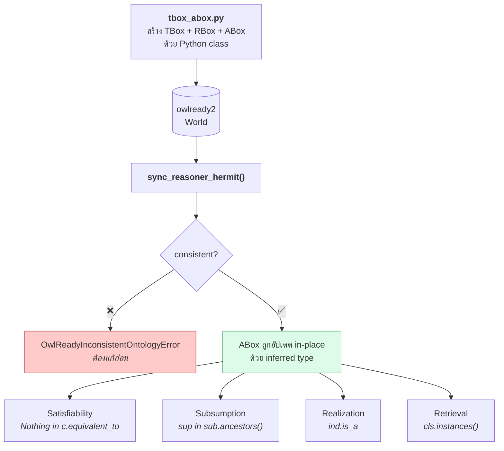

# 04.11 Python: owlready2 และ HermiT

บทนี้แปลง DL axiom เป็นโค้ด Python ด้วย **owlready2** สร้าง TBox + ABox แล้วรัน **HermiT reasoner**
เพื่อดู reasoning task ทั้ง 6 ทำงานจริง — ตั้งแต่ตรวจ satisfiability ไปจนถึง realization
ผลลัพธ์ทุกอย่างในบทนี้มาจากการรันจริง

> 📁 ไฟล์เต็ม: [`code/ch04/tbox_abox.py`](../code/ch04/tbox_abox.py) และ [`code/ch04/run_hermit.py`](../code/ch04/run_hermit.py)

---

## ติดตั้ง

```bash
pip install owlready2
java -version     # ต้องมี Java 8+ เพราะ HermiT เป็นโปรแกรม Java
```

owlready2 มาพร้อม HermiT และ Pellet ในตัว ไม่ต้องดาวน์โหลดแยก

---

## Mapping: DL → owlready2

| DL | owlready2 |
| --- | --- |
| `A ⊑ B` | `class A(B): pass` |
| `A ≡ C` | `A.equivalent_to = [C]` |
| `A ⊓ B` | `A & B` |
| `A ⊔ B` | `A \| B` |
| `¬A` | `Not(A)` |
| `∃r.C` | `r.some(C)` |
| `∀r.C` | `r.only(C)` |
| `≥n r.C` | `r.min(n, C)` |
| `≤n r.C` | `r.max(n, C)` |
| `=n r.C` | `r.exactly(n, C)` |
| `{a,b}` | `OneOf([a, b])` |
| `r ⊑ s` | `class r(s): pass` |
| `r ≡ s⁻` | `inverse_property = s` |
| `r` transitive | `class r(ObjectProperty, TransitiveProperty)` |
| `a : C` | `a = C("a")` |
| `(a,b) : r` | `a.r = [b]` หรือ `a.r.append(b)` |
| `a ≠ b` | `AllDifferent([a, b])` |

---

## 1. สร้าง TBox

```python
from owlready2 import (
    AllDifferent, Not, ObjectProperty, Thing, TransitiveProperty, get_ontology
)

onto = get_ontology("http://example.org/university.owl")

with onto:

    class Person(Thing):
        """Person ⊑ ⊤"""

    class Student(Person):
        """Student ⊑ Person"""

    class Staff(Person):
        """Staff ⊑ Person"""

    class Professor(Staff):
        """Professor ⊑ Staff"""

    class Course(Thing):
        """Course ⊑ ⊤"""

    class GraduateCourse(Course):
        """GraduateCourse ⊑ Course"""
```

> **สำคัญ**: ทุกอย่างต้องอยู่ใน `with onto:` block มิฉะนั้น class จะไปอยู่ใน default ontology

---

## 2. สร้าง RBox (role)

```python
with onto:

    class hasChild(ObjectProperty):
        domain = [Person]
        range  = [Person]

    class hasParent(ObjectProperty):
        """hasParent ≡ hasChild⁻"""
        domain = [Person]
        range  = [Person]
        inverse_property = hasChild

    class hasAncestor(hasParent, TransitiveProperty):
        """hasAncestor⁺ ⊑ hasAncestor"""

    class involvedIn(ObjectProperty):
        domain = [Person]
        range  = [Course]

    class enrolledIn(involvedIn):
        """enrolledIn ⊑ involvedIn"""
        domain = [Student]
        range  = [Course]

    class teaches(involvedIn):
        """teaches ⊑ involvedIn"""
        domain = [Professor]
        range  = [Course]
```

**สังเกต**: `class enrolledIn(involvedIn)` คือวิธีเขียน `enrolledIn ⊑ involvedIn` ใน owlready2
— inheritance ของ Python ถูกใช้แทน subproperty โดยตรง

---

## 3. Disjointness และ Defined class

```python
with onto:
    # Student ⊓ Professor ⊑ ⊥
    Student.is_a.append(Not(Professor))

    # Parent ≡ Person ⊓ ∃hasChild.Person
    class Parent(Thing):
        equivalent_to = [Person & hasChild.some(Person)]

    # GraduateStudent ≡ Student ⊓ ∃enrolledIn.GraduateCourse
    class GraduateStudent(Thing):
        equivalent_to = [Student & enrolledIn.some(GraduateCourse)]

    # ตั้งใจสร้าง class ที่ unsatisfiable เพื่อทดสอบ reasoner
    class StudentProfessor(Thing):
        equivalent_to = [Student & Professor]
```

---

## 4. สร้าง ABox

```python
with onto:
    alice      = Student("alice")
    bob        = Person("bob")
    carol      = Person("carol")
    prof_smith = Professor("profSmith")

    cs101 = Course("cs101")
    cs501 = GraduateCourse("cs501")

    alice.enrolledIn  = [cs501, cs101]
    prof_smith.teaches = [cs101, cs501]
    alice.hasChild    = [bob]
    bob.hasChild      = [carol]

    # OWL ไม่มี Unique Name Assumption -- ต้องบอกให้ชัดว่าเป็นคนละคน
    AllDifferent([alice, bob, carol, prof_smith])
```

---

## 5. รัน HermiT

```python
from owlready2 import OwlReadyInconsistentOntologyError, sync_reasoner_hermit

try:
    with onto:
        sync_reasoner_hermit(infer_property_values=True)
    print("✅ KB consistent")
except OwlReadyInconsistentOntologyError:
    print("❌ KB inconsistent — ต้องแก้ก่อนใช้งาน")
```

| Parameter | ความหมาย |
| --- | --- |
| `infer_property_values=True` | อนุมานค่าของ object property ด้วย ไม่ใช่แค่ class |
| `infer_data_property_values=True` | อนุมานค่าของ data property (**Pellet เท่านั้น**) |
| `debug=2` | แสดง log ของ reasoner |
| `x=world` | ระบุ World ที่ต้องการ (เมื่อใช้หลาย World) |

---

## 6. Reasoning task ทั้ง 6 — ผลรันจริง

### Task 1: Concept Satisfiability

```python
from owlready2 import Nothing

unsat = [c for c in onto.classes() if Nothing in c.equivalent_to]
for cls in unsat:
    print(f"❌ {cls.name} unsatisfiable (≡ ⊥)")
```

```
❌ StudentProfessor     unsatisfiable (≡ ⊥)
```

**เหตุผล**: `StudentProfessor ≡ Student ⊓ Professor` แต่ `Student ⊑ ¬Professor` → ไม่มีสมาชิกได้

### Task 2: KB Consistency

```
✅ KB consistent — มี model อย่างน้อยหนึ่งตัว
```

### Task 3: Subsumption

```python
pairs = [
    (onto.GraduateStudent, onto.Student),
    (onto.GraduateStudent, onto.Person),
    (onto.Professor,       onto.Person),
    (onto.Parent,          onto.Person),
    (onto.Student,         onto.Professor),
]
for sub, sup in pairs:
    holds = sup in sub.ancestors()
    print(f"{'✅' if holds else '❌'} {sub.name} ⊑ {sup.name}")
```

```
✅ GraduateStudent    ⊑ Student
✅ GraduateStudent    ⊑ Person
✅ Professor          ⊑ Person
✅ Parent             ⊑ Person
❌ Student            ⊑ Professor
```

> `GraduateStudent ⊑ Student` เป็น **inferred** ไม่ได้เขียนไว้เลย — reasoner สรุปจากนิยาม `≡`

### Task 4: Equivalence

```
StudentProfessor     ≡ Nothing
```

### Task 5: Instance Checking — ก่อน vs หลัง

```python
before = {ind.name: sorted(c.name for c in ind.is_a if hasattr(c, "name"))
          for ind in onto.individuals()}
# ... run reasoner ...
for ind in onto.individuals():
    after = sorted(c.name for c in ind.is_a if hasattr(c, "name"))
    print(f"{ind.name:12s} {before[ind.name]} → {after}")
```

| Individual | ก่อน reasoning | หลัง reasoning | ได้อะไรเพิ่ม |
| --- | --- | --- | --- |
| `alice` | `['Student']` | `['GraduateStudent', 'Parent']` | **GraduateStudent, Parent** |
| `bob` | `['Person']` | `['Parent']` | **Parent** |
| `carol` | `['Person']` | `['Person']` | — |
| `profSmith` | `['Professor']` | `['Professor']` | — |

**อธิบาย**

- `alice : GraduateStudent` — เพราะเป็น Student และ `enrolledIn` ไปยัง `cs501` ซึ่งเป็น GraduateCourse ครบตามนิยาม `≡`
- `alice : Parent` — เพราะ `hasChild` ไปยัง `bob` ซึ่งเป็น Person
- `bob : Parent` — เพราะ `hasChild` ไปยัง `carol`
- `carol` ไม่ได้อะไรเพิ่ม เพราะไม่มีลูก

> 💡 owlready2 **แทนที่** `is_a` เดิมด้วย most specific class หลัง reasoning
> จึงเห็น `['GraduateStudent', 'Parent']` แทนที่จะรวม `Student` และ `Person` ด้วย



### Task 6: Realization และ Retrieval

```python
# Realization -- individual อยู่ class ไหน
for ind in onto.individuals():
    print(f"{ind.name}: {[c.name for c in ind.is_a if hasattr(c, 'name')]}")

# Retrieval -- class มีสมาชิกใคร
for cls in [onto.Person, onto.Student, onto.GraduateStudent, onto.Parent]:
    print(f"{cls.name}: {sorted(i.name for i in cls.instances())}")
```

```
Retrieval:
  Person             = ['alice', 'bob', 'carol', 'profSmith']
  Student            = ['alice']
  GraduateStudent    = ['alice']
  Parent             = ['alice', 'bob']
  Professor          = ['profSmith']
  Course             = ['cs101', 'cs501']
```

> สังเกต `Person` มีสมาชิกครบ 4 คนแม้ `profSmith` ประกาศเป็นแค่ `Professor` — เพราะ `instances()` ใช้ hierarchy หลัง reasoning

---

## 7. สาธิต inconsistency

```python
from owlready2 import Not, OwlReadyInconsistentOntologyError, Thing, World

world = World()
bad = world.get_ontology("http://example.org/bad.owl")

with bad:
    class Person(Thing): pass
    class Student(Person): pass
    class Professor(Person): pass
    Student.is_a.append(Not(Professor))

    alice = Student("alice")
    alice.is_a.append(Professor)      # ขัดกับ disjointness

try:
    with bad:
        sync_reasoner_hermit(x=world)
    print("consistent")
except OwlReadyInconsistentOntologyError:
    print("❌ INCONSISTENT")
```

```
❌ INCONSISTENT ตามที่คาดไว้
   Justification:
     1. Student ⊑ ¬Professor
     2. alice : Student
     3. alice : Professor
   → ไม่มี interpretation ใดที่ทั้งสามข้อเป็นจริงพร้อมกัน
```

> 💡 ใช้ **`World()` แยก** เมื่อต้องการ ontology หลายชุดในโปรแกรมเดียว
> เพราะ owlready2 เก็บทุกอย่างใน global default world หากไม่ระบุ

---

## บันทึกและโหลดกลับ

```python
onto.save(file="university.owl", format="rdfxml")

# โหลดกลับ
from owlready2 import get_ontology
onto2 = get_ontology("file://university.owl").load()

# โหลดจาก URL
dbpedia = get_ontology("http://dbpedia.org/ontology/").load()
```

| Format ที่รองรับ | ค่า `format` |
| --- | --- |
| RDF/XML | `"rdfxml"` (default) |
| N-Triples | `"ntriples"` |

> ⚠️ owlready2 **ไม่ save เป็น Turtle โดยตรง** — ถ้าต้องการ Turtle ให้ save เป็น RDF/XML แล้วแปลงด้วย rdflib

```python
from rdflib import Graph

onto.save(file="university.owl", format="rdfxml")
Graph().parse("university.owl", format="xml").serialize("university.ttl", format="turtle")
```

---

## Flow ทั้งหมด



---

## Troubleshooting

| อาการ | สาเหตุ | วิธีแก้ |
| --- | --- | --- |
| `JavaNotFoundError` | ไม่มี Java | ติดตั้ง JDK 8+ แล้วตั้ง `owlready2.JAVA_EXE` |
| class ไปอยู่ ontology ผิด | ลืม `with onto:` | ห่อทุกการประกาศด้วย `with onto:` |
| reasoner ไม่อนุมานอะไรเลย | ใช้ `is_a` แทน `equivalent_to` | defined class ต้องใช้ `equivalent_to` |
| reasoning ช้ามาก | ABox ใหญ่ / มี nominal | ลด ABox หรือใช้ OWL 2 EL + ELK |
| `AttributeError: onto.X` | สะกดชื่อผิด หรือยังไม่ได้ประกาศ | ตรวจ `list(onto.classes())` |
| ผลลัพธ์ปนกันข้ามการรัน | ใช้ default world ร่วมกัน | ใช้ `World()` แยกต่อ ontology |
| `AllDifferent` ไม่มีผล | ลืมประกาศ | OWL ไม่มี UNA — ต้องประกาศเสมอ |

---

## Key Points

- **owlready2 map DL เข้ากับ Python class ตรง ๆ**: `class A(B)` = `A ⊑ B`, `equivalent_to` = `≡`, `&` `|` `Not` = `⊓` `⊔` `¬`
- ทุกการประกาศต้องอยู่ใน **`with onto:` block**
- `r.some(C)` = `∃r.C`, `r.only(C)` = `∀r.C`, `r.min/max/exactly(n, C)` = cardinality
- `sync_reasoner_hermit()` รัน HermiT และ **แก้ ABox in-place** — ต้องเก็บสภาพก่อนไว้ถ้าอยากเทียบ
- **`equivalent_to` ทำให้เกิด automatic classification** — `is_a` ไม่ทำ (นี่คือความต่างระหว่าง defined กับ primitive class)
- ตรวจ unsatisfiable class ด้วย `Nothing in cls.equivalent_to`; ตรวจ consistency ด้วย `try/except OwlReadyInconsistentOntologyError`
- `cls.instances()` = **retrieval**, `ind.is_a` หลัง reasoning = **realization**
- ใช้ **`World()` แยก** เมื่อทำงานกับ ontology หลายชุดในโปรแกรมเดียว
- owlready2 **ไม่ save Turtle โดยตรง** — save RDF/XML แล้วแปลงด้วย rdflib
