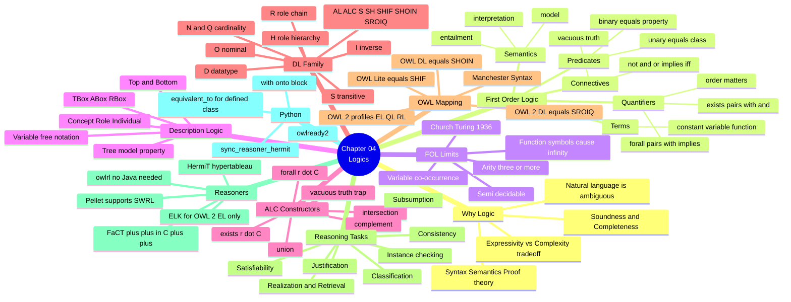

# 04.12 สรุป Chapter 04

Chapter 04 วางรากฐานทางตรรกะของทั้ง Semantic Web: จาก FOL ที่ทรงพลังแต่ undecidable
สู่ Description Logic ที่ยอมสละความสามารถบางอย่างเพื่อรับประกันว่า reasoner จะจบเสมอ
บทสรุปนี้รวมตารางเทียบ **FOL vs DL vs RDFS vs OWL** ที่จะใช้อ้างอิงตลอดคอร์สที่เหลือ

---

## Concept Map



---

## ตารางเปรียบเทียบหลัก: FOL vs DL vs RDFS vs OWL

| ประเด็น | **FOL** | **Description Logic** | **RDFS** | **OWL 2 DL** |
| --- | --- | --- | --- | --- |
| Decidable | ❌ semi-decidable | ✅ | ✅ | ✅ |
| Complexity | undecidable | ขึ้นกับ family | **P** | **N2ExpTime** |
| Function symbol | ✅ | ❌ | ❌ | ❌ |
| Predicate arity | ไม่จำกัด | ≤ 2 | ≤ 2 | ≤ 2 |
| Negation `¬` | ✅ | ✅ | ❌ | ✅ |
| Union `⊔` | ✅ | ✅ (ALC ขึ้นไป) | ❌ | ✅ |
| Existential `∃r.C` | ✅ | ✅ | ❌ | ✅ |
| Universal `∀r.C` | ✅ | ✅ | ❌ | ✅ |
| Cardinality | ✅ (เขียนยาว) | ✅ (N/Q) | ❌ | ✅ |
| Inverse role | ✅ | ✅ (I) | ❌ | ✅ |
| Transitive role | ✅ | ✅ (S) | ⚠️ เฉพาะ subClassOf/subPropertyOf | ✅ |
| Role hierarchy | ✅ | ✅ (H) | ✅ | ✅ |
| Nominal `{a,b}` | ✅ | ✅ (O) | ❌ | ✅ |
| Role chain | ✅ | ✅ (R, OWL 2) | ❌ | ✅ |
| Variable co-occurrence | ✅ | ❌ | ❌ | ❌ (ต้องใช้ SWRL) |
| ตรวจ inconsistency | ✅ (อาจไม่จบ) | ✅ | ❌ | ✅ |
| Automatic classification | ✅ | ✅ | ❌ | ✅ |
| Reasoner ที่ใช้จริง | Vampire, E | — | owlrl, Jena | HermiT, Pellet, FaCT++ |

---

## DL Notation Cheat Sheet

| สัญลักษณ์ | อ่าน | OWL | Manchester |
| --- | --- | --- | --- |
| `⊤` | top | `owl:Thing` | `owl:Thing` |
| `⊥` | bottom | `owl:Nothing` | `owl:Nothing` |
| `C ⊓ D` | C and D | `owl:intersectionOf` | `C and D` |
| `C ⊔ D` | C or D | `owl:unionOf` | `C or D` |
| `¬C` | not C | `owl:complementOf` | `not C` |
| `∃r.C` | some | `owl:someValuesFrom` | `r some C` |
| `∀r.C` | only | `owl:allValuesFrom` | `r only C` |
| `∃r.{a}` | value | `owl:hasValue` | `r value a` |
| `≥n r.C` | min | `owl:minQualifiedCardinality` | `r min n C` |
| `≤n r.C` | max | `owl:maxQualifiedCardinality` | `r max n C` |
| `=n r.C` | exactly | `owl:qualifiedCardinality` | `r exactly n C` |
| `{a,b}` | one of | `owl:oneOf` | `{a, b}` |
| `C ⊑ D` | subsumed | `rdfs:subClassOf` | `SubClassOf:` |
| `C ≡ D` | equivalent | `owl:equivalentClass` | `EquivalentTo:` |
| `r⁻` | inverse | `owl:inverseOf` | `inverse r` |
| `r ∘ s ⊑ t` | chain | `owl:propertyChainAxiom` | `SubPropertyChain:` |
| `a : C` | instance of | `rdf:type` | `Types:` |

---

## DL Family Cheat Sheet

| ตัวอักษร | เพิ่มอะไร |
| --- | --- |
| `AL` | `⊓`, `∀r.C`, `∃r.⊤`, `¬A` (atomic) |
| `C` | `¬C` เต็มรูปแบบ → ได้ `⊔` และ `∃r.C` มาฟรี |
| `S` | ALC + **transitive role** |
| `H` | **role hierarchy** `r ⊑ s` |
| `O` | **nominal** `{a,b}` |
| `I` | **inverse role** `r⁻` |
| `N` | number restriction `≥n r` |
| `Q` | qualified number `≥n r.C` |
| `F` | functional role |
| `R` | **role chain** + reflexive/irreflexive/disjoint role |
| `(D)` | **datatype** |

| DL | = OWL |
| --- | --- |
| `SHIF(D)` | OWL Lite |
| `SHOIN(D)` | OWL 1 DL |
| `SROIQ(D)` | **OWL 2 DL** |
| `EL++` | OWL 2 EL |
| `DL-Lite` | OWL 2 QL |

---

## Reasoning Tasks Cheat Sheet

| Task | คำถาม | ลดรูปเป็น | owlready2 |
| --- | --- | --- | --- |
| Satisfiability | `C ≢ ⊥` ? | (ฐาน) | `Nothing in C.equivalent_to` |
| Consistency | KB มี model ? | satisfiability | `try: sync_reasoner_hermit()` |
| Subsumption | `C ⊑ D` ? | `C ⊓ ¬D` unsat | `D in C.ancestors()` |
| Equivalence | `C ≡ D` ? | subsumption 2 ทาง | `D in C.equivalent_to` |
| Instance checking | `a : C` ? | consistency | `C in a.is_a` |
| Realization | a อยู่ class ไหน | instance checking | `a.is_a` |
| Retrieval | C มีสมาชิกใคร | instance checking | `C.instances()` |

---

## owlready2 Cheat Sheet

```python
from owlready2 import (
    AllDifferent, Not, ObjectProperty, DataProperty, Thing,
    TransitiveProperty, SymmetricProperty, FunctionalProperty,
    OneOf, World, get_ontology, sync_reasoner_hermit, sync_reasoner_pellet,
    OwlReadyInconsistentOntologyError, Nothing,
)

onto = get_ontology("http://example.org/onto.owl")

with onto:
    class Person(Thing): pass                    # Person ⊑ ⊤
    class Student(Person): pass                  # Student ⊑ Person

    class hasChild(ObjectProperty):              # role
        domain, range = [Person], [Person]

    class hasParent(ObjectProperty):
        inverse_property = hasChild              # hasParent ≡ hasChild⁻

    Student.is_a.append(Not(Professor))          # disjoint

    class Parent(Thing):                         # defined class
        equivalent_to = [Person & hasChild.some(Person)]

    alice = Student("alice")                     # ABox
    alice.hasChild = [bob]
    AllDifferent([alice, bob])                   # no UNA

try:
    with onto:
        sync_reasoner_hermit(infer_property_values=True)
except OwlReadyInconsistentOntologyError:
    print("inconsistent")

onto.save(file="out.owl", format="rdfxml")
```

---

## Self-check

1. FOL เป็น decidable หรือไม่ และคำว่า semi-decidable แปลว่าอะไร
2. DL ตัดอะไรออกจาก FOL บ้าง และทำให้ได้คุณสมบัติอะไร
3. `∃r.C` กับ `∀r.C` ต่างกันอย่างไรเมื่อ individual ไม่มี `r` เลย
4. `SHOIN` ประกอบด้วย constructor อะไรบ้าง และตรงกับ OWL species ไหน
5. Subsumption ลดรูปเป็น satisfiability อย่างไร และทำไม RDFS จึงทำแบบนี้ไม่ได้
6. ทำไม KB ที่ inconsistent จึงอนุมานได้ทุกอย่าง
7. ทำไม ELK จึงเร็วกว่า HermiT มากในกรณี SNOMED CT
8. `is_a` กับ `equivalent_to` ใน owlready2 ให้ผล reasoning ต่างกันอย่างไร

---

## Preview: Chapter 05 — Knowledge Management

Chapter 04 อธิบายว่า KB = TBox + ABox (+ RBox) แต่ยังไม่ได้ลงรายละเอียดว่าจะ **จัดการ** มันอย่างไรในงานจริง
Chapter 05 ตอบคำถามนั้น

| จะได้เรียน | สาระ |
| --- | --- |
| KB architecture | TBox / ABox / RBox — โครงสร้างและหน้าที่ |
| **Primitive vs Defined class** | necessary vs necessary+sufficient condition |
| TBox axioms | ตารางรวม class axiom และ property axiom พร้อม Turtle |
| ABox ลึก | individual declaration, class/property assertion |
| ABox negation | `owl:sameAs`, `owl:differentFrom`, `AllDifferent`, negative assertion |
| **RBox** | role hierarchy, role characteristics, **role chain** |
| Reasoning over KB | instance retrieval, realization, ผลของ OWA ต่อ ABox |
| KB management | **versioning**, **modularization**, `owl:imports`, แยกไฟล์ TBox/ABox |
| Python | สร้าง university KB แยกไฟล์ TBox/ABox แล้ว load + reason |

ตัวอย่างสิ่งที่จะทำได้ตอนจบ Chapter 05:

```
university-tbox.ttl     ← schema, เปลี่ยนไม่บ่อย, version 1.2.0
university-rbox.ttl     ← role axiom
university-abox.ttl     ← ข้อมูลจริง, เปลี่ยนทุกวัน
                        ↓ owl:imports
              รวมกัน แล้วรัน reasoner
```

---

## Key Points

- **Formal logic** ให้ syntax, semantics และ proof theory ที่ชัดเจน พร้อม **soundness** และ **completeness**
- **FOL เป็น semi-decidable** — reasoner อาจไม่มีวันหยุด จึงใช้ในงาน Web scale ไม่ได้
- **DL = fragment ของ FOL ที่ decidable** โดยตัด function symbol, arity ≥ 3 และ variable co-occurrence ออก
- **ALC** มี 6 constructor: `⊓ ⊔ ¬ ∃r.C ∀r.C` + `⊤/⊥` — และ `∀r.C` เป็นจริงโดย **vacuous truth** เมื่อไม่มี `r`
- ชื่อ DL family ประกอบจากตัวอักษร: **`SROIQ(D)` = OWL 2 DL**, **`SHOIN(D)` = OWL 1 DL**, **`EL++` = OWL 2 EL**
- **Reasoning task ทั้ง 6 ลดรูปเป็น satisfiability** — และ KB ที่ inconsistent อนุมานได้ทุกอย่าง จึงต้องแก้ก่อนเสมอ
- **HermiT** = default ที่ปลอดภัย, **Pellet** = รองรับ SWRL, **ELK** = เร็วมากแต่เฉพาะ OWL 2 EL
- **owlready2** map DL เข้ากับ Python class ตรง ๆ และ `equivalent_to` คือสิ่งที่ทำให้เกิด automatic classification
- **Trade-off กลาง**: expressivity ↑ → complexity ↑ — เลือกภาษาที่เบาที่สุดที่ยังตอบคำถามได้
