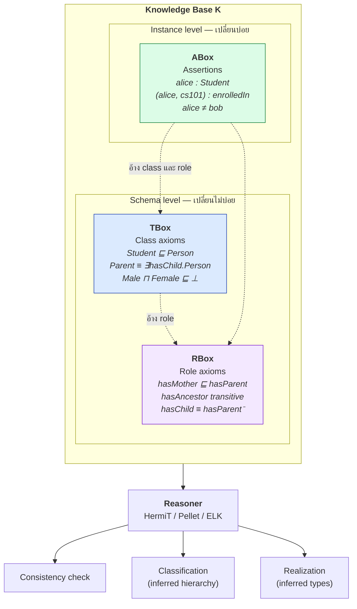
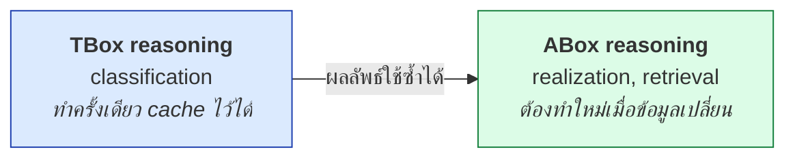
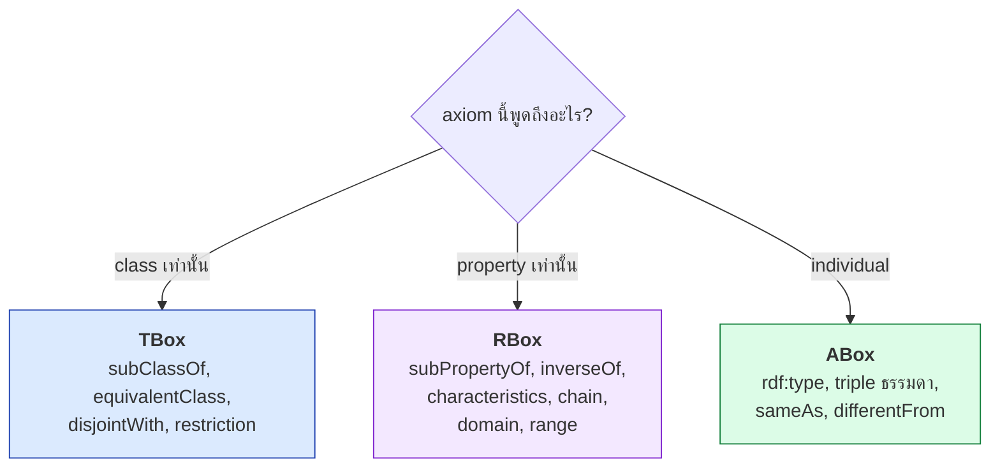

# 05.01 Knowledge Base = TBox + ABox + RBox

**Knowledge Base (KB)** คือชุดความรู้ที่ reasoner ทำงานด้วย ประกอบด้วยสามส่วนที่มีบทบาทต่างกันชัดเจน
บทนี้อธิบายโครงสร้างทั้งสามส่วน ความสัมพันธ์ระหว่างกัน และเหตุผลว่าทำไมการแยกส่วนเหล่านี้
จึงสำคัญต่อทั้ง performance และการบำรุงรักษาในระยะยาว

---

## นิยาม

```
K = ( T , R , A )
```

| ส่วน | ชื่อเต็ม | เก็บอะไร | ตัวอย่าง |
| --- | --- | --- | --- |
| **T** | **TBox** — Terminological Box | นิยาม **concept** (class) | `Student ⊑ Person` |
| **R** | **RBox** — Role Box | นิยาม **role** (property) | `hasMother ⊑ hasParent` |
| **A** | **ABox** — Assertional Box | ข้อเท็จจริงเกี่ยวกับ **individual** | `alice : Student` |

> บางตำรารวม RBox ไว้ใน TBox (เขียน `K = (T, A)`) — แต่ DL สมัยใหม่อย่าง `SROIQ` แยกออกมา
> เพราะ role axiom มีข้อจำกัดพิเศษ (เช่น **regularity condition** ของ role chain)

---

## สถาปัตยกรรม



---

## เทียบกับสิ่งที่คุ้นเคย

| | Relational DB | Object-oriented | **Knowledge Base** |
| --- | --- | --- | --- |
| Schema | DDL (`CREATE TABLE`) | class definition | **TBox + RBox** |
| Data | rows | objects | **ABox** |
| ความสัมพันธ์ | foreign key | reference | role assertion |
| การตรวจสอบ | constraint (CWA) | type system | **reasoning (OWA)** |
| เพิ่ม field ใหม่ | `ALTER TABLE` | แก้ class + recompile | **เพิ่ม triple ได้เลย** |
| ข้อมูลไม่ครบ | `NULL` | `null` | **ไม่ทราบ (OWA)** |
| Schema กับ data ปนกันได้ | ❌ | ⚠️ | ✅ (ใช้ภาษาเดียวกัน) |

---

## TBox — Terminological Box

เก็บ **นิยามของ concept** และความสัมพันธ์ระหว่าง concept

```turtle
@prefix ex:   <http://example.org/university#> .
@prefix owl:  <http://www.w3.org/2002/07/owl#> .
@prefix rdfs: <http://www.w3.org/2000/01/rdf-schema#> .

# --- inclusion axiom (primitive class) ---
ex:Student  rdfs:subClassOf ex:Person .
ex:Professor rdfs:subClassOf ex:Staff .
ex:Staff    rdfs:subClassOf ex:Person .

# --- disjointness ---
ex:Student owl:disjointWith ex:Professor .

# --- equivalence axiom (defined class) ---
ex:GraduateStudent owl:equivalentClass [
    a owl:Class ;
    owl:intersectionOf (
        ex:Student
        [ a owl:Restriction ;
          owl:onProperty     ex:enrolledIn ;
          owl:someValuesFrom ex:GraduateCourse ]
    )
] .
```

| ประเภท axiom | สัญลักษณ์ | OWL |
| --- | --- | --- |
| Concept inclusion | `C ⊑ D` | `rdfs:subClassOf` |
| Concept equivalence | `C ≡ D` | `owl:equivalentClass` |
| Disjointness | `C ⊓ D ⊑ ⊥` | `owl:disjointWith` |
| Disjoint union | `C ≡ D₁ ⊔ ... ⊔ Dₙ` (disjoint) | `owl:disjointUnionOf` |

---

## RBox — Role Box

เก็บ **นิยามของ role** และคุณสมบัติของ role

```turtle
@prefix ex:   <http://example.org/university#> .
@prefix owl:  <http://www.w3.org/2002/07/owl#> .
@prefix rdfs: <http://www.w3.org/2000/01/rdf-schema#> .

# --- role hierarchy ---
ex:enrolledIn rdfs:subPropertyOf ex:involvedIn .
ex:teaches    rdfs:subPropertyOf ex:involvedIn .

# --- inverse ---
ex:taughtBy owl:inverseOf ex:teaches .

# --- characteristics ---
ex:partOf     a owl:TransitiveProperty .
ex:colleagueOf a owl:SymmetricProperty .
ex:hasStudentId a owl:FunctionalProperty .

# --- role chain (OWL 2) ---
ex:worksInFaculty owl:propertyChainAxiom ( ex:memberOf ex:partOf ) .

# --- domain / range ---
ex:enrolledIn rdfs:domain ex:Student ;
              rdfs:range  ex:Course .
```

| ประเภท axiom | สัญลักษณ์ | OWL |
| --- | --- | --- |
| Role inclusion | `r ⊑ s` | `rdfs:subPropertyOf` |
| Role equivalence | `r ≡ s` | `owl:equivalentProperty` |
| Inverse | `r ≡ s⁻` | `owl:inverseOf` |
| Role chain | `r ∘ s ⊑ t` | `owl:propertyChainAxiom` |
| Transitive | `r⁺ ⊑ r` | `owl:TransitiveProperty` |
| Functional | `⊤ ⊑ ≤1 r` | `owl:FunctionalProperty` |
| Disjoint roles | `r ⊓ s ⊑ ⊥` | `owl:propertyDisjointWith` |

---

## ABox — Assertional Box

เก็บ **ข้อเท็จจริงเกี่ยวกับ individual**

```turtle
@prefix ex:  <http://example.org/university#> .
@prefix owl: <http://www.w3.org/2002/07/owl#> .
@prefix xsd: <http://www.w3.org/2001/XMLSchema#> .

# --- concept assertion ---
ex:alice a ex:Student .
ex:cs501 a ex:GraduateCourse .

# --- role assertion ---
ex:alice ex:enrolledIn ex:cs501 .

# --- data property assertion ---
ex:alice ex:studentId "S-2024-0421" ;
         ex:enrollmentYear "2024"^^xsd:gYear .

# --- identity assertion ---
ex:alice owl:differentFrom ex:bob .
ex:alice owl:sameAs <http://other.example.org/person/a-johnson> .

[] a owl:AllDifferent ;
   owl:members ( ex:alice ex:bob ex:carol ) .
```

| ประเภท assertion | สัญลักษณ์ | OWL |
| --- | --- | --- |
| Concept assertion | `a : C` | `rdf:type` |
| Role assertion | `(a,b) : r` | triple ธรรมดา |
| Negative role assertion | `(a,b) : ¬r` | `owl:NegativePropertyAssertion` |
| Equality | `a = b` | `owl:sameAs` |
| Inequality | `a ≠ b` | `owl:differentFrom` / `owl:AllDifferent` |

---

## ทำไมต้องแยกสามส่วน

### 1. อัตราการเปลี่ยนแปลงต่างกันมาก

| | TBox | RBox | ABox |
| --- | --- | --- | --- |
| ความถี่ในการเปลี่ยน | ปีละไม่กี่ครั้ง | นาน ๆ ครั้ง | **ทุกวัน/ทุกนาที** |
| ขนาดทั่วไป | 10²–10⁴ axiom | 10¹–10³ axiom | **10⁴–10⁹ assertion** |
| ผู้แก้ไข | ontology engineer | ontology engineer | ระบบ / ETL |
| ผลกระทบเมื่อผิด | ทั้งระบบ | ทั้งระบบ | เฉพาะ record |

### 2. Complexity ของ reasoning ต่างกัน



**กลยุทธ์ที่ใช้จริงในระบบ production**

1. รัน **TBox classification** ครั้งเดียวตอน deploy แล้ว cache **inferred class hierarchy** ไว้
2. เมื่อ ABox เปลี่ยน ให้รันเฉพาะ **ABox reasoning** โดยใช้ hierarchy ที่ cache ไว้
3. รัน classification ใหม่เฉพาะเมื่อ TBox เปลี่ยน

### 3. แยกไฟล์ทำให้ version control ทำงานได้

```
onto/
├── university-tbox.ttl      ← git, semantic versioning, code review
├── university-rbox.ttl      ← git
└── data/
    └── university-abox.ttl  ← ETL generate ทุกคืน, ไม่ commit
```

รายละเอียดใน [05.08 KB Management](05.08-kb-management.md)

---

## ตัวอย่าง KB สมบูรณ์

<table>
<tr><th width="50%">Full form</th><th width="50%">Shorthand</th></tr>
<tr valign="top">
<td>

```turtle
@prefix ex:   <http://example.org/university#> .
@prefix rdf:  <http://www.w3.org/1999/02/22-rdf-syntax-ns#> .
@prefix rdfs: <http://www.w3.org/2000/01/rdf-schema#> .
@prefix owl:  <http://www.w3.org/2002/07/owl#> .

# ===== TBox =====
ex:Student rdf:type owl:Class .
ex:Student rdfs:subClassOf ex:Person .
ex:Professor rdf:type owl:Class .
ex:Professor rdfs:subClassOf ex:Person .
ex:Student owl:disjointWith ex:Professor .

# ===== RBox =====
ex:enrolledIn rdf:type owl:ObjectProperty .
ex:enrolledIn rdfs:subPropertyOf ex:involvedIn .
ex:teaches rdf:type owl:ObjectProperty .
ex:teaches rdfs:subPropertyOf ex:involvedIn .
ex:taughtBy rdf:type owl:ObjectProperty .
ex:taughtBy owl:inverseOf ex:teaches .

# ===== ABox =====
ex:alice rdf:type ex:Student .
ex:alice ex:enrolledIn ex:cs501 .
ex:profSmith rdf:type ex:Professor .
ex:profSmith ex:teaches ex:cs501 .
ex:alice owl:differentFrom ex:profSmith .
```

</td>
<td>

```turtle
@prefix ex:   <http://example.org/university#> .
@prefix rdf:  <http://www.w3.org/1999/02/22-rdf-syntax-ns#> .
@prefix rdfs: <http://www.w3.org/2000/01/rdf-schema#> .
@prefix owl:  <http://www.w3.org/2002/07/owl#> .

# ===== TBox =====
ex:Student a owl:Class ;
    rdfs:subClassOf ex:Person ;
    owl:disjointWith ex:Professor .

ex:Professor a owl:Class ;
    rdfs:subClassOf ex:Person .

# ===== RBox =====
ex:enrolledIn a owl:ObjectProperty ;
    rdfs:subPropertyOf ex:involvedIn .

ex:teaches a owl:ObjectProperty ;
    rdfs:subPropertyOf ex:involvedIn .

ex:taughtBy a owl:ObjectProperty ;
    owl:inverseOf ex:teaches .

# ===== ABox =====
ex:alice a ex:Student ;
    ex:enrolledIn ex:cs501 ;
    owl:differentFrom ex:profSmith .

ex:profSmith a ex:Professor ;
    ex:teaches ex:cs501 .
```

</td>
</tr>
</table>

**reasoner จะอนุมานเพิ่ม**

```turtle
ex:alice     ex:involvedIn ex:cs501 .    # RBox: enrolledIn ⊑ involvedIn
ex:profSmith ex:involvedIn ex:cs501 .    # RBox: teaches ⊑ involvedIn
ex:cs501     ex:taughtBy   ex:profSmith . # RBox: taughtBy ≡ teaches⁻
ex:alice     a ex:Person .                # TBox: Student ⊑ Person
ex:profSmith a ex:Person .                # TBox: Professor ⊑ Person
```

---

## ตรวจว่า axiom แต่ละตัวอยู่ box ไหน



> ⚠️ **กรณีก้ำกึ่ง**: `owl:hasValue` และ `owl:oneOf` อยู่ใน TBox แต่**อ้างถึง individual**
> จึงเชื่อม TBox กับ ABox เข้าด้วยกัน — เป็นเหตุผลที่ nominal (`O`) ทำให้ reasoning แพงขึ้นมาก
> ตามที่เรียนใน [04.07](../04-logics/04.07-dl-family.md)

---

## Key Points

- **KB = (TBox, RBox, ABox)** — schema ของ class, schema ของ property และข้อเท็จจริงของ individual
- **TBox** เก็บ class axiom (`⊑`, `≡`, disjointness); **RBox** เก็บ role axiom (hierarchy, inverse, characteristics, chain); **ABox** เก็บ assertion
- แยกสามส่วนเพราะ **อัตราการเปลี่ยนแปลงต่างกันมาก** — TBox ปีละครั้ง, ABox ทุกวัน
- **Complexity ต่างกัน**: TBox classification ทำครั้งเดียวแล้ว cache ได้; ABox reasoning ต้องรันใหม่เมื่อข้อมูลเปลี่ยน
- แยกไฟล์ทำให้ TBox เข้า **version control + code review** ได้ ส่วน ABox ให้ ETL generate
- reasoner รวมทั้งสาม box แล้วทำ consistency check, classification และ realization
- `owl:hasValue` และ `owl:oneOf` อยู่ TBox แต่อ้าง individual — เป็นสาเหตุที่ nominal ทำให้ reasoning แพง
