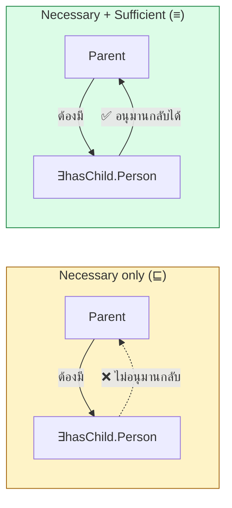
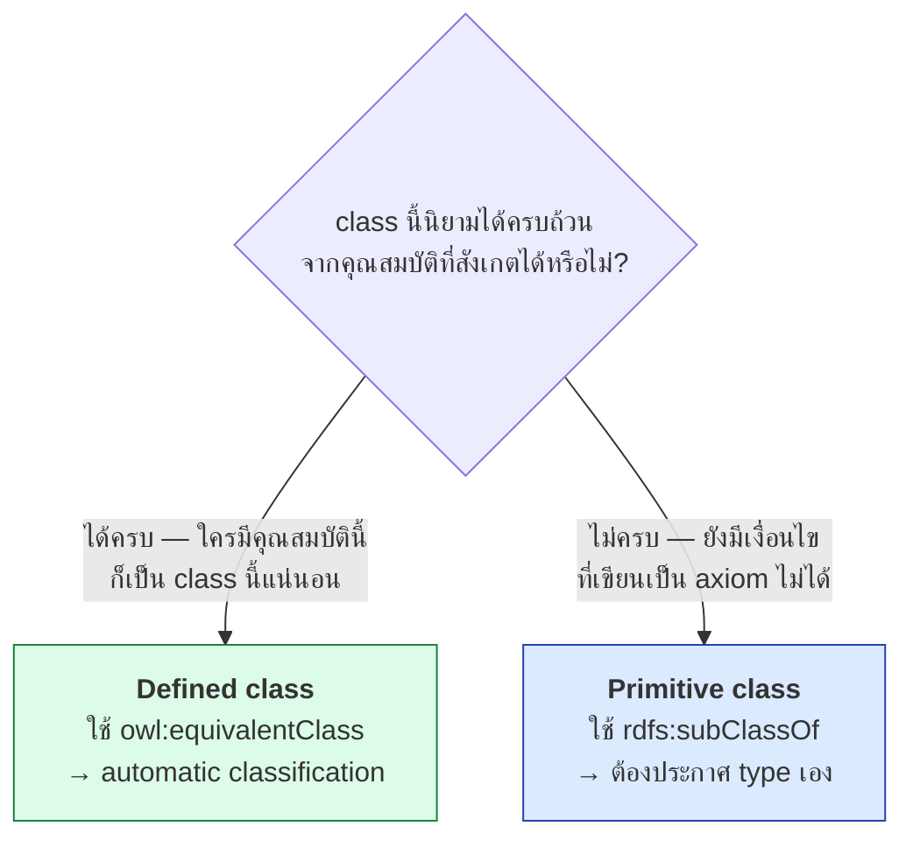

# 05.02 TBox เชิงลึก: Primitive vs Defined Class

ความแตกต่างระหว่าง **primitive class** กับ **defined class** เป็นการตัดสินใจที่สำคัญที่สุดในการออกแบบ TBox
เพราะมันกำหนดว่า reasoner จะ **จัดประเภทให้อัตโนมัติหรือไม่** บทนี้อธิบายผ่านแนวคิด
**necessary condition** กับ **sufficient condition** พร้อมตัวอย่างที่รันได้จริง

---

## Necessary vs Sufficient Condition

| ประเภทเงื่อนไข | ความหมาย | ทิศทางการอนุมาน |
| --- | --- | --- |
| **Necessary** | ถ้าเป็น C แล้ว **ต้อง** มีคุณสมบัตินี้ | `C → คุณสมบัติ` |
| **Sufficient** | ถ้ามีคุณสมบัตินี้ **ก็เพียงพอ** ที่จะเป็น C | `คุณสมบัติ → C` |



---

## Primitive Class — มีแต่ necessary condition

```
Parent ⊑ Person ⊓ ∃hasChild.Person
```

**อ่านว่า**: ทุก Parent เป็น Person และมีลูก — **แต่ไม่ได้บอกว่าใครที่มีลูกจะเป็น Parent**

<table>
<tr><th width="50%">Full form</th><th width="50%">Shorthand</th></tr>
<tr valign="top">
<td>

```turtle
@prefix ex:   <http://example.org/> .
@prefix rdf:  <http://www.w3.org/1999/02/22-rdf-syntax-ns#> .
@prefix rdfs: <http://www.w3.org/2000/01/rdf-schema#> .
@prefix owl:  <http://www.w3.org/2002/07/owl#> .

ex:Parent rdf:type owl:Class .
ex:Parent rdfs:subClassOf ex:Person .
ex:Parent rdfs:subClassOf _:r1 .
_:r1 rdf:type owl:Restriction .
_:r1 owl:onProperty ex:hasChild .
_:r1 owl:someValuesFrom ex:Person .
```

</td>
<td>

```turtle
@prefix ex:   <http://example.org/> .
@prefix rdf:  <http://www.w3.org/1999/02/22-rdf-syntax-ns#> .
@prefix rdfs: <http://www.w3.org/2000/01/rdf-schema#> .
@prefix owl:  <http://www.w3.org/2002/07/owl#> .

ex:Parent a owl:Class ;
    rdfs:subClassOf ex:Person ,
        [ a owl:Restriction ;
          owl:onProperty     ex:hasChild ;
          owl:someValuesFrom ex:Person ] .
```

</td>
</tr>
</table>

### ผลลัพธ์

```turtle
ex:alice a ex:Person ;
         ex:hasChild ex:bob .
ex:bob a ex:Person .
```

**reasoner อนุมาน**: `ex:alice a ex:Parent`? → **❌ ไม่** — เพราะไม่มีเงื่อนไข sufficient

```turtle
ex:carol a ex:Parent .
```

**reasoner อนุมาน**: `ex:carol a ex:Person` และ `ex:carol` มี `hasChild` ไปยัง Person บางคน → **✅ ใช่**

---

## Defined Class — มีทั้ง necessary และ sufficient

```
Parent ≡ Person ⊓ ∃hasChild.Person
```

<table>
<tr><th width="50%">Full form</th><th width="50%">Shorthand</th></tr>
<tr valign="top">
<td>

```turtle
@prefix ex:   <http://example.org/> .
@prefix rdf:  <http://www.w3.org/1999/02/22-rdf-syntax-ns#> .
@prefix owl:  <http://www.w3.org/2002/07/owl#> .

ex:Parent rdf:type owl:Class .
ex:Parent owl:equivalentClass _:c1 .
_:c1 rdf:type owl:Class .
_:c1 owl:intersectionOf _:l1 .
_:l1 rdf:first ex:Person .
_:l1 rdf:rest _:l2 .
_:l2 rdf:first _:r1 .
_:l2 rdf:rest rdf:nil .
_:r1 rdf:type owl:Restriction .
_:r1 owl:onProperty ex:hasChild .
_:r1 owl:someValuesFrom ex:Person .
```

</td>
<td>

```turtle
@prefix ex:   <http://example.org/> .
@prefix rdf:  <http://www.w3.org/1999/02/22-rdf-syntax-ns#> .
@prefix owl:  <http://www.w3.org/2002/07/owl#> .

ex:Parent a owl:Class ;
    owl:equivalentClass [
        a owl:Class ;
        owl:intersectionOf (
            ex:Person
            [ a owl:Restriction ;
              owl:onProperty     ex:hasChild ;
              owl:someValuesFrom ex:Person ]
        )
    ] .
```

</td>
</tr>
</table>

### ผลลัพธ์

```turtle
ex:alice a ex:Person ;
         ex:hasChild ex:bob .
ex:bob a ex:Person .
```

**reasoner อนุมาน**: `ex:alice a ex:Parent` → **✅ ใช่** — นี่คือ **automatic classification**

---

## เทียบผลรันจริง

จาก [`code/ch04/run_hermit.py`](../code/ch04/run_hermit.py) ที่ใช้ `equivalent_to`:

| Individual | ก่อน reasoning | หลัง reasoning |
| --- | --- | --- |
| `alice` (Student + enrolledIn GradCourse) | `['Student']` | `['GraduateStudent', 'Parent']` |
| `bob` (Person + hasChild carol) | `['Person']` | `['Parent']` |

ถ้าเปลี่ยนเป็น `is_a` (primitive) แทน `equivalent_to` (defined) ผลจะเป็น:

| Individual | หลัง reasoning |
| --- | --- |
| `alice` | `['Student']` — **ไม่ได้อะไรเพิ่มเลย** |
| `bob` | `['Person']` |

---

## กฎการตัดสินใจ



### ตัวอย่างการตัดสินใจ

| Class | ประเภท | เหตุผล |
| --- | --- | --- |
| `Person` | **primitive** | นิยาม "ความเป็นคน" ด้วย axiom ไม่ได้ |
| `Course` | **primitive** | เป็น concept พื้นฐานของโดเมน |
| `Parent` | **defined** | = Person ที่มีลูก — ครบถ้วน |
| `GraduateStudent` | **defined** | = Student ที่ลง GradCourse — ครบถ้วน |
| `BusyProfessor` | **defined** | = Professor ที่สอน ≥ 3 วิชา — ครบถ้วน |
| `Male` / `Female` | **primitive** | เป็นคุณสมบัติพื้นฐาน ไม่ได้นิยามจากอย่างอื่น |
| `Orphan` | **defined** | = Person ที่ไม่มีพ่อแม่ที่ยังมีชีวิต |

> 💡 **หลักปฏิบัติ**: ontology ส่วนใหญ่มี primitive class เป็น "โครงกระดูก" (hierarchy หลัก)
> และ defined class เป็น "ชั้นวิเคราะห์" ที่ reasoner จัดให้อัตโนมัติ
> **ถ้าไม่มี defined class เลย = ไม่ได้ใช้ประโยชน์จาก OWL** (ใช้ RDFS ก็พอ)

---

## Protégé แสดงความต่างอย่างไร

| | Primitive class | Defined class |
| --- | --- | --- |
| ไอคอน | วงกลมสีเหลือง **ทึบ** | วงกลมสีเหลือง **มีเส้นขอบสามเส้น** |
| แสดงใน | `SubClass Of` | `Equivalent To` |
| หลังรัน reasoner | อยู่ที่เดิม | **อาจย้ายตำแหน่งใน hierarchy** |

---

## Anti-pattern: ใช้ defined class มากเกินไป

```turtle
# ❌ ผิด — ทำให้ทุกอย่างเป็น defined class
ex:Person owl:equivalentClass [
    a owl:Class ;
    owl:intersectionOf (
        ex:LivingThing
        [ a owl:Restriction ; owl:onProperty ex:hasDNA ; owl:someValuesFrom ex:HumanDNA ]
    )
] .
```

**ปัญหา**: ตอนนี้ทุกอย่างที่มี HumanDNA จะถูกจัดเป็น Person รวมถึงเซลล์ ตัวอย่างเลือด หรือศพ
ซึ่งอาจไม่ใช่สิ่งที่ต้องการ

```turtle
# ✅ ถูก — Person เป็น primitive
ex:Person rdfs:subClassOf ex:LivingThing .
```

---

## Anti-pattern: ประกาศ type ทั้งที่เป็น defined class

```turtle
# ❌ ซ้ำซ้อนและเสี่ยงขัดแย้ง
ex:GraduateStudent owl:equivalentClass [ ... ] .

ex:alice a ex:Student , ex:GraduateStudent ;    # ประกาศเองทั้งที่ reasoner ทำให้ได้
         ex:enrolledIn ex:cs501 .
```

**ปัญหา**: ถ้าภายหลัง `cs501` ถูกเปลี่ยนเป็น undergraduate course ข้อมูลจะขัดแย้งกับ type ที่ประกาศไว้
และ reasoner จะรายงาน inconsistency

```turtle
# ✅ ถูก — ประกาศเฉพาะข้อเท็จจริง ให้ reasoner จัดประเภทเอง
ex:alice a ex:Student ;
         ex:enrolledIn ex:cs501 .
```

---

## Necessary condition หลายข้อ

primitive class มี necessary condition ได้หลายข้อ

```turtle
ex:Professor a owl:Class ;
    rdfs:subClassOf
        ex:Staff ,
        [ a owl:Restriction ;
          owl:onProperty     ex:hasDegree ;
          owl:someValuesFrom ex:PhD ] ,
        [ a owl:Restriction ;
          owl:onProperty     ex:worksFor ;
          owl:someValuesFrom ex:University ] .
```

**อ่านว่า**: ทุก Professor เป็น Staff **และ** มีปริญญาเอก **และ** ทำงานให้มหาวิทยาลัย
— แต่ไม่ใช่ทุกคนที่มีปริญญาเอกและทำงานมหาวิทยาลัยจะเป็น Professor (อาจเป็นนักวิจัย)

---

## Defined class ที่มีเงื่อนไขซับซ้อน

```turtle
@prefix ex:  <http://example.org/> .
@prefix owl: <http://www.w3.org/2002/07/owl#> .
@prefix xsd: <http://www.w3.org/2001/XMLSchema#> .

# HonorsStudent ≡ Student ⊓ ∃hasGPA.{x | x ≥ 3.5} ⊓ (≥ 30 completedCredits.Course)
ex:HonorsStudent owl:equivalentClass [
    a owl:Class ;
    owl:intersectionOf (
        ex:Student
        [ a owl:Restriction ;
          owl:onProperty ex:hasGPA ;
          owl:someValuesFrom [
              a rdfs:Datatype ;
              owl:onDatatype xsd:decimal ;
              owl:withRestrictions ( [ xsd:minInclusive "3.5"^^xsd:decimal ] )
          ] ]
        [ a owl:Restriction ;
          owl:onProperty              ex:completedCredits ;
          owl:minQualifiedCardinality "30"^^xsd:nonNegativeInteger ;
          owl:onClass                 ex:Course ]
    )
] .
```

---

## เปรียบเทียบสรุป

| | Primitive class | Defined class |
| --- | --- | --- |
| OWL | `rdfs:subClassOf` | `owl:equivalentClass` |
| DL | `C ⊑ D` | `C ≡ D` |
| เงื่อนไข | necessary เท่านั้น | necessary + sufficient |
| Automatic classification | ❌ | ✅ |
| ต้องประกาศ type เอง | ✅ | ❌ (ให้ reasoner ทำ) |
| owlready2 | `class C(D)` หรือ `C.is_a.append(...)` | `C.equivalent_to = [...]` |
| ใช้กับ | concept พื้นฐานของโดเมน | concept ที่นิยามจากคุณสมบัติได้ครบ |
| สัดส่วนที่แนะนำ | โครงหลักของ hierarchy | ชั้นวิเคราะห์ |

---

## Key Points

- **Necessary condition** = "ถ้าเป็น C แล้วต้อง..."; **Sufficient condition** = "ถ้ามี... ก็เป็น C"
- **Primitive class** (`rdfs:subClassOf`, `⊑`) มีแต่ necessary — reasoner **ไม่จัดประเภทให้**
- **Defined class** (`owl:equivalentClass`, `≡`) มีทั้งสอง — เกิด **automatic classification**
- นี่คือความต่างที่ทำให้ **OWL มีค่ามากกว่า RDFS** — ถ้าไม่มี defined class เลย ใช้ RDFS ก็พอ
- ใช้ **defined class** เมื่อ class นั้นนิยามได้ครบถ้วนจากคุณสมบัติที่สังเกตได้
- ใช้ **primitive class** สำหรับ concept พื้นฐานที่นิยามด้วย axiom ไม่ได้ (Person, Course, Male)
- **อย่าประกาศ type ของ defined class เอง** — ปล่อยให้ reasoner ทำ มิฉะนั้นเสี่ยงขัดแย้งเมื่อข้อมูลเปลี่ยน
- primitive class มี **necessary condition หลายข้อ** ได้ — ประกาศ `rdfs:subClassOf` หลายตัว
