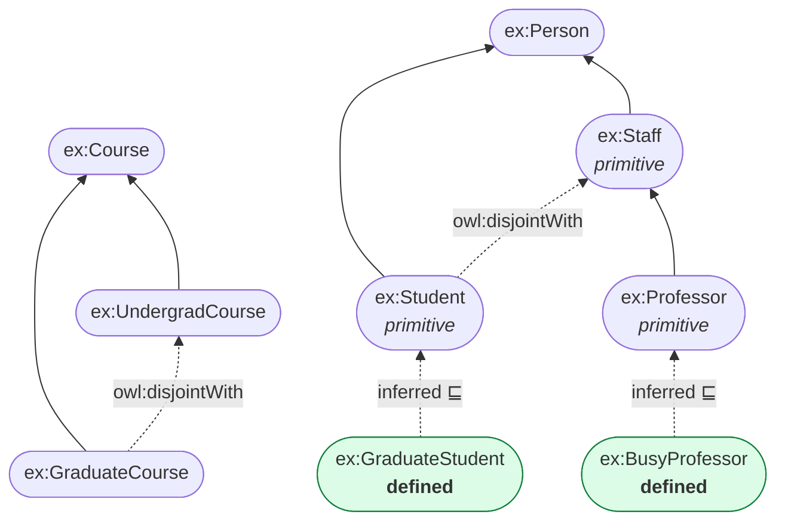

# 05.03 TBox Axioms: ตารางรวมและตัวอย่าง Turtle

บทนี้เป็น **reference ครบถ้วน** ของ axiom ทุกชนิดที่เขียนได้ใน TBox — class axiom, class constructor
และ property axiom — พร้อมตัวอย่าง Turtle ทั้ง full form และ shorthand
ใช้เปิดค้างไว้ระหว่างสร้าง ontology จริง

---

## ตารางรวม Class Axioms

| Axiom | DL | OWL | ความหมาย |
| --- | --- | --- | --- |
| Subclass | `C ⊑ D` | `rdfs:subClassOf` | ทุก C เป็น D |
| Equivalence | `C ≡ D` | `owl:equivalentClass` | C กับ D เป็นเซตเดียวกัน |
| Disjointness | `C ⊓ D ⊑ ⊥` | `owl:disjointWith` | C กับ D ไม่มีสมาชิกร่วม |
| All disjoint | — | `owl:AllDisjointClasses` | หลาย class disjoint กันทั้งหมด |
| Disjoint union | `C ≡ D₁ ⊔ D₂` (disjoint) | `owl:disjointUnionOf` | C แบ่งเป็นส่วนที่ไม่ทับกัน |
| Deprecation | — | `owl:deprecated` | class นี้เลิกใช้แล้ว |

---

## 1. `rdfs:subClassOf`

<table>
<tr><th width="50%">Full form</th><th width="50%">Shorthand</th></tr>
<tr valign="top">
<td>

```turtle
@prefix ex:   <http://example.org/> .
@prefix rdf:  <http://www.w3.org/1999/02/22-rdf-syntax-ns#> .
@prefix rdfs: <http://www.w3.org/2000/01/rdf-schema#> .
@prefix owl:  <http://www.w3.org/2002/07/owl#> .

ex:Student rdf:type owl:Class .
ex:Student rdfs:subClassOf ex:Person .
ex:Student rdfs:subClassOf _:r1 .
_:r1 rdf:type owl:Restriction .
_:r1 owl:onProperty ex:enrolledIn .
_:r1 owl:someValuesFrom ex:Course .
```

</td>
<td>

```turtle
@prefix ex:   <http://example.org/> .
@prefix rdf:  <http://www.w3.org/1999/02/22-rdf-syntax-ns#> .
@prefix rdfs: <http://www.w3.org/2000/01/rdf-schema#> .
@prefix owl:  <http://www.w3.org/2002/07/owl#> .

ex:Student a owl:Class ;
    rdfs:subClassOf ex:Person ,
        [ a owl:Restriction ;
          owl:onProperty     ex:enrolledIn ;
          owl:someValuesFrom ex:Course ] .
```

</td>
</tr>
</table>

---

## 2. `owl:equivalentClass`

```turtle
# กรณีง่าย: class สองตัวเท่ากัน
ex:Car owl:equivalentClass ex:Automobile .

# กรณีที่ใช้จริง: defined class
ex:Parent owl:equivalentClass [
    a owl:Class ;
    owl:intersectionOf (
        ex:Person
        [ a owl:Restriction ;
          owl:onProperty     ex:hasChild ;
          owl:someValuesFrom ex:Person ]
    )
] .

# เชื่อม vocabulary ข้าม namespace
ex:Person owl:equivalentClass foaf:Person , schema:Person .
```

---

## 3. `owl:disjointWith` และ `owl:AllDisjointClasses`

```turtle
# สองตัว
ex:Male owl:disjointWith ex:Female .

# หลายตัว — เขียนแบบคู่ต้องเขียน n(n-1)/2 บรรทัด
ex:Solid  owl:disjointWith ex:Liquid , ex:Gas .
ex:Liquid owl:disjointWith ex:Gas .

# วิธีที่ดีกว่าเมื่อมีหลายตัว
[] a owl:AllDisjointClasses ;
   owl:members ( ex:Solid ex:Liquid ex:Gas ex:Plasma ) .
```

| จำนวน class | เขียนแบบ `disjointWith` | ใช้ `AllDisjointClasses` |
| --- | --- | --- |
| 2 | 1 บรรทัด | เกินจำเป็น |
| 4 | 6 บรรทัด | 1 บล็อก |
| 10 | **45 บรรทัด** | 1 บล็อก |

---

## 4. `owl:disjointUnionOf`

บอกว่า class หนึ่ง**แบ่งออกเป็นส่วนย่อยที่ครบถ้วนและไม่ทับกัน**

```turtle
ex:Person owl:disjointUnionOf ( ex:Male ex:Female ) .
```

เทียบเท่ากับสามอย่างรวมกัน:

```turtle
ex:Person owl:equivalentClass [ a owl:Class ; owl:unionOf ( ex:Male ex:Female ) ] .
ex:Male   rdfs:subClassOf ex:Person .
ex:Female rdfs:subClassOf ex:Person .
ex:Male   owl:disjointWith ex:Female .
```

> ⚠️ **ระวัง**: `disjointUnionOf` บอกว่า **ไม่มีอะไรอื่น** นอกจากที่ระบุ — เป็นการปิดโลกบางส่วน
> ถ้าไม่แน่ใจว่าครบจริง อย่าใช้

---

## ตารางรวม Class Constructors

| Constructor | DL | OWL | ตัวอย่าง |
| --- | --- | --- | --- |
| Intersection | `C ⊓ D` | `owl:intersectionOf` | `Person ⊓ Female` |
| Union | `C ⊔ D` | `owl:unionOf` | `Student ⊔ Staff` |
| Complement | `¬C` | `owl:complementOf` | `¬Student` |
| Enumeration | `{a,b,c}` | `owl:oneOf` | `{mon,tue,wed}` |
| Existential | `∃r.C` | `owl:someValuesFrom` | `∃hasChild.Person` |
| Universal | `∀r.C` | `owl:allValuesFrom` | `∀teaches.Course` |
| Has value | `∃r.{a}` | `owl:hasValue` | `∃country.{France}` |
| Has self | `∃r.Self` | `owl:hasSelf` | `∃likes.Self` |
| Min cardinality | `≥n r` | `owl:minCardinality` | `≥2 hasChild` |
| Max cardinality | `≤n r` | `owl:maxCardinality` | `≤5 hasChild` |
| Exact cardinality | `=n r` | `owl:cardinality` | `=1 hasMother` |
| Qualified min | `≥n r.C` | `owl:minQualifiedCardinality` + `owl:onClass` | `≥2 hasChild.Male` |
| Qualified max | `≤n r.C` | `owl:maxQualifiedCardinality` + `owl:onClass` | `≤3 teaches.GradCourse` |
| Qualified exact | `=n r.C` | `owl:qualifiedCardinality` + `owl:onClass` | `=1 hasSupervisor.Professor` |

รายละเอียดเต็มของ restriction และ cardinality อยู่ใน [08.07](../08-owl/08.07-restrictions.md) และ [08.08](../08-owl/08.08-cardinality.md)

---

## ตารางรวม Property Axioms

| Axiom | DL | OWL |
| --- | --- | --- |
| Sub-property | `r ⊑ s` | `rdfs:subPropertyOf` |
| Equivalent property | `r ≡ s` | `owl:equivalentProperty` |
| Inverse | `r ≡ s⁻` | `owl:inverseOf` |
| Disjoint properties | `r ⊓ s ⊑ ⊥` | `owl:propertyDisjointWith` |
| All disjoint | — | `owl:AllDisjointProperties` |
| Property chain | `r ∘ s ⊑ t` | `owl:propertyChainAxiom` |
| Domain | `∃r.⊤ ⊑ C` | `rdfs:domain` |
| Range | `⊤ ⊑ ∀r.C` | `rdfs:range` |
| Transitive | `r⁺ ⊑ r` | `owl:TransitiveProperty` |
| Symmetric | `r ≡ r⁻` | `owl:SymmetricProperty` |
| Asymmetric | `r ⊓ r⁻ ⊑ ⊥` | `owl:AsymmetricProperty` |
| Reflexive | `⊤ ⊑ ∃r.Self` | `owl:ReflexiveProperty` |
| Irreflexive | `∃r.Self ⊑ ⊥` | `owl:IrreflexiveProperty` |
| Functional | `⊤ ⊑ ≤1 r` | `owl:FunctionalProperty` |
| Inverse functional | `⊤ ⊑ ≤1 r⁻` | `owl:InverseFunctionalProperty` |

---

## ตัวอย่างเต็ม: TBox ของมหาวิทยาลัย

<table>
<tr><th width="50%">Full form</th><th width="50%">Shorthand</th></tr>
<tr valign="top">
<td>

```turtle
@prefix ex:   <http://example.org/university#> .
@prefix rdf:  <http://www.w3.org/1999/02/22-rdf-syntax-ns#> .
@prefix rdfs: <http://www.w3.org/2000/01/rdf-schema#> .
@prefix owl:  <http://www.w3.org/2002/07/owl#> .
@prefix xsd:  <http://www.w3.org/2001/XMLSchema#> .

ex:Person rdf:type owl:Class .
ex:Person rdfs:label "Person"@en .

ex:Student rdf:type owl:Class .
ex:Student rdfs:subClassOf ex:Person .

ex:Staff rdf:type owl:Class .
ex:Staff rdfs:subClassOf ex:Person .

ex:Professor rdf:type owl:Class .
ex:Professor rdfs:subClassOf ex:Staff .

ex:Student owl:disjointWith ex:Staff .

ex:Course rdf:type owl:Class .
ex:GraduateCourse rdf:type owl:Class .
ex:GraduateCourse rdfs:subClassOf ex:Course .
ex:UndergradCourse rdf:type owl:Class .
ex:UndergradCourse rdfs:subClassOf ex:Course .
ex:GraduateCourse owl:disjointWith ex:UndergradCourse .

ex:GraduateStudent rdf:type owl:Class .
ex:GraduateStudent owl:equivalentClass _:c1 .
_:c1 rdf:type owl:Class .
_:c1 owl:intersectionOf _:l1 .
_:l1 rdf:first ex:Student .
_:l1 rdf:rest _:l2 .
_:l2 rdf:first _:r1 .
_:l2 rdf:rest rdf:nil .
_:r1 rdf:type owl:Restriction .
_:r1 owl:onProperty ex:enrolledIn .
_:r1 owl:someValuesFrom ex:GraduateCourse .

ex:BusyProfessor rdf:type owl:Class .
ex:BusyProfessor owl:equivalentClass _:c2 .
_:c2 rdf:type owl:Class .
_:c2 owl:intersectionOf _:l3 .
_:l3 rdf:first ex:Professor .
_:l3 rdf:rest _:l4 .
_:l4 rdf:first _:r2 .
_:l4 rdf:rest rdf:nil .
_:r2 rdf:type owl:Restriction .
_:r2 owl:onProperty ex:teaches .
_:r2 owl:minQualifiedCardinality "3"^^xsd:nonNegativeInteger .
_:r2 owl:onClass ex:Course .
```

</td>
<td>

```turtle
@prefix ex:   <http://example.org/university#> .
@prefix rdf:  <http://www.w3.org/1999/02/22-rdf-syntax-ns#> .
@prefix rdfs: <http://www.w3.org/2000/01/rdf-schema#> .
@prefix owl:  <http://www.w3.org/2002/07/owl#> .
@prefix xsd:  <http://www.w3.org/2001/XMLSchema#> .

# ----- primitive classes -----
ex:Person a owl:Class ;
    rdfs:label "Person"@en .

ex:Student a owl:Class ;
    rdfs:subClassOf  ex:Person ;
    owl:disjointWith ex:Staff .

ex:Staff a owl:Class ;
    rdfs:subClassOf ex:Person .

ex:Professor a owl:Class ;
    rdfs:subClassOf ex:Staff .

ex:Course a owl:Class .

ex:GraduateCourse a owl:Class ;
    rdfs:subClassOf  ex:Course ;
    owl:disjointWith ex:UndergradCourse .

ex:UndergradCourse a owl:Class ;
    rdfs:subClassOf ex:Course .

# ----- defined classes -----
ex:GraduateStudent owl:equivalentClass [
    a owl:Class ;
    owl:intersectionOf (
        ex:Student
        [ a owl:Restriction ;
          owl:onProperty     ex:enrolledIn ;
          owl:someValuesFrom ex:GraduateCourse ]
    )
] .

ex:BusyProfessor owl:equivalentClass [
    a owl:Class ;
    owl:intersectionOf (
        ex:Professor
        [ a owl:Restriction ;
          owl:onProperty              ex:teaches ;
          owl:minQualifiedCardinality "3"^^xsd:nonNegativeInteger ;
          owl:onClass                 ex:Course ]
    )
] .
```

</td>
</tr>
</table>

**นับบรรทัด**: full form 47 บรรทัด vs shorthand 40 บรรทัด — และ shorthand เห็นโครงสร้างชัดกว่ามาก

---

## แผนภาพ TBox ที่ได้



---

## ตรวจสอบ TBox ด้วย Python

```python
from rdflib import Graph
from rdflib.namespace import OWL, RDF, RDFS

g = Graph().parse("university-tbox.ttl", format="turtle")

classes = set(g.subjects(RDF.type, OWL.Class))
defined  = {c for c in classes if list(g.objects(c, OWL.equivalentClass))}
primitive = classes - defined

print(f"classes ทั้งหมด : {len(classes)}")
print(f"  primitive     : {len(primitive)}  {sorted(str(c).split('#')[-1] for c in primitive)}")
print(f"  defined       : {len(defined)}  {sorted(str(c).split('#')[-1] for c in defined)}")

disjoint = list(g.subject_objects(OWL.disjointWith))
print(f"disjointWith  : {len(disjoint)} คู่")
for s, o in disjoint:
    print(f"  {str(s).split('#')[-1]} ⊓ {str(o).split('#')[-1]} ⊑ ⊥")
```

Expected output:

```
classes ทั้งหมด : 7
  primitive     : 5  ['Course', 'GraduateCourse', 'Person', 'Professor', 'Staff', 'Student', 'UndergradCourse']
  defined       : 2  ['BusyProfessor', 'GraduateStudent']
disjointWith  : 2 คู่
  Student ⊓ Staff ⊑ ⊥
  GraduateCourse ⊓ UndergradCourse ⊑ ⊥
```

---

## Checklist ตอนเขียน TBox

- [ ] ทุก class มี `rdfs:label`@en และ `rdfs:comment`@en
- [ ] แยกชัดว่าตัวไหน **primitive** (`subClassOf`) ตัวไหน **defined** (`equivalentClass`)
- [ ] ประกาศ `owl:disjointWith` ระหว่าง sibling class ที่ไม่ควรทับกัน — **ไม่ทำ = reasoner ตรวจ error ไม่ได้**
- [ ] ใช้ `owl:AllDisjointClasses` เมื่อมี sibling ≥ 3 ตัว
- [ ] ไม่ใช้ `owl:disjointUnionOf` เว้นแต่แน่ใจว่า partition ครบจริง
- [ ] hierarchy ลึกไม่เกิน 5–6 ชั้น
- [ ] รัน reasoner ตรวจว่าไม่มี class ไหน unsatisfiable

---

## Key Points

- **Class axiom หลัก 4 ตัว**: `rdfs:subClassOf`, `owl:equivalentClass`, `owl:disjointWith`, `owl:disjointUnionOf`
- `owl:AllDisjointClasses` ประหยัดกว่ามากเมื่อมี sibling หลายตัว (10 ตัว → 1 บล็อก แทน 45 บรรทัด)
- `owl:disjointUnionOf` = union + subclass + disjoint รวมกัน — **ปิดโลกบางส่วน** ใช้เมื่อแน่ใจว่าครบเท่านั้น
- **Class constructor** 14 แบบครอบคลุมตั้งแต่ `intersectionOf` จนถึง qualified cardinality
- **Property axiom** แบ่งเป็น relationship (`subPropertyOf`, `inverseOf`, chain) และ characteristics (transitive, functional, ...)
- **การประกาศ `owl:disjointWith` เป็นสิ่งที่คนลืมบ่อยที่สุด** — และเป็นสาเหตุที่ reasoner ตรวจจับ error ไม่ได้
- Full form ของ defined class ยาวมาก — เขียน **shorthand** หรือใช้ Protégé เสมอ
- ตรวจสัดส่วน primitive/defined ด้วยสคริปต์ — ถ้าไม่มี defined class เลย แสดงว่ายังไม่ได้ใช้ประโยชน์จาก OWL
