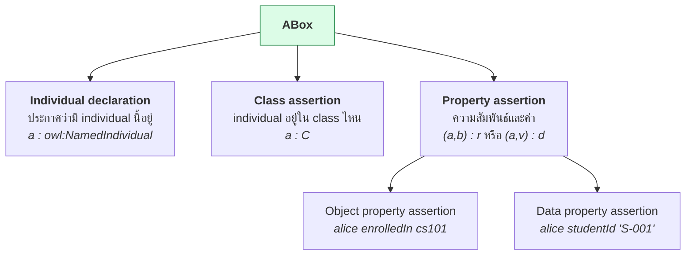
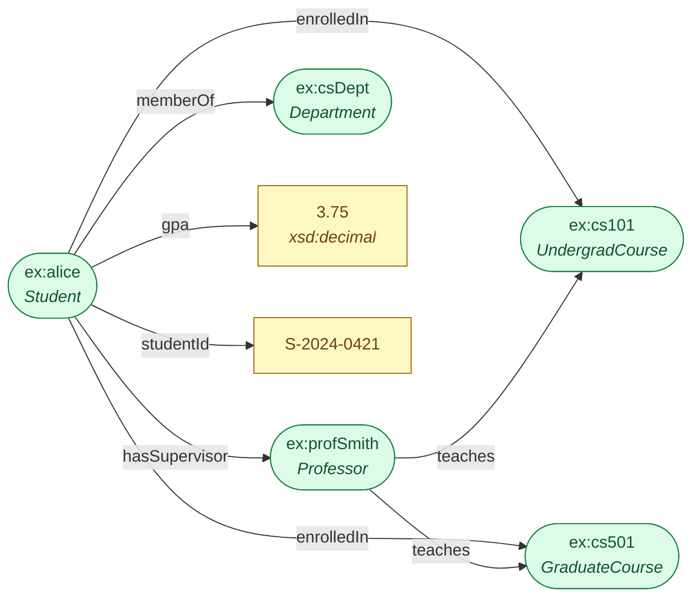
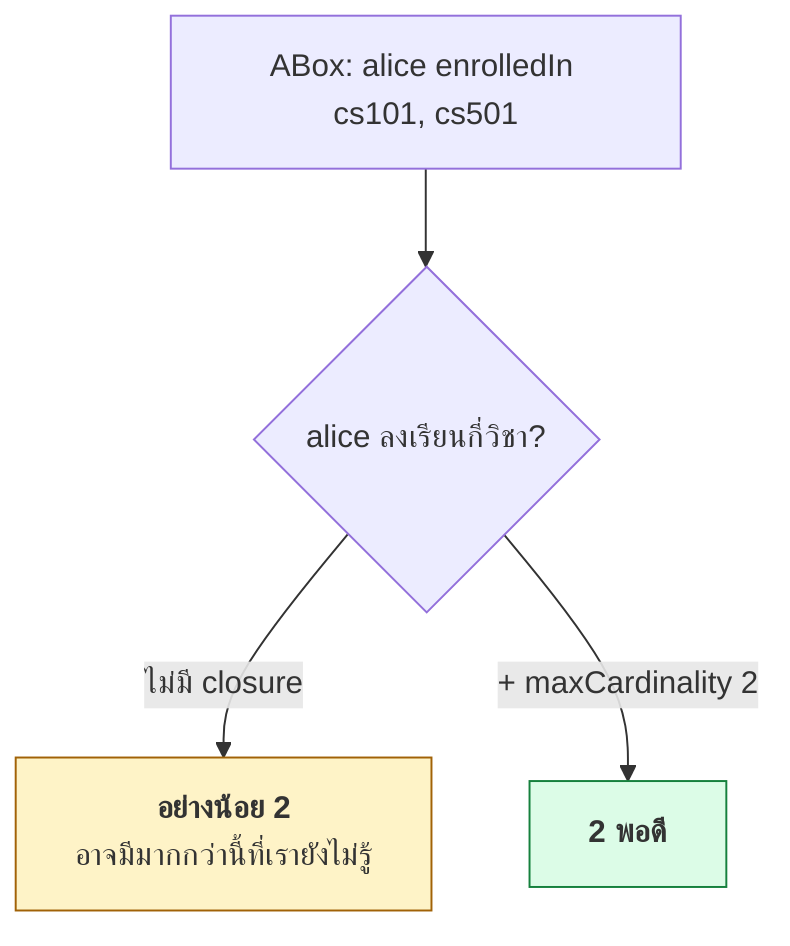

# 05.04 ABox เชิงลึก

**ABox** เก็บข้อเท็จจริงเกี่ยวกับ individual — ใครเป็นอะไร ใครสัมพันธ์กับใคร และมีค่าอะไรบ้าง
บทนี้ลงรายละเอียดของ assertion ทั้ง 3 ชนิด: **individual declaration**, **class assertion** และ **property assertion**
พร้อมข้อควรระวังที่มาจาก Open World Assumption

---

## Assertion 3 ชนิด



---

## 1. Individual Declaration

```turtle
@prefix ex:  <http://example.org/university#> .
@prefix owl: <http://www.w3.org/2002/07/owl#> .

ex:alice a owl:NamedIndividual .
```

**`owl:NamedIndividual` จำเป็นไหม?**

| กรณี | จำเป็น |
| --- | --- |
| OWL 2 DL แบบเคร่งครัด | ✅ ต้องประกาศ |
| ใช้งานทั่วไป / RDFS | ❌ ไม่จำเป็น |
| ส่งออกจาก Protégé | Protégé ใส่ให้อัตโนมัติ |

ในทางปฏิบัติการเขียน `ex:alice a ex:Student .` ก็เพียงพอ เพราะ reasoner รู้ว่า `ex:alice` เป็น individual อยู่แล้ว
แต่ถ้าต้องการให้ ontology เป็น **OWL 2 DL ที่ถูกต้องทางการ** ต้องแยก individual ออกจาก class ให้ชัด

```turtle
# แบบที่ Protégé สร้าง
ex:alice a owl:NamedIndividual , ex:Student .
```

---

## 2. Class Assertion

```turtle
@prefix ex: <http://example.org/university#> .

# individual เดียวมีหลาย type ได้
ex:alice a ex:Student , ex:ResearchAssistant , ex:ScholarshipHolder .

# type ที่เป็น class expression ก็ได้ (anonymous class)
ex:bob a [
    a owl:Restriction ;
    owl:onProperty     ex:enrolledIn ;
    owl:someValuesFrom ex:GraduateCourse
] .
```

**ข้อที่สองอ่านว่า**: bob มีความสัมพันธ์ `enrolledIn` ไปยัง GraduateCourse บางตัว — แต่ **ไม่บอกว่าตัวไหน**
เป็นวิธีเขียน existential knowledge ที่มีประโยชน์มากภายใต้ OWA

### ⚠️ อย่าประกาศ type ที่ reasoner สรุปได้เอง

```turtle
# ❌ ซ้ำซ้อน — GraduateStudent เป็น defined class
ex:alice a ex:Student , ex:GraduateStudent ;
         ex:enrolledIn ex:cs501 .

# ✅ ถูก — ประกาศเฉพาะข้อเท็จจริง
ex:alice a ex:Student ;
         ex:enrolledIn ex:cs501 .
```

---

## 3. Object Property Assertion

```turtle
@prefix ex: <http://example.org/university#> .

ex:alice ex:enrolledIn ex:cs101 , ex:cs501 ;
         ex:hasSupervisor ex:profSmith ;
         ex:memberOf ex:csDept .
```

### Assertion กับ anonymous individual

```turtle
# "alice มี supervisor คนหนึ่งที่เป็น Professor แต่เราไม่รู้ว่าใคร"
ex:alice ex:hasSupervisor [ a ex:Professor ] .
```

blank node ตรงนี้แทน **existential** — มีอยู่จริงแต่ไม่ระบุตัวตน

> ⚠️ **ระวัง**: การเขียนแบบนี้ทำให้ reasoner สร้าง individual ที่ไม่มีชื่อขึ้นมา
> ซึ่งทำให้ **นับจำนวนผิด** ถ้าไม่ระวัง — เขียน `ex:alice ex:hasSupervisor [ a ex:Professor ]` สองครั้ง
> อาจหมายถึงคนละคนหรือคนเดียวกันก็ได้ (No-UNA)

---

## 4. Data Property Assertion

```turtle
@prefix ex:  <http://example.org/university#> .
@prefix xsd: <http://www.w3.org/2001/XMLSchema#> .

ex:alice
    ex:studentId       "S-2024-0421" ;
    ex:enrollmentYear  "2024"^^xsd:gYear ;
    ex:gpa             "3.75"^^xsd:decimal ;
    ex:isActive        "true"^^xsd:boolean ;
    ex:dateOfBirth     "2000-05-14"^^xsd:date ;
    ex:fullName        "Alice Johnson"@en ,
                       "อลิซ จอห์นสัน"@th .
```

**ข้อควรระวังเรื่อง datatype** (ทบทวนจาก [02.02](../02-rdf/02.02-uri-literal-bnode.md))

```turtle
ex:alice ex:gpa "3.75" .                    # xsd:string — FILTER(?gpa > 3.5) ใช้ไม่ได้!
ex:alice ex:gpa "3.75"^^xsd:decimal .       # ✅ ถูกต้อง
ex:alice ex:gpa 3.75 .                      # ✅ เท่ากับบรรทัดบน (Turtle เดา decimal ให้)
```

---

## ตัวอย่าง ABox เต็ม

<table>
<tr><th width="50%">Full form</th><th width="50%">Shorthand</th></tr>
<tr valign="top">
<td>

```turtle
@prefix ex:  <http://example.org/university#> .
@prefix rdf: <http://www.w3.org/1999/02/22-rdf-syntax-ns#> .
@prefix owl: <http://www.w3.org/2002/07/owl#> .
@prefix xsd: <http://www.w3.org/2001/XMLSchema#> .

ex:alice rdf:type owl:NamedIndividual .
ex:alice rdf:type ex:Student .
ex:alice ex:studentId "S-2024-0421" .
ex:alice ex:gpa "3.75"^^xsd:decimal .
ex:alice ex:enrolledIn ex:cs101 .
ex:alice ex:enrolledIn ex:cs501 .
ex:alice ex:hasSupervisor ex:profSmith .
ex:alice ex:memberOf ex:csDept .

ex:profSmith rdf:type owl:NamedIndividual .
ex:profSmith rdf:type ex:Professor .
ex:profSmith ex:employeeId "E-1042" .
ex:profSmith ex:teaches ex:cs101 .
ex:profSmith ex:teaches ex:cs501 .

ex:cs101 rdf:type owl:NamedIndividual .
ex:cs101 rdf:type ex:UndergradCourse .
ex:cs101 ex:courseCode "CS101" .
ex:cs101 ex:credits "3"^^xsd:integer .

ex:cs501 rdf:type owl:NamedIndividual .
ex:cs501 rdf:type ex:GraduateCourse .
ex:cs501 ex:courseCode "CS501" .
ex:cs501 ex:credits "4"^^xsd:integer .

ex:csDept rdf:type owl:NamedIndividual .
ex:csDept rdf:type ex:Department .
ex:csDept ex:deptName "Computer Science" .
```

</td>
<td>

```turtle
@prefix ex:  <http://example.org/university#> .
@prefix rdf: <http://www.w3.org/1999/02/22-rdf-syntax-ns#> .
@prefix owl: <http://www.w3.org/2002/07/owl#> .
@prefix xsd: <http://www.w3.org/2001/XMLSchema#> .

ex:alice a owl:NamedIndividual , ex:Student ;
    ex:studentId      "S-2024-0421" ;
    ex:gpa            3.75 ;
    ex:enrolledIn     ex:cs101 , ex:cs501 ;
    ex:hasSupervisor  ex:profSmith ;
    ex:memberOf       ex:csDept .

ex:profSmith a owl:NamedIndividual , ex:Professor ;
    ex:employeeId "E-1042" ;
    ex:teaches    ex:cs101 , ex:cs501 .

ex:cs101 a owl:NamedIndividual , ex:UndergradCourse ;
    ex:courseCode "CS101" ;
    ex:credits    3 .

ex:cs501 a owl:NamedIndividual , ex:GraduateCourse ;
    ex:courseCode "CS501" ;
    ex:credits    4 .

ex:csDept a owl:NamedIndividual , ex:Department ;
    ex:deptName "Computer Science" .
```

</td>
</tr>
</table>



**reasoner จะอนุมาน**: `ex:alice a ex:GraduateStudent` (จาก defined class ใน [05.03](05.03-tbox-axioms.md))

---

## ผลของ Open World Assumption ต่อ ABox

### 1. ข้อมูลที่ไม่มี ≠ เป็นเท็จ

```turtle
ex:bob a ex:Student .
# ไม่มี ex:bob ex:enrolledIn ...
```

| คำถาม | คำตอบ |
| --- | --- |
| bob ลงเรียนวิชาไหนบ้าง | **ไม่ทราบ** (ไม่ใช่ "ไม่มี") |
| bob เป็น `LazyStudent ≡ Student ⊓ ¬∃enrolledIn.Course` หรือไม่ | **ไม่ทราบ** |
| bob ลงเรียนกี่วิชา | **อย่างน้อย 0** — ไม่มีขีดจำกัดบน |

### 2. Closure axiom — วิธีปิดโลกเฉพาะจุด

ถ้าต้องการบอกว่า "alice ลงเรียน **เฉพาะ** สองวิชานี้เท่านั้น" ต้องเขียน closure axiom

```turtle
# ปิดโลกด้วย allValuesFrom + oneOf
ex:alice a [
    a owl:Restriction ;
    owl:onProperty ex:enrolledIn ;
    owl:allValuesFrom [ a owl:Class ; owl:oneOf ( ex:cs101 ex:cs501 ) ]
] .

# หรือปิดด้วย cardinality
ex:alice a [
    a owl:Restriction ;
    owl:onProperty     ex:enrolledIn ;
    owl:maxCardinality "2"^^xsd:nonNegativeInteger
] .
```

หลังจากนี้ reasoner จึงจะสรุปได้ว่า alice ลงเรียนแค่ 2 วิชา



### 3. นับไม่ได้ถ้าไม่ประกาศ differentFrom

```turtle
ex:alice ex:enrolledIn ex:cs101 , ex:cs501 .
# reasoner: "อย่างน้อย 1 วิชา" -- เพราะไม่รู้ว่า cs101 ≠ cs501!

ex:cs101 owl:differentFrom ex:cs501 .
# ตอนนี้ reasoner สรุปได้ว่า "อย่างน้อย 2 วิชา"
```

รายละเอียดใน [05.05](05.05-abox-negation.md)

---

## ขนาดของ ABox กับ performance

| ขนาด ABox | ทางเลือกที่ปฏิบัติได้ |
| --- | --- |
| < 10⁴ assertion | HermiT / Pellet ทำงานได้สบาย |
| 10⁴–10⁶ | ใช้ **OWL 2 RL** + rule engine (owlrl, GraphDB) |
| 10⁶–10⁸ | ใช้ **OWL 2 QL** + query rewriting (Ontop, Stardog) |
| > 10⁸ | ใช้ RDFS-level semantics + property path ใน SPARQL |

> 💡 **หลักปฏิบัติ**: DL reasoning เต็มรูปแบบเหมาะกับ **TBox ที่ซับซ้อนแต่ ABox เล็ก**
> ถ้า ABox ใหญ่มาก ให้ลดระดับ semantics ลงเป็น OWL 2 RL/QL

---

## Best practices สำหรับ ABox

- [ ] **แยกไฟล์ ABox ออกจาก TBox** — คนละ lifecycle คนละคนแก้
- [ ] ระบุ **datatype ให้ครบ** โดยเฉพาะตัวเลขและวันที่
- [ ] อย่าประกาศ type ที่เป็น **defined class** — ให้ reasoner ทำ
- [ ] ประกาศ `owl:differentFrom` หรือ `owl:AllDifferent` เมื่อจำเป็นต้องนับ
- [ ] ใช้ **IRI ที่มีความหมาย** (`ex:student/S-2024-0421`) ไม่ใช่เลขสุ่ม
- [ ] หลีกเลี่ยง blank node ใน ABox ที่จะ publish เป็น LOD
- [ ] ใส่ `rdfs:label` ให้ individual สำคัญเพื่อให้ UI แสดงผลได้

---

## Key Points

- ABox มี assertion 3 ชนิด: **individual declaration**, **class assertion** และ **property assertion** (object และ data)
- `owl:NamedIndividual` จำเป็นสำหรับ **OWL 2 DL ที่เคร่งครัด** เท่านั้น — ใช้งานทั่วไปไม่ต้อง
- individual มีหลาย type พร้อมกันได้ และ type เป็น **anonymous class expression** ก็ได้
- **อย่าประกาศ type ของ defined class เอง** — ปล่อยให้ reasoner จัดให้ มิฉะนั้นเสี่ยงขัดแย้ง
- ระบุ **datatype ให้ครบ** มิฉะนั้น `FILTER(?gpa > 3.5)` ใน SPARQL จะไม่ทำงาน
- ภายใต้ **OWA**: ข้อมูลที่ไม่มี = ไม่ทราบ, และ **นับไม่ได้ถ้าไม่ประกาศ `owl:differentFrom`**
- ใช้ **closure axiom** (`allValuesFrom` + `oneOf` หรือ `maxCardinality`) เมื่อต้องการปิดโลกเฉพาะจุด
- ABox ขนาดใหญ่ควรลดระดับ semantics เป็น **OWL 2 RL/QL** แทนการรัน DL reasoner เต็มรูปแบบ
