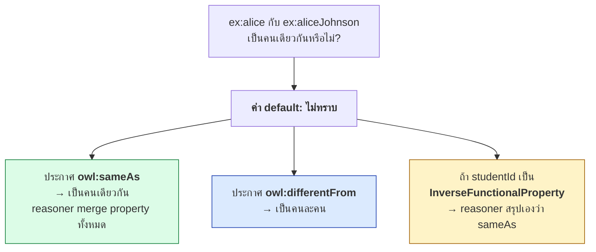
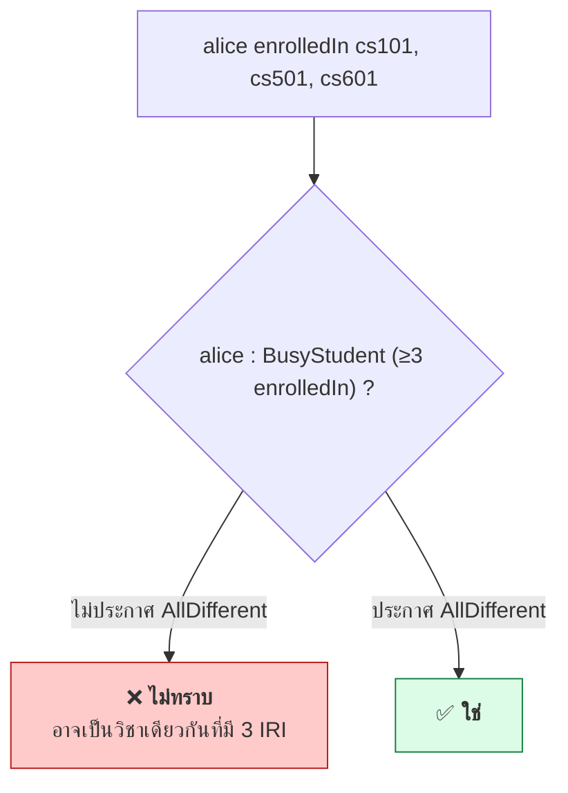
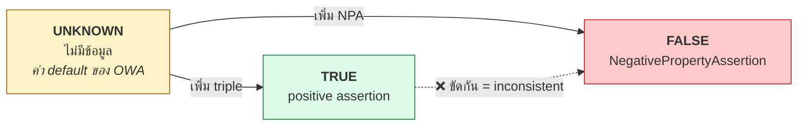

# 05.05 ABox: Negation และ Identity

OWL ไม่มี **Unique Name Assumption** — IRI ที่ต่างกันอาจหมายถึงสิ่งเดียวกัน และการที่ไม่มีข้อมูลก็ไม่ได้แปลว่าเป็นเท็จ
บทนี้อธิบายเครื่องมือที่ใช้จัดการเรื่อง identity (`owl:sameAs`, `owl:differentFrom`, `owl:AllDifferent`)
และการปฏิเสธ (`owl:NegativePropertyAssertion`) พร้อมผลกระทบที่มักถูกมองข้าม

---

## No Unique Name Assumption (No-UNA)

```turtle
@prefix ex: <http://example.org/> .

ex:alice ex:studentId "S-001" .
ex:aliceJohnson ex:studentId "S-001" .
```

**คำถาม**: `ex:alice` กับ `ex:aliceJohnson` เป็นคนเดียวกันหรือไม่

| ระบบ | คำตอบ |
| --- | --- |
| Relational DB (มี UNA) | **คนละ row** เพราะ primary key ต่างกัน |
| OWL (**ไม่มี UNA**) | **ไม่ทราบ** — อาจเป็นคนเดียวกันก็ได้ |



---

## `owl:sameAs`

**บอกว่า IRI สองตัวชี้ไปที่ individual ตัวเดียวกัน**

```turtle
@prefix ex:  <http://example.org/> .
@prefix owl: <http://www.w3.org/2002/07/owl#> .
@prefix wd:  <http://www.wikidata.org/entity/> .
@prefix dbr: <http://dbpedia.org/resource/> .

ex:MarieCurie owl:sameAs wd:Q7186 , dbr:Marie_Curie .
```

### ผลของ `owl:sameAs` — merge ทุกอย่าง

```turtle
ex:alice ex:studentId "S-001" ;
         ex:enrolledIn ex:cs101 .

ex:aliceJohnson ex:gpa 3.75 ;
                ex:memberOf ex:csDept .

ex:alice owl:sameAs ex:aliceJohnson .
```

**reasoner อนุมาน** — property ของทั้งสองรวมกัน:

```turtle
ex:alice        ex:gpa 3.75 ; ex:memberOf ex:csDept .
ex:aliceJohnson ex:studentId "S-001" ; ex:enrolledIn ex:cs101 .
```

### คุณสมบัติของ `owl:sameAs`

| คุณสมบัติ | ความหมาย |
| --- | --- |
| Reflexive | `a owl:sameAs a` เสมอ |
| Symmetric | `a sameAs b` → `b sameAs a` |
| Transitive | `a sameAs b` และ `b sameAs c` → `a sameAs c` |

> ⚠️ **transitivity คือดาบสองคม** — ถ้ามี `sameAs` ผิดเพียงเส้นเดียวในเครือข่าย LOD
> entity ที่ไม่เกี่ยวกันเลยอาจถูกรวมเข้าด้วยกันเป็นลูกโซ่
> ปัญหานี้เรียกว่า **sameAs explosion** และเป็นปัญหาจริงใน LOD Cloud

### ใช้ `owl:sameAs` อย่างระมัดระวัง

| สถานการณ์ | ควรใช้ | ทางเลือกที่ปลอดภัยกว่า |
| --- | --- | --- |
| entity เดียวกันแน่นอน (มี identifier ทางการยืนยัน) | ✅ `owl:sameAs` | — |
| น่าจะเป็นสิ่งเดียวกัน แต่ไม่แน่ใจ | ❌ | `skos:closeMatch` |
| แนวคิดคล้ายกันแต่ขอบเขตต่าง | ❌ | `skos:relatedMatch` |
| ต้องการแค่ชี้ให้ดูเพิ่มเติม | ❌ | `rdfs:seeAlso` |

---

## `owl:differentFrom` และ `owl:AllDifferent`

```turtle
@prefix ex:  <http://example.org/> .
@prefix owl: <http://www.w3.org/2002/07/owl#> .

# สองตัว
ex:alice owl:differentFrom ex:bob .

# หลายตัว -- เขียนแบบคู่ต้องเขียน n(n-1)/2 บรรทัด
[] a owl:AllDifferent ;
   owl:members ( ex:alice ex:bob ex:carol ex:dave ex:eve ) .
```

| จำนวน individual | `differentFrom` | `AllDifferent` |
| --- | --- | --- |
| 2 | 1 บรรทัด | เกินจำเป็น |
| 5 | **10 บรรทัด** | 1 บล็อก |
| 20 | **190 บรรทัด** | 1 บล็อก |

### ทำไมต้องประกาศ

```turtle
ex:alice ex:enrolledIn ex:cs101 , ex:cs501 , ex:cs601 .

ex:BusyStudent owl:equivalentClass [
    a owl:Restriction ;
    owl:onProperty     ex:enrolledIn ;
    owl:minCardinality "3"^^xsd:nonNegativeInteger
] .
```

**reasoner สรุปว่า `alice : BusyStudent` หรือไม่?**

- **ไม่** — เพราะไม่รู้ว่า `cs101`, `cs501`, `cs601` เป็นคนละวิชากัน อาจเป็นวิชาเดียวกันที่มี 3 IRI!

```turtle
# เพิ่มบรรทัดนี้แล้ว reasoner จึงสรุปได้
[] a owl:AllDifferent ;
   owl:members ( ex:cs101 ex:cs501 ex:cs601 ) .
```



> 💡 **หลักปฏิบัติ**: ถ้า ontology ของคุณใช้ **cardinality restriction** ที่ไหนก็ตาม
> ต้องประกาศ `owl:AllDifferent` ให้ individual ที่เกี่ยวข้อง มิฉะนั้น cardinality จะไม่ทำงาน

---

## `owl:InverseFunctionalProperty` — ให้ reasoner สรุป sameAs เอง

```turtle
@prefix ex:  <http://example.org/> .
@prefix owl: <http://www.w3.org/2002/07/owl#> .

# studentId ระบุตัวคนได้เพียงคนเดียว
ex:studentId a owl:InverseFunctionalProperty .

ex:alice        ex:studentId "S-001" .
ex:aliceJohnson ex:studentId "S-001" .
```

**reasoner อนุมาน**: `ex:alice owl:sameAs ex:aliceJohnson` ✅

นี่คือวิธี **entity resolution อัตโนมัติ** ที่ทรงพลังมาก — ใช้กับ property ที่เป็น identifier ธรรมชาติ

| Property ที่ควรเป็น InverseFunctional | เหตุผล |
| --- | --- |
| `ex:studentId`, `ex:employeeId` | identifier ทางการ |
| `foaf:mbox` | email หนึ่งอันเป็นของคนเดียว |
| `ex:isbn` | ISBN ระบุหนังสือได้ตัวเดียว |
| `ex:nationalId` | เลขบัตรประชาชน |

> ⚠️ **ระวัง**: อย่าประกาศ `InverseFunctionalProperty` กับ property ที่ค่าซ้ำได้จริง
> เช่น `ex:phoneNumber` (บ้านเดียวกันใช้เบอร์เดียวกัน) — จะทำให้ reasoner merge คนที่ไม่ใช่คนเดียวกัน

---

## `owl:NegativePropertyAssertion`

บอกว่าความสัมพันธ์หนึ่ง **เป็นเท็จ** อย่างชัดเจน — ไม่ใช่แค่ "ไม่มีข้อมูล"

```turtle
@prefix ex:  <http://example.org/> .
@prefix owl: <http://www.w3.org/2002/07/owl#> .

# "alice ไม่ได้ลงเรียน cs999" (ยืนยันชัดเจน ไม่ใช่แค่ไม่มีข้อมูล)
[] a owl:NegativePropertyAssertion ;
   owl:sourceIndividual  ex:alice ;
   owl:assertionProperty ex:enrolledIn ;
   owl:targetIndividual  ex:cs999 .

# กรณี data property ใช้ owl:targetValue แทน
[] a owl:NegativePropertyAssertion ;
   owl:sourceIndividual  ex:alice ;
   owl:assertionProperty ex:gpa ;
   owl:targetValue       "4.00"^^xsd:decimal .
```

### เปรียบเทียบสามสถานะ

| สถานะ | เขียนอย่างไร | reasoner ตอบ `alice enrolledIn cs999` |
| --- | --- | --- |
| **จริง** | `ex:alice ex:enrolledIn ex:cs999 .` | **YES** |
| **ไม่ทราบ** | (ไม่เขียนอะไร) | **UNKNOWN** |
| **เท็จ** | `owl:NegativePropertyAssertion` | **NO** |



**ถ้าประกาศทั้ง positive และ negative assertion ของ triple เดียวกัน → KB inconsistent**

---

## Class ที่เป็นการปฏิเสธ

```turtle
# alice ไม่ใช่ Professor
ex:alice a [ a owl:Class ; owl:complementOf ex:Professor ] .

# alice ไม่มีลูกเลย  (closure)
ex:alice a [
    a owl:Restriction ;
    owl:onProperty     ex:hasChild ;
    owl:maxCardinality "0"^^xsd:nonNegativeInteger
] .

# เทียบเท่ากับ
ex:alice a [ a owl:Class ;
             owl:complementOf [ a owl:Restriction ;
                                owl:onProperty     ex:hasChild ;
                                owl:someValuesFrom owl:Thing ] ] .
```

---

## ตัวอย่างเต็ม

<table>
<tr><th width="50%">Full form</th><th width="50%">Shorthand</th></tr>
<tr valign="top">
<td>

```turtle
@prefix ex:  <http://example.org/university#> .
@prefix rdf: <http://www.w3.org/1999/02/22-rdf-syntax-ns#> .
@prefix owl: <http://www.w3.org/2002/07/owl#> .
@prefix wd:  <http://www.wikidata.org/entity/> .

ex:studentId rdf:type owl:InverseFunctionalProperty .

ex:alice rdf:type ex:Student .
ex:alice ex:studentId "S-001" .
ex:alice ex:enrolledIn ex:cs101 .

ex:a_johnson rdf:type ex:Student .
ex:a_johnson ex:studentId "S-001" .
ex:a_johnson ex:gpa 3.75 .

ex:bob rdf:type ex:Student .
ex:bob ex:studentId "S-002" .

_:ad rdf:type owl:AllDifferent .
_:ad owl:members _:m1 .
_:m1 rdf:first ex:cs101 .
_:m1 rdf:rest _:m2 .
_:m2 rdf:first ex:cs501 .
_:m2 rdf:rest rdf:nil .

_:npa rdf:type owl:NegativePropertyAssertion .
_:npa owl:sourceIndividual ex:bob .
_:npa owl:assertionProperty ex:enrolledIn .
_:npa owl:targetIndividual ex:cs501 .
```

</td>
<td>

```turtle
@prefix ex:  <http://example.org/university#> .
@prefix rdf: <http://www.w3.org/1999/02/22-rdf-syntax-ns#> .
@prefix owl: <http://www.w3.org/2002/07/owl#> .
@prefix wd:  <http://www.wikidata.org/entity/> .

ex:studentId a owl:InverseFunctionalProperty .

ex:alice a ex:Student ;
    ex:studentId  "S-001" ;
    ex:enrolledIn ex:cs101 .

ex:a_johnson a ex:Student ;
    ex:studentId "S-001" ;
    ex:gpa       3.75 .

ex:bob a ex:Student ;
    ex:studentId "S-002" .

# cs101 กับ cs501 เป็นคนละวิชา
[] a owl:AllDifferent ;
   owl:members ( ex:cs101 ex:cs501 ) .

# bob ไม่ได้ลงเรียน cs501 (ยืนยันชัดเจน)
[] a owl:NegativePropertyAssertion ;
   owl:sourceIndividual  ex:bob ;
   owl:assertionProperty ex:enrolledIn ;
   owl:targetIndividual  ex:cs501 .
```

</td>
</tr>
</table>

**reasoner จะอนุมาน**

```turtle
ex:alice owl:sameAs ex:a_johnson .      # จาก InverseFunctionalProperty
ex:alice ex:gpa 3.75 .                  # merge จาก sameAs
ex:a_johnson ex:enrolledIn ex:cs101 .   # merge จาก sameAs
```

---

## Key Points

- OWL **ไม่มี Unique Name Assumption** — IRI ต่างกันอาจเป็นสิ่งเดียวกัน จนกว่าจะประกาศให้ชัด
- **`owl:sameAs`** merge property ทั้งหมดของสอง individual และเป็น **reflexive, symmetric, transitive**
- transitivity ทำให้เกิด **sameAs explosion** ได้ — ถ้าไม่แน่ใจ ให้ใช้ `skos:closeMatch` หรือ `rdfs:seeAlso` แทน
- **`owl:AllDifferent`** ประหยัดกว่า `owl:differentFrom` มากเมื่อมีหลาย individual (20 ตัว → 1 บล็อก แทน 190 บรรทัด)
- **cardinality restriction ไม่ทำงานถ้าไม่ประกาศ `owl:AllDifferent`** — เป็นข้อผิดพลาดที่พบบ่อยที่สุด
- **`owl:InverseFunctionalProperty`** ทำให้ reasoner สรุป `sameAs` เอง — เป็น entity resolution อัตโนมัติ
- **`owl:NegativePropertyAssertion`** แยก "เท็จ" ออกจาก "ไม่ทราบ" — เป็นวิธีเดียวที่ระบุความเป็นเท็จได้ใน OWL
- ประกาศทั้ง positive และ negative assertion ของ triple เดียวกัน → **KB inconsistent**
