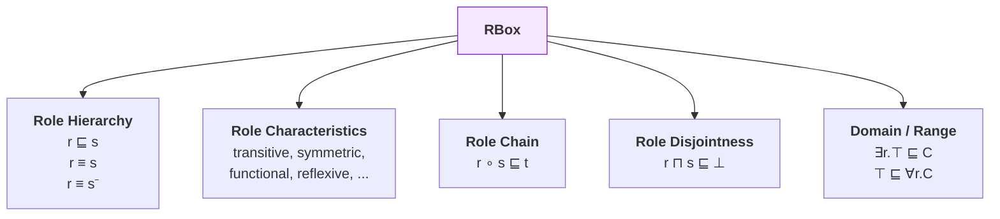
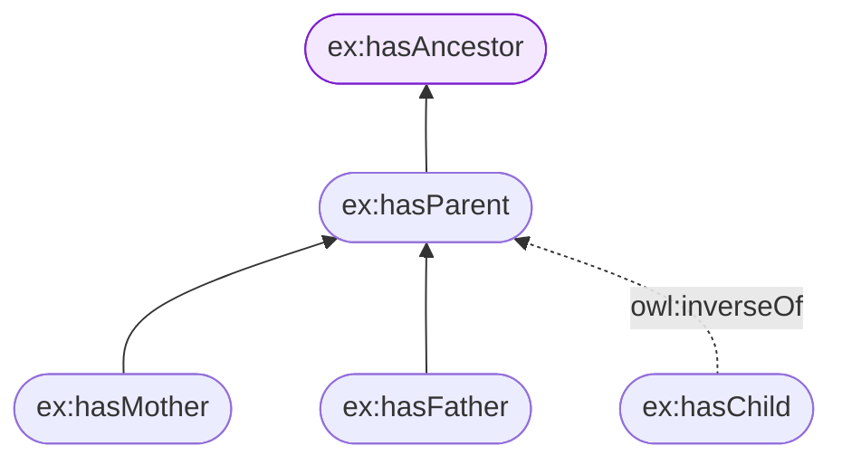
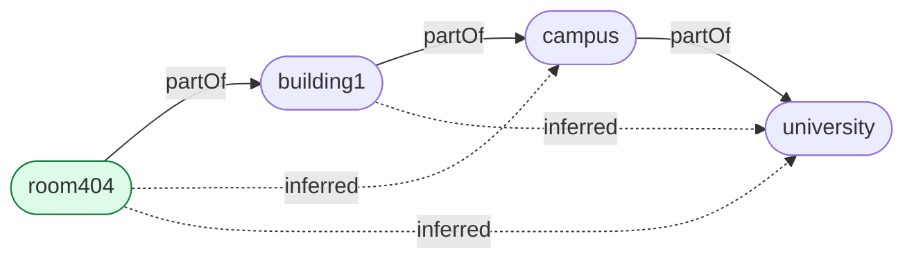
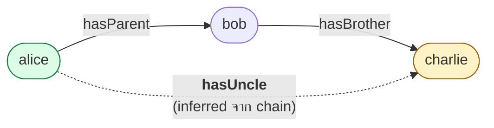
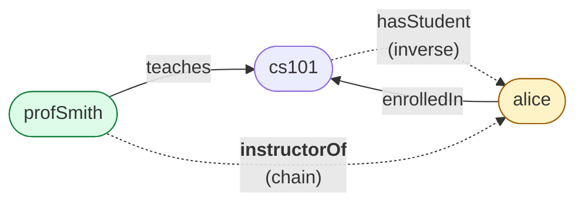

# 05.06 RBox: Role Hierarchy, Characteristics และ Role Chain

**RBox** เก็บ axiom ที่เกี่ยวกับ **role (property)** ล้วน ๆ — ลำดับชั้น คุณสมบัติทางคณิตศาสตร์ และ role chain
บทนี้ครอบคลุมทั้งหมด พร้อมอธิบาย **regularity condition** ที่จำกัดการใช้ role chain
เพื่อรักษาความ decidable ของ OWL 2 DL

---

## องค์ประกอบของ RBox



---

## 1. Role Hierarchy

```turtle
@prefix ex:   <http://example.org/> .
@prefix rdfs: <http://www.w3.org/2000/01/rdf-schema#> .
@prefix owl:  <http://www.w3.org/2002/07/owl#> .

# r ⊑ s
ex:hasMother rdfs:subPropertyOf ex:hasParent .
ex:hasFather rdfs:subPropertyOf ex:hasParent .
ex:hasParent rdfs:subPropertyOf ex:hasAncestor .

# r ≡ s
ex:worksAt owl:equivalentProperty ex:employedBy .

# r ≡ s⁻
ex:hasChild owl:inverseOf ex:hasParent .
```



---

## 2. Role Characteristics ครบทุกตัว

| Characteristic | DL | OWL | ตัวอย่างที่เหมาะสม | อนุมานอะไร |
| --- | --- | --- | --- | --- |
| **Transitive** | `r⁺ ⊑ r` | `owl:TransitiveProperty` | `partOf`, `hasAncestor` | `r(a,b) ∧ r(b,c) → r(a,c)` |
| **Symmetric** | `r ≡ r⁻` | `owl:SymmetricProperty` | `marriedTo`, `siblingOf` | `r(a,b) → r(b,a)` |
| **Asymmetric** | `r ⊓ r⁻ ⊑ ⊥` | `owl:AsymmetricProperty` | `hasParent`, `taller Than` | `r(a,b) → ¬r(b,a)` |
| **Reflexive** | `⊤ ⊑ ∃r.Self` | `owl:ReflexiveProperty` | `knows` (ในบางนิยาม) | `r(a,a)` เสมอ |
| **Irreflexive** | `∃r.Self ⊑ ⊥` | `owl:IrreflexiveProperty` | `hasParent`, `marriedTo` | `¬r(a,a)` |
| **Functional** | `⊤ ⊑ ≤1 r` | `owl:FunctionalProperty` | `hasBiologicalMother`, `hasSSN` | มีค่าได้ค่าเดียว |
| **InverseFunctional** | `⊤ ⊑ ≤1 r⁻` | `owl:InverseFunctionalProperty` | `hasEmail`, `hasISBN` | ค่าระบุ subject ได้ตัวเดียว |

### ตัวอย่าง Transitive

```turtle
@prefix ex:  <http://example.org/> .
@prefix owl: <http://www.w3.org/2002/07/owl#> .

ex:partOf a owl:TransitiveProperty .

ex:room404  ex:partOf ex:building1 .
ex:building1 ex:partOf ex:campus .
ex:campus    ex:partOf ex:university .
```

**อนุมานได้**

```turtle
ex:room404   ex:partOf ex:campus , ex:university .
ex:building1 ex:partOf ex:university .
```



### ตัวอย่าง Functional

```turtle
ex:hasBiologicalMother a owl:FunctionalProperty .

ex:alice ex:hasBiologicalMother ex:mary .
ex:alice ex:hasBiologicalMother ex:maria .
```

**reasoner อนุมาน**: `ex:mary owl:sameAs ex:maria` (เพราะมีได้ค่าเดียว!)

> ⚠️ **ระวัง**: ถ้ามี `ex:mary owl:differentFrom ex:maria` ด้วย → **KB inconsistent**
> นี่คือวิธีที่ functional property ช่วยจับข้อมูลผิดพลาด

### ตัวอย่าง Irreflexive vs Asymmetric

```turtle
ex:hasParent a owl:IrreflexiveProperty , owl:AsymmetricProperty .

ex:alice ex:hasParent ex:alice .    # → inconsistent (irreflexive)

ex:alice ex:hasParent ex:bob .
ex:bob   ex:hasParent ex:alice .    # → inconsistent (asymmetric)
```

### ⚠️ ข้อจำกัด: Transitive กับ Cardinality ใช้ร่วมกันไม่ได้

```turtle
# ❌ ผิด — ทำให้ OWL 2 DL ไม่ decidable
ex:partOf a owl:TransitiveProperty .

ex:Room rdfs:subClassOf [
    a owl:Restriction ;
    owl:onProperty     ex:partOf ;
    owl:maxCardinality "1"^^xsd:nonNegativeInteger
] .
```

**กฎ**: property ที่เป็น **transitive** (หรือมี transitive subproperty) **ห้ามใช้ใน cardinality restriction**
เพราะจะทำให้ระบบ undecidable — reasoner จะปฏิเสธ ontology นี้

เหตุผลเดียวกันทำให้ **transitive property เป็น functional ไม่ได้**

---

## 3. Role Chain (OWL 2 เท่านั้น)

**Role chain** บอกว่าการเดินตาม role หลายตัวต่อกัน เทียบเท่ากับ role อีกตัวหนึ่ง

```
r ∘ s ⊑ t
```

<table>
<tr><th width="50%">Full form</th><th width="50%">Shorthand</th></tr>
<tr valign="top">
<td>

```turtle
@prefix ex:  <http://example.org/> .
@prefix rdf: <http://www.w3.org/1999/02/22-rdf-syntax-ns#> .
@prefix owl: <http://www.w3.org/2002/07/owl#> .

ex:hasUncle rdf:type owl:ObjectProperty .
ex:hasUncle owl:propertyChainAxiom _:c1 .
_:c1 rdf:first ex:hasParent .
_:c1 rdf:rest _:c2 .
_:c2 rdf:first ex:hasBrother .
_:c2 rdf:rest rdf:nil .
```

</td>
<td>

```turtle
@prefix ex:  <http://example.org/> .
@prefix rdf: <http://www.w3.org/1999/02/22-rdf-syntax-ns#> .
@prefix owl: <http://www.w3.org/2002/07/owl#> .

ex:hasUncle a owl:ObjectProperty ;
    owl:propertyChainAxiom ( ex:hasParent ex:hasBrother ) .
```

</td>
</tr>
</table>

### ตัวอย่างการทำงาน

```turtle
ex:alice ex:hasParent  ex:bob .
ex:bob   ex:hasBrother ex:charlie .
```

**อนุมาน**: `ex:alice ex:hasUncle ex:charlie` ✅



### ตัวอย่าง role chain ที่ใช้จริง

```turtle
# ตำแหน่งที่ตั้งซ้อนกัน: อยู่ในสิ่งที่อยู่ใน X ก็คืออยู่ใน X
ex:locatedIn owl:propertyChainAxiom ( ex:locatedIn ex:partOf ) .

# หน่วยงานของหน่วยงาน
ex:worksInFaculty owl:propertyChainAxiom ( ex:memberOf ex:partOf ) .

# ยาที่รักษาโรคที่เกิดจากเชื้อ
ex:treatsPathogen owl:propertyChainAxiom ( ex:treats ex:causedBy ) .

# ปู่ย่าตายาย
ex:hasGrandparent owl:propertyChainAxiom ( ex:hasParent ex:hasParent ) .
```

### chain ยาวกว่า 2 ตัวก็ได้

```turtle
ex:hasGreatGrandparent owl:propertyChainAxiom
    ( ex:hasParent ex:hasParent ex:hasParent ) .
```

### ⚠️ Regularity Condition

OWL 2 DL จำกัดว่า role chain ต้องเป็นไปตาม **regularity condition** เพื่อคง decidability

**กฎหลัก**: ต้องมี **strict partial order `≺`** บน role ที่ทำให้ chain axiom `r₁ ∘ ... ∘ rₙ ⊑ s` เป็นไปตามรูปแบบใดรูปแบบหนึ่ง:

| รูปแบบที่อนุญาต | ตัวอย่าง |
| --- | --- |
| `s ∘ s ⊑ s` (transitive) | `partOf ∘ partOf ⊑ partOf` ✅ |
| `s⁻ ⊑ s` | `marriedTo⁻ ⊑ marriedTo` ✅ |
| `r₁ ∘ ... ∘ rₙ ⊑ s` โดยทุก `rᵢ ≺ s` | `hasParent ∘ hasBrother ⊑ hasUncle` ✅ |
| `s ∘ r₁ ∘ ... ∘ rₙ ⊑ s` โดยทุก `rᵢ ≺ s` | `locatedIn ∘ partOf ⊑ locatedIn` ✅ |
| `r₁ ∘ ... ∘ rₙ ∘ s ⊑ s` โดยทุก `rᵢ ≺ s` | `partOf ∘ locatedIn ⊑ locatedIn` ✅ |

**ตัวอย่างที่ผิดกฎ**

```turtle
# ❌ วนกลับ -- ไม่มี strict partial order ที่รองรับ
ex:r owl:propertyChainAxiom ( ex:s ex:r ) .
ex:s owl:propertyChainAxiom ( ex:r ex:s ) .
```

reasoner จะรายงาน error ว่า **"non-simple role"** หรือ **"regularity violation"**

### Simple role

**Simple role** = role ที่ไม่ได้เกิดจาก role chain หรือ transitive property (ทั้งทางตรงและผ่าน subproperty)

| ใช้ role ที่ไม่ simple ได้ในกรณีเหล่านี้ | ❌ |
| --- | --- |
| Cardinality restriction | ❌ |
| `owl:FunctionalProperty` | ❌ |
| `owl:InverseFunctionalProperty` | ❌ |
| `owl:AsymmetricProperty` | ❌ |
| `owl:IrreflexiveProperty` | ❌ |
| `owl:propertyDisjointWith` | ❌ |
| `owl:hasSelf` | ❌ |

---

## 4. Role Disjointness

```turtle
@prefix ex:  <http://example.org/> .
@prefix owl: <http://www.w3.org/2002/07/owl#> .

# ไม่มีใครเป็นทั้งพ่อแม่และลูกของคนเดียวกัน
ex:hasParent owl:propertyDisjointWith ex:hasChild .

# หลายตัว
[] a owl:AllDisjointProperties ;
   owl:members ( ex:hasParent ex:hasChild ex:hasSibling ) .
```

```turtle
ex:alice ex:hasParent ex:bob .
ex:alice ex:hasChild  ex:bob .    # → KB inconsistent
```

---

## ตัวอย่าง RBox เต็ม

```turtle
@prefix ex:   <http://example.org/university#> .
@prefix rdf:  <http://www.w3.org/1999/02/22-rdf-syntax-ns#> .
@prefix rdfs: <http://www.w3.org/2000/01/rdf-schema#> .
@prefix owl:  <http://www.w3.org/2002/07/owl#> .

# ===== Role hierarchy =====
ex:involvedIn a owl:ObjectProperty ;
    rdfs:label  "involved in"@en ;
    rdfs:domain ex:Person ;
    rdfs:range  ex:Course .

ex:enrolledIn a owl:ObjectProperty ;
    rdfs:subPropertyOf ex:involvedIn ;
    rdfs:domain ex:Student ;
    rdfs:range  ex:Course .

ex:teaches a owl:ObjectProperty ;
    rdfs:subPropertyOf ex:involvedIn ;
    rdfs:domain ex:Professor ;
    rdfs:range  ex:Course .

# ===== Inverse =====
ex:taughtBy a owl:ObjectProperty ;
    owl:inverseOf ex:teaches .

ex:hasStudent a owl:ObjectProperty ;
    owl:inverseOf ex:enrolledIn .

# ===== Characteristics =====
ex:partOf a owl:ObjectProperty , owl:TransitiveProperty ;
    rdfs:label "part of"@en .

ex:colleagueOf a owl:ObjectProperty , owl:SymmetricProperty , owl:IrreflexiveProperty .

ex:hasSupervisor a owl:ObjectProperty , owl:FunctionalProperty , owl:AsymmetricProperty ;
    rdfs:domain ex:Student ;
    rdfs:range  ex:Professor .

ex:studentId a owl:DatatypeProperty , owl:FunctionalProperty , owl:InverseFunctionalProperty .

# ===== Role chain =====
# ถ้าเป็นสมาชิกของภาควิชา และภาควิชาอยู่ในคณะ → เป็นสมาชิกของคณะ
ex:memberOfFaculty a owl:ObjectProperty ;
    owl:propertyChainAxiom ( ex:memberOf ex:partOf ) .

# ถ้าสอนวิชาที่นักศึกษาลงเรียน → เป็นอาจารย์ผู้สอนของนักศึกษาคนนั้น
ex:instructorOf a owl:ObjectProperty ;
    owl:propertyChainAxiom ( ex:teaches ex:hasStudent ) .

# ===== Role disjointness =====
ex:teaches owl:propertyDisjointWith ex:enrolledIn .
```

**ผลของ role chain `ex:instructorOf`**

```turtle
ex:profSmith ex:teaches    ex:cs101 .
ex:alice     ex:enrolledIn ex:cs101 .
# ex:cs101 ex:hasStudent ex:alice .   (inferred จาก inverse)
```

→ อนุมาน `ex:profSmith ex:instructorOf ex:alice` ✅



---

## Key Points

- **RBox** เก็บ role hierarchy, characteristics, role chain, disjointness และ domain/range
- Role characteristics มี 7 ตัว: **transitive, symmetric, asymmetric, reflexive, irreflexive, functional, inverse functional**
- **Functional property ทำให้ reasoner สรุป `sameAs` เอง** เมื่อมีสองค่า — และจับข้อผิดพลาดได้ถ้ามี `differentFrom`
- ⚠️ **Transitive property ใช้ใน cardinality restriction ไม่ได้** และเป็น functional ไม่ได้ — เพราะจะทำให้ undecidable
- **Role chain** (`owl:propertyChainAxiom`) เป็นความสามารถใหม่ของ OWL 2 ที่ทรงพลังมาก — เขียน `hasUncle`, `locatedIn` แบบซ้อนได้
- Role chain ต้องเป็นไปตาม **regularity condition** — ถ้าวนกลับ reasoner จะปฏิเสธ ontology
- **Simple role** (ไม่เกิดจาก chain/transitive) เท่านั้นที่ใช้กับ cardinality, functional, asymmetric, irreflexive, hasSelf ได้
- `owl:propertyDisjointWith` จับกรณีที่ความสัมพันธ์สองแบบเกิดพร้อมกันไม่ได้
