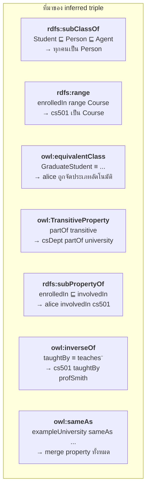
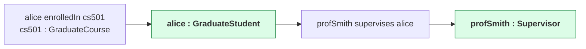
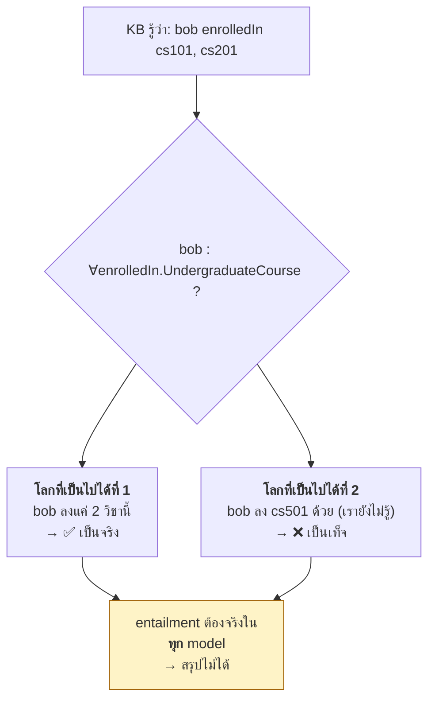
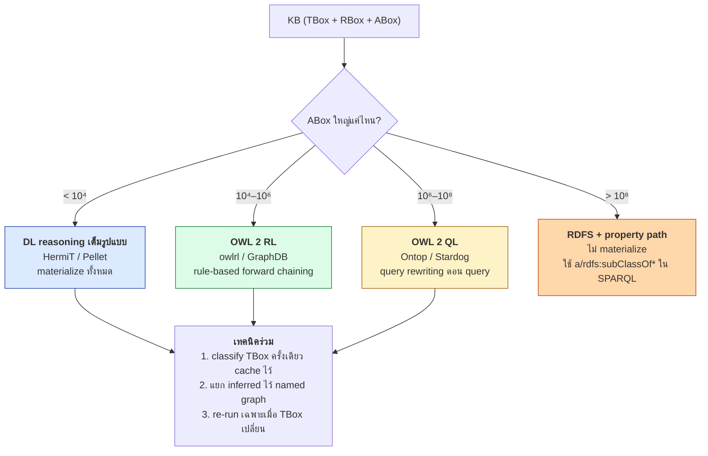

# 05.07 Reasoning เหนือ Knowledge Base

บทนี้รวบยอดว่า reasoner ทำอะไรกับ KB ที่มีทั้ง TBox, RBox และ ABox — **instance retrieval**, **realization**
และที่สำคัญที่สุดคือ **ผลของ Open World Assumption ต่อ ABox** ซึ่งเป็นสิ่งที่ทำให้ผลลัพธ์ต่างจากที่หลายคนคาดหวัง
ตัวเลขทั้งหมดในบทนี้มาจากการรัน [`code/ch05/kb_reasoning.py`](../code/ch05/kb_reasoning.py) จริง

---

## KB ที่ใช้เป็นตัวอย่าง

| ไฟล์ | เนื้อหา | ขนาด |
| --- | --- | --- |
| [`university_tbox.ttl`](../code/ch05/university_tbox.ttl) | TBox + RBox | 249 triples |
| [`university_abox.ttl`](../code/ch05/university_abox.ttl) | ABox | 177 triples |
| **รวม** | | **426 triples** |

---

## ผล reasoning: ก่อนและหลัง

หลังรัน `owlrl.DeductiveClosure(owlrl.OWLRL_Semantics)`:

```
inferred : 869 triples
total    : 1295 triples   (จาก 426)
```

| Query | ก่อน reasoning | หลัง reasoning |
| --- | --- | --- |
| `?p a uni:Person` | 0 | **7** — adminBrown, alice, bob, carol, dave, profJones, profSmith |
| `?c a uni:Course` | 0 | **6** — cs101, cs201, cs301, cs501, cs601, ma101 |
| `?s a uni:GraduateStudent` | 0 | **1** — alice |
| `?p a uni:PublishedResearcher` | 0 | **2** — alice, profSmith |
| `uni:csDept uni:partOf ?o` | 1 | **3** — engineeringFaculty, exampleUniversity, + sameAs target |
| `?p uni:involvedIn uni:cs501` | 0 | **2** — alice, profSmith |
| `uni:cs501 uni:taughtBy ?p` | 0 | **1** — profSmith |

### อธิบายที่มาของแต่ละผลลัพธ์



> 💡 สังเกตว่า `uni:csDept uni:partOf ?o` ได้ผลลัพธ์เพิ่มจาก **`owl:sameAs`** ด้วย —
> เพราะ `uni:exampleUniversity owl:sameAs <https://www.example.edu/id/university>`
> ทำให้ IRI ภายนอกถูกดึงเข้ามาเป็นคำตอบด้วย

---

## Realization: ก่อน vs หลัง (HermiT)

| Individual | ก่อน reasoning | หลัง reasoning | ได้อะไรเพิ่ม |
| --- | --- | --- | --- |
| `alice` | `['Student']` | `['GraduateStudent', 'PublishedResearcher']` | ✅ **GraduateStudent, PublishedResearcher** |
| `bob` | `['Student']` | `['Student']` | — |
| `carol` | `['Student']` | `['Student']` | — |
| `dave` | `['Student']` | `['Student']` | — |
| `profSmith` | `['Professor']` | `['BusyProfessor', 'PublishedResearcher', 'Supervisor']` | ✅ **3 class** |
| `profJones` | `['Professor']` | `['Professor']` | — |

### ทำไม `profSmith` ได้ 3 class

```turtle
uni:profSmith uni:teaches    uni:cs101 , uni:cs501 , uni:cs601 ;   # 3 วิชา
              uni:supervises uni:alice ;                            # alice เป็น GraduateStudent
              uni:authorOf   uni:paper001 , uni:paper002 .          # มีผลงาน
```

| Defined class | เงื่อนไข | ตรงหรือไม่ |
| --- | --- | --- |
| `BusyProfessor ≡ Professor ⊓ (≥3 teaches.Course)` | สอน ≥ 3 วิชา | ✅ (สอน 3 วิชา + มี `AllDifferent`) |
| `Supervisor ≡ Professor ⊓ ∃supervises.GraduateStudent` | ดูแล grad student | ✅ (alice ถูกอนุมานเป็น GraduateStudent ก่อน) |
| `PublishedResearcher ≡ ∃authorOf.Publication` | มีผลงาน | ✅ |

**สังเกตลำดับการอนุมานแบบลูกโซ่**: `alice : GraduateStudent` ต้องเกิดก่อน `profSmith : Supervisor` จึงเป็นไปได้



---

## ⚠️ ผลของ OWA: ทำไม `bob` ไม่ได้เป็น `UndergraduateStudent`

```turtle
uni:UndergraduateStudent ≡ Student ⊓ ∀enrolledIn.UndergraduateCourse
                                   ⊓ ∃enrolledIn.UndergraduateCourse

uni:bob a uni:Student ;
    uni:enrolledIn uni:cs101 , uni:cs201 .    # ทั้งสองเป็น UndergraduateCourse
```

**คาดหวัง**: `bob : UndergraduateStudent`
**ผลจริง**: **ไม่ใช่** — และ retrieval ของ `UndergraduateStudent` ได้ `[]`

### เหตุผล

`∀enrolledIn.UndergraduateCourse` แปลว่า "**ทุกวิชาที่ bob ลง** ต้องเป็น undergraduate"
ภายใต้ OWA reasoner **ไม่รู้ว่ามีวิชาอื่นที่ bob ลงอีกหรือไม่** จึงสรุปไม่ได้



### ทางแก้: Closure Axiom

```turtle
@prefix uni: <http://example.org/university#> .
@prefix owl: <http://www.w3.org/2002/07/owl#> .

# ปิดโลกด้วย oneOf: bob ลงเรียนเฉพาะสองวิชานี้เท่านั้น
uni:bob a [
    a owl:Restriction ;
    owl:onProperty uni:enrolledIn ;
    owl:allValuesFrom [ a owl:Class ; owl:oneOf ( uni:cs101 uni:cs201 ) ]
] .
```

หลังเพิ่มแล้ว reasoner สรุปได้ว่า `bob : UndergraduateStudent` ✅

| วิธีปิดโลก | เหมาะเมื่อ |
| --- | --- |
| `allValuesFrom` + `oneOf` | รู้แน่ชัดว่ามีค่าอะไรบ้าง |
| `maxCardinality n` | รู้จำนวนสูงสุด |
| `maxCardinality 0` | ยืนยันว่าไม่มีเลย |
| ใช้ **SHACL** แทน | ต้องการ validate ไม่ใช่ inference |

---

## ⚠️ กรณี `dave` — ไม่มี `enrolledIn` เลย

```turtle
uni:dave a uni:Student ;
    uni:studentId "S-2024-0777" ;
    uni:memberOf uni:csDept .
    # ไม่มี enrolledIn เลย
```

| คำถาม | SPARQL | Reasoner (OWA) |
| --- | --- | --- |
| dave ลงเรียนวิชาไหน | 0 แถว | **ไม่ทราบ** |
| dave เป็น UndergraduateStudent | — | **ไม่ทราบ** |
| dave ไม่ได้ลงเรียนอะไรเลย | — | **ไม่ทราบ** |

> 💡 **จุดที่ต้องเข้าใจให้ชัด**: SPARQL ทำงานบน **triple ที่มีอยู่จริงใน graph** (คล้าย closed world)
> ส่วน reasoner ทำงานบน **สิ่งที่ entailed ในทุก model** (open world) — **ผลลัพธ์จึงต่างกันได้**

---

## Instance Retrieval กับ owlready2: ข้อควรระวัง

จากผลรันจริง:

```
Retrieval:
  Person                 = ['adminBrown', 'alice', 'bob', 'carol', 'dave', 'profJones', 'profSmith']
  Student                = []          ← ⚠️ ว่าง!
  GraduateStudent        = ['alice']
  Professor              = ['profJones', 'profSmith']
  BusyProfessor          = ['profSmith']
```

**ทำไม `Student` จึงว่าง** — owlready2 **แทนที่** `is_a` ของ individual ด้วย **most specific class** หลัง reasoning
`alice` จึงมี `is_a = [GraduateStudent, PublishedResearcher]` และไม่มี `Student` โดยตรงอีกต่อไป

```python
# ❌ ได้ผลไม่ครบ — เอาเฉพาะ direct instance
list(onto.Student.instances())

# ✅ ถูกต้อง — ใช้ SPARQL บน rdflib หลัง reasoning
g.query("SELECT ?s WHERE { ?s a uni:Student }")

# ✅ หรือไล่ subclass เอง
def all_instances(cls):
    result = set(cls.instances())
    for sub in cls.subclasses():
        result |= all_instances(sub)
    return result
```

---

## เปรียบเทียบ owlrl vs HermiT บน KB เดียวกัน

| | **owlrl** (OWL 2 RL) | **HermiT** (OWL 2 DL) |
| --- | --- | --- |
| ต้องมี Java | ❌ | ✅ |
| triple หลัง reasoning | 1,295 (จาก 426) | (แก้ ABox in-place) |
| `alice : GraduateStudent` | ✅ | ✅ |
| `profSmith : BusyProfessor` | ⚠️ ขึ้นกับ cardinality support | ✅ |
| ตรวจ inconsistency | จำกัด | ✅ ครบถ้วน |
| ตรวจ unsatisfiable class | ❌ | ✅ |
| Role chain (`instructorOf`) | ✅ | ✅ |
| ทำงานกับ | `rdflib.Graph` | `owlready2.World` |

จากผลรันจริง HermiT อนุมาน role chain ได้:

```
* Owlready * Adding relation university.profSmith instructorOf university.alice
* Owlready * Adding relation university.profSmith instructorOf university.bob
* Owlready * Adding relation university.profSmith instructorOf university.carol
* Owlready * Adding relation university.profJones instructorOf university.carol
```

มาจาก `uni:instructorOf owl:propertyChainAxiom ( uni:teaches uni:hasStudent )`

---

## กลยุทธ์ reasoning สำหรับระบบจริง



---

## Key Points

- KB 426 triples ขยายเป็น **1,295 triples** หลังรัน OWL 2 RL — เกือบ 3 เท่า
- inferred triple มาจาก 7 กลไก: **subClassOf, range, equivalentClass, transitive, subPropertyOf, inverseOf, sameAs**
- **Defined class ทำให้เกิด automatic classification** — `alice : GraduateStudent`, `profSmith : BusyProfessor/Supervisor/PublishedResearcher`
- การอนุมานเป็น **ลูกโซ่**: `alice : GraduateStudent` ต้องเกิดก่อน `profSmith : Supervisor`
- ⚠️ **`∀r.C` สรุปไม่ได้ภายใต้ OWA** — `bob` ไม่ถูกจัดเป็น `UndergraduateStudent` แม้ลงเฉพาะวิชา undergrad
- ต้องใช้ **closure axiom** (`allValuesFrom` + `oneOf` หรือ `maxCardinality`) เพื่อปิดโลกเฉพาะจุด
- **SPARQL ทำงานแบบ closed world** บน triple ที่มีจริง ส่วน **reasoner ทำงานแบบ open world** — ผลต่างกันได้
- ⚠️ `owlready2.instances()` คืนเฉพาะ **direct instance** — ใช้ SPARQL หรือไล่ subclass เองแทน
- เลือกกลยุทธ์ตามขนาด ABox: **DL** (< 10⁴), **OWL 2 RL** (10⁴–10⁶), **OWL 2 QL** (10⁶–10⁸), **RDFS + property path** (> 10⁸)
