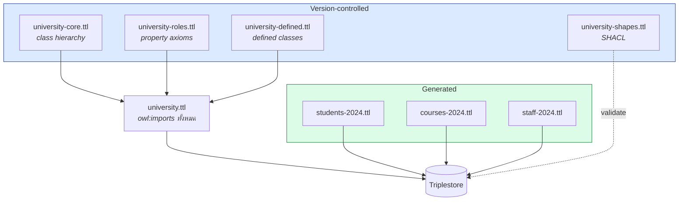
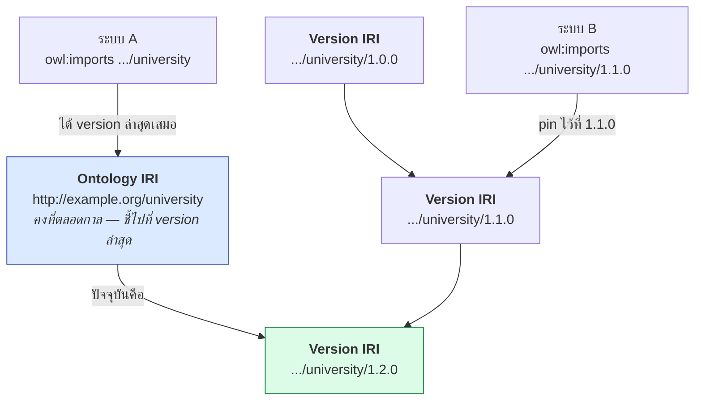
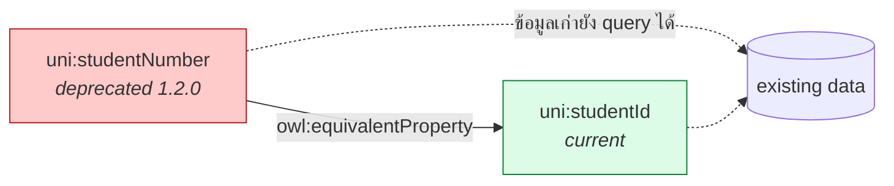
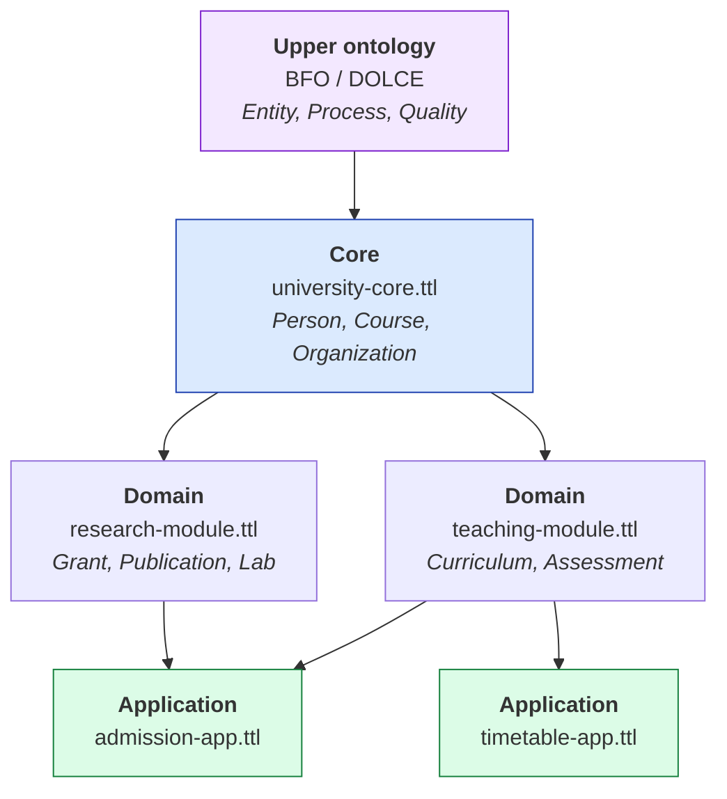
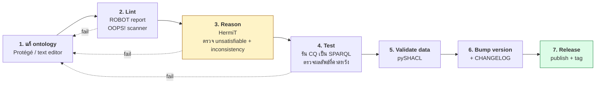

# 05.08 การจัดการ Knowledge Base

ontology ที่ใช้จริงมีอายุยาวหลายปี มีคนแก้หลายคน และต้องเชื่อมกับ ontology อื่น
บทนี้ครอบคลุมงานวิศวกรรมที่ทำให้ KB อยู่รอดในระยะยาว: **versioning**, **modularization**,
`owl:imports` และการ **แยกไฟล์ TBox/ABox** ให้เข้ากับ workflow ของทีม

---

## 1. แยกไฟล์: TBox / RBox / ABox

```
project/
├── onto/
│   ├── university-core.ttl        ← TBox: class hierarchy หลัก
│   ├── university-roles.ttl       ← RBox: property axioms
│   ├── university-defined.ttl     ← TBox: defined classes
│   └── university.ttl             ← ไฟล์รวมที่ owl:imports ทั้งสามตัว
├── data/
│   ├── students-2024.ttl          ← ABox — ETL generate
│   ├── courses-2024.ttl           ← ABox
│   └── staff-2024.ttl             ← ABox
└── shapes/
    └── university-shapes.ttl      ← SHACL validation
```

| ไฟล์ | ใครแก้ | Version control | ความถี่ |
| --- | --- | --- | --- |
| `onto/*.ttl` | ontology engineer | ✅ git + code review | ปีละไม่กี่ครั้ง |
| `data/*.ttl` | ETL / ระบบ | ❌ (generate ใหม่ได้) | ทุกวัน |
| `shapes/*.ttl` | data engineer | ✅ git | เดือนละครั้ง |



---

## 2. `owl:imports`

`owl:imports` บอกให้ reasoner โหลด ontology อื่นเข้ามารวมด้วย

```turtle
@prefix owl:     <http://www.w3.org/2002/07/owl#> .
@prefix dcterms: <http://purl.org/dc/terms/> .
@prefix xsd:     <http://www.w3.org/2001/XMLSchema#> .

<http://example.org/university> a owl:Ontology ;
    dcterms:title "University Ontology"@en ;
    owl:imports
        <http://example.org/university/core> ,
        <http://example.org/university/roles> ,
        <http://example.org/university/defined> ,
        <http://xmlns.com/foaf/0.1/> ;
    owl:versionInfo "1.2.0" .
```

### พฤติกรรมสำคัญ

| ประเด็น | รายละเอียด |
| --- | --- |
| **Transitive** | ถ้า A imports B และ B imports C → A ได้ C ด้วย |
| **Cycle ได้** | A imports B, B imports A — ไม่ error แต่ควรเลี่ยง |
| **โหลดผ่าน network** | tool จะพยายาม dereference IRI จริง |
| **ไม่ใช่ copy** | เป็นการอ้างอิง ไม่ใช่ inline |

### ⚠️ ปัญหาที่พบบ่อยที่สุด: import ที่ dereference ไม่ได้

จากการรัน [`kb_reasoning.py`](../code/ch05/kb_reasoning.py) จริง — owlready2 พยายามดึง
`http://example.org/university` ผ่าน network แล้วได้ **HTTP 403** ทำให้โปรแกรมพัง

**ทางแก้ 3 แบบ**

```python
# 1) ตัด owl:imports ออกก่อน แล้วโหลดไฟล์เอง
from rdflib.namespace import OWL
merged.remove((None, OWL.imports, None))

# 2) owlready2: map IRI ไปยังไฟล์ local
import owlready2
owlready2.onto_path.append("/path/to/local/ontologies")

# 3) Protégé: Preferences → Ontology catalog → เพิ่ม catalog-v001.xml
```

**catalog file** (`catalog-v001.xml`) เป็นวิธีมาตรฐานที่ Protégé และ ROBOT ใช้

```xml
<?xml version="1.0" encoding="UTF-8"?>
<catalog prefer="public" xmlns="urn:oasis:names:tc:entity:xmlns:xml:catalog">
  <uri id="User Entered Import Resolution"
       name="http://example.org/university/core"
       uri="university-core.ttl"/>
  <uri id="User Entered Import Resolution"
       name="http://example.org/university/roles"
       uri="university-roles.ttl"/>
</catalog>
```

---

## 3. Versioning

### Semantic Versioning สำหรับ ontology

```
MAJOR . MINOR . PATCH
```

| ส่วน | เพิ่มเมื่อ | ตัวอย่าง |
| --- | --- | --- |
| **MAJOR** | เปลี่ยนแบบ **breaking** | ลบ class, เปลี่ยน IRI, เปลี่ยนความหมายของ property |
| **MINOR** | เพิ่มแบบ **backward-compatible** | เพิ่ม class ใหม่, เพิ่ม subclass, เพิ่ม annotation |
| **PATCH** | แก้ที่ไม่กระทบ semantics | แก้ typo ใน label/comment |

### Property ที่ใช้

```turtle
@prefix owl:     <http://www.w3.org/2002/07/owl#> .
@prefix dcterms: <http://purl.org/dc/terms/> .
@prefix xsd:     <http://www.w3.org/2001/XMLSchema#> .

<http://example.org/university> a owl:Ontology ;
    owl:versionInfo     "1.2.0" ;
    owl:versionIRI      <http://example.org/university/1.2.0> ;
    owl:priorVersion    <http://example.org/university/1.1.0> ;
    dcterms:created     "2025-01-15"^^xsd:date ;
    dcterms:modified    "2025-06-01"^^xsd:date ;
    owl:backwardCompatibleWith <http://example.org/university/1.1.0> ;
    owl:incompatibleWith       <http://example.org/university/0.9.0> .
```

| Property | ความหมาย |
| --- | --- |
| `owl:versionInfo` | สตริงบอก version (อ่านง่าย) |
| `owl:versionIRI` | **IRI เฉพาะของ version นี้** — ใช้ pin version ได้ |
| `owl:priorVersion` | version ก่อนหน้า |
| `owl:backwardCompatibleWith` | ใช้แทน version เก่าได้ |
| `owl:incompatibleWith` | ใช้แทนไม่ได้ |

### Ontology IRI vs Version IRI



---

## 4. Deprecation แทนการลบ

**ห้ามลบ term ที่เคยเผยแพร่แล้ว** — เพราะข้อมูลของคนอื่นอาจอ้างถึงอยู่

```turtle
@prefix uni:  <http://example.org/university#> .
@prefix owl:  <http://www.w3.org/2002/07/owl#> .
@prefix rdfs: <http://www.w3.org/2000/01/rdf-schema#> .

uni:studentNumber a owl:DatatypeProperty ;
    rdfs:label      "student number"@en ;
    owl:deprecated  true ;
    rdfs:comment    "Deprecated in 1.2.0. Use uni:studentId instead."@en ;
    rdfs:seeAlso    uni:studentId ;
    owl:versionInfo "deprecated since 1.2.0" .

# เชื่อมกับ term ใหม่เพื่อให้ข้อมูลเก่ายังใช้ได้
uni:studentNumber owl:equivalentProperty uni:studentId .
```



---

## 5. Modularization

### ประเภทของ module

| ประเภท | ขอบเขต | ตัวอย่าง | reuse ได้แค่ไหน |
| --- | --- | --- | --- |
| **Upper/Foundational** | concept นามธรรมสูงสุด | BFO, DOLCE, SUMO | ทุกโดเมน |
| **Core** | concept กลางของโดเมน | `university-core.ttl` | ทั้งองค์กร |
| **Domain** | เฉพาะโดเมนย่อย | `research-module.ttl` | หน่วยงานเดียว |
| **Application** | ผูกกับ use case | `admission-app.ttl` | แอปเดียว |



### หลักการแบ่ง module

- [ ] **แต่ละ module มี IRI และ version ของตัวเอง**
- [ ] **ทิศทางการ import ไปทางเดียว** — application → domain → core → upper (ไม่วนกลับ)
- [ ] module ระดับล่างไม่รู้จัก module ระดับบน
- [ ] แต่ละ module ควรมีขนาดที่คนคนเดียวเข้าใจได้ (~100–500 axiom)
- [ ] มี **catalog file** ให้ tool resolve IRI เป็นไฟล์ local ได้

---

## 6. Workflow ที่แนะนำ



### ตัวอย่าง CI script

```bash
#!/usr/bin/env bash
set -euo pipefail

echo "== 1. ตรวจ syntax =="
for f in onto/*.ttl data/*.ttl; do
  python -c "from rdflib import Graph; Graph().parse('$f', format='turtle')" \
    && echo "  OK   $f" || { echo "  FAIL $f"; exit 1; }
done

echo "== 2. ตรวจ annotation ครบถ้วน =="
python scripts/check_annotations.py onto/

echo "== 3. รัน reasoner ตรวจ consistency =="
python scripts/run_reasoner.py onto/university.ttl

echo "== 4. รัน competency questions =="
python scripts/run_cq_tests.py tests/cq/

echo "== 5. Validate ข้อมูลด้วย SHACL =="
pyshacl -s shapes/university-shapes.ttl -df turtle data/students-2024.ttl

echo "ทุกขั้นตอนผ่าน ✅"
```

---

## 7. เครื่องมือที่ควรรู้จัก

| เครื่องมือ | ใช้ทำอะไร |
| --- | --- |
| **ROBOT** | CLI สำหรับ ontology: merge, extract module, reason, report, diff |
| **Protégé** | แก้ไข ontology แบบ GUI + รัน reasoner |
| **OOPS!** | สแกนหา pitfall อัตโนมัติ (ดู [10.08](../10-ontology-design/10.08-evaluation.md)) |
| **pySHACL** | validate ข้อมูลตาม shape |
| **owl-diff / ROBOT diff** | เทียบสอง version ว่าต่างกันอย่างไร |

ตัวอย่างคำสั่ง ROBOT ที่ใช้บ่อย:

```bash
# รวมหลาย module เป็นไฟล์เดียว
robot merge --input onto/university-core.ttl \
            --input onto/university-roles.ttl \
            --output dist/university-merged.ttl

# รัน reasoner แล้วบันทึก inferred axiom
robot reason --input dist/university-merged.ttl \
             --reasoner hermit \
             --output dist/university-inferred.ttl

# สร้างรายงานคุณภาพ
robot report --input dist/university-merged.ttl \
             --output reports/quality.tsv

# ดึง module ย่อยตาม seed term
robot extract --input onto/university.ttl \
              --method BOT \
              --term-file terms.txt \
              --output modules/student-module.ttl
```

---

## Checklist การจัดการ KB

- [ ] แยกไฟล์ **TBox/RBox** (version-controlled) ออกจาก **ABox** (generated)
- [ ] ทุก ontology มี `owl:versionInfo` และ `owl:versionIRI`
- [ ] ใช้ **semantic versioning** — MAJOR สำหรับ breaking change
- [ ] **ห้ามลบ term** — ใช้ `owl:deprecated true` + `rdfs:seeAlso` ชี้ไป term ใหม่
- [ ] มี **catalog file** สำหรับ resolve `owl:imports` เป็นไฟล์ local
- [ ] ทิศทาง import ไปทางเดียว: application → domain → core → upper
- [ ] มี **CI** ที่ตรวจ syntax → annotation → consistency → CQ → SHACL
- [ ] มี **CHANGELOG** บอกว่าแต่ละ version เปลี่ยนอะไร

---

## Key Points

- **แยกไฟล์ TBox/RBox (git) ออกจาก ABox (generated)** — คนละ lifecycle คนละผู้แก้ไข
- `owl:imports` เป็น **transitive** และ tool จะพยายาม **dereference IRI จริงผ่าน network**
- ⚠️ import ที่ dereference ไม่ได้เป็นปัญหาที่พบบ่อยที่สุด — แก้ด้วย **catalog file** หรือตัด imports ออกแล้วโหลดไฟล์เอง
- ใช้ **semantic versioning**: MAJOR = breaking, MINOR = เพิ่มแบบเข้ากันได้, PATCH = แก้ typo
- แยก **Ontology IRI** (คงที่ ชี้ version ล่าสุด) จาก **Version IRI** (pin ได้)
- **ห้ามลบ term ที่เผยแพร่แล้ว** — ใช้ `owl:deprecated true` พร้อม `owl:equivalentProperty` ชี้ไป term ใหม่
- Modularize เป็น 4 ระดับ: **upper → core → domain → application** โดย import ไปทางเดียว
- ตั้ง **CI pipeline**: syntax → annotation → reasoner → competency question → SHACL
- **ROBOT** คือ CLI มาตรฐานสำหรับงาน ontology: merge, reason, report, extract, diff
