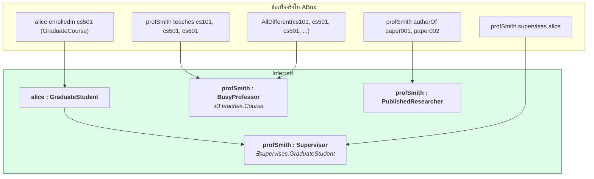

# 05.09 Python: สร้างและ Reason บน KB ที่แยกไฟล์

บทนี้ลงมือสร้าง **Knowledge Base ของมหาวิทยาลัยที่แยกไฟล์ TBox/ABox** จริง แล้วโหลดเข้ามารัน reasoning
ด้วยสองวิธี — **owlrl** (ไม่ต้องมี Java) และ **owlready2 + HermiT** (OWL 2 DL เต็มรูปแบบ)
ผลลัพธ์ทุกตัวเลขมาจากการรันจริง

> 📁 ไฟล์: [`university_tbox.ttl`](../code/ch05/university_tbox.ttl) · [`university_abox.ttl`](../code/ch05/university_abox.ttl) · [`kb_reasoning.py`](../code/ch05/kb_reasoning.py)

---

## โครงสร้างไฟล์

```
code/ch05/
├── university_tbox.ttl    ← TBox + RBox  (249 triples)
├── university_abox.ttl    ← ABox         (177 triples)
└── kb_reasoning.py        ← โหลด + reason + query
```

---

## 1. TBox: จุดสำคัญของไฟล์

```turtle
@prefix uni:     <http://example.org/university#> .
@prefix owl:     <http://www.w3.org/2002/07/owl#> .
@prefix rdfs:    <http://www.w3.org/2000/01/rdf-schema#> .
@prefix xsd:     <http://www.w3.org/2001/XMLSchema#> .
@prefix dcterms: <http://purl.org/dc/terms/> .

# ----- ontology header พร้อม versioning -----
<http://example.org/university> a owl:Ontology ;
    dcterms:title   "University Ontology — TBox"@en ;
    owl:versionInfo "1.2.0" ;
    owl:versionIRI  <http://example.org/university/1.2.0> .

# ----- primitive class -----
uni:Student a owl:Class ;
    rdfs:label       "Student"@en ;
    rdfs:comment     """A person admitted to a degree programme. Covers currently
enrolled students only; use uni:Alumnus for graduates."""@en ;
    rdfs:subClassOf  uni:Person ;
    owl:disjointWith uni:Staff .

# ----- defined class -> automatic classification -----
uni:GraduateStudent a owl:Class ;
    owl:equivalentClass [
        a owl:Class ;
        owl:intersectionOf (
            uni:Student
            [ a owl:Restriction ;
              owl:onProperty     uni:enrolledIn ;
              owl:someValuesFrom uni:GraduateCourse ]
        )
    ] .

uni:BusyProfessor a owl:Class ;
    owl:equivalentClass [
        a owl:Class ;
        owl:intersectionOf (
            uni:Professor
            [ a owl:Restriction ;
              owl:onProperty              uni:teaches ;
              owl:minQualifiedCardinality "3"^^xsd:nonNegativeInteger ;
              owl:onClass                 uni:Course ]
        )
    ] .

# ----- RBox: role chain -----
uni:instructorOf a owl:ObjectProperty ;
    rdfs:comment "A professor instructs every student enrolled in a course they teach."@en ;
    owl:propertyChainAxiom ( uni:teaches uni:hasStudent ) .

# ----- RBox: transitive -----
uni:partOf a owl:ObjectProperty , owl:TransitiveProperty ;
    rdfs:domain uni:Organization ;
    rdfs:range  uni:Organization .
```

---

## 2. ABox: จุดสำคัญของไฟล์

```turtle
@prefix uni: <http://example.org/university#> .
@prefix owl: <http://www.w3.org/2002/07/owl#> .

<http://example.org/university/data> a owl:Ontology ;
    owl:imports <http://example.org/university> .

uni:profSmith a owl:NamedIndividual , uni:Professor ;
    rdfs:label     "Jane Smith"@en ;
    uni:employeeId "E-1042" ;
    uni:memberOf   uni:csDept ;
    uni:teaches    uni:cs101 , uni:cs501 , uni:cs601 ;   # 3 วิชา -> BusyProfessor
    uni:supervises uni:alice ;
    uni:authorOf   uni:paper001 , uni:paper002 .

uni:alice a owl:NamedIndividual , uni:Student ;
    uni:studentId  "S-2024-0421" ;
    uni:gpa        3.85 ;
    uni:enrolledIn uni:cs501 , uni:cs601 ;               # grad course -> GraduateStudent
    uni:authorOf   uni:paper002 .

uni:dave a owl:NamedIndividual , uni:Student ;
    uni:studentId "S-2024-0777" .
    # ไม่มี enrolledIn เลย -- ภายใต้ OWA แปลว่า "ไม่ทราบ"

# ----- จำเป็นสำหรับ cardinality! -----
[] a owl:AllDifferent ;
   owl:members ( uni:cs101 uni:cs201 uni:cs301 uni:cs501 uni:cs601 uni:ma101 ) .
```

> ⚠️ **ถ้าไม่มี `owl:AllDifferent` ก้อนสุดท้าย** reasoner จะสรุปไม่ได้ว่า profSmith สอน 3 วิชา
> เพราะไม่รู้ว่า cs101, cs501, cs601 เป็นคนละวิชา — `BusyProfessor` จะไม่ทำงาน

---

## 3. โหลด KB

```python
from pathlib import Path
from rdflib import Graph, Namespace

HERE = Path(__file__).parent
TBOX = HERE / "university_tbox.ttl"
ABOX = HERE / "university_abox.ttl"
UNI = Namespace("http://example.org/university#")


def load_kb() -> Graph:
    """โหลด TBox และ ABox เข้า graph เดียวกัน"""
    g = Graph()
    g.bind("uni", UNI)
    g.parse(TBOX, format="turtle")
    tbox_size = len(g)
    g.parse(ABOX, format="turtle")

    print(f"TBox : {tbox_size:>4} triples")
    print(f"ABox : {len(g) - tbox_size:>4} triples")
    print(f"รวม  : {len(g):>4} triples")
    return g
```

Expected output:

```
TBox :  249 triples  (university_tbox.ttl)
ABox :  177 triples  (university_abox.ttl)
รวม  :  426 triples
```

---

## 4. Reasoning ด้วย owlrl (ไม่ต้องมี Java)

```python
import owlrl

def reason_owlrl(g: Graph) -> set:
    asserted = set(g)
    owlrl.DeductiveClosure(owlrl.OWLRL_Semantics).expand(g)
    return set(g) - asserted


inferred = reason_owlrl(graph)
print(f"inferred : {len(inferred)} triples")
print(f"total    : {len(graph)} triples")
```

Expected output:

```
inferred : 869 triples
total    : 1295 triples
```

---

## 5. เทียบผล query ก่อน/หลัง

```python
QUERIES = {
    "ทุกคนที่เป็น uni:Person": """
        PREFIX uni: <http://example.org/university#>
        SELECT ?p WHERE { ?p a uni:Person . }
    """,
    "uni:GraduateStudent (defined class)": """
        PREFIX uni: <http://example.org/university#>
        SELECT ?s WHERE { ?s a uni:GraduateStudent . }
    """,
    "csDept partOf อะไรบ้าง (transitive)": """
        PREFIX uni: <http://example.org/university#>
        SELECT ?o WHERE { uni:csDept uni:partOf ?o . }
    """,
    "cs501 taughtBy ใคร (inverse)": """
        PREFIX uni: <http://example.org/university#>
        SELECT ?p WHERE { uni:cs501 uni:taughtBy ?p . }
    """,
}

for title, query in QUERIES.items():
    rows = sorted({str(r[0]).split("#")[-1] for r in graph.query(query)})
    print(f"{title}: {rows}")
```

| Query | ก่อน | หลัง |
| --- | --- | --- |
| `?p a uni:Person` | `[]` | `['adminBrown','alice','bob','carol','dave','profJones','profSmith']` |
| `?c a uni:Course` | `[]` | `['cs101','cs201','cs301','cs501','cs601','ma101']` |
| `?s a uni:GraduateStudent` | `[]` | `['alice']` |
| `?p a uni:PublishedResearcher` | `[]` | `['alice','profSmith']` |
| `uni:csDept uni:partOf ?o` | `['engineeringFaculty']` | `['engineeringFaculty','exampleUniversity', ...]` |
| `?p uni:involvedIn uni:cs501` | `[]` | `['alice','profSmith']` |
| `uni:cs501 uni:taughtBy ?p` | `[]` | `['profSmith']` |

---

## 6. Reasoning ด้วย owlready2 + HermiT

owlready2 อ่าน Turtle ไม่ได้โดยตรง จึงต้องแปลงเป็น RDF/XML ก่อน

```python
from rdflib.namespace import OWL
from owlready2 import (
    OwlReadyInconsistentOntologyError, World, sync_reasoner_hermit
)

merged = Graph()
merged.parse(TBOX, format="turtle")
merged.parse(ABOX, format="turtle")

# ⚠️ ตัด owl:imports ออก มิฉะนั้น owlready2 จะพยายามดึง IRI ผ่าน network
merged.remove((None, OWL.imports, None))

tmp = HERE / "_merged_kb.owl"
merged.serialize(destination=str(tmp), format="xml")

world = World()
onto = world.get_ontology(f"file://{tmp}").load()

try:
    with onto:
        sync_reasoner_hermit(x=world, infer_property_values=True)
    print("✅ KB consistent")
except OwlReadyInconsistentOntologyError:
    print("❌ KB inconsistent")
```

Expected output:

```
* Owlready * Adding relation university.profSmith instructorOf university.alice
* Owlready * Adding relation university.profSmith instructorOf university.bob
* Owlready * Adding relation university.profSmith instructorOf university.carol
* Owlready * Adding relation university.profJones instructorOf university.carol
✅ KB consistent
```

> 💡 บรรทัด `Adding relation ... instructorOf ...` คือผลของ **role chain**
> `uni:instructorOf owl:propertyChainAxiom ( uni:teaches uni:hasStudent )` ทำงานจริง

---

## 7. Realization: ก่อน vs หลัง

```python
def types_of(name: str) -> list:
    ind = onto.search_one(iri=f"*{name}")
    return sorted(c.name for c in ind.is_a if hasattr(c, "name")) if ind else []

before = {n: types_of(n) for n in ["alice", "bob", "profSmith", "profJones"]}
# ... run reasoner ...
for name, old in before.items():
    print(f"{name:12s} {old} → {types_of(name)}")
```

Expected output:

```
alice        ['Student']    → ['GraduateStudent', 'PublishedResearcher']
bob          ['Student']    → ['Student']
carol        ['Student']    → ['Student']
dave         ['Student']    → ['Student']
profSmith    ['Professor']  → ['BusyProfessor', 'PublishedResearcher', 'Supervisor']
profJones    ['Professor']  → ['Professor']
```



---

## 8. Retrieval

```python
for cls_name in ["Person", "Student", "GraduateStudent", "UndergraduateStudent",
                 "Professor", "BusyProfessor", "Supervisor", "PublishedResearcher"]:
    cls = onto.search_one(iri=f"*{cls_name}")
    print(f"{cls_name:22s} = {sorted(i.name for i in cls.instances())}")
```

Expected output:

```
Person                 = ['adminBrown','alice','bob','carol','dave','profJones','profSmith']
Student                = []                        ← ⚠️ ดูคำอธิบายด้านล่าง
GraduateStudent        = ['alice']
UndergraduateStudent   = []                        ← ⚠️ ผลของ OWA
Professor              = ['profJones', 'profSmith']
BusyProfessor          = ['profSmith']
Supervisor             = ['profSmith']
PublishedResearcher    = ['alice', 'profSmith']
```

### ⚠️ ทำไม `Student` จึงว่าง

owlready2 **แทนที่ `is_a` ด้วย most specific class** หลัง reasoning — `alice` ไม่มี `Student` ใน `is_a` โดยตรงอีกต่อไป
ใช้ SPARQL บน rdflib แทนถ้าต้องการผลครบ

### ⚠️ ทำไม `UndergraduateStudent` จึงว่าง

`UndergraduateStudent ≡ Student ⊓ ∀enrolledIn.UndergraduateCourse ⊓ ∃enrolledIn.UndergraduateCourse`

`bob` ลงเรียนเฉพาะ cs101 และ cs201 (undergrad ทั้งคู่) แต่ภายใต้ **OWA** reasoner ไม่รู้ว่ามีวิชาอื่นอีกหรือไม่
จึงสรุป `∀enrolledIn.UndergraduateCourse` ไม่ได้ — ต้องเพิ่ม **closure axiom** (ดู [05.07](05.07-reasoning-over-kb.md))

---

## 9. รันจริง

```bash
python code/ch05/kb_reasoning.py
```

---

## Troubleshooting (จากปัญหาที่เจอจริงตอนพัฒนาไฟล์นี้)

| อาการ | สาเหตุ | วิธีแก้ |
| --- | --- | --- |
| `UnsupportedDatatypeException: xsd:gYear` | **HermiT รองรับเฉพาะ datatype ใน OWL 2 datatype map** | ใช้ `xsd:integer` แทน `xsd:gYear` |
| `HTTPError: 403 Forbidden` ตอน load | owlready2 พยายาม dereference `owl:imports` | `merged.remove((None, OWL.imports, None))` หรือใช้ catalog file |
| `BusyProfessor` ว่างทั้งที่สอน 3 วิชา | ลืม `owl:AllDifferent` | ประกาศ `owl:AllDifferent` ให้ course ทุกตัว |
| `cls.instances()` ได้ผลไม่ครบ | owlready2 คืนเฉพาะ direct instance | ใช้ SPARQL หรือไล่ `subclasses()` เอง |
| `UndergraduateStudent` ว่าง | `∀r.C` สรุปไม่ได้ภายใต้ OWA | เพิ่ม closure axiom |
| owlready2 อ่าน `.ttl` ไม่ได้ | รองรับแค่ RDF/XML และ N-Triples | แปลงด้วย rdflib ก่อน |
| reasoning ช้ามาก | ABox ใหญ่ + nominal/inverse | ลดระดับเป็น OWL 2 RL/QL |

### Datatype ที่ HermiT รองรับ

| ✅ รองรับ | ❌ ไม่รองรับ |
| --- | --- |
| `xsd:string`, `xsd:integer`, `xsd:decimal`, `xsd:float`, `xsd:double` | `xsd:gYear`, `xsd:gMonth`, `xsd:gDay` |
| `xsd:boolean`, `xsd:dateTime`, `xsd:dateTimeStamp` | `xsd:duration`, `xsd:QName` |
| `xsd:anyURI`, `xsd:hexBinary`, `xsd:base64Binary` | `xsd:NOTATION` |
| `rdf:PlainLiteral`, `rdfs:Literal`, `owl:rational`, `owl:real` | |

---

## Key Points

- แยกไฟล์ **TBox (249 triples)** กับ **ABox (177 triples)** แล้วโหลดเข้า graph เดียวกันด้วย `g.parse()` สองครั้ง
- **owlrl** ขยาย 426 → **1,295 triples** โดยไม่ต้องมี Java แต่ตรวจ inconsistency ได้จำกัด
- **owlready2 + HermiT** ให้ OWL 2 DL เต็มรูปแบบ รวมถึง **role chain** และการตรวจ consistency
- ⚠️ ต้อง **ตัด `owl:imports` ออก** ก่อนส่งให้ owlready2 มิฉะนั้นจะพยายามดึง IRI ผ่าน network
- ⚠️ **HermiT ไม่รองรับ `xsd:gYear`** และ datatype อื่นที่ไม่อยู่ใน OWL 2 datatype map
- ⚠️ **`owl:AllDifferent` จำเป็นเสมอเมื่อใช้ cardinality** — มิฉะนั้น `BusyProfessor` จะไม่ทำงาน
- ⚠️ `owlready2.instances()` คืนเฉพาะ direct instance — ใช้ SPARQL แทนถ้าต้องการครบ
- ⚠️ `∀r.C` **สรุปไม่ได้ภายใต้ OWA** — ต้องเพิ่ม closure axiom ถ้าต้องการ
- owlready2 **อ่าน Turtle ไม่ได้** — แปลงเป็น RDF/XML ด้วย rdflib ก่อนเสมอ
