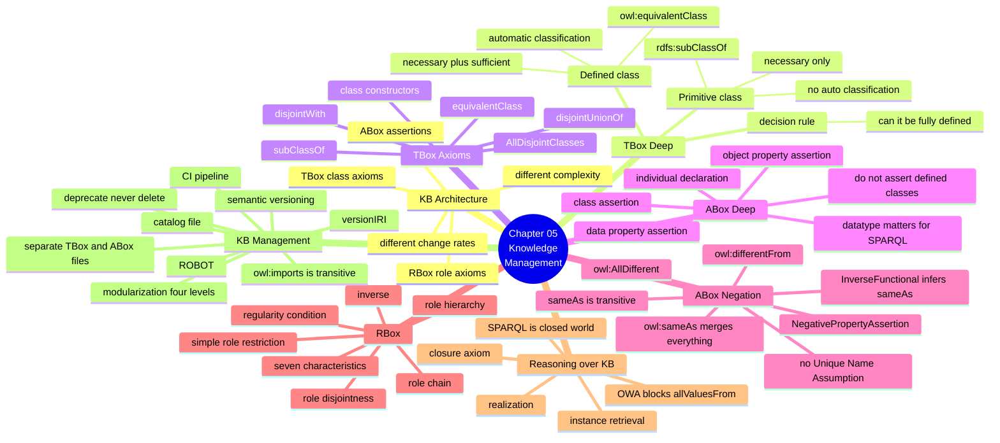
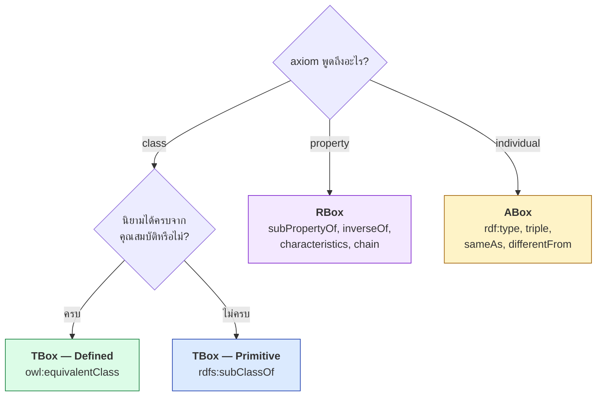

# 05.10 สรุป Chapter 05 + TBox/ABox/RBox Cheat Sheet

Chapter 05 เปลี่ยนจาก "ทฤษฎี DL" ไปสู่ "การจัดการ KB จริง" — แยกความรู้เป็น TBox/RBox/ABox
รู้ว่าเมื่อไหร่ใช้ primitive เมื่อไหร่ใช้ defined class เข้าใจผลของ OWA ต่อ ABox
และวางระบบ versioning กับ modularization ให้ ontology อยู่รอดในระยะยาว

---

## Concept Map



---

## TBox / RBox / ABox Cheat Sheet

### TBox — Class Axioms

| ต้องการ | DL | Turtle |
| --- | --- | --- |
| A เป็น subclass ของ B | `A ⊑ B` | `ex:A rdfs:subClassOf ex:B .` |
| A เท่ากับ B | `A ≡ B` | `ex:A owl:equivalentClass ex:B .` |
| A กับ B ไม่ทับกัน | `A ⊓ B ⊑ ⊥` | `ex:A owl:disjointWith ex:B .` |
| หลาย class ไม่ทับกัน | — | `[] a owl:AllDisjointClasses ; owl:members ( ex:A ex:B ex:C ) .` |
| A แบ่งเป็น B กับ C พอดี | — | `ex:A owl:disjointUnionOf ( ex:B ex:C ) .` |
| **Defined class** | `A ≡ B ⊓ ∃r.C` | `ex:A owl:equivalentClass [ a owl:Class ; owl:intersectionOf ( ex:B [ a owl:Restriction ; owl:onProperty ex:r ; owl:someValuesFrom ex:C ] ) ] .` |

### RBox — Role Axioms

| ต้องการ | DL | Turtle |
| --- | --- | --- |
| r เป็น subproperty ของ s | `r ⊑ s` | `ex:r rdfs:subPropertyOf ex:s .` |
| r เท่ากับ s | `r ≡ s` | `ex:r owl:equivalentProperty ex:s .` |
| r เป็นตรงข้ามกับ s | `r ≡ s⁻` | `ex:r owl:inverseOf ex:s .` |
| r ∘ s ⊑ t | `r ∘ s ⊑ t` | `ex:t owl:propertyChainAxiom ( ex:r ex:s ) .` |
| r transitive | `r⁺ ⊑ r` | `ex:r a owl:TransitiveProperty .` |
| r symmetric | `r ≡ r⁻` | `ex:r a owl:SymmetricProperty .` |
| r asymmetric | `r ⊓ r⁻ ⊑ ⊥` | `ex:r a owl:AsymmetricProperty .` |
| r reflexive | `⊤ ⊑ ∃r.Self` | `ex:r a owl:ReflexiveProperty .` |
| r irreflexive | `∃r.Self ⊑ ⊥` | `ex:r a owl:IrreflexiveProperty .` |
| r functional | `⊤ ⊑ ≤1 r` | `ex:r a owl:FunctionalProperty .` |
| r inverse functional | `⊤ ⊑ ≤1 r⁻` | `ex:r a owl:InverseFunctionalProperty .` |
| r กับ s ใช้พร้อมกันไม่ได้ | `r ⊓ s ⊑ ⊥` | `ex:r owl:propertyDisjointWith ex:s .` |

### ABox — Assertions

| ต้องการ | DL | Turtle |
| --- | --- | --- |
| a เป็น C | `a : C` | `ex:a a ex:C .` |
| a สัมพันธ์ b ผ่าน r | `(a,b) : r` | `ex:a ex:r ex:b .` |
| a มีค่า v | `(a,v) : d` | `ex:a ex:d "v"^^xsd:string .` |
| a กับ b คือคนเดียวกัน | `a = b` | `ex:a owl:sameAs ex:b .` |
| a กับ b คนละคน | `a ≠ b` | `ex:a owl:differentFrom ex:b .` |
| หลายตัวคนละคนทั้งหมด | — | `[] a owl:AllDifferent ; owl:members ( ex:a ex:b ex:c ) .` |
| a **ไม่** สัมพันธ์ b | `(a,b) : ¬r` | `[] a owl:NegativePropertyAssertion ; owl:sourceIndividual ex:a ; owl:assertionProperty ex:r ; owl:targetIndividual ex:b .` |

---

## กฎที่ห้ามลืม 8 ข้อ

| # | กฎ | ผลถ้าลืม |
| --- | --- | --- |
| 1 | **Defined class ต้องใช้ `owl:equivalentClass`** | ไม่มี automatic classification |
| 2 | **cardinality ต้องคู่กับ `owl:AllDifferent`** | cardinality ไม่ทำงาน (No-UNA) |
| 3 | **`∀r.C` สรุปไม่ได้ภายใต้ OWA** | class ที่ใช้ `allValuesFrom` จะว่างเสมอ |
| 4 | **ประกาศ `owl:disjointWith` ระหว่าง sibling** | reasoner ตรวจ error ไม่ได้เลย |
| 5 | **Transitive property ใช้กับ cardinality ไม่ได้** | reasoner ปฏิเสธ ontology |
| 6 | **อย่าประกาศ type ที่เป็น defined class เอง** | เสี่ยงขัดแย้งเมื่อข้อมูลเปลี่ยน |
| 7 | **ระบุ datatype ให้ครบ** | `FILTER(?x > 3.5)` ใน SPARQL ไม่ทำงาน |
| 8 | **ห้ามลบ term ที่เผยแพร่แล้ว** | ข้อมูลของผู้ใช้เดิมพัง |

---

## Decision Tree: axiom นี้ควรอยู่ไหน



---

## Python Cheat Sheet

```python
from pathlib import Path
from rdflib import Graph, Namespace
from rdflib.namespace import OWL
import owlrl

UNI = Namespace("http://example.org/university#")

# --- โหลด KB แยกไฟล์ ---
g = Graph(); g.bind("uni", UNI)
g.parse("university_tbox.ttl", format="turtle")
g.parse("university_abox.ttl", format="turtle")

# --- reasoning โดยไม่ต้องมี Java ---
asserted = set(g)
owlrl.DeductiveClosure(owlrl.OWLRL_Semantics).expand(g)
inferred = set(g) - asserted

# --- reasoning ด้วย HermiT ---
from owlready2 import World, sync_reasoner_hermit, OwlReadyInconsistentOntologyError

g.remove((None, OWL.imports, None))            # ⚠️ สำคัญ
g.serialize("merged.owl", format="xml")
world = World()
onto = world.get_ontology("file://merged.owl").load()
try:
    with onto:
        sync_reasoner_hermit(x=world, infer_property_values=True)
except OwlReadyInconsistentOntologyError:
    print("inconsistent")

# --- realization / retrieval ---
ind = onto.search_one(iri="*alice")
print([c.name for c in ind.is_a])               # realization
print([i.name for i in onto.GraduateStudent.instances()])   # retrieval (direct only!)
```

---

## Self-check

1. TBox, RBox, ABox แต่ละส่วนเก็บอะไร และทำไมต้องแยก
2. Primitive class กับ defined class ต่างกันอย่างไร และตัดสินใจอย่างไร
3. ทำไม cardinality restriction จึงไม่ทำงานถ้าไม่ประกาศ `owl:AllDifferent`
4. ทำไม `bob` ที่ลงเรียนเฉพาะวิชา undergrad จึงไม่ถูกจัดเป็น `UndergraduateStudent`
5. Role chain คืออะไร และ regularity condition จำกัดอะไร
6. `owl:sameAs` ต่างจาก `rdfs:seeAlso` และ `skos:closeMatch` อย่างไร
7. ถ้าต้องเลิกใช้ property หนึ่ง ควรทำอย่างไรแทนการลบ
8. Ontology IRI กับ Version IRI ต่างกันอย่างไร

---

## Preview: Chapter 06 — SPARQL

จนถึงตอนนี้เรา **สร้าง** และ **reason** บน KB ได้แล้ว แต่ยัง query ได้แค่พื้นฐาน
Chapter 06 จะสอน **SPARQL** อย่างเต็มรูปแบบ ตั้งแต่ SELECT ธรรมดาไปจนถึง federated query ข้าม endpoint

| จะได้เรียน | สาระ |
| --- | --- |
| SPARQL intro | ประวัติ W3C, triple pattern |
| SELECT พื้นฐาน | `SELECT`, `WHERE`, `PREFIX`, ตัวแปร `?x` |
| Filter | `FILTER`, `OPTIONAL`, `UNION`, `MINUS`, `NOT EXISTS` |
| Advanced | `ORDER BY`, `LIMIT`, `DISTINCT`, `COUNT`, `GROUP BY`, `HAVING`, subquery |
| **Property path** | `*` `+` `?` `|` — query แบบ recursive โดยไม่ต้องมี reasoner |
| Query form อื่น | `CONSTRUCT`, `ASK`, `DESCRIBE` |
| **SPARQL Update** | `INSERT DATA`, `DELETE`, `DELETE/INSERT WHERE`, `CLEAR`, `DROP` |
| Endpoint | SPARQL endpoint, named graph, `GRAPH` keyword |
| **Federation** | `SERVICE` — query ข้าม DBpedia + Wikidata พร้อมกัน |
| Python | `SPARQLWrapper` → DataFrame |

ตัวอย่างสิ่งที่จะทำได้ตอนจบ Chapter 06:

```sparql
PREFIX uni: <http://example.org/university#>

# หา "ทุกอย่างที่ csDept อยู่ภายใต้" โดยไม่ต้องรัน reasoner
SELECT ?org WHERE {
  uni:csDept uni:partOf+ ?org .
}
```

---

## Key Points

- **KB = TBox (class) + RBox (role) + ABox (instance)** — แยกกันเพราะอัตราการเปลี่ยนและ complexity ต่างกัน
- **Defined class (`≡`) ทำให้เกิด automatic classification** ส่วน primitive class (`⊑`) ไม่ทำ
- **OWL ไม่มี UNA** — cardinality ไม่ทำงานถ้าไม่ประกาศ `owl:AllDifferent`
- **`∀r.C` สรุปไม่ได้ภายใต้ OWA** — ต้องใช้ closure axiom หรือเปลี่ยนไปใช้ SHACL
- **Role chain** (`owl:propertyChainAxiom`) เป็นความสามารถทรงพลังของ OWL 2 ที่ต้องเป็นไปตาม regularity condition
- **`owl:disjointWith` เป็นสิ่งที่ลืมบ่อยที่สุด** — และเป็นสาเหตุที่ reasoner ตรวจ error ไม่ได้
- แยกไฟล์ **TBox (git) / ABox (generated)** และใช้ **semantic versioning** + `owl:versionIRI`
- **ห้ามลบ term** — ใช้ `owl:deprecated` แล้วชี้ไป term ใหม่ด้วย `owl:equivalentProperty`
- ตั้ง **CI pipeline**: syntax → annotation → reasoner → competency question → SHACL
