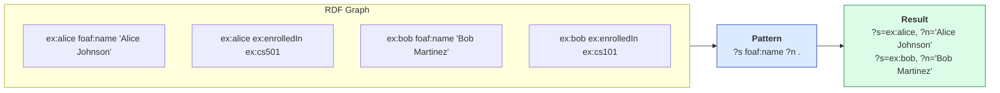
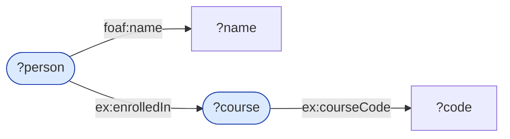
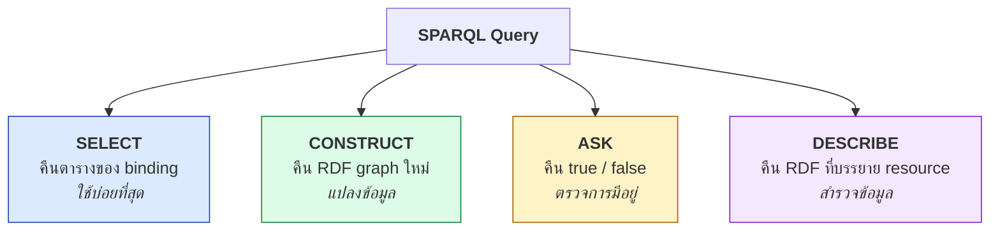
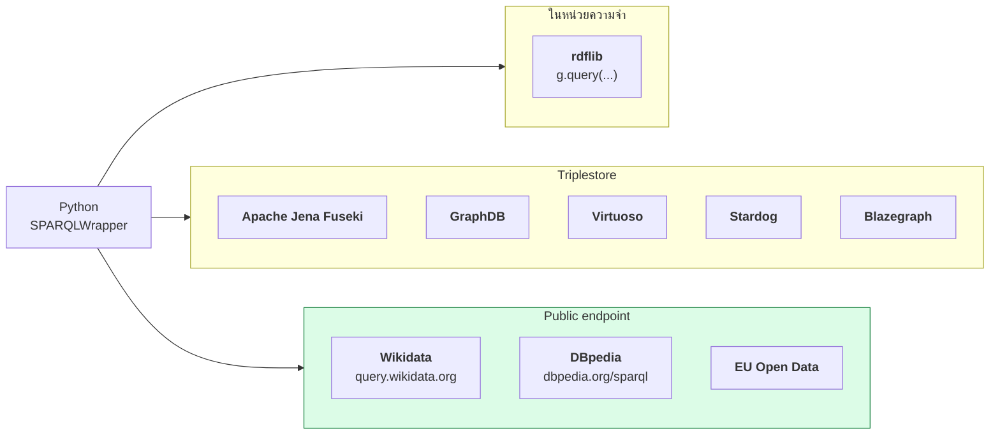

# 06.01 SPARQL คืออะไร

**SPARQL** (อ่านว่า "sparkle") ย่อมาจาก *SPARQL Protocol and RDF Query Language* เป็นภาษามาตรฐาน W3C
สำหรับ query RDF graph — เทียบได้กับ SQL ในโลก relational แต่ทำงานบนกราฟแทนตาราง
บทนี้อธิบายที่มา โครงสร้างพื้นฐาน และแนวคิดหลักคือ **triple pattern matching**

---

## ประวัติโดยย่อ

| ปี | เหตุการณ์ |
| --- | --- |
| 2004 | W3C เริ่มร่าง SPARQL |
| **2008** | **SPARQL 1.0** เป็น W3C Recommendation — SELECT/CONSTRUCT/ASK/DESCRIBE |
| **2013** | **SPARQL 1.1** เป็น W3C Recommendation |
| ปัจจุบัน | SPARQL 1.2 อยู่ระหว่างพัฒนา (รองรับ RDF-star) |

**สิ่งที่ SPARQL 1.1 เพิ่มเข้ามา** (และเป็นสิ่งที่ใช้จริงทุกวันนี้)

| ฟีเจอร์ | ทำอะไร |
| --- | --- |
| **Aggregate** | `COUNT`, `SUM`, `AVG`, `GROUP BY`, `HAVING` |
| **Subquery** | query ซ้อนใน query |
| **Property path** | `*` `+` `?` `|` `/` `^` — เดินตาม path แบบ recursive |
| **SPARQL Update** | `INSERT`, `DELETE`, `LOAD`, `CLEAR`, `DROP` |
| **Federation** | `SERVICE` — query ข้าม endpoint |
| **`NOT EXISTS` / `MINUS`** | negation |
| **`BIND` / `VALUES`** | กำหนดค่าให้ตัวแปร |

> ⚠️ SPARQL 1.1 ประกอบด้วยหลายเอกสาร: **Query Language**, **Update**, **Protocol**, **Federated Query**,
> **Graph Store HTTP Protocol**, **Service Description**, **Entailment Regimes**, **Results Formats**

---

## SPARQL vs SQL

| ประเด็น | SQL | SPARQL |
| --- | --- | --- |
| ข้อมูล | ตาราง (rows × columns) | กราฟ (triples) |
| Schema | ต้องรู้ล่วงหน้า | **ไม่จำเป็น** |
| JOIN | เขียนเอง ระบุ key | **เกิดเอง** เมื่อใช้ตัวแปรเดียวกัน |
| ข้อมูลไม่มี | `NULL` | ไม่มีแถวเลย (ใช้ `OPTIONAL`) |
| ค้นข้ามฐานข้อมูล | ยาก | `SERVICE` |
| ผลลัพธ์ | ตาราง | ตาราง / กราฟ / boolean |
| Recursive query | `WITH RECURSIVE` (ยุ่ง) | **property path** (`*`, `+`) |
| มาตรฐาน | ANSI SQL (แต่ละเจ้าต่างกัน) | **W3C Rec** (ตรงกันทุกเจ้า) |

---

## แนวคิดหลัก: Triple Pattern

**Triple pattern** คือ triple ที่มีตัวแปรได้ในตำแหน่งใดก็ได้

```sparql
?person  ?property  ?value .        # ตัวแปรทั้งสามตำแหน่ง
?person  foaf:name  ?name .         # ตัวแปรสองตำแหน่ง
ex:alice foaf:name  ?name .         # ตัวแปรตำแหน่งเดียว
ex:alice foaf:name  "Alice" .       # ไม่มีตัวแปร (เป็น ASK แบบหนึ่ง)
```

**ตัวแปร** ขึ้นต้นด้วย `?` หรือ `$` (นิยมใช้ `?`)

### การทำงาน: pattern matching



### Basic Graph Pattern (BGP)

หลาย triple pattern ต่อกัน = **BGP** — ทุก pattern ต้อง match **พร้อมกัน** (เป็น AND โดยปริยาย)

```sparql
?person foaf:name    ?name .
?person ex:enrolledIn ?course .
?course ex:courseCode ?code .
```

**ตัวแปรเดียวกัน = JOIN โดยอัตโนมัติ** — ไม่ต้องเขียน `JOIN ... ON ...` เหมือน SQL



---

## Query แรกของคุณ

```sparql
PREFIX uni: <http://example.org/university#>
PREFIX rdfs: <http://www.w3.org/2000/01/rdf-schema#>

SELECT ?student ?name
WHERE {
  ?student a         uni:Student .
  ?student rdfs:label ?name .
}
```

ผลลัพธ์บน [`data/university.ttl`](../data/university.ttl):

| ?student | ?name |
| --- | --- |
| `uni:alice` | `"Alice Johnson"@en` |
| `uni:bob` | `"Bob Martinez"@en` |
| `uni:carol` | `"Carol Nguyen"@en` |
| `uni:dave` | `"Dave Wilson"@en` |

---

## โครงสร้างของ SPARQL query

```sparql
# ---------- 1. Prologue ----------
BASE   <http://example.org/>
PREFIX uni:  <http://example.org/university#>
PREFIX rdfs: <http://www.w3.org/2000/01/rdf-schema#>

# ---------- 2. Query form ----------
SELECT DISTINCT ?student ?name

# ---------- 3. Dataset clause ----------
FROM <http://example.org/graph/students>
FROM NAMED <http://example.org/graph/courses>

# ---------- 4. WHERE clause ----------
WHERE {
  ?student a          uni:Student ;
           rdfs:label ?name .
  FILTER(LANG(?name) = "en")
}

# ---------- 5. Solution modifiers ----------
ORDER BY ?name
LIMIT 10
OFFSET 0
```

| ส่วน | หน้าที่ | บังคับ |
| --- | --- | :---: |
| **Prologue** | ประกาศ `PREFIX` และ `BASE` | ❌ |
| **Query form** | `SELECT` / `CONSTRUCT` / `ASK` / `DESCRIBE` | ✅ |
| **Dataset clause** | `FROM` / `FROM NAMED` ระบุ graph | ❌ |
| **WHERE clause** | graph pattern ที่ต้องการ match | ❌ (แต่แทบทุกครั้งมี) |
| **Solution modifiers** | `ORDER BY`, `LIMIT`, `OFFSET`, `GROUP BY`, `HAVING` | ❌ |

---

## Query Form ทั้ง 4 แบบ



ตัวอย่างสั้น ๆ ของแต่ละแบบ (รายละเอียดใน [06.06](06.06-other-forms.md)):

```sparql
PREFIX uni: <http://example.org/university#>

# SELECT -- ได้ตาราง
SELECT ?s WHERE { ?s a uni:Student . }

# CONSTRUCT -- ได้ graph ใหม่
CONSTRUCT { ?s a <https://schema.org/Person> . }
WHERE      { ?s a uni:Student . }

# ASK -- ได้ true/false
ASK { uni:alice a uni:GraduateStudent . }

# DESCRIBE -- ได้ triple ทั้งหมดที่เกี่ยวกับ resource
DESCRIBE uni:alice
```

---

## SPARQL ทำงานที่ไหน



---

## SPARQL กับ Reasoning

**สำคัญมาก**: SPARQL โดยพื้นฐาน **ไม่ทำ reasoning** — มัน match กับ triple ที่มีอยู่จริงใน graph เท่านั้น

```sparql
PREFIX uni: <http://example.org/university#>
SELECT ?p WHERE { ?p a uni:Person . }
```

| สถานการณ์ | ผลลัพธ์ |
| --- | --- |
| graph ดิบ (ไม่ได้ reason) | **0 แถว** — เพราะไม่มี triple `uni:alice a uni:Person` เขียนไว้ |
| หลังรัน reasoner แล้ว materialize | **7 แถว** |
| ใช้ property path แทน reasoner | **7 แถว** (ดูด้านล่าง) |

**ทางเลือกที่ 3: ใช้ property path**

```sparql
PREFIX uni:  <http://example.org/university#>
PREFIX rdfs: <http://www.w3.org/2000/01/rdf-schema#>

# เดินตาม subClassOf ขึ้นไปเองโดยไม่ต้องมี reasoner
SELECT ?p WHERE {
  ?p a/rdfs:subClassOf* uni:Person .
}
```

| ทางเลือก | ข้อดี | ข้อเสีย |
| --- | --- | --- |
| **Materialize** (รัน reasoner แล้วเก็บ) | query เร็ว เขียนง่าย | storage โต, ต้อง re-run |
| **Property path** | ไม่กิน storage | query ช้ากว่า, ต้องเขียนเอง |
| **Entailment regime** ของ triplestore | โปร่งใส | รองรับไม่ครบทุกเจ้า |

---

## รูปแบบผลลัพธ์

| Query form | รูปแบบผลลัพธ์ | MIME type |
| --- | --- | --- |
| SELECT / ASK | **SPARQL Results JSON** | `application/sparql-results+json` |
| SELECT / ASK | SPARQL Results XML | `application/sparql-results+xml` |
| SELECT | CSV / TSV | `text/csv`, `text/tab-separated-values` |
| CONSTRUCT / DESCRIBE | Turtle | `text/turtle` |
| CONSTRUCT / DESCRIBE | JSON-LD | `application/ld+json` |

ตัวอย่าง SPARQL Results JSON:

```json
{
  "head": { "vars": [ "student", "name" ] },
  "results": {
    "bindings": [
      {
        "student": { "type": "uri", "value": "http://example.org/university#alice" },
        "name":    { "type": "literal", "xml:lang": "en", "value": "Alice Johnson" }
      }
    ]
  }
}
```

---

## Key Points

- **SPARQL** เป็น W3C Recommendation — 1.0 (2008) และ **1.1 (2013)** ที่เพิ่ม aggregate, property path, update และ federation
- หน่วยพื้นฐานคือ **triple pattern** — triple ที่มีตัวแปร (`?x`) ได้ทุกตำแหน่ง
- หลาย pattern ต่อกันเป็น **Basic Graph Pattern** และ **ตัวแปรเดียวกัน = JOIN โดยอัตโนมัติ**
- โครงสร้าง query: **Prologue → Query form → Dataset clause → WHERE → Solution modifiers**
- Query form มี 4 แบบ: **SELECT** (ตาราง), **CONSTRUCT** (graph), **ASK** (boolean), **DESCRIBE** (graph)
- **SPARQL ไม่ทำ reasoning โดยตัวมันเอง** — ต้อง materialize ก่อน, ใช้ property path หรือพึ่ง entailment regime ของ store
- ไม่ต้องรู้ schema ล่วงหน้า และ query ข้าม endpoint ได้ด้วย `SERVICE` — สองข้อนี้คือข้อได้เปรียบเหนือ SQL
